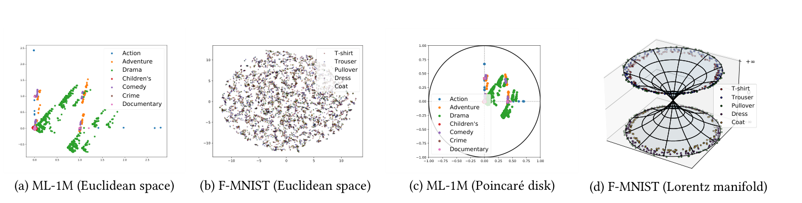
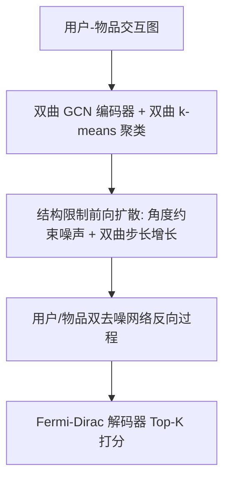

# Hyperbolic Diffusion Recommender Model (双曲扩散推荐模型)

- **会议/期刊**: WWW 2025
- **作者与机构**: Meng Yuan, Yutian Xiao, Wei Chen, Chu Zhao, Deqing Wang, Fuzhen Zhuang（北京航空航天大学、重庆理工大学、中关村实验室）
- **推荐链路定位**: 召回（基于生成式表征的 Top-K 检索）
- **研究方向**: 生成式推荐与离散语义ID / 图神经网络推荐
- **论文原文**: [https://arxiv.org/abs/2504.01541v2](https://arxiv.org/abs/2504.01541v2)
- **开源代码**: [https://github.com/yuanmeng-cpu/HDRM](https://github.com/yuanmeng-cpu/HDRM)

## TL;DR (1分钟核心速览)

本文指出图像数据近似各向同性分布，而用户-物品交互数据呈现显著的各向异性与方向性结构；传统扩散推荐在欧氏空间注入各向同性高斯噪声，会把这种方向性信号逐步抹平为噪声。为此作者提出 HDRM：在 Poincaré 双曲流形上构建潜在扩散过程，用"聚类中心→原点"的测地方向约束噪声注入方向，并施加双曲步长增长的结构限制。在 ML-1M / Amazon-Book / Yelp2020 三个数据集、7:1:2 划分与 Full-Ranking 协议下，R@10 相对最强基线提升 0.5%–5.6%，N@10 提升 1.3%–6.7%。

## Background & Motivation (背景与核心矛盾)

- **主流范式**: DiffRec、DDRM、CODIGEM 等把 CV 中的去噪扩散框架直接搬到推荐，在欧氏空间对用户/物品表征做前向加噪与反向去噪，以生成式方式重建交互表征。
- **前人局限**: 其一，作者用 SVD 对 ML-1M 物品特征做二维投影（图 1a），发现数据沿多个方向呈强各向异性条带，而 F-MNIST 图像特征（图 1b）近似以原点为中心的各向同性团块——欧氏各向同性高斯噪声会持续侵蚀前者的方向性语义。其二，欧氏空间体积多项式增长，无法自然承载交互图中普遍存在的幂律/层次结构，去噪后的表征易丢失图拓扑。
- **核心洞察 (Key Insight)**: 双曲空间体积随半径指数膨胀，其距离变化率依赖位置与方向，天然适配各向异性数据；图 1c 显示 ML-1M 特征在 Poincaré 圆盘中能保留方向性条带结构。
- **本文切入点**: 把扩散过程整体搬到双曲流形，并用"聚类锚定方向 + 步长增长"的结构限制让噪声注入沿偏好方向进行，而非无差别 isotropic 扰动。

<figure class="paper-figure" markdown="span">
  <figcaption>图 1：使用 SVD 分解对数据进行二维可视化，其中每种颜色对应一个唯一类别。(a) MovieLens-1M 中物品特征的欧几里得可视化；(b) Fashion-MNIST 中图像特征的欧几里得可视化；(c) MovieLens-1M 中物品特征的双曲可视化；(d) Fashion-MNIST 中图像特征的双曲可视化。</figcaption>
</figure>

## Method (核心方法设计)

### 1. 整体框架 (Overall Architecture)

HDRM 采用两阶段训练。第一阶段用双曲图卷积编码器把用户-物品二部图嵌入 Poincaré 球，经 Fermi-Dirac 解码器做距离打分，得到预训练双曲表征；第二阶段在切空间上执行双曲潜在扩散：先用双曲 k-means 对物品聚类得到簇心，再以"簇心指向原点"的测地方向构造角度约束噪声，配合双曲步长增长项完成前向加噪；反向过程由用户、物品两个独立去噪网络迭代还原干净表征，最终送入解码器打分。训练损失为双曲 margin 排序损失与重建损失的加权和，并附加基于正样本分数的重加权项以抑制噪声交互。

### 2. 关键设计拆解 (Key Designs)

1. **双曲几何自编码器（Hyperbolic Geometric Autoencoding）**：欧氏 GCN 无法表达幂律层次，作者将初始表征经 $\mathbf{z}^{(0)}=(0,\mathbf{x})$置于原点切空间后指数映射入流形，邻居聚合在切空间完成：$\mathbf{z}_i^{(k)}=\mathbf{z}_i^{(k-1)}+\sum_{u\in\mathcal{N}_i}\frac{1}{|\mathcal{N}_i|}\mathbf{z}_u^{(k-1)}$，多层求和后统一映射回流形。打分改用双曲距离的 Fermi-Dirac 形式$s(u,i)=1/\big(\exp(d_{\mathbb{L}}^{\kappa}(\hat{\mathbf{e}}_u^0,\hat{\mathbf{e}}_i^0)^2-q)/t+1\big)$，使"距离近=偏好强"的几何语义与双曲度量自洽。

2. **结构限制的方向性前向扩散（Structural-Restricted Forward Process）**：这是全文核心增量。标准前向过程 $q(\mathbf{z}_t|\mathbf{z}_{t-1})=\sqrt{1-\beta_t}\mathbf{z}_{t-1}+\sqrt{\beta_t}\boldsymbol{\epsilon}$ 的噪声无方向，作者将其改写为
$$q(\mathbf{z}_t|\mathbf{z}_{t-1})=\sqrt{1-\beta_t}\mathbf{z}_{t-1}+\sqrt{\beta_t}\mathbf{a}+\delta\tanh\!\big(\sqrt{\kappa}\zeta^{\kappa}_{\mathbf{z}_{t-1}}/r\big)\mathbf{z}_{t-1},$$
其中 $\mathbf{a}_u=\mathrm{sign}(\log^{\kappa}_{\mathbf{o}}(\mathbf{e}_{\mu_u}))*\boldsymbol{\epsilon}_B$把噪声方向锁定为"所属簇心$\mu_u$指向原点$\mathbf{o}$"的测地方向，$\delta\tanh(\cdot)$项则模拟双曲空间随半径指数增长的体积膨胀。直觉上，噪声不再随机打散表征，而是沿偏好演化的主方向推进，从而在加噪-去噪循环中保住各向异性语义；理论上当$t\to\infty$时$\mathbf{z}_t$收敛到 Poincaré 正态分布$\mathcal{N}_B(\delta\mathbf{z}_{t-1},\mathbf{I})$，保证反向过程有良好定义的高斯型先验。

3. **训练目标、负采样与推理效率**：总损失为
$$\mathcal{L}_{\text{total}}(u,i,j)=w(u,i,j)\big[\alpha\mathcal{L}_{\text{Rec}}(u,i,j)+(1-\alpha)\mathcal{L}_{\text{re}}(u,i)\big],$$
其中 $\mathcal{L}_{\text{Rec}}=\max(s(u,j)-s(u,i)+m,0)$为双曲 margin 排序损失，$\mathcal{L}_{\text{re}}$为对$t\sim\mathcal{U}(1,T)$采样的重建 MSE，重加权系数$w=\mathrm{sigmoid}(s(u,i))^{\gamma}$降低低分正样本（疑似噪声交互）的权重。负采样采用每正样本配一个随机负物品的均匀采样。推理时从 Poincaré 正态先验采样$\mathbf{z}_T$，经$T$步反向去噪得到$\hat{\mathbf{z}}_0$后全库打分；单轮前向加噪仅需一步，每 epoch 复杂度约$O(\mathcal{T}(t)\cdot 2nd)+O((c+1)nd)$，$c$ 为簇数。

## Experimental Setup & Evaluation Protocol (实验设置与评估协议)

- **数据集与预处理**: 评分低于 4 视为假阳性交互予以剔除；同时构造"干净训练 (C)"与"自然噪声训练 (N)"两套设定，后者保留原始含噪交互并额外注入等量随机采样交互用于鲁棒性测试。

| 数据集 | #Users | #Items (C) | #Interactions (C) | #Items (N) | #Interactions (N) | 场景说明 |
| :--- | :---: | :---: | :---: | :---: | :---: | :--- |
| Amazon-Book | 108,822 | 94,949 | 3,146,256 | 178,181 | 3,145,223 | 图书，极稀疏 |
| Yelp2020 | 54,574 | 34,395 | 1,402,736 | 77,405 | 1,471,675 | 本地生活 |
| ML-1M | 5,949 | 2,810 | 571,531 | 3,494 | 618,297 | 电影，相对稠密 |

- **数据划分与防穿越 (Splitting Strategy)**: 采用 `比例划分`，训练/验证/测试 = 7:1:2，遵循近期协同过滤工作的标准划分口径。
- **排名评测协议 (Ranking Protocol)**: 无偏 `Full-Ranking`（对全库未交互物品排序），指标为 Recall@10/20 与 NDCG@10/20。
- **对比基线与超参设置**: 覆盖四类基线——经典 CF（BPRMF、LightGCN）、自编码器（CDAE、Multi-DAE）、扩散推荐（CODIGEM、DiffRec、DDRM，其中 DDRM 取 LightGCN+DDRM 完整形式）、双曲推荐（HyperML、HGCF、HICF）。显著性采用 $t$-test，$p<0.05$。

## Key Experimental Results (实验关键数据)

### 1. 主实验对比 (Main Results)

| Model | ML-1M R@10 | ML-1M N@10 | Amazon R@10 | Amazon N@10 | Yelp R@10 | Yelp N@10 |
| :--- | :---: | :---: | :---: | :---: | :---: | :---: |
| BPRMF (UAI'09) | 0.0876 | 0.0749 | 0.0437 | 0.0264 | 0.0341 | 0.0210 |
| LightGCN (SIGIR'20) | 0.0987 | 0.0833 | 0.0534 | 0.0325 | 0.0540 | 0.0325 |
| HGCF (WWW'21) | 0.1009 | 0.0865 | 0.0633 | 0.0392 | 0.0560 | 0.0329 |
| HICF (KDD'22) | 0.0970 | 0.0848 | 0.0652 | 0.0426 | 0.0590 | 0.0366 |
| DiffRec (SIGIR'23) | 0.1023 | 0.0876 | 0.0695 | 0.0451 | 0.0581 | 0.0363 |
| DDRM (SIGIR'24) | 0.1017 | 0.0874 | 0.0685 | 0.0432 | 0.0556 | 0.0343 |
| **HDRM** | **0.1078\*** | **0.0931\*** | **0.0698\*** | **0.0457\*** | **0.0623\*** | **0.0390\*** |
| Improv. | +5.4% | +6.3% | +0.5% | +1.3% | +5.6% | +6.7% |

### 2. 消融实验 (Ablation Study)

| 变体 | ML-1M R@10 | ML-1M N@10 | Amazon R@10 | Amazon N@10 | Yelp R@10 | Yelp N@10 |
| :--- | :---: | :---: | :---: | :---: | :---: | :---: |
| HDRM 完整 | **0.1078** | **0.0931** | **0.0698** | **0.0467** | **0.0623** | **0.0390** |
| w/o $\mathcal{H}_n^{\kappa}$（去双曲编码器） | 0.1063 | 0.0917 | 0.0695 | 0.0447 | 0.0589 | 0.0377 |
| w/o Geo（去几何结构限制） | 0.1052 | 0.0902 | 0.0687 | 0.0438 | 0.0571 | 0.0362 |
| w/o Diff（去扩散过程） | 0.1035 | 0.0883 | 0.0693 | 0.0446 | 0.0587 | 0.0373 |

### 3. 关键实验发现 (Key Findings)

1. **双曲与扩散互补而非替代**：Yelp2020 上纯双曲 HICF（R@10=0.0590）已超过纯扩散 DiffRec（0.0581），说明层次结构建模本身有价值；HDRM 将两者结合后达 0.0623，验证"双曲承载结构 + 扩散承载去噪生成"的组合收益是叠加而非冗余。
2. **稠密数据靠扩散、稀疏数据靠几何限制**：ML-1M 上移除扩散模块损失最大（R@10 从 0.1078 降至 0.1035），而 Amazon-Book 与 Yelp2020 上移除几何结构限制损失最大（Yelp 从 0.0623 降至 0.0571）。作者归因于 ML-1M 交互稠密、偏好演化剧烈，扩散的多步去噪更能刻画动态；稀疏集则更依赖双曲几何约束防止表征在流形上过度发散或坍缩。
3. **噪声鲁棒性来自去噪机制而非双曲几何**：在含噪设定下 HICF 在 Yelp 上 R@10 暴跌至 0.0477，而 HDRM 仍保持 0.0523 并全面领先 DiffRec/DDRM；说明双曲空间本身不抗噪，真正起作用的是扩散的反向去噪过程，HDRM 的优势在于"去噪 + 方向保持"双重作用。

## Highlights & Limitations (亮点、对比与审稿批判)

- **与代表作对比 (vs. Prior Work)**: 与 DiffRec/DDRM 的本质区别在于噪声分布——后者在欧氏空间注入各向同性高斯噪声，HDRM 在双曲流形注入簇心锚定的方向性噪声；与 HICF/HGCF 的区别在于后者只做静态双曲嵌入，HDRM 在其上叠加了生成式扩散过程，使表征在加噪-去噪中动态演化。
- **可迁移亮点**: (1) "聚类中心→原点"的测地方向约束是一种轻量级方向先验注入方式，可迁移到任何需要保持表征方向性的生成式推荐；(2) 基于正样本分数的 sigmoid 重加权 $w=\mathrm{sigmoid}(s(u,i))^{\gamma}$ 实现简单，可直接用于其他隐式反馈模型的噪声交互降权。
- **审稿级局限批判**: 其一，推理需执行 $T$步反向去噪，且用户与物品各需一个去噪网络，在线打分延迟显著高于 LightGCN 类单次前传模型，论文未给出实际推理耗时对比；其二，Amazon-Book 上 R@10 仅提升 0.5%，增益接近噪声水平，说明方法在极稀疏场景下优势有限，且双曲 k-means 聚类数$c$、步长$\delta$、margin$m$ 等多个超参需逐数据集调优（ML-1M 最优 margin=0.1，另两集为 0.2），工程调参成本偏高。

## Rating (四维评分)

- **方法创新性 (Novelty)**: ⭐⭐⭐⭐ （首次将扩散推荐整体迁移至双曲流形，方向性噪声与双曲步长增长的结构限制有清晰几何直觉与收敛性讨论支撑）
- **评估协议与实验扎实度 (Protocol & Experiments)**: ⭐⭐⭐⭐ （三数据集 + Full-Ranking + 显著性检验 + 消融 + 噪声鲁棒性 + 超参分析齐全，但缺少推理效率与线上验证）
- **写作与数学规范度 (Clarity & Rigor)**: ⭐⭐⭐⭐ （双曲算子与扩散公式定义完整，附录补充流形运算细节；部分符号如 $\hat{\mathbf{e}}_u^0$与$\hat{\mathbf{z}}_u^0$ 的混用略影响阅读）
- **工业落地与复现价值 (Industrial & Practical Value)**: ⭐⭐⭐ （代码已开源、两阶段训练可解耦，但多步去噪推理开销与多超参敏感性限制了大规模在线部署）

