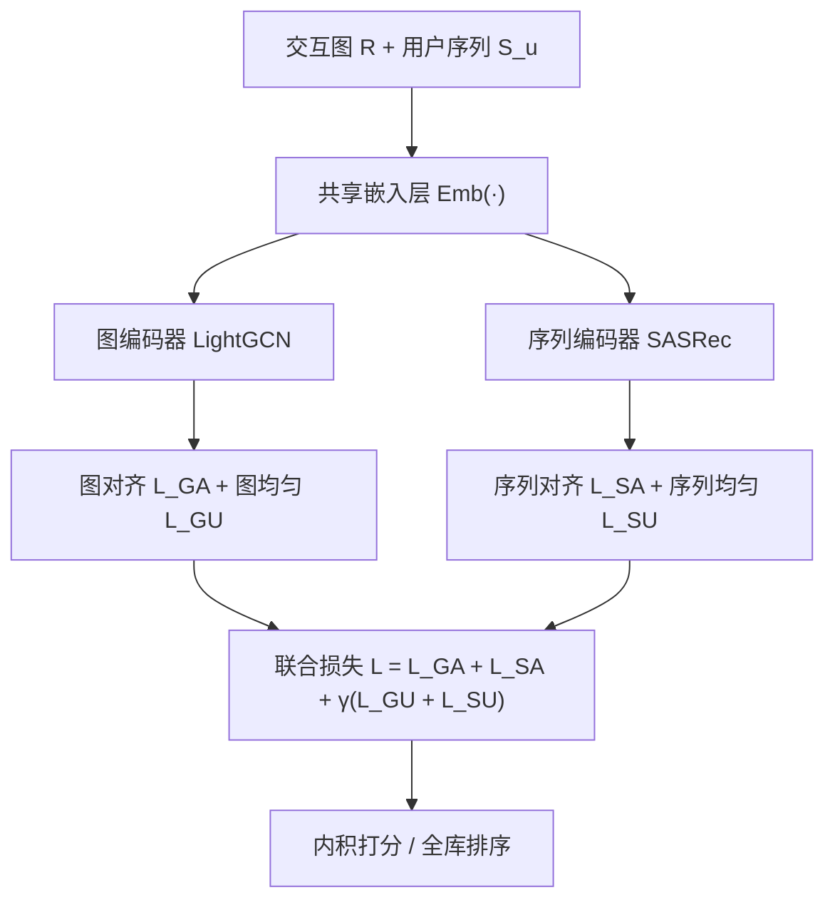
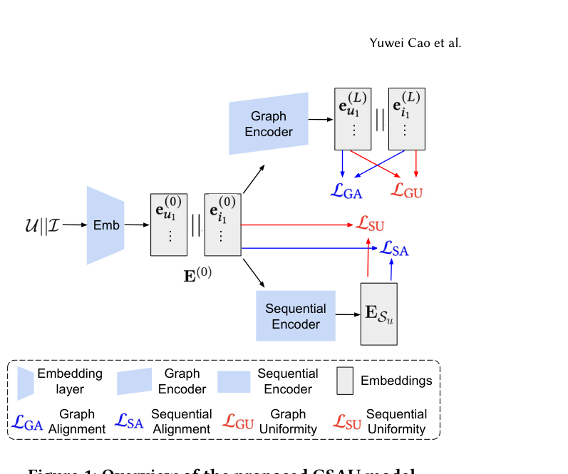

# Graph-Sequential Alignment and Uniformity: Toward Enhanced Recommendation Systems (图-序列对齐与均匀性：面向增强推荐系统)

- **会议/期刊**: WWW Companion 2025 (Short Paper)
- **作者与机构**: Yuwei Cao, Philip S. Yu 等（University of Illinois Chicago / Salesforce AI Research / Beihang University）
- **推荐链路定位**: 召回（图协同过滤召回 + 序列下一项召回的统一表征）
- **研究方向**: 图神经网络与知识图谱推荐 / 序列与会话推荐
- **论文原文**: [https://arxiv.org/abs/2412.04276v2](https://arxiv.org/abs/2412.04276v2)
- **开源代码**: [https://github.com/YuweiCao-UIC/GSAU.git](https://github.com/YuweiCao-UIC/GSAU.git)

## TL;DR (1分钟核心速览)

图推荐（LightGCN 类）擅长高阶协同信号但看不到序列，序列推荐（SASRec 类）擅长个性化时序但忽略用户间高阶关联，二者信号互补却难以联合训练——直接混用 BPR/CE 等异构损失会导致梯度冲突与训练震荡。本文提出 GSAU：两个编码器共享同一嵌入层，用「对齐 + 均匀性」损失在子模块内与子模块间同时约束表征。在 Amazon Beauty/Sports/Toys 三个 5-core 数据集、Leave-One-Out 全库排序协议下，GSAU(rec) 相对最强基线 SASRec(u) 的 R@10 提升 5.16%–13.40%，N@10 提升 2.26%–13.81%。

## Background & Motivation (背景与核心矛盾)

- **主流范式**: 图推荐在 user-item 二部图上做邻域传播捕获高阶协同过滤信号；序列推荐用 Transformer/GRU 建模用户交互序列做 next-item 预测。两条路线各自 SOTA，但彼此封闭。
- **前人局限**: (1) 图编码器完全丢弃时序先后与序列内上下文，无法区分「刚交互」与「很久以前交互」的物品；(2) 序列编码器只看单用户自身历史，无法利用「相似用户买过什么」的高阶协同信号，冷启动/稀疏用户尤其吃亏。
- **核心洞察 (Key Insight)**: 两类模型的失效恰好互补，且已有工作（MCLSR、MRGSRec）证明融合有收益；但简单拼接/融合层会引入额外参数与异构损失冲突——BPR 与 CE 的优化动力学不一致，联合训练时梯度方向相互拉扯，训练不稳定、表征退化。
- **本文切入点**: 不做复杂融合模块，而是让两个编码器**共享同一嵌入层**，用一套同构的「对齐-均匀性」损失替代异构损失，把知识迁移问题转化为表征几何约束问题。

## Method (核心方法设计)

### 1. 整体框架 (Overall Architecture)

输入为 user-item 交互图 $\mathcal{R}$与按时间排序的用户序列$\mathcal{S}_u$。共享嵌入层$\mathrm{Emb}(\cdot)$把全部用户与物品映射到同一$d$维空间$\mathbf{E}^{(0)}$；图编码器（LightGCN 式邻域聚合）输出$\mathbf{e}_u^{(L)},\mathbf{e}_i^{(L)}$，序列编码器（SASRec 式 masked 自注意力 + 位置嵌入）输出序列表征$\mathbf{E}_{\mathcal{S}_u}$。两路表征在同一空间内被四组损失约束：图对齐$\mathcal{L}_{GA}$、序列对齐$\mathcal{L}_{SA}$、图均匀性$\mathcal{L}_{GU}$、序列均匀性$\mathcal{L}_{SU}$，联合优化后直接用内积打分做全库召回。

<figure class="paper-figure" markdown="span">
  <figcaption>图1：所提出的GSAU模型概览。</figcaption>
</figure>

### 2. 关键设计拆解 (Key Designs)

1. **跨子模块共享嵌入层（Shared Embedding Layer）**：痛点是不加约束的双塔各自学一套物品向量，知识无法互通。本文让图与序列编码器**共用同一张物品/用户嵌入表**，序列侧不再有独立 item embedding，序列表征因此天然落在物品嵌入空间内，成为「hyper-item」。这样图侧学到的协同结构可直接被序列侧读取，反之序列侧的时序共现也能回写物品向量，无需任何融合层参数。

2. **子模块内对齐 + 均匀性（Intra-module Alignment & Uniformity）**：对齐损失把正样本对拉近，均匀性损失把随机样本对在高维球面上推开：

$$\mathcal{L}_{A}\triangleq\mathbb{E}_{(\mathbf{e}_x,\mathbf{e}_{x^+})\sim p_{\text{pos}}}\|f(\mathbf{e}_x)-f(\mathbf{e}_{x^+})\|^2,\quad \mathcal{L}_{U}\triangleq\log\mathbb{E}_{(\mathbf{e}_x,\mathbf{e}_{x'})\sim p_{\text{data}}}\exp\left(-2\|f(\mathbf{e}_x)-f(\mathbf{e}_{x'})\|^2\right)$$

其中 $f(\cdot)$为$\ell_2$归一化。图侧正样本取交互对$P_{g\_pos}=\{(\mathbf{e}_u^{(L)},\mathbf{e}_i^{(L)})\mid (u,i)\in\mathcal{R}\}$；序列侧正样本取被 mask 物品与其序列表征$P_{s\_pos}=\{(\mathbf{e}_i^{(0)},\mathbf{E}_{\mathcal{S}_u})\mid i\in\mathcal{S}_u^m\}$。直觉：对齐保证「用户—其交互物品」「序列—其目标物品」语义一致，均匀性防止表征坍缩到狭窄锥体，保留全库排序所需的判别空间。

3. **跨子模块均匀性（Cross-module Uniformity）与训练目标**：仅做模块内均匀性时，序列表征与「非本序列物品」之间没有排斥约束，物品空间仍被割裂。本文在序列均匀性的采样集 $P_{s\_data}$中显式加入第三子集$\{(\mathbf{e}_i^{(0)},\mathbf{E}_{\mathcal{S}_u})\mid i\notin\mathcal{S}_u\}$，强制序列远离无关物品，从而把「hyper-item」真正焊进物品空间。总损失为

$$\mathcal{L}=\mathcal{L}_{GA}+\mathcal{L}_{SA}+\gamma\left(\mathcal{L}_{GU}+\mathcal{L}_{SU}\right)$$

$\gamma$平衡对齐与均匀性，全部采样在 batch 级完成，**无需显式负采样器**（均匀性项隐式承担负样本分散职责）。变体 GSAU(rec) 把$\mathcal{L}_{SA}$ 换成 CE 损失，额外获得「序列远离全部负样本」的显式判别力，实验证明更优。

## Experimental Setup & Evaluation Protocol (实验设置与评估协议)

- **数据集与预处理**: 三个 Amazon 子集，均保留 `5-core`：

| 数据集 | #Users | #Items | #Interactions | 稀疏度/密度 | 特征/场景说明 |
| :--- | :---: | :---: | :---: | :---: | :--- |
| Beauty | 22,363 | 12,101 | 198,502 | 99.93% 稀疏 | 美妆，序列较短 |
| Sports & Outdoors | 35,598 | 18,357 | 296,337 | 99.95% 稀疏 | 运动户外 |
| Toys & Games | 19,412 | 11,924 | 167,597 | 99.93% 稀疏 | 玩具，长尾明显 |

- **数据划分与防穿越 (Splitting Strategy)**: `Leave-One-Out`——按时间戳升序，最后一条测试、倒数第二条验证、其余训练，严格防时序穿越。
- **排名评测协议 (Ranking Protocol)**: 无偏 `Full-Ranking`（对全库未交互物品排序），指标 R@10/R@50、N@10/N@50。
- **对比基线与超参设置**: 图侧 LightGCN、DirectAU、GraphAU；序列侧 BERT4Rec、SASRec 及其均匀性增强版 BERT4Rec(u)/SASRec(u)；融合基线 MRGSRec。嵌入维度 $d=64$，Adam，lr=1e-3，最多 300 epoch，验证 NDCG@20 连续 10 轮不升即早停；$\gamma\in\{0.05,0.1,0.2,0.3,0.4,0.5\}$网格搜索，最优$\gamma=0.1$。全部基于 RecBole 实现以保证公平。

## Key Experimental Results (实验关键数据)

### 1. 主实验对比 (Main Results)

| Method | Beauty R@10 | Beauty N@10 | Sports R@10 | Sports N@10 | Toys R@10 | Toys N@10 |
| :--- | :---: | :---: | :---: | :---: | :---: | :---: |
| LightGCN | 0.0435 | 0.0216 | 0.0299 | 0.0153 | 0.0425 | 0.0226 |
| DirectAU | 0.0492 | 0.0252 | 0.0318 | 0.0165 | 0.0501 | 0.0264 |
| GraphAU | 0.0489 | 0.0245 | 0.0323 | 0.0168 | 0.0472 | 0.0248 |
| BERT4Rec(u) | 0.0487 | 0.0258 | 0.0195 | 0.0095 | 0.0471 | 0.0255 |
| SASRec | 0.0826 | 0.0414 | 0.0467 | 0.0218 | 0.0891 | 0.0434 |
| SASRec(u) | 0.0833 | 0.0443 | 0.0470 | 0.0239 | 0.0878 | 0.0453 |
| MRGSRec | 0.0681 | 0.0349 | 0.0434 | 0.0227 | — | — |
| GSAU | 0.0631 | 0.0303 | 0.0491 | 0.0256 | 0.0655 | 0.0306 |
| **GSAU (rec)** | **0.0876** | **0.0453** | **0.0533** | **0.0272** | **0.0937** | **0.0474** |
| Improv.% vs SASRec(u) | +5.16 | +2.26 | +13.40 | +13.81 | +5.16 | +4.64 |

### 2. 消融实验 (Ablation Study, Beauty)

| 变体 | R@10 | R@50 | N@10 | N@50 |
| :--- | :---: | :---: | :---: | :---: |
| GSAU (rec) 完整 | **0.0876** | **0.1974** | **0.0453** | **0.0694** |
| w/o graph（去图编码器） | 0.0833 | 0.1806 | 0.0443 | 0.0653 |
| w/o sequential（去序列编码器） | 0.0492 | 0.1270 | 0.0252 | 0.0421 |
| w/o rec（$\mathcal{L}_{SA}$ 替回对齐损失） | 0.0631 | 0.1622 | 0.0303 | 0.0518 |
| w/o u-i uniform（去第三子集） | 0.0739 | 0.1743 | 0.0391 | 0.0609 |
| replace sequential（BERT4Rec 替换 SASRec） | 0.0526 | 0.1397 | 0.0256 | 0.0444 |

### 3. 关键实验发现 (Key Findings)

1. **图分支是「增益放大器」而非「主力」**：去掉图编码器后 R@10 仅从 0.0876 降到 0.0833（≈SASRec(u) 水平），但去掉序列编码器后暴跌至 0.0492（−43.8%），说明序列编码器提供主判别力，图分支通过共享嵌入注入高阶协同信号带来约 5% 的净增益——这也解释了为何 GSAU 单独使用（0.0631）反而不如 SASRec(u)，必须配合 CE 才能释放全部潜力。
2. **跨模块均匀性第三子集不可省**：移除 $\{(\mathbf{e}_i,\mathbf{E}_{\mathcal{S}_u})\mid i\notin\mathcal{S}_u\}$ 后 R@10 从 0.0876 掉到 0.0739（−15.6%），N@10 从 0.0453 掉到 0.0391，证明「序列—无关物品」的排斥约束是打通两个嵌入空间的关键，仅做模块内均匀性会造成物品空间割裂。
3. **CE 优于纯对齐，且方法对序列骨干鲁棒**：$\mathcal{L}_{SA}\to$CE 带来 R@10 +38.8%（0.0631→0.0876），因 CE 同时完成对齐与对全部负样本的分散；把 SASRec 换成 BERT4Rec 后仍达 0.0526，显著高于 BERT4Rec(u) 的 0.0487，说明增益来自对齐-均匀性框架而非特定序列架构。$\gamma$在 0.1–0.4 区间平稳，$\gamma=0.1$最优，$>0.5$或$<0.05$ 均明显退化。

## Highlights & Limitations (亮点、对比与审稿批判)

- **与代表作对比 (vs. Prior Work)**: 相比 DirectAU/GraphAU 只在图侧内部做对齐-均匀性，本文把该几何约束**跨架构**使用，是首个把 alignment/uniformity 用于图-序列联合优化的方案；相比 MRGSRec 用融合层拼接两路表征，本文零融合参数、仅靠共享嵌入 + 损失约束，结构更轻且 Beauty R@10 高出 28.6%（0.0876 vs 0.0681）。
- **可迁移亮点**: (1) 「共享嵌入表 + 跨模块均匀性负样本集」可作为任意双塔/多源召回融合的通用正则插件，无需改网络结构；(2) 用 CE 替代对齐损失以同时获得对齐与全负样本分散，是低成本提升序列侧判别力的实用技巧。
- **审稿级局限批判**: (1) 仅 3 个 Amazon 域、5 页短文，缺少工业级大规模与线上 A/B 验证，且未报告训练/推理时延——双编码器联合训练开销约为单模型两倍，全库排序需两路表征融合策略但文中未明确推理期如何合并打分；(2) 均匀性损失需 batch 内两两距离计算，对 batch size 与 $\gamma$敏感（$\gamma$ 越界即显著退化），且 GSAU 无 CE 版本反而弱于基线，说明框架对损失配置依赖较强，泛化性论证不足。

## Rating (四维评分)

- **方法创新性 (Novelty)**: ⭐⭐⭐⭐ （把 alignment/uniformity 从单架构内部推广到图-序列跨架构联合优化，思路简洁且有表征几何理论支撑，但属组合式创新而非全新机制）
- **评估协议与实验扎实度 (Protocol & Experiments)**: ⭐⭐⭐ （Leave-One-Out + Full-Ranking 协议规范、消融完整，但仅 3 个同源 Amazon 数据集、无显著性检验与线上验证）
- **写作与数学规范度 (Clarity & Rigor)**: ⭐⭐⭐⭐ （四组损失的采样集定义清晰、公式紧凑，5 页短文信息密度高；但推理期两路表征如何合并打分未交代）
- **工业落地与复现价值 (Industrial & Practical Value)**: ⭐⭐⭐⭐ （代码开源、基于 RecBole 易复现、零融合参数易嵌入现有双塔召回；但双编码器训练成本与 batch 级均匀性计算是部署瓶颈）

