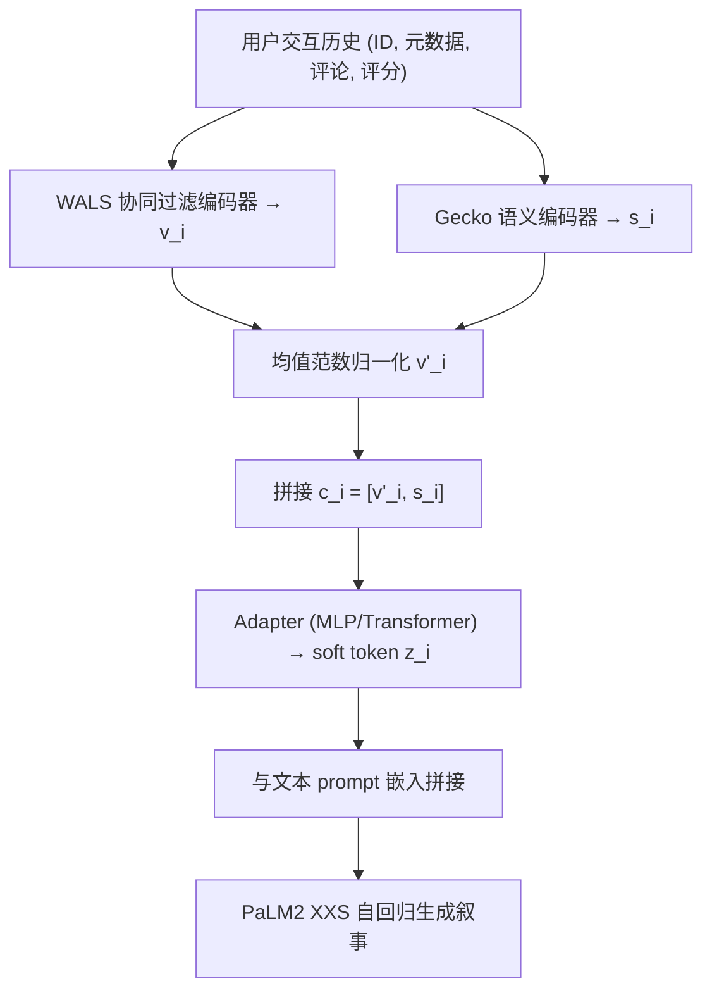
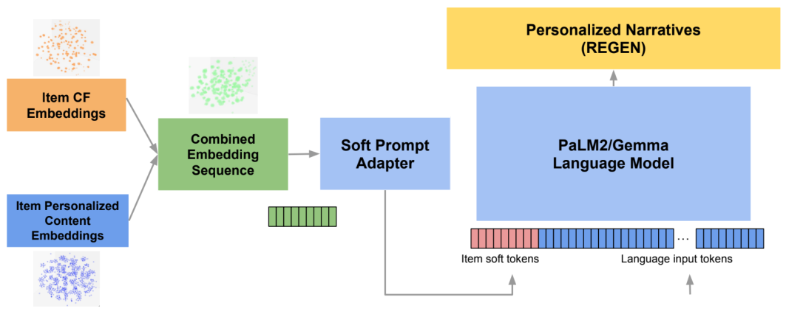

# Beyond Retrieval: Generating Narratives in Conversational Recommender Systems (超越检索：对话推荐系统中的叙事生成)

- **会议/期刊**: WWW 2025
- **作者与机构**: Krishna Sayana, Raghavendra Vasudeva, Yuri Vasilevski, Kun Su, Liam Hebert, James Pine, Hubert Pham, Ambarish Jash, Sukhdeep Sodhi（Google Research）
- **推荐链路定位**: 端到端生成式（对话推荐叙事生成）
- **研究方向**: 大语言模型推荐 / 对话推荐与智能体仿真
- **论文原文**: [https://arxiv.org/abs/2410.16780v2](https://arxiv.org/abs/2410.16780v2)
- **开源代码**: 暂未开源（REGEN 数据集公开可用）

## TL;DR (1分钟核心速览)

对话推荐系统长期卡在"推荐信号进不了 LLM、LLM 生成的语言又脱离用户偏好"的断层上。本文提出 REGEN 数据集（在 Amazon Reviews 上扩展购买理由、商品背书、用户画像等五类叙事），并给出一个解耦式融合架构：WALS 协同过滤嵌入与 Gecko 语义嵌入拼接后经 Adapter 映射为 soft token 前置注入 PaLM2 XXS。在 Office Products 与 Clothing 两域、按"训练/测试用户完全不重叠"的严格划分下，CF+内容联合输入较任一单模态在 BLEU/ROUGE-LSum/语义相似度上提升 4–12%（上下文相关任务最高 +23.9% BLEU）。

## Background & Motivation (背景与核心矛盾)

- **主流范式**: 对话推荐要么走 RAG（检索器选品 + LLM 生成），要么把物品/交互全部文本化喂给 LLM，要么把物品嵌入作为 soft prompt 注入 LLM。
- **前人局限**: RAG 依赖检索器精度、推理有额外开销且无法端到端梯度训练；纯文本化方案在 token 级编码用户信号会丢失信息、长历史计算昂贵且难融入元数据；已有嵌入注入工作（PERSOMA、User-LLM 等）只生成品类标签或单句摘要，未触及开放式长叙事。
- **核心洞察 (Key Insight)**: 推荐系统的结构化隐向量与人类语言的细腻表达之间存在表征鸿沟，而 LLM 的 soft prompt 机制恰好提供了一个"不占文本 token 就能携带推荐信号"的接口——$N$个交互只需$N$ 个 soft token。
- **本文切入点**: 用解耦编码（CF 编码器与语义编码器各自独立选型）+ 轻量 Adapter 融合，把两类信号投影进 LLM 输入空间，并以新数据集 REGEN 建立首个叙事生成基准。

## Method (核心方法设计)

### 1. 整体框架 (Overall Architecture)

模型采用"双编码器—拼接—Adapter—LLM"四段式：对用户历史 $S_u=\{i_1,\dots,i_n\}$中每个交互$i=(ID,T,P)$，CF 编码器由评分矩阵经 WALS 矩阵分解得到用户/物品嵌入$u_u, v_i\in\mathbb{R}^d$；语义编码器把物品元数据$m_i$与用户评论$r_i$拼接成文本$t_i$，经 Gecko 1B 句向量模型得$s_i\in\mathbb{R}^{d_s}$。两者归一化后拼接为$c_i=[v'_i, s_i]$，送入 Adapter（MLP 或 Transformer）映射为与 LLM 维度对齐的 soft token$z_i\in\mathbb{R}^{d_l}$，再前置拼接到文本 prompt 的 token 嵌入序列前，由 PaLM2 XXS 自回归生成叙事。训练时冻结双编码器与 LLM，仅训 Adapter，实现"推荐模型与语言模型各自独立扩展"的工程诉求。

<figure class="paper-figure" markdown="span">
  <figcaption>图4：模型架构概览。</figcaption>
</figure>

### 2. 关键设计拆解 (Key Designs)

1. **范数保持的异构嵌入融合（Norm-Preserving Fusion）**：Gecko 输出已 L2 归一化，而 WALS 嵌入的范数隐含物品流行度信息，直接归一化会抹掉这一信号。作者改为按全体物品嵌入的平均 L2 范数做期望值归一化 $v'_i = v_i / \overline{\|v\|_2}$，再与$s_i$ 拼接。直觉是：让 CF 分量保留"相对流行度"的尺度差异，同时与语义分量量级可比，避免 Adapter 被某一模态的尺度主导——消融显示该预处理能稳定提升指标。

2. **线性 Adapter 的可解释分解（Linear Adapter Decomposition）**：当 Adapter 取线性投影 $W\in\mathbb{R}^{d_l\times(d_i+d_s)}$时，soft token 可精确拆为$e_n = W_1 e_i + W_2 e_s$，其中$W_1, W_2$ 分别是作用于 CF 与内容子空间的子矩阵。这一分解让"CF 贡献了多少、内容贡献了多少"首次可被量化（按投影后范数占比统计），也为后续 t-SNE 分析奠定基础；实验表明线性 Adapter 与 MLP 性能差距在 5% 以内，却换来完全的可解释性。

3. **训练目标、负采样与推理效率**：任务是条件语言建模，损失为标准 token 级交叉熵 $\mathcal{L}=-\sum_{t}\log p_\theta(y_t\mid y_{<t}, Z_u, P)$，无负采样环节（生成式范式天然规避了排序任务的负采样设计）。推理时每个交互仅占 1 个 soft token，相比把整段评论文本塞进上下文，输入长度大幅压缩，serving 更快；代价是双编码器需离线预计算并维护物品嵌入表。

## Experimental Setup & Evaluation Protocol (实验设置与评估协议)

- **数据集与预处理**: 基于 Amazon Reviews (2018)，序列按时间戳排序、截断至最近 50 个交互、过滤缺失标题的物品：

| 数据集 | #Users | #Items | 平均交互/用户 | 特征/场景说明 |
| :--- | :---: | :---: | :---: | :--- |
| Office Products | 101K | 27K | 7–8 | 小物品词表，常规可预测购买 |
| Clothing, Shoes & Jewelry | 1.2M | 376K | 9.2 | 大物品词表，趋势驱动购买 |

- **数据划分与防穿越 (Splitting Strategy)**: 采用**用户级不重叠划分**（训练集与测试集用户完全不同），强制模型从嵌入而非记忆用户 ID 中理解历史，是本文评估协议最值得称道之处；叙事标签由 Gemini 1.5 Flash 基于完整历史生成，商品背书任务刻意扣留最后一条评论以防标签泄漏。
- **排名评测协议 (Ranking Protocol)**: 本文不做排序评测，改用三类生成指标——BLEU、ROUGE-LSum、基于 Gecko 句向量的语义相似度；辅以 Gemini Pro 作为 Auto-Rater，在 veracity/grounding/clarity/foresight/personalization 等七属性上做 7 分制打分，采用 10–15 次集成投票取多数。
- **对比基线与超参设置**: 基线为三种输入配置——仅 CF（WALS $d=128$）、仅内容（Gecko 1B$d_s=768$）、CF+内容；LLM 为 PaLM2 XXS，Adapter 为 MLP。

## Key Experimental Results (实验关键数据)

### 1. 主实验对比 (Main Results)

Office Products（$|I|=27K$）核心结果：

| 输出任务 | 指标 | CF | Content | CF+Content | vs CF | vs Content |
| :--- | :--- | :---: | :---: | :---: | :---: | :---: |
| Purchase reason | BLEU | 17.71 | 21.07 | **21.92** | +23.8% | +4.0% |
| Purchase reason | ROUGE-LSum | 38.26 | 42.63 | **43.01** | +12.4% | +0.9% |
| Purchase reason | Similarity | 0.614 | 0.664 | **0.669** | +9.0% | +0.8% |
| Reason explanation | BLEU | 19.56 | 21.68 | **24.24** | +23.9% | +11.8% |
| Reason explanation | ROUGE-LSum | 37.26 | 38.05 | **41.11** | +10.3% | +8.0% |
| Reason explanation | Similarity | 0.783 | 0.787 | **0.851** | +8.7% | +8.1% |
| User Summary (Brief) | BLEU | 17.96 | **19.30** | 19.12 | +6.5% | −0.9% |
| User Summary (Long) | Similarity | 0.885 | 0.895 | **0.903** | +2.0% | +0.9% |

Clothing（$|I|=376K$）上趋势一致但幅度收窄：Reason explanation 的 BLEU 为 17.81 / 18.01 / **18.96**（+6.5% / +5.3%），Similarity 为 0.795 / 0.820 / **0.838**；值得注意的是该域仅 CF 的指标已逼近内容模态，说明大物品池下协同信号更充分。

### 2. 消融实验 (Ablation Study)

| 配置 | Reason Expl. BLEU | Reason Expl. Sim. | Long Summary Sim. | 说明 |
| :--- | :---: | :---: | :---: | :--- |
| 仅 CF | 19.56 | 0.783 | 0.885 | 缺语义细节 |
| 仅 Content | 21.68 | 0.787 | 0.895 | 缺个性化协同 |
| CF+Content（无范数归一化） | 略低于完整版 | — | — | 尺度失衡拖累 |
| CF+Content（完整） | **24.24** | **0.851** | **0.903** | 双信号互补 |
| 线性 Adapter 替代 MLP | 差距 <5% | — | — | 可解释性换微小损失 |

### 3. 关键实验发现 (Key Findings)

1. **上下文相关任务才是 CF 的主战场**：购买理由解释任务上 CF+内容较内容单模态 BLEU 提升 11.8%、相似度提升 8.1%，而聚合型用户摘要任务上联合输入几乎无增益（BLEU −0.9%）。说明 CF 信号的价值在于"锚定最近一次交互"，当任务只需概括长期画像时，内容特征已足够。
2. **内容分量在 soft token 中占主导但 CF 不可省**：按投影范数统计，$W_2 e_s$的占比显著高于$W_1 e_i$，这与"仅内容优于仅 CF"的主实验结果自洽；但联合后仍稳定增益，证明 CF 提供的是内容无法替代的协同互补信息，而非冗余。
3. **soft prompt 学出了独立嵌入空间**：t-SNE 显示 soft token 及其 CF/内容分量聚成与 LLM 词表嵌入截然不同的簇。作者用球堆积 kissing number 论证——LLM 词表仅占高维空间极小比例，Adapter 另辟空间是合理且高效的"扩展词表"行为，与语义 ID 思路异曲同工。

## Highlights & Limitations (亮点、对比与审稿批判)

- **与代表作对比 (vs. Prior Work)**: 相比 RAG 路线（Lewis 等），本文无需检索器、可端到端训练且推理 token 更少；相比 PERSOMA/User-LLM 等嵌入注入工作，本文把输出从品类标签/单句摘要推进到开放式多类型长叙事；相比 CALRec 的对比对齐，本文不做联合训练而是解耦编码，牺牲潜在精度换取工程可扩展性与可解释性。
- **可迁移亮点**: ①"平均范数归一化"这一保持流行度尺度的融合技巧，可直接迁移到任何 CF 嵌入与预训练语义嵌入拼接的场景；②线性 Adapter 的 $W_1/W_2$ 范数占比分析，为多模态融合的贡献归因提供了零成本诊断工具。
- **审稿级局限批判**: ①评估高度依赖 LLM Auto-Rater 与 BLEU/ROUGE，缺少大规模人类 SxS 评测，且 BLEU 绝对值偏低（17–24），指标区分度存疑；②双编码器冻结、仅训 Adapter，未探索联合训练或 cross-attention 融合，且 Office 域物品平均仅被 10–20 个用户交互，CF 信号本身稀疏，结论在交互稠密域是否成立仍待验证。

## Rating (四维评分)

- **方法创新性 (Novelty)**: ⭐⭐⭐ （融合架构本身较朴素，创新主要在数据集构建与 soft prompt 可解释性分析，而非新算子）
- **评估协议与实验扎实度 (Protocol & Experiments)**: ⭐⭐⭐ （用户级不重叠划分严谨、双域验证到位，但缺人类评测、指标绝对值偏低）
- **写作与数学规范度 (Clarity & Rigor)**: ⭐⭐⭐⭐ （线性 Adapter 分解推导干净，kissing number 论证有巧思，符号定义清晰）
- **工业落地与复现价值 (Industrial & Practical Value)**: ⭐⭐⭐⭐ （解耦架构契合工业级大物品池，数据集公开，但代码未开源、依赖内部 PaLM2/Gecko）

