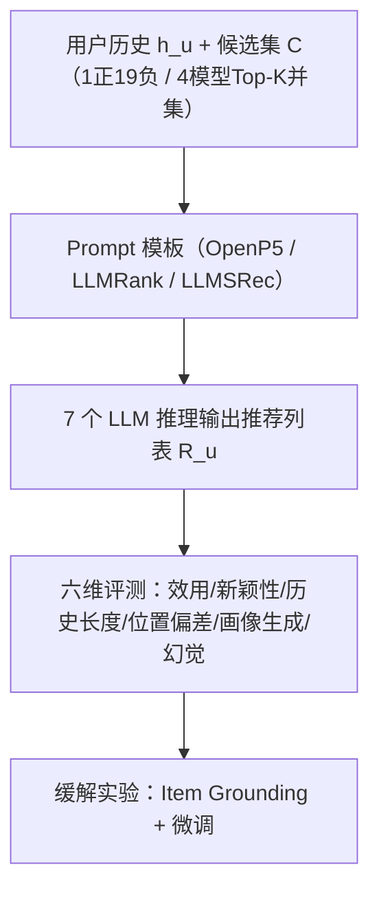
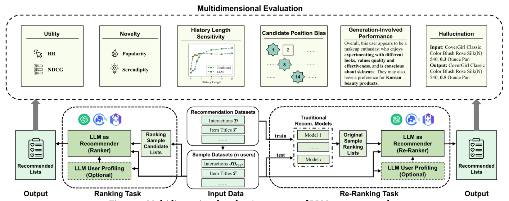

# Beyond Utility: Evaluating LLM as Recommender (超越效用：将 LLM 作为推荐系统的评测)

- **会议/期刊**: WWW 2025
- **作者与机构**: Chumeng Jiang, Jiayin Wang, Weizhi Ma, Min Zhang 等（清华大学 DCST/AIR、泉城实验室、滑铁卢大学、华为诺亚方舟实验室）
- **推荐链路定位**: 重排（兼评召回式 Ranking 任务）
- **研究方向**: 大语言模型推荐 / 去偏与可信评测
- **论文原文**: [https://arxiv.org/abs/2411.00331v2](https://arxiv.org/abs/2411.00331v2)
- **开源代码**: [https://github.com/JiangDeccc/EvaLLMasRecommender](https://github.com/JiangDeccc/EvaLLMasRecommender)

## TL;DR (1分钟核心速览)

现有 LLM4Rec 工作几乎只盯准确率，忽略了 LLM 引入的独有失效模式。本文提出六维评测框架（效用、新颖性 + 历史长度敏感性、候选位置偏差、画像生成、幻觉），在 4 个数据集上以 1 正 19 负的候选池、1000 用户采样测试集，系统对比 7 个 LLM（3 种 Prompt 策略）与 6 个传统模型。结论：LLM 在重排任务上全面超越传统模型（Beauty 上 GPT-3.5 HR@5 0.0320 vs. LightGCN 0.0244，+31%），在知识密集域（LastFM）与冷启动（1–2 条历史）占优，但候选位置偏差严重（CandPosBias HR@5 达 0.5172），部分小模型幻觉率高达 22.9%。

## Background & Motivation (背景与核心矛盾)

- **主流范式**: 将推荐数据转成文本 Prompt，让 LLM 从候选集中选出 Top-K 列表（Ranking），或对传统召回结果做重排（Re-Ranking）。
- **前人局限**: ① 已有评测（Palma 等、FaiRLLM 系列）分散在准确率、多样性、公平性等传统维度，设置各异、无统一框架；② 这些维度无法刻画 LLM 特有的失效——位置偏好、幻觉、生成式画像、对长历史的利用能力。
- **核心洞察 (Key Insight)**: LLM 推荐与传统模型的能力边界不同：强世界知识与文本生成是增益，位置敏感与幻觉是新增风险，必须用"LLM 原生"维度来度量。
- **本文切入点**: 构建可复现的六维评测框架，把"LLM 作为推荐器"的优势与短板同时量化，并给出缓解手段（item grounding、微调）的实证。

## Method (核心方法设计)

### 1. 整体框架 (Overall Architecture)

框架统一了 Ranking 与 Re-Ranking 两种任务：Ranking 用 1 正 + $m$随机负样本构造候选集$C^{\text{rank}}_{u,y}=\{y,i_{x_1},\dots,i_{x_m}\}$；Re-Ranking 用 4 个召回模型（BPRMF/GRU4Rec/SASRec/LightGCN）的 Top-K 并集构造$C^{\text{rerank}}_{u,y}=R^{f_1}_u\cup\dots\cup R^{f_l}_u$。LLM 输出推荐列表$R^{g,P}_u=g_{\text{LLM}}(P(u,h_u,C_{u,y};\mathcal{T}))$，随后在六个维度上打分。为控制成本，测试集从全量用户中采样$n=1000$构成$SD_{\text{test}}$，并用 K-S 检验（式 4）保证采样集与全量集在所选指标上分布无显著差异，否则重采样。

<figure class="paper-figure" markdown="span">
  <figcaption>图1：LLM作为推荐系统的多维评估流程。</figcaption>
</figure>

### 2. 关键设计拆解 (Key Designs)

1. **候选位置偏差度量 (CandPosBias)**：LLM 对候选列表位置天然敏感，而真实场景无法预知正样本位置。作者对比"正样本固定首位"与"随机位置"两种摆放下的准确率，并先做 $-\log(1-\text{Acc})$ 变换以消除指标上限 1 带来的压缩效应：
$$\text{CandPosBias}_{\text{Acc}}=-\log(1-\text{Acc}(R^{\text{first pos}}))+\log(1-\text{Acc}(R^{\text{random pos}})),\ \text{Acc}\in\{\text{HR},\text{NDCG}\}$$
理想值为 0；该变换使高、低准确率区间的差异可比，避免"高位饱和"掩盖偏差。

2. **幻觉率与画像生成评测**：幻觉定义为 LLM 输出标题经忽略大小写/空格/符号的字符串匹配后仍无法映射回真实物品集 $\mathcal{I}$ 的比例：
$$\text{Hallucination}=\frac{1}{|\mathcal{R}|}\sum_{R_u\in\mathcal{R}}\frac{1}{K}\sum_{i\in R_u}\mathbb{I}(i\in\mathcal{I})$$
画像生成则先由 LLM 依据 $h_u[-L:]$生成文本画像$Profile_u$，再注入 Prompt，对比"仅画像 / 仅历史 / 画像+历史"三档，检验生成式中间表示能否保留关键偏好模式。

3. **历史长度敏感性协议**：对每个用户仅保留最近 $L$条记录$h_u[-L:]$，并同步裁剪训练集$D'$ 使传统模型与 LLM 看到等量信息（式 7），从而公平比较冷/暖用户曲线。这一"同步裁剪"是本文相对前人评测的关键方法学增量，避免了 LLM 与训练模型信息量不对等。

## Experimental Setup & Evaluation Protocol (实验设置与评估协议)

- **数据集与预处理**（均 `5-core` 过滤，物品标题作为文本描述）：

| 数据集 | #Users | #Items | #Interactions | 密度 | 场景说明 |
| :--- | :---: | :---: | :---: | :---: | :--- |
| Beauty | 22,363 | 12,101 | 198,502 | 0.0734% | 短历史，美妆 |
| Sports | 35,598 | 18,357 | 296,337 | 0.0453% | 短历史，户外 |
| ML-1M | 6,040 | 3,416 | 999,611 | 4.8448% | 长历史，电影 |
| LastFM | 1,543 | 7,286 | 173,778 | 1.5458% | 长历史，音乐人 |

- **数据划分与防穿越**: `Leave-One-Out` 划分 $D_{\text{train}}/D_{\text{valid}}/D_{\text{test}}$；测试阶段再随机采样 1000 用户构成$SD_{\text{test}}$，K-S 检验通过后方可使用。
- **排名评测协议**: 属 `Sampled Ranking`——Ranking 任务每用户 1 正 + 19 随机负（正负比 1:19），Re-Ranking 任务候选池为 4 个召回模型 Top-K 并集（池大小 20）。候选顺序在不同 LLM 间保持一致（因位置偏差会污染对比），温度设为最低（GPT/Llama 为 0，GLM 为 0.01）。
- **对比基线与超参**: 传统基线 6 个（MostPop、BM25、BPRMF、GRU4Rec、SASRec、LightGCN，基于 ReChorus 调参，结果取 5 次随机初始化均值）；LLM 侧 7 个（GPT4o、GPT4o-mini、GPT3.5、Claude3-haiku、Llama3-70b、Qwen2-7b、Mistral-7b）× 3 种 Prompt（OpenP5 模板、LLMRank、LLMSRec 的 in-context learning）。显著性以 $p<0.01$ 标注。

## Key Experimental Results (实验关键数据)

### 1. 主实验对比 (Main Results)

Ranking 任务效用（HR@5 / NDCG@5，节选）：

| 模型 | Beauty HR@5 | Beauty NDCG@5 | Sports HR@5 | ML-1M HR@5 | LastFM HR@5 | LastFM NDCG@5 |
| :--- | :---: | :---: | :---: | :---: | :---: | :---: |
| MostPop | 0.504 | 0.3434 | 0.498 | 0.675 | 0.650 | 0.5100 |
| BPRMF | 0.652 | 0.5015 | 0.664 | 0.843 | 0.841 | 0.7645 |
| SASRec | 0.647 | 0.4996 | 0.686 | **0.875** | 0.836 | 0.7635 |
| LightGCN | **0.673** | **0.5177** | **0.708** | 0.853 | 0.860 | 0.7667 |
| GPT4o | 0.604 | 0.4450 | 0.676 | 0.734 | 0.886 | 0.8159 |
| Llama3-70b | 0.526 | 0.3882 | 0.557 | 0.502 | 0.846 | 0.7728 |
| LLMSRec (Llama3-70b) | 0.553 | 0.4121 | 0.581 | 0.528 | **0.906** | **0.8300** |

Re-Ranking 任务（Beauty，GPT-3.5 vs. 4 个召回模型）：

| 指标 | BPRMF | GRU4Rec | SASRec | LightGCN | GPT3.5 |
| :--- | :---: | :---: | :---: | :---: | :---: |
| HR@5 ↑ | 0.0238 | 0.0216 | 0.0242 | 0.0244 | **0.0320** (+31.1%) |
| NDCG@5 ↑ | 0.0145 | 0.0130 | 0.0144 | 0.0147 | **0.0202** (+37.4%) |
| Popularity ↑ | 0.0219 | 0.0086 | 0.0259 | 0.0226 | **0.0904** |
| Serendipity ↑ | 0.0140 | 0.0106 | 0.0144 | 0.0132 | **0.0200** |
| CandPosBias HR@5 →0 | 0.0000 | 0.0000 | 0.0000 | 0.0000 | 0.2282 |
| Hallucination ↓ | - | - | - | - | 0.0159 |

### 2. 消融实验 (Ablation Study)

以"缓解手段"为消融对象（ML-1M，HR@5；以及微调前后对比）：

| 配置 | Mistral | Qwen2 | Llama3 | Claude3 | GPT4o-mini | GPT4o |
| :--- | :---: | :---: | :---: | :---: | :---: | :---: |
| w/o Mapping | 0.327 | 0.346 | 0.502 | 0.620 | 0.674 | 0.734 |
| Text Emb. Grounding | **0.401** | **0.354** | **0.508** | **0.677** | **0.677** | **0.735** |
| BM25 Grounding | 0.396 | 0.353 | 0.507 | 0.676 | 0.676 | 0.735 |

| 微调前后（Llama3.1-8B） | Beauty | Sports | ML-1M | LastFM |
| :--- | :---: | :---: | :---: | :---: |
| Zero-shot Hallucination ↓ | 0.139 | 0.133 | 0.425 | 0.023 |
| Finetuned Hallucination ↓ | 0.064 | 0.055 | **0.001** | 0.013 |
| Zero-shot CandPosBias HR@1 | 0.0630 | 0.0482 | 0.0098 | 0.0747 |
| Finetuned CandPosBias HR@1 | -0.0536 | 0.0241 | 0.0578 | 0.0245 |

### 3. 关键实验发现 (Key Findings)

1. **知识密集域是 LLM 的甜区，协同信号是短板**：LastFM 上 LLMSRec 达 HR@5 0.906，显著超过最强传统模型 LightGCN 的 0.860（$p<0.01$）；但在 Beauty/Sports/ML-1M 上 GPT4o 仍落后 LightGCN（0.604 vs. 0.673），说明 LLM 的收益来自预训练语料对歌手/电影的覆盖，而非协同过滤能力。
2. **短历史即可饱和，冷启动反超传统模型**：LLM 在历史长度 1–2 条时即可超过传统模型的最优表现，但曲线在 10 条以内见顶后增长停滞；传统模型则随历史增长平滑提升。Qwen2/Mistral 在 ML-1M 上甚至出现"给历史反而变差"的知识冲突现象。
3. **位置偏差是 LLM 排名的头号杀手，重排可部分缓解**：Ranking 下 CandPosBias HR@5 高达 0.5172，正样本越靠后准确率越低；Re-Ranking 下 GPT-3.5 降至 0.2282，且可反向利用召回序作为位置先验。微调能把 ML-1M 幻觉率从 0.425 压到 0.001，但对位置偏差改善有限（Beauty 甚至符号翻转）。

## Highlights & Limitations (亮点、对比与审稿批判)

- **与代表作对比 (vs. Prior Work)**: 相比 Palma 等仅覆盖新颖性/流行度偏差的评测，本文首次把"位置偏差、幻觉、画像生成、历史长度"纳入统一可复现框架；相比 LLMRank 仅在单一设置下报告"中间位置最优"，本文扩大样本与数据集后修正为"多数 LLM 偏好靠前位置"，结论更稳健。
- **可迁移亮点**: ① $-\log(1-\text{Acc})$ 变换度量位置偏差，可直接迁移到任何列表式排序器的位置鲁棒性评估；② "先检测幻觉率再决定 grounding 策略"（<0.005 随机映射即可，>0.005 用 BM25 性价比最高）是低成本工程准则。
- **审稿级局限批判**: ① Ranking 任务用 1:19 采样候选池模拟全库排序，与真实 Full-Ranking 存在分布差距，且 1000 用户采样虽经 K-S 检验仍可能低估长尾用户；② 仅评测零样本/少样本 off-the-shelf LLM，未纳入 OpenP5、POD 等微调式 LLM4Rec，结论对"训练过的 LLM 推荐器"外推性存疑；③ 位置偏差度量依赖"首位 vs 随机"两点对比，未刻画完整位置-准确率曲线形状。

## Rating (四维评分)

- **方法创新性 (Novelty)**: ⭐⭐⭐⭐ （评测维度设计新颖，位置偏差的对数变换与同步裁剪协议有方法学价值，但本质是评测框架而非新模型）
- **评估协议与实验扎实度 (Protocol & Experiments)**: ⭐⭐⭐⭐ （4 数据集 × 7 LLM × 3 Prompt × 6 基线的矩阵非常完整，K-S 采样检验与 $p<0.01$ 显著性到位，扣分在采样排序而非全库排序）
- **写作与数学规范度 (Clarity & Rigor)**: ⭐⭐⭐⭐ （六维指标定义清晰、附录给出全部指标公式，符号统一；部分指标如 PopREO 仅在附录展开，正文可读性略受影响）
- **工业落地与复现价值 (Industrial & Practical Value)**: ⭐⭐⭐⭐⭐ （代码数据全开源，直接给出"LLM 适合做重排而非召回""grounding 按幻觉率选策略"等可落地结论，对线上 LLM 重排部署有直接指导）

