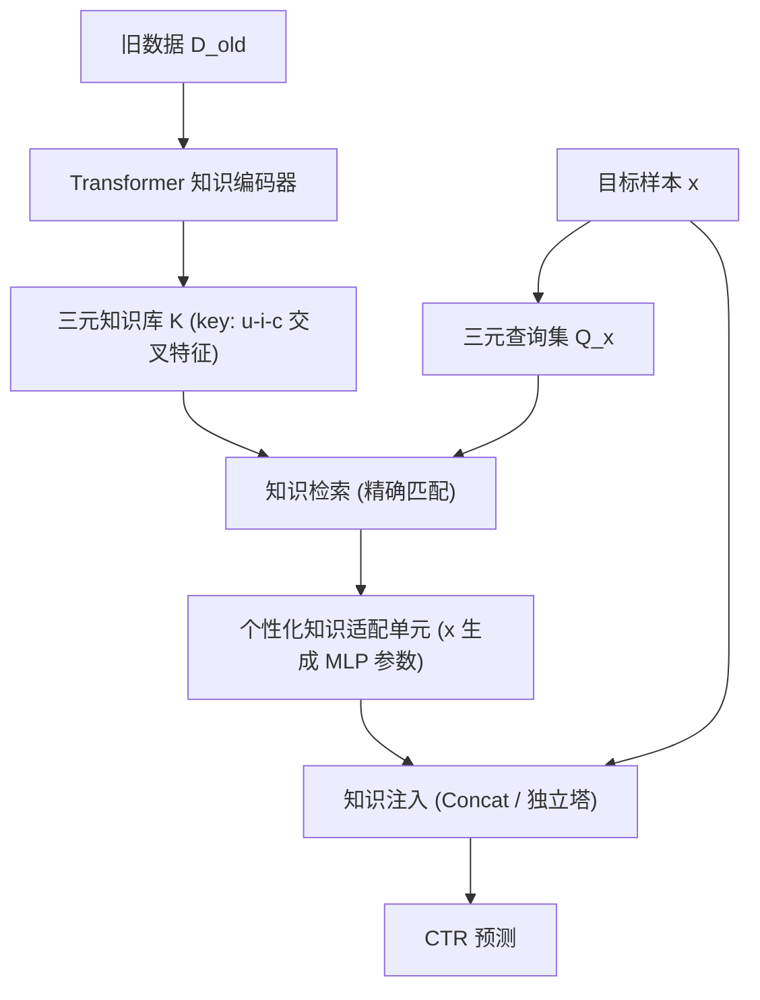
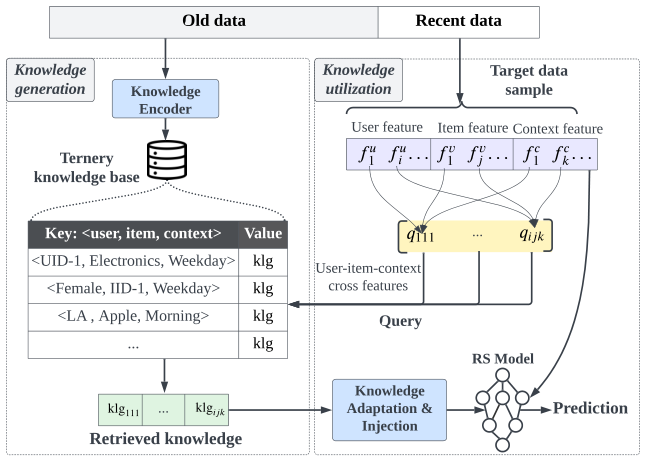

# D2K: Turning Historical Data into Retrievable Knowledge for Recommender Systems (将历史数据转化为可检索知识)

- **会议/期刊**: WWW 2025
- **作者与机构**: Jiarui Qin, Weinan Zhang, Yong Yu (上海交通大学)；Weiwen Liu, Ruiming Tang (华为诺亚方舟实验室)
- **推荐链路定位**: 精排 (CTR 预估增强)
- **研究方向**: 大语言模型推荐 / CTR 预估与特征交叉
- **论文原文**: [https://arxiv.org/abs/2401.11478v2](https://arxiv.org/abs/2401.11478v2)
- **开源代码**: 暂未开源

## TL;DR (1分钟核心速览)

针对推荐系统"旧日志知识难以保留"的灾难性遗忘痛点，本文提出数据为中心框架 D2K：将历史日志中所有用户-物品-上下文三元交叉特征编码为键值知识库，目标样本检索后经个性化适配单元注入任意 CTR 模型。在 AD 与 Eleme 两个大规模数据集上，以 DeepFM/DIN/DCNv2 为骨干，AUC 相对最优基线提升 1.35%–2.90%，且知识库压缩至 4% 仍具竞争力。

## Background & Motivation (背景与核心矛盾)

- **主流范式**: 现有方法（知识蒸馏 IncCTR、增量学习、记忆网络 MemoryNet、预训练 Embedding）均将旧数据知识**隐式压缩进模型参数**，即 parameter-centric。
- **前人局限**: ① 参数容量固定而日志持续增长，新信息写入必然擦除旧信息，导致灾难性遗忘；② 参数中的知识难以灵活管理新旧权衡，且与骨干模型强耦合。
- **核心洞察 (Key Insight)**: 原始数据本身信息容量最大，若将旧数据转为**显式可检索知识库**，则容量可随数据线性扩展、知识显式可用、且模型无关。更进一步，用户反馈由 user/item/context 三方面共同决定，故知识应以**三元交叉特征**为键，而非传统以 user ID 为键的一元知识。
- **本文切入点**: 用 Transformer 编码器把每个三元交叉特征映射为"直接知识"向量（单独即可产生预测），再以目标样本为条件个性化适配后注入骨干。

## Method (核心方法设计)

### 1. 整体框架 (Overall Architecture)

数据按时间戳切为旧数据 $\mathcal{D}_{old}$与近期数据（训练/测试）。**知识生成**阶段：在$\mathcal{D}_{old}$上训练 Transformer 知识编码器，枚举所有三元交叉特征$\langle f^u_i, f^v_j, f^c_k\rangle$并编码为向量，构建键值知识库$\mathcal{K}$。**知识利用**阶段：目标样本$x$生成同构三元查询集$Q_x$，精确查表得全局知识，经个性化适配单元转为样本相关表示，再以拼接或独立塔方式注入任意 RS 模型。

<figure class="paper-figure" markdown="span">
  <figcaption>图3：D2K的框架。</figcaption>
</figure>

### 2. 关键设计拆解 (Key Designs)

1. **三元知识编码器 (Ternary Knowledge Encoder)**：痛点是一元知识（仅 user ID 索引）信息量不足、无法独立预测。本文将全部特征嵌入作为 $Q=K=V$输入 Transformer 得特征表示$\boldsymbol{g}$，枚举三元组合并拼接后经 MLP 得知识向量：
$$\boldsymbol{z}_{ijk}=\mathrm{MLP}\big(\mathrm{concat}(\boldsymbol{g}^u_i,\boldsymbol{g}^v_j,\boldsymbol{g}^c_k)\big)$$
编码器以 $\hat{y}=\sigma(\boldsymbol{w}_l^\top\cdot\mathrm{concat}(\{\boldsymbol{z}_{ijk}\})+b_l)$做 BCE 训练，使知识向量被映射到**线性可分空间**——这正是后续仅用线性塔即可消费知识的原因。选 Transformer 因其可变输入长度：训练时$F$ 个特征、抽取时仅 3 个特征。

2. **个性化知识适配单元 (Personalized Knowledge Adaptation)**：检索到的知识是全局平均语义（如"LA & Apple & Morning"的平均点击影响），需按目标样本个性化。借鉴 hypernetwork 思想，用目标样本嵌入线性投影生成适配 MLP 的全部权重与偏置：
$$\boldsymbol{w}_x=\boldsymbol{w}_{pro}\cdot\boldsymbol{x},\quad \hat{\boldsymbol{z}}_{ijk}=\delta_L\big(\boldsymbol{w}^L_x(\cdots\delta_1(\boldsymbol{w}^1_x\boldsymbol{z}_{ijk}+\boldsymbol{b}^1_x)\cdots)+\boldsymbol{b}^L_x\big)$$
不同 $x$ 对应不同 MLP，参数高效且天然样本相关；实验表明共享嵌入（不额外建表）已足够。

3. **训练目标、知识更新与推理开销**：知识编码器用 BCE 训练，增强后的 RS 模型同样用 BCE 端到端训练，**无需负采样**（两数据集均含曝光未点击负样本）。知识库更新采用 Average Pooling（新旧向量平均，等价于新旧编码器集成）优于 Recent Priority（直接替换）。推理侧每 batch(1024) 检索仅 44.7ms(AD)/89.8ms(Eleme)，知识库一次性构建（62/113 分钟，76/138 GB），满足低延迟要求。

## Experimental Setup & Evaluation Protocol (实验设置与评估协议)

- **数据集与预处理**: 两数据集均含正负样本，无需负采样。

| 数据集 | #Users | #Items | #Interactions | 特征域/ID 数 | 场景说明 |
| :--- | :---: | :---: | :---: | :---: | :--- |
| AD (Taobao) | 1,061,768 | 827,009 | 25,029,435 | 14 / 3.03M | 展示广告曝光点击，含 22 天行为序列 |
| Eleme | 5,782,482 | 1,853,764 | 49,114,930 | 25 / 16.52M | 外卖点击日志，特征丰富 |

- **数据划分与防穿越 (Splitting Strategy)**: **全局时间戳分块切分**——按时间排序后切为 $\mathcal{D}_1,\dots,\mathcal{D}_T$，$\mathcal{D}_{old}=\{\mathcal{D}_1..\mathcal{D}_{p_1}\}$、训练集$\mathcal{D}_{tr}=\{\mathcal{D}_{p_1+1}..\mathcal{D}_{p_2}\}$、测试集为剩余块，严格防穿越。
- **排名评测协议 (Ranking Protocol)**: 点级 CTR 预估，报告 **AUC**（成对排序，主指标）与 **LogLoss**（点级校准）；非全库 ranking 协议。
- **对比基线与超参设置**: 骨干为 DeepFM / DIN / DCNv2；基线含 Fixed Window(R/A)、Incremental、IncCTR(KD-batch)、Pretrain embedding、MemoryNet、Random、SVP-CF；5 个随机种子取 mean±std，显著性 $p<0.05$。

## Key Experimental Results (实验关键数据)

### 1. 主实验对比 (Main Results)

AD 数据集 AUC（节选，完整见原文表 1）：

| Method | DeepFM | DIN | DCNv2 |
| :--- | :---: | :---: | :---: |
| Fixed Window (R) | 0.6202 | 0.6203 | 0.6211 |
| IncCTR (KD-batch) | 0.6191 | 0.6194 | 0.6107 |
| MemoryNet (一元知识) | 0.6192 | 0.6195 | 0.6215 |
| SVP-CF (coreset) | 0.6234 | 0.6234 | 0.6246 |
| Fixed Window (A) 全量数据 | 0.6237 | 0.6228 | 0.6235 |
| **D2K-adp-share** | **0.6318** | **0.6340** | **0.6341** |
| Improv.% vs 最优基线 | +1.35% | +1.70% | +1.52% |

Eleme 数据集 AUC：D2K-adp-share 达 0.6033 / 0.6107 / 0.6147，相对最优基线提升 **+2.90% / +2.33% / +1.89%**。

### 2. 消融实验 (Ablation Study)

| 变体 | AD-DeepFM | AD-DIN | Eleme-DIN |
| :--- | :---: | :---: | :---: |
| D2K-base (无适配) | 0.6328 | 0.6333 | 0.5917 |
| D2K-adp-sep (独立嵌入) | 0.6325 | 0.6338 | 0.6093 |
| D2K-adp-small (1/4 嵌入) | 0.6330 | 0.6339 | 0.6009 |
| **D2K-adp-share (共享嵌入)** | 0.6318 | **0.6340** | **0.6107** |

### 3. 关键实验发现 (Key Findings)

1. **三元知识 > 一元知识**：D2K-base 在 AD 上即达 0.6328/0.6333/0.6339，全面超过 MemoryNet（0.6192–0.6215）与 Pretrain embedding，证明以 u-i-c 交叉特征为键比 user ID 为键携带更充分的直接判别信息。
2. **数据为中心优于参数为中心**：D2K 甚至超过用全部 $\mathcal{D}_{old}+\mathcal{D}_{tr}$ 训练的 Fixed Window (A)（AD 上 0.6318 vs 0.6237），说明"最大信息量"若经梯度压缩进固定参数反而不如显式三元知识保留得完整；增量学习基线在 AD 上甚至劣于 Fixed Window (R)，凸显分布漂移下的遗忘问题。
3. **知识库可大幅压缩且鲁棒**：AD 上 FS2/FS3 仅保留 FS1 的 21%/4% 条目，AUC 仍高于 Fixed Window (R) 并与最优基线持平，呈边际递减；知识过期 24 小时后 D2K 仍以 0.6228/0.6262/0.6253 领先所有基线，验证工程可用性。

## Highlights & Limitations (亮点、对比与审稿批判)

- **与代表作对比 (vs. Prior Work)**: 相较 IncCTR（蒸馏旧模型参数）与 MemoryNet（user ID 索引一元记忆），D2K 本质区别在于**知识载体从参数搬到外部键值库**，容量随数据扩展且模型无关；相较 SVP-CF 等 coreset 方法（启发式丢弃 90% 数据），D2K 保留全部三元模式且无启发式规则依赖。
- **可迁移亮点**: ① "三元交叉特征作键 + 线性可分编码"可直接迁移到任何特征丰富场景的检索增强；② 用目标样本生成适配 MLP 参数的 hypernetwork 思路，可低成本实现全局知识的样本级个性化。
- **审稿级局限批判**: ① 知识库采用**精确匹配**，查询未命中即得空向量（作者自认未来需支持模糊检索），且 76–138 GB 内存与 62–113 分钟构建成本对高频更新场景偏重；② 仅在两个含负样本的公开 CTR 数据集验证，缺少全库 ranking 协议与线上 A/B，且 Eleme 上 LogLoss 未稳定占优、部分变体方差较大（如 D2K-base LL 0.3256±0.0915）。

## Rating (四维评分)

- **方法创新性 (Novelty)**: ⭐⭐⭐⭐ （数据为中心 + 三元直接知识 + hypernetwork 适配的组合新颖，理论直觉清晰但单点算子较常规）
- **评估协议与实验扎实度 (Protocol & Experiments)**: ⭐⭐⭐⭐ （两大规模数据集、三骨干、5 种子显著性检验、消融/压缩/更新/过期全覆盖，缺全库 ranking 与线上验证）
- **写作与数学规范度 (Clarity & Rigor)**: ⭐⭐⭐⭐ （三元知识与直接知识定义明确、公式简洁，但适配单元参数量推导略跳跃）
- **工业落地与复现价值 (Industrial & Practical Value)**: ⭐⭐⭐⭐ （模型无关易插拔、检索延迟 <100ms/batch，但知识库存储与更新开销是主要落地门槛）

