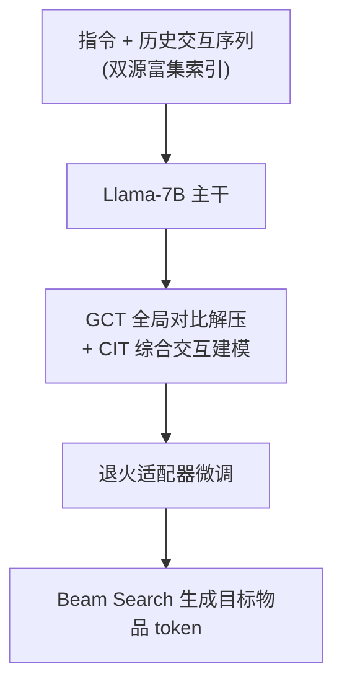
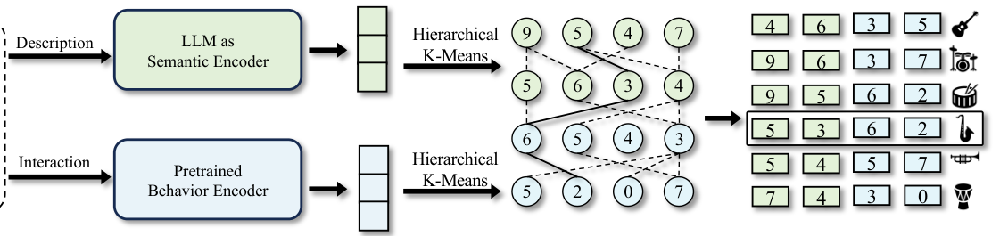

# EAGER-LLM: Enhancing Large Language Models as Recommenders through Exogenous Behavior-Semantic Integration (通过外源行为-语义融合增强大语言模型推荐能力)

- **会议/期刊**: WWW 2025
- **作者与机构**: Minjie Hong, Yan Xia, Zehan Wang, Jieming Zhu, Ye Wang, Sihang Cai, Xiaoda Yang, Quanyu Dai, Zhenhua Dong, Zhimeng Zhang, Zhou Zhao（浙江大学 / 华为诺亚方舟实验室）
- **推荐链路定位**: 端到端生成式（生成式召回/排序一体）
- **研究方向**: 大语言模型推荐 / 生成式推荐与离散语义 ID
- **论文原文**: [https://arxiv.org/abs/2502.14735v1](https://arxiv.org/abs/2502.14735v1)
- **开源代码**: 暂未开源

## TL;DR (1分钟核心速览)

LLM 预训练的语言语义与推荐所需的协同语义存在巨大鸿沟，现有 LLM4Rec 要么用原子 ID 造成词表冗余、要么从零学协同信号效率低下。EAGER-LLM 提出双源知识富集物品索引（语义+行为分层 K-Means 离散化）、非侵入式多尺度对齐重建任务（GCT/CIT）与退火适配器，将海量外源信号以约 200 万:1 压缩率注入 LLM。在 Amazon Beauty/Sports/Instruments 三数据集、Leave-One-Out + Full-Ranking 协议下，Recall@10 相对最强基线提升 21.88%/26.16%/3.99%，NDCG@10 提升 12.22%/20.23%/4.04%。

## Background & Motivation (背景与核心矛盾)

- **主流范式**: 生成式推荐将物品映射为离散 token 序列，用 decoder-only LLM 自回归生成目标物品 ID（TIGER、LC-Rec、P5-CID 等），把"双塔相似度检索"改写为"下一 token 预测"。
- **前人局限一（索引低效）**: 原子 ID（bracket token）在候选集远超 LLM 词表时产生严重 tokenization 冗余；纯描述文本索引又引入强归纳偏置，掩盖真实行为意图。
- **前人局限二（信号割裂）**: 外源协同信号与 LLM 语言语义域差异巨大，直接注入（如 LETTER 的正则化、CoLLM 的输入拼接）会破坏 LLM 原有能力；而 Q-Former 类编码端融合存在显著压缩损失。
- **核心洞察 (Key Insight)**: 行为与语义两个特征空间域差异过大，编码端融合必然丢信息；不如**分别离散化、拼接成索引**，让 LLM 主干在解码端自行完成融合，避免额外泛化偏置。
- **本文切入点**: 用极少量 token 高压缩承载双源先验，再以非侵入式重建任务"解压"这些知识，最后用适配器在推荐精度与语言能力间退火平衡。

## Method (核心方法设计)

### 1. 整体框架 (Overall Architecture)

输入为指令 + 用户历史交互序列（每物品由 4 个语义 token + 4 个行为 token 组成的富集索引表示），经 Llama-7B 主干自回归生成目标物品的 token 序列。训练分三阶段：初始训练（多任务条件语言建模 + 双源对比重建损失）→ 退火适配器微调（少量高质量序列推荐数据 + Adapter 参数）→ 推理（丢弃 SRT 附加参数，beam size=20 生成）。核心闭环是"高压缩索引承载先验 → 重建任务解压 → 适配器平衡能力"。

<figure class="paper-figure" markdown="span">
  <figcaption>图2：双源知识丰富物品索引的示意图。以极高压缩率将大量外源行为语义信号融入物品索引。</figcaption>
</figure>

### 2. 关键设计拆解 (Key Designs)

1. **双源知识富集物品索引 (DKI)**：针对原子 ID 冗余与编码端融合损失，对语义嵌入 $z^s_i$（LLM 末层隐状态均值池化）与行为嵌入$z^b_i$（DIN 双塔编码器输出）**分别**做分层 K-Means 离散化，得到语义码$C^s$与行为码$C^b$并拼接为物品索引。每物品 4 token、每 token 256 值，理论上可唯一表征$256^4 \approx 4.29\times10^9$ 个物品，词表扩展开销极小；解耦索引避免编码端融合的信息损失，让 LLM 在解码端自行建模行为-语义交互。

2. **非侵入式多尺度对齐重建任务**：极端压缩率（约 200 万:1）使模型难以直接消化外源知识。**GCT** 在序列末尾加摘要 token $y_{[CON]}$，用仅在训练期存在的解压引导投影器$f_t$将其映射为语义/行为引导隐状态，与原始嵌入$Z^s, Z^b$做 InfoNCE 对比：$\mathcal{L}^t_{con}=\mathcal{F}(f_t(\text{hiddenstate}_{[CON]}), Z^t)$，$t\in\{b,s\}$。**CIT** 则将序列推荐、语义重建、偏好理解三子任务统一重构为 next-token 预测，避免额外 selector 改变输出域分布。

3. **训练目标、负采样与推理效率**：总损失 $\mathcal{L}=\mathcal{L}_{gen}+\mathbb{I}_{SRT}(\lambda_1\mathcal{L}^s_{con}+\lambda_2\mathcal{L}^b_{con})$，其中$\mathbb{I}_{SRT}$为示性函数。对比学习采用 batch 内负样本（InfoNCE），生成任务本身免负采样。退火阶段仅训练 Adapter 参数$\varphi_a$：$\max_{\varphi_a}\sum_{(x,y)}\sum_t \log P_{\Phi+\varphi_r+\varphi_a}(y_t|x,y_{<t})$。推理时丢弃$\varphi_r$ 与投影器，仅保留主干 + 可选 Adapter，beam search 直接生成，避免全库打分。

## Experimental Setup & Evaluation Protocol (实验设置与评估协议)

- **数据集与预处理**: Amazon 三子类，均采用 `5-core` 过滤：

| 数据集 | #Users | #Items | #Interactions | 稀疏度 | 场景说明 |
| :--- | :---: | :---: | :---: | :---: | :--- |
| Beauty | 22,363 | 12,101 | 198,360 | 0.00073 | 美妆 |
| Sports and Outdoors | 35,598 | 18,357 | 296,175 | 0.00045 | 户外运动 |
| Instruments | 24,733 | 9,923 | 206,153 | 0.00083 | 乐器 |

- **数据划分与防穿越**: `Leave-One-Out`（标准 SASRec 协议），训练时用户历史截断至 20 个物品。
- **排名评测协议**: 生成式范式下以 beam size=20 生成候选，报告 Recall@{5,10} 与 NDCG@{5,10}；对比基线为全库排序语义。
- **对比基线与超参设置**: 四类基线——传统序列（GRU4REC/Caser/HGN）、Transformer（Bert4Rec/S³-Rec/FDSA）、生成式（P5-CID/TIGER）、LLM-based（LC-Rec/LETTER）。主干 Llama-7B，AdamW，lr=5e-5，weight decay=0.01，总 batch=128；所有结果相对最强基线 $p<0.05$ 显著。

## Key Experimental Results (实验关键数据)

### 1. 主实验对比 (Main Results)

| 数据集 | 指标 | TIGER | P5-CID | LC-Rec | LETTER-LC-Rec | **EAGER-LLM** | Improv. |
| :--- | :--- | :---: | :---: | :---: | :---: | :---: | :---: |
| Beauty | R@5 | 0.0454 | 0.0400 | 0.0482 | — | **0.0548** | +13.69% |
| Beauty | R@10 | 0.0648 | 0.0590 | 0.0681 | — | **0.0830** | +21.88% |
| Beauty | N@10 | 0.0384 | 0.0335 | 0.0409 | — | **0.0459** | +12.22% |
| Sports | R@5 | 0.0264 | 0.0313 | 0.0304 | — | **0.0373** | +19.17% |
| Sports | R@10 | 0.0400 | 0.0431 | 0.0451 | — | **0.0569** | +26.16% |
| Sports | N@10 | 0.0225 | 0.0262 | 0.0246 | — | **0.0315** | +20.23% |
| Instruments | R@5 | 0.0863 | 0.0827 | 0.0964 | 0.0913 | **0.0991** | +2.80% |
| Instruments | R@10 | 0.1064 | 0.1016 | 0.1177 | 0.1115 | **0.1224** | +3.99% |
| Instruments | N@10 | 0.0803 | 0.0768 | 0.0890 | 0.0854 | **0.0926** | +4.04% |

同主干（Llama2-7B）公平对比：EAGER-LLM 在 Instruments 上 R@5=0.0994、N@10=0.0922，全面超越 LETTER-TIGER（0.0909/0.0831）与 LETTER-LC-Rec（0.0913/0.0854），提升 7.48%–8.95%。

### 2. 消融实验 (Ablation Study)

| 变体 (DKI/GCT/AAT) | Beauty R@10 | Beauty N@10 | Instruments R@10 | Instruments N@10 |
| :--- | :---: | :---: | :---: | :---: |
| 全移除（随机索引） | 0.0650 | 0.0358 | 0.1071 | 0.0817 |
| +DKI | 0.0760 | 0.0413 | 0.1199 | 0.0886 |
| +DKI+GCT | 0.0781 | 0.0432 | 0.1215 | 0.0914 |
| +DKI+GCT+AAT | **0.0817** | **0.0451** | **0.1225** | **0.0927** |

### 3. 关键实验发现 (Key Findings)

1. **DKI 是最大贡献项**：仅加 DKI 即让 Beauty R@10 从 0.0650 升至 0.0760（+16.9%），说明高压缩双源索引本身已能有效注入外源先验；即便全移除组件（随机索引）仍优于绝大多数传统基线，验证生成式框架的鲁棒底座。
2. **GCT 主要提升排序质量而非召回**：加 GCT 后 Beauty N@10 从 0.0413 升至 0.0432（+4.6%），而 R@10 仅 +2.8%，表明解压任务优化的是候选相对次序（NDCG），而非扩大命中集合。
3. **双源索引存在超加性协同**：Unit（语义+行为）索引性能显著超过 Semantic 与 Behavior 单独贡献之和；在 Beauty 上纯 Semantic 索引甚至劣于 Random（高压缩下难以单独解码），而引入行为信号后二者互相增强、负效应转为正收益。索引长度实验显示 4 层已足够，更多层不损 ID 生成但增加推理时延。

## Highlights & Limitations (亮点、对比与审稿批判)

- **与代表作对比 (vs. Prior Work)**: 相比 TIGER/LC-Rec 仅用语义 ID、忽视外源行为信号，本文显式引入 DIN 行为码；相比 LETTER 用正则化硬注入协同信号，本文改为"解耦索引 + 解码端融合"，避免编码端压缩损失；相比 CoLLM 输入拼接外部嵌入，本文以离散 token 承载先验，词表开销与泛化偏置更小。
- **可迁移亮点**: (1) 分层 K-Means 双源解耦离散化可迁移至任意多模态/多源 ID 构建；(2) "训练期投影器 + 推理期丢弃"的非侵入对齐范式，可低成本为任意 LLM 注入领域信号而不损通用能力。
- **审稿级局限批判**: (1) 仅用 Llama-7B 单主干、三 Amazon 子类，未验证更大模型与工业级候选规模下的可扩展性；(2) 生成式 beam search 推理时延与 4 层索引的 token 开销未做定量对比，且缺少线上 A/B 或冷启动分桶实验支撑实际收益。

## Rating (四维评分)

- **方法创新性 (Novelty)**: ⭐⭐⭐⭐ （双源解耦离散化 + 非侵入重建 + 退火适配器组合新颖，但各组件均可追溯至 TIGER/LC-Rec/EAGER 的增量改进）
- **评估协议与实验扎实度 (Protocol & Experiments)**: ⭐⭐⭐⭐ （三数据集 + 四类基线 + 同主干公平对比 + 消融与索引组合分析完整，但缺显著性方差报告与冷启动分桶）
- **写作与数学规范度 (Clarity & Rigor)**: ⭐⭐⭐⭐ （公式与三阶段流程清晰，压缩率与容量推导直观；部分符号如 $\varphi_r$/$\varphi_a$ 定义略分散）
- **工业落地与复现价值 (Industrial & Practical Value)**: ⭐⭐⭐⭐ （索引构建与训练流程可复现，推理免全库打分；但代码未开源、7B 主干部署成本与生成时延仍是落地门槛）

