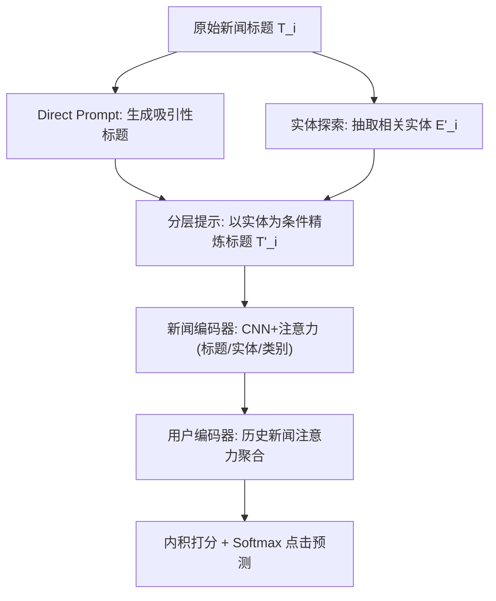
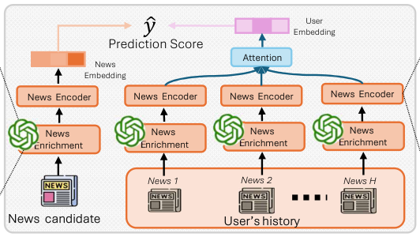

# Enhancing News Recommendation with Hierarchical LLM Prompting (基于分层 LLM 提示的新闻推荐增强)

- **会议/期刊**: WWW 2025
- **作者与机构**: Hai-Dang Kieu, Minh Duc Nguyen, Dung D. Le (VinUniversity); Delvin Ce Zhang (Penn State); Qiang Wu, Min Xu (UTS)
- **推荐链路定位**: 召回（新闻候选打分）
- **研究方向**: 大语言模型推荐 / 冷启动与长尾推荐
- **论文原文**: [https://arxiv.org/abs/2504.20452v1](https://arxiv.org/abs/2504.20452v1)
- **开源代码**: 暂未开源

## TL;DR (1分钟核心速览)

新闻标题与摘要文本稀疏、语义浅，导致用户偏好建模不准。本文提出 PNR-LLM，用**分层提示（Direct Prompt → 实体探索 → 分层精炼）**驱动 LLM 为每篇新闻生成更丰富的标题与相关实体，再经 CNN+注意力编码融合为统一新闻/用户向量。该模块**模型无关**，可即插即用。在 MIND-SMALL 上 AUC 达 68.88（较 GLoCIM 提升 0.67），MIND-LARGE 上位列第二；将增强标题注入 NRMS/NAML/LSTUR 均带来 1–2 个点提升。

## Background & Motivation (背景与核心矛盾)

- **主流范式**: 内容型方法（NAML/NRMS/LSTUR）用 CNN/GRU/自注意力编码标题与摘要；图方法（DKN/DIGAT/GLORY）引入外部知识图谱实体；近期 PLM/LLM 方法（UNBERT、Prompt4NR、ONCE）用预训练模型增强文本表征或做摘要。
- **前人局限**: (1) 新闻标题极短、信息稀疏甚至歧义，浅层文本编码难以刻画用户真实兴趣；(2) 图方法依赖外部知识图谱，但实体连接稀疏、图谱不完整，在冷门新闻上失效；(3) 已有 LLM 方法多聚焦"摘要压缩"，只是把原文变短，并未**外推**出标题之外的新信息。
- **核心洞察 (Key Insight)**: LLM 的生成能力可用于"补全"而非"压缩"——若某新闻曾出现在 LLM 训练语料中，LLM 能推断出其最相关的实体与更具吸引力的表述，从而把稀疏标题扩展为语义更密集的表示。
- **本文切入点**: 用**分层提示**分步生成"吸引性标题 + 相关实体"，再以实体为条件二次精炼标题，避免一次性生成导致语义漂移。

## Method (核心方法设计)

### 1. 整体框架 (Overall Architecture)

离线阶段，对每篇新闻 $d_i$执行三步分层提示，得到增强标题$T'_i$与增强实体序列$E'_i$；在线阶段，新闻编码器分别对增强标题（GloVe + CNN + 词级注意力）、实体（自注意力 + 注意力聚合）、类别做编码，再经一层融合注意力得到新闻向量；用户编码器对历史阅读序列做新闻级注意力聚合得到用户向量；最终以用户-候选新闻向量的内积经 softmax 输出点击概率，用交叉熵 + 负采样训练。

<figure class="paper-figure" markdown="span">
  <figcaption>图2：我们的PNR-LLM示意图。</figcaption>
</figure>

### 2. 关键设计拆解 (Key Designs)

1. **分层提示新闻增强 (Hierarchical Prompting)**：痛点是一次性让 LLM"改写标题"容易偏离原意或过度泛化。本文拆为三步：先 Direct Prompt 生成吸引性标题，再让 LLM 探索与该新闻相关的实体集合，最后把前两步输出拼接为条件，提示 LLM 生成"兼顾信息量与吸引力、且与原标题对齐"的最终标题。直觉是**实体作为锚点约束了生成空间**，使扩展内容既有新信息又不失真，从而缓解标题稀疏问题。

2. **多源注意力新闻编码器 (Enriched News Encoder)**：标题经 CNN 得上下文词表示 $\mathbf{X}_n$，词级注意力权重$\alpha^t_i = \mathrm{softmax}\big(\mathbf{q}_t^\top \tanh(\mathbf{W}_t \mathbf{x}^t_i + \mathbf{b}_t)\big)$，加权求和得标题向量；实体序列经自注意力后再用同构注意力聚合为实体向量；类别向量一并拼接，最后再经一层注意力融合三者得到新闻表示。这样实体提供的细粒度关联可在共享实体新闻间建立语义桥梁，弥补纯文本编码的不足。

3. **训练目标与推理开销**：采用 4 负采样 + 交叉熵损失 $\mathcal{L} = -\sum \log \frac{\exp(\hat{y}^+)}{\exp(\hat{y}^+) + \sum_{j=1}^{4}\exp(\hat{y}^-_j)}$，Adam 优化，学习率$1\times10^{-4}$，TransE 实体初始化。**关键工程点**：LLM 增强完全离线一次性完成，在线推理只走轻量 CNN/注意力网络，不引入额外延迟；增强实体经 Wikidata 校验去重（如 "U.S." 与 "United States" 归一）。

## Experimental Setup & Evaluation Protocol (实验设置与评估协议)

- **数据集与预处理**: 沿用 GLORY 的设置，使用 MIND 两个版本，用户均至少有 5 次点击记录。

| 数据集 | #Users | #Items(News) | #Interactions | 稀疏度/密度 | 特征/场景说明 |
| :--- | :---: | :---: | :---: | :---: | :--- |
| MIND-SMALL | 50,000 | 65,238 | 347,727 | 极稀疏 | 微软新闻日志，含标题/摘要/实体/类别 |
| MIND-LARGE | 1,000,000 | 161,013 | 24,155,470 | 极稀疏 | 同上，规模扩大 20 倍 |

- **数据划分与防穿越 (Splitting Strategy)**: 沿用 MIND 官方按时间戳的划分（训练/验证/测试按行为时间切分），测试集为各用户最后一次 impression 之后的日志，属**全局时间戳切分**，避免未来信息泄漏。
- **排名评测协议 (Ranking Protocol)**: 在**全部 impression 候选**上计算 AUC、MRR、nDCG@5、nDCG@10，即无偏 **Full-Ranking**（每个 impression 内对全部候选新闻排序），非采样排序。
- **对比基线与超参设置**: 基线含 NPA、NRMS、NAML、LSTUR、MINER、DKN、DIGAT、GERL、GLORY、GLoCIM；文本编码用 GloVe 初始化 + CNN，实体用 MIND 提供的 TransE；LLM 采用 Gemini 1.0 Pro（另对比 LLaMA 3、GPT-4o mini）；生成标题最优 token 长度经调参定为 40。

## Key Experimental Results (实验关键数据)

### 1. 主实验对比 (Main Results)

| Model | MIND-SMALL AUC | MRR | N@5 | N@10 | MIND-LARGE AUC | MRR | N@5 | N@10 |
| :--- | :---: | :---: | :---: | :---: | :---: | :---: | :---: | :---: |
| NPA | 64.65 | 30.01 | 33.14 | 39.47 | 65.92 | 32.07 | 34.72 | 40.37 |
| NRMS | 65.63 | 30.96 | 34.13 | 40.52 | 67.66 | 33.25 | 36.28 | 41.98 |
| NAML | 66.12 | 31.53 | 34.88 | 41.09 | 66.46 | 32.75 | 35.66 | 41.40 |
| LSTUR | 65.87 | 30.78 | 35.15 | 40.15 | 67.08 | 32.36 | 35.15 | 40.93 |
| DIGAT | 67.82 | 32.65 | 36.25 | 42.49 | N.A. | N.A. | N.A. | N.A. |
| GLORY | 67.68 | 32.45 | 35.78 | 42.10 | 69.04 | 33.83 | 37.53 | 43.69 |
| GLoCIM | 68.21 | 33.02 | 36.69 | 42.78 | **69.52** | **34.34** | **37.89** | **44.08** |
| **PNR-LLM (ours)** | **68.88** | **33.58** | **37.50** | **43.49** | 69.32 | 34.26 | 37.81 | 43.79 |
| **Improv.% (vs best)** | **+0.98%** | **+1.70%** | **+2.21%** | **+1.66%** | -0.29% | -0.23% | -0.21% | -0.66% |

### 2. 消融实验 (Ablation Study)

| 配置 | AUC | MRR | N@5 | N@10 | 说明 |
| :--- | :---: | :---: | :---: | :---: | :--- |
| PNR-LLM (CNN 编码) | 68.88 | 33.58 | 37.50 | 43.49 | 完整模型 |
| PNR-LLM w/ DistilBERT | **70.54** | **35.26** | **38.07** | **44.23** | 换 PLM 编码器，全面最优 |
| NRMS → NRMS++ | 65.63→67.86 | 30.96→32.61 | 34.13→36.02 | 40.52→42.26 | 仅替换增强标题 |
| NAML → NAML++ | 66.12→68.01 | 31.53→32.75 | 34.88→36.29 | 41.09→42.46 | 仅替换增强标题 |
| LSTUR → LSTUR++ | 65.87→66.98 | 30.78→32.16 | 35.15→35.82 | 40.15→41.41 | 仅替换增强标题 |
| 原始实体 vs 增强实体 | 较低 | — | — | — | 增强实体进一步提升 |
| 标题 token 长度 | 40 最优 | — | — | — | 过长/过短均下降 |

### 3. 关键实验发现 (Key Findings)

1. **增强标题是模型无关的通用增益**：把 PNR-LLM 生成的标题直接喂给 NRMS/NAML/LSTUR，AUC 分别提升 2.23/1.89/1.11 个点，证明收益来自数据增强本身而非特定编码器结构，这是本文最有说服力的证据。
2. **分层提示显著优于单步提示**：图 3(a) 显示分层提示 > 直接提示 > 实体提示 > 主题提示 > 原始摘要，说明"实体锚定 + 二次精炼"的结构化流程是性能关键，单纯用主题或摘要几乎无增益。
3. **PLM 编码器与增强数据互补**：换成 DistilBERT 后 AUC 升至 70.54，反超所有基线（含 CAUM 70.04、MINER 69.61），说明原始短标题对 PLM 而言信息不足，而增强标题恰好补足了 PLM 所需的上下文密度。

## Highlights & Limitations (亮点、对比与审稿批判)

- **与代表作对比 (vs. Prior Work)**: 相比 GLORY/DIGAT 依赖外部知识图谱实体（受图谱稀疏性制约），本文用 LLM 直接**外推**实体，覆盖更广；相比 ONCE 等 LLM 摘要方法，本文是"扩展"而非"压缩"，保留并新增信息；相比 Prompt4NR 把推荐改写成语言建模任务，本文把 LLM 定位为**离线数据增强器**，在线仍是轻量模型，工程代价低得多。
- **可迁移亮点**: (1) "实体探索 → 条件精炼"的两阶段提示模板可迁移到电商商品标题、短视频标题等短文本场景；(2) 把 LLM 增强产物作为即插即用模块注入现有基线做对照实验，是验证数据增强价值的标准范式。
- **审稿级局限批判**: (1) MIND-LARGE 上并未超越 GLoCIM（AUC 69.32 vs 69.52），作者未解释规模增大后增益衰减的原因，可能是大用户集下实体覆盖更全、增强边际收益递减；(2) 增强依赖 LLM 训练语料对新闻的覆盖，对**全新/冷门新闻**（未见于预训练语料）的实体外推可靠性存疑，且 Wikidata 校验只能去重不能保证相关性；(3) 离线增强需对 16 万篇新闻逐条调用 LLM，成本与可复现性（未开源、依赖 Gemini 闭源 API）是落地障碍。

## Rating (四维评分)

- **方法创新性 (Novelty)**: ⭐⭐⭐ （分层提示"扩展而非摘要"的思路有新意，但各组件（CNN+注意力、负采样）均为成熟范式，创新偏工程组合）
- **评估协议与实验扎实度 (Protocol & Experiments)**: ⭐⭐⭐⭐ （Full-Ranking 全 impression 评测规范，双规模数据集 + 模型无关性验证 + 多 LLM/多提示对比充分，但缺显著性检验）
- **写作与数学规范度 (Clarity & Rigor)**: ⭐⭐⭐ （框架图清晰，但公式较简略、符号复用多，实体编码细节描述偏少）
- **工业落地与复现价值 (Industrial & Practical Value)**: ⭐⭐⭐ （离线增强 + 在线轻量推理的架构务实，但未开源且依赖闭源 LLM，复现成本较高）

