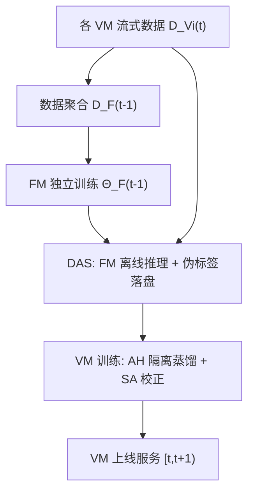

# External Large Foundation Model: How to Efficiently Serve Trillions of Parameters for Online Ads Recommendation (外部大基础模型：如何高效服务万亿参数在线广告推荐)

- **会议/期刊**: WWW 2025 (Industrial Track, Oral)
- **作者与机构**: Mingfu Liang, Xi Liu, Rong Jin 等 (Meta AI; UIUC)
- **推荐链路定位**: 精排 (CTR/CVR 预估)，跨召回/粗排/精排多阶段
- **研究方向**: 大语言模型推荐 (LLM4Rec) / 工业架构与去偏
- **论文原文**: [arXiv:2502.17494v7](https://arxiv.org/abs/2502.17494v7)
- **开源代码**: 暂未开源

## TL;DR (1分钟核心速览)

工业广告推荐面临两大被学术界忽视的硬约束：服务模型训练/推理预算受限（C1），以及流式数据分布持续漂移（C2）。本文提出 ExFM 框架：将万亿参数教师模型作为"基础模型 (FM)"独立训练，通过外部蒸馏与数据增强服务 (DAS) 离线落盘伪标签，一对多服务多个业务精排模型 (VM)，不增加任何线上推理延迟；并用辅助头 (AH) 与学生适配器 (SA) 分别缓解跨域偏置与新鲜度鸿沟。内部工业数据上 FM 带来 0.11%–0.25% NE 增益（NE 增益 0.02% 即显著），公开数据集 TaobaoAd 上 AUC 相对无蒸馏提升约 1.35%。

## Background & Motivation (背景与核心矛盾)

- **主流范式**: 借鉴 LLM 的 scaling law，推荐模型不断堆参数（DHEN、Wukong、Interformer 等），但学术界普遍忽略工业部署的预算与流式约束。
- **前人局限**: (1) 现有蒸馏多为**协同训练 (co-distillation)**，教师与学生联合训练，反而抬高服务模型的训练开销，且需为每个业务单独维护大教师，不可扩展；(2) 静态环境假设失效——广告系统中新用户/广告不断进出，模型必须递归更新，教师一旦陈旧（staleness）NE Loss 持续恶化（图 2）。
- **核心洞察 (Key Insight)**: 理想教师应满足两点——**外部蒸馏**（与学生的训练解耦）且 **1-to-N**（一个教师服务多业务，摊薄成本），即"推荐基础模型"；但聚合多业务数据会引入**跨域偏置**，教师相对学生的训练数据存在**新鲜度鸿沟**。
- **本文切入点**: 用 DAS 系统把教师推理离线化，用 AH 隔离偏置传播、用 SA 在线校正漂移，从系统与算法两侧同时破局。

## Method (核心方法设计)

### 1. 整体框架 (Overall Architecture)

FM 与各 VM 在流式数据上递归训练：时刻 $t$，FM 先在聚合数据$D_F(t-1)=\bigcup_i D_{V_i}(t-1)$上训练得$\Theta_F(t-1)$；随后 FM 对第$t$天各 VM 的训练样本离线推理，伪标签经 DAS 落盘并与真实标签拼接；VM 用该外部监督训练得$\Theta_{V_i}(t)$并上线服务$[t,t+1)$。关键在于 FM 的推理发生在标签回传的等待窗口内（CTR 5–90 分钟、CVR 1 天），秒级预算足以评估万亿模型，且只需覆盖训练样本中极小比例的曝光，重叠流量业务进一步摊薄成本。

### 2. 关键设计拆解 (Key Designs)

1. **辅助头 AH（隔离跨域偏置）**：常规蒸馏把真标签与伪标签塞进同一 serving head，梯度纠缠使教师偏置直接污染主干。AH 在主干 $x$上另建蒸馏头$\hat{y}_D=\psi(x)$，serving head 仅受真标签监督$\mathcal{L}_s=h(\hat{y}_S,y)$，蒸馏头仅受伪标签监督$\mathcal{L}_d=h(\hat{y}_D,\alpha\cdot\hat{y}_F)$。作者用两层线性模型构造证明：单头蒸馏的解会偏离真值$Z^\top u_1$，而分离头可保证收敛到最优解，从而保住广告最关键的**校准性**。由于点击极度稀疏、$\hat{y}_F$大量趋零，进一步引入梯度缩放$\beta$、标签缩放$\alpha$与损失权重$w$：
$$\mathcal{L}_{ah}=\mathcal{L}_s(\hat{y}_S,y)+w\cdot\mathcal{L}_d(\hat{y}_D,\alpha\cdot\hat{y}_F)$$
2. **学生适配器 SA（弥合新鲜度鸿沟）**：FM 伪标签相对 VM 训练数据存在时间滞后。SA 是一个以 $\hat{y}_F$为输入、以真标签$y$为监督的小 MLP，先优化$\mathcal{L}_{sta}=h(\hat{y}_{SA},y)$，再**停梯度**$\mathrm{SG}(\hat{y}_{SA})$作为第二个蒸馏目标$\mathcal{L}_{sa}=h(\hat{y}_D,\mathrm{SG}(\hat{y}_{SA}))$。定理 3.2 给出回归误差界$|w_V-w|_2\le O\!\left(\gamma\sqrt{(ds)^{1/2}/N\log\tfrac{1}{\delta}}\right)$，比标准蒸馏界收紧$(d/s)^{1/4}$倍，意味着当分布漂移时间尺度介于$d$与$\sqrt{ds}$ 之间时 SA 能快速追上。
3. **训练目标、负采样与推理效率**：VM 总损失为 $\mathcal{L}_{ah}+\mathcal{L}_{sa}$，均为二元交叉熵，无额外负采样设计（CTR 全曝光样本）。FM 推理完全离线、不进入线上链路，服务延迟零增量；DAS 用 SPD + Zeus（基于 Zookeeper 的强一致元数据存储）实现快照发布/加载解耦与租约式垃圾回收，避免切换期资源浪费。

## Experimental Setup & Evaluation Protocol (实验设置与评估协议)

- **数据集与预处理**: 内部工业数据为十亿级 CTR/CVR 样本，每样本约 1k 特征，日增十亿级；公开数据统计如下：

| 数据集 | #Samples | #Features | 场景说明 |
| :--- | :---: | :---: | :--- |
| Amazon Electronics | 3.0M | 6 | 电商 CTR |
| TaobaoAd | 25.0M | 22 | 按 new_user_class_level 切 3 个域 |
| KuaiVideo | 13.7M | 9 | Click/Follow/Like 三任务 |

- **数据划分与防穿越 (Splitting Strategy)**: 公开数据按 UNIX 时间戳切 8 天：前 4 天训 FM，第 5 天 FM 推理生成监督、VM 训练，第 6 天测试，滚动重复 3 次；内部数据全部 **one-pass 流式训练**，batch 按到达时间排序，杜绝多轮穿越。
- **排名评测协议 (Ranking Protocol)**: 内部用 **NE (Normalized Entropy)**，NE 增益 0.02% 即视为显著；公开数据用 **AUC / LogLoss**，均为全样本评估，非采样排序。
- **对比基线与超参设置**: FM 取 DMIN / DCN / DCNv2（BARS 基准 SOTA），VM 取 FaM / FmFaM / DeepFaM（低延迟轻量模型，参数量约少 30%）；内部 FM 规模为 VM 的 15–600 倍（0.8T–3.2T 参数，$1X=60$M FLOPs）。对比组为 `w/o distill`、`distill w/ L_kd`、`w/ L_ah`、`w/ L_ah+L_sa`。

## Key Experimental Results (实验关键数据)

### 1. 主实验对比 (Main Results)

TaobaoAd 上以 DMIN 为 FM、DeepFaM 为 VM 的代表性结果（完整 3×3 组合见原文表 2/3）：

| 方法 | AUC | LogLoss | AUC 相对提升 |
| :--- | :---: | :---: | :---: |
| w/o distill (VM alone) | 0.5488 | 0.5713 | — |
| distill w/ $\mathcal{L}_{kd}$ | 0.5576 | 0.2943 | +1.60% |
| distill w/ $\mathcal{L}_{ah}$ | 0.5630 | 0.2885 | +2.59% |
| **distill w/ $\mathcal{L}_{ah}+\mathcal{L}_{sa}$** | **0.5648** | **0.2871** | **+2.92%** |

Amazon Electronics（DMIN→DeepFaM）：0.8502 → **0.8573** AUC，LogLoss 0.5303 → **0.5119**。内部工业数据：1000X/3.2T FM 对召回/粗排/精排三阶段 VM 分别带来 **0.25% / 0.19% / 0.11%** NE 增益，阶段越靠前收益越大。

### 2. 消融实验 (Ablation Study)

| 配置 | TaobaoAd AUC (FaM) | Amazon AUC (FaM) | 说明 |
| :--- | :---: | :---: | :--- |
| w/o distill | 0.5389 | 0.8331 | 无 FM |
| + $\mathcal{L}_{kd}$ | 0.5408 | 0.8349 | 单头蒸馏，增益微弱 |
| + AH | 0.5449 | 0.8399 | 主要跃升来源 |
| + AH + SA | **0.5462** | **0.8418** | 进一步稳定增益 |
| AH 去掉 GS/LS/LW | 内部 NE 回退约 4% | — | 三项缩放缺一不可 |

### 3. 关键实验发现 (Key Findings)

1. **AH 是收益主引擎，SA 是稳定器**：TaobaoAd 上单头蒸馏仅 +0.35% AUC，AH 将其拉到 +1.11%，SA 再推到 +1.35%；内部流式曲线上 AH 带来约 -4% 的 NE 变化（越低越好）且长期稳定。
2. **FM 能"掰弯"增长曲线**：内部数据上带 FM 的迭代趋势线斜率显著陡于无 FM 基线，且 0.8T→3.2T 规模扩张持续带来正增益，验证了推荐领域的 scaling 有效性。
3. **SA 无法替代 FM 更新**：图 9 显示 FM 停止训练越久收益越衰减，SA 在任何陈旧度下都能加增益，但无法逆转衰减趋势——说明外部蒸馏必须配合教师的持续刷新，SA 只是缓冲而非解药。

## Highlights & Limitations (亮点、对比与审稿批判)

- **与代表作对比 (vs. Prior Work)**: 相比 Lee et al. (2024) 的持续学习框架，ExFM 的教师更新**不依赖学生回放**，避免耦合带来的陈旧与开销；相比 Khani et al. (2024) 的辅助蒸馏，本文 AH 是**完全隔离的任务头**（不同时消费真标签），且首次为 SA 提供 $(d/s)^{1/4}$ 的收敛界证明，并补齐了公开基准实验。
- **可迁移亮点**: (1) "离线落盘伪标签 + 标签回传等待窗口内推理"这一 DAS 思路可迁移到任何有延迟反馈的推荐场景（CVR、停留时长）；(2) AH 的隔离头 + 梯度/标签缩放组合是低成本提升蒸馏校准性的通用技巧。
- **审稿级局限批判**: (1) 万亿参数 FM 的离线推理与快照维护成本未量化，1-to-N 摊薄效果依赖业务流量重叠度，冷启动业务可能不划算；(2) 公开实验的 VM 刻意选用弱模型（FaM 系列），与 SOTA 精排模型的蒸馏收益是否同样显著缺乏验证，且未报告方差/显著性检验。

## Rating (四维评分)

- **方法创新性 (Novelty)**: ⭐⭐⭐⭐ （外部蒸馏 + 1-to-N 基础模型的系统级重构新颖，AH/SA 均有理论支撑，但单点算法创新偏工程化）
- **评估协议与实验扎实度 (Protocol & Experiments)**: ⭐⭐⭐⭐ （内部万亿级 + 三个公开数据集、跨域/跨任务/跨阶段全覆盖，流式切分严谨；扣分在缺显著性检验与强 VM 基线）
- **写作与数学规范度 (Clarity & Rigor)**: ⭐⭐⭐⭐ （定理陈述与附录构造性证明完整，符号清晰；正文公式与系统描述略混杂，部分细节下放附录）
- **工业落地与复现价值 (Industrial & Practical Value)**: ⭐⭐⭐⭐⭐ （已在 Meta 广告系统服务万亿参数模型且零线上延迟增量，DAS 架构可直接借鉴；可惜未开源）

