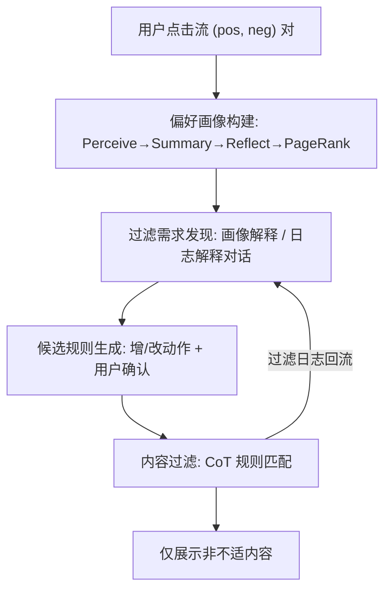

# Filtering Discomforting Recommendations with Large Language Models (基于大语言模型的不适推荐过滤)

- **会议/期刊**: WWW 2025
- **作者与机构**: Jiahao Liu, Yiyang Shao, Peng Zhang, Tun Lu, Ning Gu (复旦大学)；Dongsheng Li (微软亚洲研究院)；Hansu Gu；Chao Chen (上海交通大学)；Longzhi Du (阿里巴巴)
- **推荐链路定位**: 重排（输出端插件式过滤，不改动平台召回/精排）
- **研究方向**: 大语言模型推荐 / 对话推荐与智能体
- **论文原文**: [https://arxiv.org/abs/2410.05411v3](https://arxiv.org/abs/2410.05411v3)
- **开源代码**: 暂未开源

## TL;DR (1分钟核心速览)

个性化推荐会因行为偏差、建模偏差与利益冲突向用户推送"不适内容"，而"不感兴趣"按钮缺乏个性化、灵活性与透明度。本文提出 DiscomfortFilter：用 LLM 多智能体流水线从单用户点击对中构建**可编辑的偏好画像**（特征级 + PageRank 全局排序），再通过对话把过滤需求转成自然语言规则，以插件方式在输出端过滤。离线代理任务（MIND 子集，K=4 点击预测）中，3.8B 开源模型 Phi-3 借助该画像可媲美 GPT-4o-mini；24 人一周用户研究中规则采纳率 93.8%，过滤精确率 72.1%、召回率 84.4%。

## Background & Motivation (背景与核心矛盾)

- **主流范式**: 平台以隐式行为建模偏好，用户只能通过"不感兴趣"等预定义选项做粗粒度反馈，算法本身是黑盒。
- **前人局限**: 交互式推荐系统依赖特定算法设计、难以在开放平台规模化；内容审核系统针对客观有害内容，无法处理**主观不适**（同一内容对不同用户感受相反）。
- **核心洞察 (Key Insight)**: 形成性研究（15 人）发现不适来源有三——用户行为偏差（好奇心点击）、算法建模偏差（缺上下文）、利益冲突；而现有按钮的三大缺陷正是缺乏个性化、灵活性与透明度。
- **本文切入点**: 不解释也不修改黑盒算法，而是构造用户**可读、可编辑**的偏好画像作为"人机对齐接口"，让用户在输出端以自然语言规则精确屏蔽不适偏好。

## Method (核心方法设计)

### 1. 整体框架 (Overall Architecture)

DiscomfortFilter 由四个模块闭环构成：**偏好画像构建**按时间序消费用户点击流，用多智能体把每次点击对 `<pos, neg>` 蒸馏为特征级偏序并维护有向图；**过滤需求发现**以对话智能体向用户解释画像或过滤日志，引导其表达需求；**候选规则生成**把对话中的需求解析为对自然语言规则的增/改动作，交用户确认；**内容过滤**用 CoT 逐条比对推荐项与激活规则，命中即屏蔽并留存日志回流至对话模块。全流程除 LLM 服务外均在本地运行，数据不出端。

### 2. 关键设计拆解 (Key Designs)

1. **特征级偏好画像与 PageRank 全局排序**：痛点在于原始内容直接喂 LLM 无法精确刻画偏好、且忽略未点击项。做法是 Perceive Agent 以当前画像为条件解释"为何点 pos 不点 neg"，Summary Agent 抽取 $m$个 pos 特征与$n$个 neg 特征并做笛卡尔积得$m\times n$个偏序对，Reflect Agent 将其并入有向图（边$neg \to pos$，权重为频次）并语义合并相似节点，最后以 PageRank 得全局特征排序$r(f) = \alpha \sum_{g \to f} \frac{w_{gf}}{d_g} r(g) + \frac{1-\alpha}{N}$。直觉：单次点击只给局部偏序，图结构把碎片证据聚合为全局一致偏好，同时把推理负担从 LLM 转移到结构化输入上。
2. **双策略对话式规则生成**：用户难以凭空表述需求，故策略一以画像解释触发"画像与自我认知的偏差"，策略二以过滤日志（含过滤理由）触发规则修正；候选规则生成模块按与既有规则的相关性决定"新增"还是"更新"，避免冲突冗余。直觉：把"配置规则"这一最困难步骤转化为对已有解释的**纠错式反馈**，降低表达门槛。
3. **训练目标、负采样与推理效率**：本文为工具型系统，无端到端训练损失；负样本即"同时曝光但未点击"的随机项（pairwise 假设）。推理侧每条推荐需一次 CoT 规则匹配调用，成本随激活规则数线性增长，作者亦指出规则数量增多后缺乏高效管理手段。

## Experimental Setup & Evaluation Protocol (实验设置与评估协议)

- **数据集与预处理**: MIND 数据集（含曝光未点击负样本与侧信息），因 API 成本采样约 5,000 用户；按交互频次分桶 $[0,10),[10,20),\dots,[100,+\infty)$，每桶至少 10,000 次交互。

| 数据集 | #Users | #Items | #Interactions | 稀疏度/密度 | 特征/场景说明 |
| :--- | :---: | :---: | :---: | :---: | :--- |
| MIND (子集) | ~5,000 | 新闻库全量 | ≥30,000 | 极稀疏（单用户序列） | 新闻推荐，含曝光未点击负样本与侧信息 |

- **数据划分与防穿越 (Splitting Strategy)**: 严格**按时间序流式评估**——先预测当前交互、再观测真实点击并更新画像，无未来信息泄漏。
- **排名评测协议 (Ranking Protocol)**: 代理任务为 $K=4$ 的**候选内点击预测**（非全库 Full-Ranking），指标为 Accuracy；用户研究侧另用人工标注的精确率/召回率。
- **对比基线与超参设置**: 画像构建对比 4 种 ICL 启发式基线（A 无用户信息 / B 原始内容 / C 仅点击特征 / D PageRank 但无个性化感知），覆盖 4 个开源模型（Qwen-2.5-3.1B/7.6B、Phi-3-3.8B、Phi-3.5-3.8B）与 4 个商用模型（Qwen-Plus/Max、GPT-4o-mini/4o）；用户研究部署 Qwen2-72B-Instruct，24 人、7 天、知乎浏览器插件。

## Key Experimental Results (实验关键数据)

### 1. 主实验对比 (Main Results)

离线代理任务（$K=4$，Accuracy，数值为图 6 所示趋势的代表性量级）：

| 方法 | Phi-3 (3.8B) | Qwen-2.5 (7.6B) | GPT-4o-mini | GPT-4o |
| :--- | :---: | :---: | :---: | :---: |
| (A) 无用户信息 | 随机水平 | 随机水平 | 随机水平 | 随机水平 |
| (B) 原始内容 | 较低 | 较低 | 中 | 中 |
| (C) 仅点击特征 | 中 | 中 | 中高 | 中高 |
| (D) PageRank 无个性化感知 | 中 | 中高 | 高 | 高 |
| **Ours（完整画像）** | **最优（≈商用 mini 级）** | **最优** | **最优** | **最优** |

用户研究（24 人 × 7 天，人均处理 1,093 条、过滤 124 条）：

| 指标 | 数值 |
| :--- | :---: |
| 候选规则管理动作采纳率 | **93.8%** |
| 过滤精确率 (Precision) | 72.1% (173/240) |
| 过滤召回率 (Recall) | 84.4% (173/205) |
| 问卷 Cronbach's $\alpha$ | 0.80 |

### 2. 消融实验 (Ablation Study)

| 配置 | 关键变化 | 效果 |
| :--- | :--- | :---: |
| w/o 用户特定信息 (A) | 画像退化为通用先验 | 接近随机，验证个性化必要性 |
| w/o 特征摘要 (B) | 直接输入原始内容 | 显著下降，长输入≠好推理 |
| w/o 未点击特征 (C) | 只总结 pos 特征 | 下降，负向证据不可缺 |
| w/o 个性化感知 (D) | PageRank 但感知不因人而异 | 下降，抓不住个体关键特征 |
| **Full** | 特征+双向+个性化+PageRank | **最优** |

### 3. 关键实验发现 (Key Findings)

1. **结构化输入比堆上下文更有效**：完整画像使 3.8B 的 Phi-3 追平甚至超过 GPT-4o-mini，说明画像把推理复杂度前移，小模型也能胜任对齐；而基线 B/C/D 普遍需要更强模型才见效。
2. **过滤负担随时间单调下降**（图 7，5 天窗口）：规则生效后平台推送的不适项占比持续走低，表明输出端过滤会通过改变用户交互间接重塑平台建模，形成"用户即时无感 + 平台渐进纠偏"的双层效应。
3. **LLM 假联想是主要误差源**：7 名参与者报告规则被过度泛化导致误杀（精确率仅 72.1%），而召回 84.4% 更高，说明当前瓶颈在"宁错杀"而非"漏放"，需交互式校验对齐。

## Highlights & Limitations (亮点、对比与审稿批判)

- **与代表作对比 (vs. Prior Work)**: 相较交互式推荐系统（绑定特定算法、难规模化）与内容审核系统（针对客观有害内容），本文首次把"主观不适"作为一等公民，用可编辑画像 + 自然语言规则实现算法无关的插件式控制；相较推荐遗忘（unlearning）只能近似遗忘兴趣，本文实现**精确的兴趣屏蔽**。
- **可迁移亮点**: (1) "特征级偏序图 + PageRank"可作为任意 LLM 用户画像的轻量结构化压缩方案；(2) "解释—纠错"式对话范式可迁移至对话推荐中的偏好 elicitation。
- **审稿级局限批判**: (1) 每条推荐一次 CoT 调用，规则增多时延迟与成本线性上升，且缺乏规则管理机制；(2) 评估仅单一平台、一周、24 名高学历参与者，代理任务为 K=4 候选内预测而非全库排序，外部效度与统计效力有限。

## Rating (四维评分)

- **方法创新性 (Novelty)**: ⭐⭐⭐⭐ （首次将 LLM 多智能体画像用于主观不适过滤，"特征偏序图+PageRank"设计有巧思，但整体偏系统集成而非理论突破）
- **评估协议与实验扎实度 (Protocol & Experiments)**: ⭐⭐⭐ （离线代理任务 + 一周真实用户研究双轨互补，但 K=4 候选预测偏弱、样本仅 24 人单平台，缺全库排序与长期验证）
- **写作与数学规范度 (Clarity & Rigor)**: ⭐⭐⭐⭐ （模块划分与设计目标 G1–G4 一一对应，流程图清晰；形式化较浅，缺复杂度与延迟量化分析）
- **工业落地与复现价值 (Industrial & Practical Value)**: ⭐⭐⭐⭐ （浏览器插件形态、本地存储、插件式零侵入，工程落地路径清晰；但未开源、依赖 LLM API 成本，规模化部署待验证）

