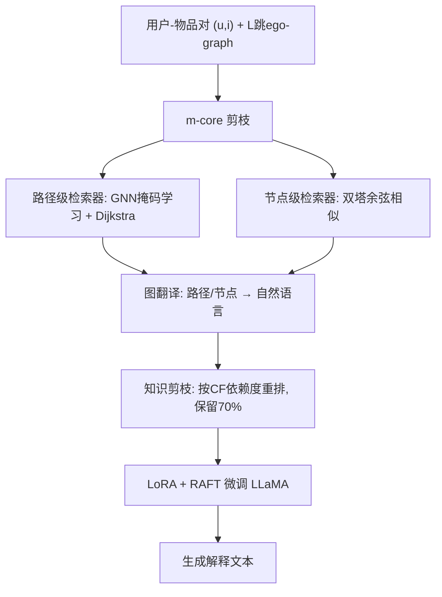
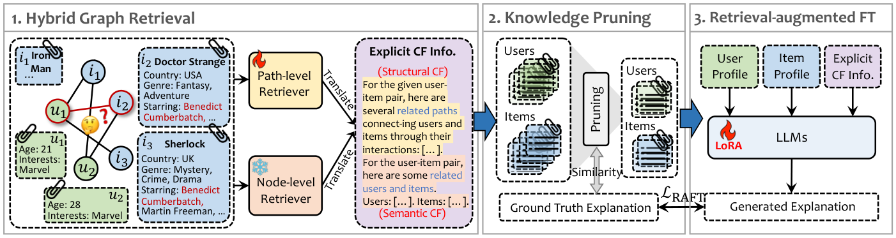

# G-Refer: Graph Retrieval-Augmented Large Language Model for Explainable Recommendation (图检索增强大语言模型的可解释推荐)

- **会议/期刊**: WWW 2025 (Research Track)
- **作者与机构**: Yuhan Li, Xinni Zhang, Linhao Luo, Heng Chang, Yuxiang Ren, Irwin King, Jia Li（HKUST-GZ / CUHK / Monash / 华为）
- **推荐链路定位**: 端到端生成式（解释生成侧）
- **研究方向**: 大语言模型推荐 / 图神经网络与知识图谱推荐
- **论文原文**: [https://arxiv.org/abs/2502.12586v1](https://arxiv.org/abs/2502.12586v1)
- **开源代码**: [https://github.com/Yuhan1i/G-Refer](https://github.com/Yuhan1i/G-Refer)

## TL;DR (1分钟核心速览)

现有 LLM 可解释推荐（如 XRec）把 GNN 学到的用户/物品隐向量直接喂给 LLM，协同过滤信号既不可解释、又与自然语言存在模态鸿沟。G-Refer 提出混合图检索：路径级检索器借 GNN 掩码学习 + Dijkstra 抽取 $k$ 条解释路径（结构 CF），节点级检索器用双塔稠密检索取语义近邻（语义 CF），再经图翻译转为文本、知识剪枝过滤"自解释"样本、LoRA 做检索增强微调。在 Amazon-books/Yelp/Google-reviews 三数据集上，BERT-R 分别提升 4.56%/8.67%/7.48%，BERT-F1 提升 1.67%/2.73%/2.81%，且解释稳定性（标准差）全面下降。

## Background & Motivation (背景与核心矛盾)

- **主流范式**: 以 XRec 为代表，用 GNN 编码用户-物品二部图得到隐向量，作为软提示注入 LLM 生成解释；早期工作则依赖模板或 GRU/LSTM 序列生成。
- **前人局限**: (C1) **隐式 CF 信号**——GNN 嵌入本身缺乏可解释性，无法核验 LLM 究竟用了哪条协同证据，加剧幻觉；(C2) **模态鸿沟**——GNN 只建模结构、丢弃节点文本语义，且结构化嵌入对 LLM 天然不友好。
- **核心洞察 (Key Insight)**: 图上的"路径"与"语义近邻节点"是天然可读的协同证据载体，其候选空间远小于子图（期望数量增长严格更慢），既避免子图难以文本化的困境，又能显式对齐自然语言。
- **本文切入点**: 把 CF 信息从"隐向量注入"改为"显式检索 + 文本翻译 + 检索增强微调"的 GraphRAG 范式。

## Method (核心方法设计)

### 1. 整体框架 (Overall Architecture)

给定待解释的 $(u,i)$对，先抽取$L$跳 ego-graph 并做$m$-core 剪枝；路径级检索器在训练好的 R-GCN 上学习边掩码，用 Dijkstra 取$k$条解释路径（结构 CF）；节点级检索器用 SentenceBERT 双塔在邻居集合内按余弦相似度取$k$个用户与$k$个物品（语义 CF）。两路证据经图翻译展平为自然语言提示，与用户/物品画像拼接；训练前用知识剪枝按"画像-解释语义相似度"重排并保留前$(1-t)$ 比例样本；最后以 LoRA + RAFT 损失微调 LLaMA，推理时温度 0、最多 256 token。

<figure class="paper-figure" markdown="span">
  <figcaption>图 1：我们提出的流水线 G-Refer 通过三个关键组件促进可解释推荐：(1) 混合图检索采用多粒度检索器检索显式 CF 信号，并由图翻译将其表述为人类可读文本；(2) 知识剪枝消除噪声并提高训练效率；(3) 检索增强微调指导 LLM 在生成信息丰富的解释时利用检索到的 CF 信息。</figcaption>
</figure>

### 2. 关键设计拆解 (Key Designs)

1. **路径级检索器（结构 CF 显式化）**：GNN 预测不可解释 $\to$在 R-GCN 上学边类型掩码$\mathbf{M}$，联合优化预测损失与路径损失$\mathcal{L}(\mathbf{M})=\mathcal{L}_{pred}(\mathbf{M})+\mathcal{L}_{path}(\mathbf{M})$，其中路径打分偏好短路径与低度节点：
$$Score(p)=\prod_{e\in p}\log\sigma(\mathbf{M}_{\tau(e)})-\log(\deg(e))$$
再以该打分重定义边权跑 Dijkstra 取 top-$k$ 路径。直觉：掩码把"哪些边真正支撑了这次推荐"外化为可读路径，度数惩罚抑制枢纽节点带来的伪解释。

2. **节点级检索器 + 图翻译（语义 CF 与模态对齐）**：结构信号稀疏且有噪 $\to$在$i$的邻居用户集$\mathcal{N}_i$内做双塔稠密检索，$sim(u,u')=\frac{f(b_u)\cdot f(b_{u'})}{\|f(b_u)\|\|f(b_{u'})\|}$，物品同理；检索器免训练。随后把路径与节点展平为 `"<User profile> -> buys -> <Item profile> -> bought by -> ..."` 的指令文本，使 LLM 与人同时可读，绕开 adapter 层。

3. **知识剪枝与 RAFT 训练**：部分样本仅凭画像即可解释，强行注入 CF 反成噪声 $\to$用$sim((u,i),Explain(u,i))$衡量对 CF 的依赖度并重排，按剪枝率$t=70\%$ 保留高依赖样本；损失为
$$\mathcal{L}_{RAFT}=-\sum_{(u,i)\in\mathcal{D}_{prune}}\log P(Explain(u,i)\mid b_u,c_i,\mathcal{K}(u,i),Q;\theta)$$
LoRA rank=8、lr=2e-5、2 epoch。训练中故意保留可能不准确的检索结果，使模型学会忽略误导性证据、回退内部知识，从而抑制幻觉。

## Experimental Setup & Evaluation Protocol (实验设置与评估协议)

- **数据集与预处理**: Amazon-books、Yelp、Google-reviews 三个公开数据集，均含用户/物品文本画像；Amazon-books 测试集平均节点度仅 2.76，属稀疏场景。

| 数据集 | 场景说明 | 关键统计/稀疏性 |
| :--- | :--- | :---: |
| Amazon-books | 图书评论，含书籍属性文本 | 测试集平均度 2.76（最稀疏） |
| Yelp | 本地生活评论 | 交互较密，语义信息丰富 |
| Google-reviews | 多品类点评 | 结构信息对解释贡献更大 |

- **数据划分与防穿越 (Splitting Strategy)**: 沿用 XRec 的划分与测试集构造（用户-物品对级解释生成任务），未额外引入时间戳切分。
- **排名评测协议 (Ranking Protocol)**: 本文任务为**解释文本生成**而非排序，故不涉及 Full-Ranking / Sampled Ranking；评测采用 GPTScore、BERT-P/R/F1、BARTScore、BLEURT、USR 六类语义指标，并报告各指标标准差作为**稳定性**度量（越低越稳）。
- **对比基线与超参设置**: 基线 NRT、Att2Seq、PETER、PEPLER、XRec；主模型 LLaMA 2-7B（与 XRec 对齐）与 LLaMA 3-8B；路径长 $\le 5$、$m=2$、$k=2$、剪枝率$t=70\%$、嵌入维 128、8×A100 训练。

## Key Experimental Results (实验关键数据)

### 1. 主实验对比 (Main Results)

| 模型 | Amazon BERT-F1↑ | Amazon BERT-R↑ | Yelp BERT-F1↑ | Yelp BERT-R↑ | Google BERT-F1↑ | Google BERT-R↑ | BERT-F1 std↓(Yelp) |
| :--- | :---: | :---: | :---: | :---: | :---: | :---: | :---: |
| NRT | 0.3443 | 0.3440 | 0.1495 | 0.2225 | 0.3496 | 0.3495 | 0.1581 |
| Att2Seq | 0.3687 | 0.3624 | 0.2379 | 0.2658 | 0.3636 | 0.3653 | 0.1147 |
| PETER | 0.4043 | 0.3799 | 0.2513 | 0.2983 | 0.3881 | 0.3905 | 0.2230 |
| PEPLER | 0.3543 | 0.3569 | 0.3052 | 0.3183 | 0.3546 | 0.3711 | 0.1050 |
| XRec | 0.4122 | 0.4038 | 0.3730 | 0.3506 | 0.4311 | 0.4069 | 0.0852 |
| G-Refer (7B) | 0.4282 | 0.4476 | 0.3922 | 0.4264 | 0.4566 | 0.4873 | 0.0862 |
| **G-Refer (8B)** | **0.4289** | **0.4494** | **0.4003** | **0.4373** | **0.4592** | **0.4935** | **0.0885** |
| Improv.% (vs XRec) | +1.67% | +4.56% | +2.73% | +8.67% | +2.81% | +7.48% | — |

人工评测（每数据集 20 对、5 位资深研究者单选）：G-Refer 在 Amazon/Yelp/Google 上被偏好比例达 69%/82%/86%，XRec 仅 31%/18%/14%。

### 2. 消融实验 (Ablation Study)

| 变体 | Yelp BERT-F1↑ | Yelp std↓ | Google BERT-F1↑ | Google std↓ |
| :--- | :---: | :---: | :---: | :---: |
| w/o path-level | 0.3927 | 0.0868 | 0.4560 | 0.0924 |
| w/o node-level | 0.3966 | 0.0894 | 0.4544 | 0.0922 |
| w/o GraphRAG | 0.3880 | 0.0896 | 0.4468 | 0.0940 |
| w/ LightGCN 替代 R-GCN | 0.3941 | 0.0870 | 0.4589 | 0.0922 |
| w/ Qwen-0.5B | 0.3201 | 0.6530 | 0.4129 | 0.2171 |
| w/ Qwen-3B | 0.3994 | 0.0861 | 0.4602 | 0.0903 |
| w/o pruning（全量训练） | 0.4002 | 0.0892 | 0.4605 | 0.0909 |
| **G-Refer (R-GCN, 8B)** | **0.4003** | **0.0885** | **0.4592** | **0.0916** |

### 3. 关键实验发现 (Key Findings)

1. **召回增益远大于精度代价**：G-Refer 的 BERT-R 提升 4.56%–8.67%，而 BERT-P 略降，说明检索证据显著补全了解释所需的关键信息（用户主题、交互历史），少量噪声换来的完整性对用户理解更划算；Amazon 增益最小（+1.67% F1）正因其测试集平均度仅 2.76，图上可检索的 CF 证据本身稀缺。
2. **两路检索互补且数据依赖**：去掉任一路径均掉点（Yelp 去 path 掉至 0.3927、去 node 掉至 0.3966），Yelp 更依赖语义节点、Google 更依赖结构路径；完全去掉 GraphRAG 降幅最大（Yelp 0.3880），证明显式检索优于纯画像生成。
3. **剪枝与检索规模存在最优区间**：全量训练（w/o pruning）在 Yelp 上 F1 反降至 0.4002 且训练成本数倍，验证"自解释样本"是噪声源；$k$从 1 增至 5 时精度在$k=2$达峰后回落，而召回对$k$ 不敏感，说明少量高质证据已足够。此外 Qwen-3B 经 RAFT 后已逼近 7B（0.3994 vs 0.3991），小模型 + 检索微调可替代大模型堆叠。

## Highlights & Limitations (亮点、对比与审稿批判)

- **与代表作对比 (vs. Prior Work)**: 相较 XRec 的"GNN 隐向量软提示"，G-Refer 把 CF 证据外化为可核验的路径与节点文本，且免去 adapter 层；相较 PGPR 的强化学习单路径搜索，本文多粒度混合检索同时覆盖结构与语义；相较 GraphLLM 的图 adapter 方案，本文以自然语言翻译彻底规避模态鸿沟。
- **可迁移亮点**: (1) "掩码学习 + Dijkstra 取解释路径"可作为任意 GNN 推荐器的即插即用解释模块（LightGCN 替换实验已验证）；(2) 按"画像-标签语义相似度"重排剪枝训练样本，可迁移到任何 RAG 微调场景以去除冗余检索上下文。
- **审稿级局限批判**: (1) 评测完全依赖 GPTScore/BERTScore 等语义相似度指标与 20 样本的小规模人工评测，缺乏对解释**事实正确性**（是否真的引用了检索路径）的细粒度校验；(2) 路径检索需先训练 GNN 并做掩码学习，叠加双塔检索与 LLM 微调，离线管线较重，论文仅报告单卡 batch=1 的训练时间曲线，未给出线上端到端延迟。

## Rating (四维评分)

- **方法创新性 (Novelty)**: ⭐⭐⭐⭐ （将 GraphRAG 的"路径+节点"双粒度显式检索引入可解释推荐，思路清晰但各组件多为已有技术的组合创新）
- **评估协议与实验扎实度 (Protocol & Experiments)**: ⭐⭐⭐⭐ （三数据集 + 六类语义指标 + 稳定性标准差 + 消融/超参/效率分析齐全，但缺事实性校验与大规模人工评测）
- **写作与数学规范度 (Clarity & Rigor)**: ⭐⭐⭐⭐ （挑战 C1/C2 与模块一一对应，公式简洁；检索粒度讨论有理论依据，但部分符号如 $\mathcal{L}_{path}$ 的推导细节略简）
- **工业落地与复现价值 (Industrial & Practical Value)**: ⭐⭐⭐⭐ （代码开源、LoRA 微调成本可控、剪枝提速明显；但多阶段离线管线与 GNN 预训练增加工程复杂度）

