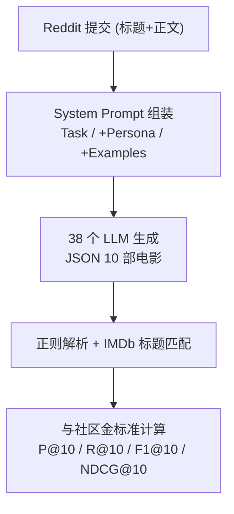
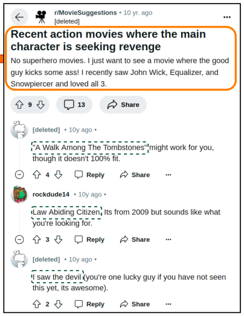

# Large Language Models as Narrative-Driven Recommenders (大语言模型作为叙事驱动推荐器)

- **会议/期刊**: WWW 2025 (Under Review, arXiv 2024-10)
- **作者与机构**: Lukas Eberhard, Thorsten Ruprechter, Denis Helic (Graz University of Technology)
- **推荐链路定位**: 端到端生成式（LLM 直接生成推荐列表）
- **研究方向**: 大语言模型推荐 (LLM4Rec) / 对话推荐
- **论文原文**: [https://arxiv.org/abs/2410.13604v1](https://arxiv.org/abs/2410.13604v1)
- **开源代码**: 暂未开源（论文声明数据与代码在 OSF 公开，但未检测到 GitHub 仓库）

## TL;DR (1分钟核心速览)

针对"叙事驱动推荐"（用户以自由文本描述需求，如"想看像《禁闭岛》那样的烧脑惊悚片"）这一传统推荐系统难以处理的场景，本文系统评测了 38 个开源/闭源 LLM（从 0.5B 到 405B）在 Reddit r/MovieSuggestions 众包标注数据集上的表现，对比零样本、身份（Persona）、少样本三种提示策略。在 F1@10/Precision@10/Recall@10/NDCG@10 全库排序协议下，GPT-4o 以 F1@10=0.2157 显著超越 doc2vec 基线（0.1258）达 **70%+**，且零样本提示与复杂提示无显著差异，中型开源模型（Gemma 2 27B）已接近大型闭源模型。

## Background & Motivation (背景与核心矛盾)

- **主流范式**: 叙事驱动推荐此前主要依赖 doc2vec、矩阵分解、协同过滤或 TF-IDF 等传统方法，将用户自由文本请求编码为向量后匹配物品。
- **前人局限**: ① 传统方法难以捕捉叙事中的细粒度语义（如"烧脑""反转""不要超级英雄"等否定约束）；② 现有 LLM4Rec 工作多聚焦评分预测、解释生成或会话推荐，对"自由叙事请求→推荐列表"这一端到端场景缺乏系统评测。
- **核心洞察 (Key Insight)**: LLM 在海量语料预训练中已内化丰富的电影语义知识与用户偏好表达模式，可能无需微调即可直接胜任叙事理解与推荐生成。
- **本文切入点**: 构建统一评测框架，用真实 Reddit 用户请求 + 社区回复作为金标准，横向对比 38 个 LLM 与 3 种提示策略，并做数据泄漏鲁棒性检验。

## Method (核心方法设计)

### 1. 整体框架 (Overall Architecture)

本文是**评测型工作**而非新模型：对每条 Reddit 提交（标题+正文）构造 system prompt + user prompt，调用 LLM 生成 JSON 格式的 10 部电影推荐，经正则解析与 IMDb 标题匹配后，与社区真实推荐计算 P@10/R@10/F1@10/NDCG@10。三种提示策略在 system prompt 上做增量：零样本仅含 Task 段；身份提示前置 Persona 段（Reddit 用户/影评人/推荐器）；少样本追加 1/5/10 个输入-输出示例。所有模型统一约束"排除请求中已提及电影"与"排除请求年份之后上映的电影"以对齐评测口径。

<figure class="paper-figure" markdown="span">
  <figcaption>图1：使用LLM和Reddit提交评估电影推荐。我们通过将不同的提示模板（左）组合成零样本（任务）、身份（角色和任务）和少样本（任务和示例）提示来评估LLM电影推荐。我们利用这些不同的提示*，通过各种LLM（中）生成这些推荐，为Reddit用户提交的真实电影请求（右）提供建议。将LLM生成的推荐（底部中央，虚线框）与Reddit社区的实际回复（右，虚线框）进行比较，以评估每个</figcaption>
</figure>

### 2. 关键设计拆解 (Key Designs)

1. **三档提示策略的正交评测**：痛点在于 LLM4Rec 文献对提示工程收益缺乏受控对比。本文固定 user prompt 格式，仅变动 system prompt 的 Persona/Examples 段，形成零样本、身份、少样本三组对照。核心发现是三者差异在多数模型上不显著（如 GPT-4o 各策略 F1 均 >0.21），说明叙事推荐任务对提示复杂度不敏感，简单零样本即可，直接降低工程部署的 prompt 设计成本。

2. **数据泄漏鲁棒性检验**：LLM 预训练语料可能已包含 Reddit 帖子，导致评测虚高。作者以 GPT-3.5 Turbo 的知识截止（2021-09）为界，用 GPT-4o 作为专家标注器从 2021-10 至 2024-07 的 92,040 条帖子中筛出 236 条高质量请求构建新测试集，重跑零样本实验得 F1@10=0.1667，相较原始 0.1962 仅轻微下降，证明结论并非泄漏驱动。

3. **训练目标、负采样与推理效率**：本文无训练、无负采样，纯推理评测。推理侧统一设置 context window=4096 tokens、max output=500 tokens，开源模型用 Ollama q4_0 量化。响应方差分析对零样本重复 30 次做单因素 ANOVA，Bonferroni 校正后（$p<3.3\times10^{-4}$）各指标无显著差异，故其余实验仅重复 3 次取中位 F1 结果，兼顾统计可靠性与推理成本。

## Experimental Setup & Evaluation Protocol (实验设置与评估协议)

- **数据集与预处理**: 采用众包标注的 r/MovieSuggestions 测试集（2016-11 至 2017-07），与前期工作 [15] 对齐：

| 数据集 | #Submissions | #Mentioned Movies | #Comments | #Recommendations | #Unique Suggested Movies | 说明 |
| :--- | :---: | :---: | :---: | :---: | :---: | :--- |
| r/MovieSuggestions (test) | 296 | 778 | 4,329 | >11,000 | 3,593 | 众包标注正/负提及电影、关键词、类型 |

- **数据划分与防穿越 (Splitting Strategy)**: 直接使用既有测试集（时间跨度 2016-11 至 2017-07），无训练集参与；提示中强制"排除请求年份后上映的电影"防止时间穿越。
- **排名评测协议 (Ranking Protocol)**: 采用**开放生成式全库匹配**——LLM 自由生成 10 部电影后与社区推荐做精确标题+年份匹配（软匹配阈值 0.9 结果无显著差异故不报告）。注意 R@10 与 F1@10 理论上限分别为 0.43 与 0.57（因每条提交社区推荐数均值 30.77）。
- **对比基线与超参设置**: 基线为 doc2vec（F1=0.1258，同数据集最优传统方法），另含协同过滤、矩阵分解、TF-IDF。LLM 侧覆盖 13 个模型家族 38 个模型，按参数量分 Tiny(<4B)/Small(4–10B)/Medium(10–50B)/Large(≥50B) 四档；温度等参数保持默认，仅调 context window。

## Key Experimental Results (实验关键数据)

### 1. 主实验对比 (Main Results)

按模型规模档聚合的平均 F1@10（跨三种提示策略），并列出代表性单模型：

| 模型/基线 | 规模档 | F1@10 | Precision@10 | Recall@10 | NDCG@10 | 相对 doc2vec |
| :--- | :---: | :---: | :---: | :---: | :---: | :---: |
| doc2vec (基线) | — | 0.1258 | — | — | — | — |
| Tiny 档均值 | <4B | ~0.05–0.08 | 低 | 低 | 低 | 多数低于基线 |
| Small 档均值 | 4–10B | ~0.10–0.13 | 中 | 中 | 中 | 部分超越 |
| Medium 档均值 | 10–50B | ~0.15–0.19 | 高 | 高 | 高 | 显著超越 |
| Large 档均值 | ≥50B | ~0.18–0.21 | 最高 | 最高 | 最高 | 显著超越 |
| **GPT-4o (identity, movie critic)** | Large | **0.2157** | **最高** | **最高** | **最高** | **+71.5%** |
| GPT-4o (全策略均值) | Large | 0.2137 | — | — | — | +69.9% |
| GPT-3.5 Turbo (全策略均值) | Medium | 0.1932 | — | — | — | +53.6% |
| Mistral Large 2 123B | Large | ~0.20 | — | — | — | ~+59% |
| Gemma 2 27B | Medium | ~0.19 | — | — | — | ~+51% |
| Mistral 7B (zero-shot) | Small | 0.1053 | — | — | — | −16.3% |
| Mistral 7B (few-shot) | Small | 0.1342 | — | — | — | +6.7% |
| GPT-3.5 Turbo (映射至 12k IMDb 池) | Medium | **0.2348** | — | — | — | **+86.6%** |

### 2. 消融实验 (Ablation Study)

本文无模块消融，但做了提示策略与鲁棒性的对照实验，等价于"提示组件消融"：

| 配置 | F1@10 | 说明 |
| :--- | :---: | :--- |
| GPT-4o 零样本 | ~0.21 | 仅 Task 段 |
| GPT-4o + Persona (movie critic) | **0.2157** | 最优单配置 |
| GPT-4o + Few-shot (1/5/10) | ~0.21 | 与零样本无显著差异 |
| GPT-3.5 Turbo 原始测试集 (zero-shot) | 0.1962 | 知识截止前数据 |
| GPT-3.5 Turbo 鲁棒性集 (zero-shot) | 0.1667 | 知识截止后数据，仅轻微下降 |
| Mistral 7B 零样本 → 少样本 | 0.1053 → 0.1342 | 小模型受益于少样本 (+27.5%) |

### 3. 关键实验发现 (Key Findings)

1. **规模不是唯一决定因素，中型模型性价比极高**：GPT-3.5 Turbo（Medium）全策略均值 F1=0.1932，仅比 GPT-4o（Large, 0.2137）低约 9.6%，而 Gemma 2 27B 等中型开源模型与同规模闭源模型持平，说明 10–50B 参数量已触及该任务的性能天花板，为工业部署提供低成本选项。
2. **零样本提示足够，复杂提示收益边际**：三种提示策略在多数模型上差异不显著，仅小模型（如 Mistral 7B 从 0.1053 提升至 0.1342）从少样本中明显受益；这意味着实际系统可省去 prompt 工程与示例维护开销，直接降低延迟与运维成本。
3. **数据泄漏不改变结论，但存在近因偏差**：知识截止后数据集上 F1 仅从 0.1962 降至 0.1667，验证结论稳健；但推荐电影年份分布强烈偏向 2000 年后（图 6），提示 LLM 存在训练数据流行度/近因偏差，长尾老片推荐能力受限。

## Highlights & Limitations (亮点、对比与审稿批判)

- **与代表作对比 (vs. Prior Work)**: 相比 doc2vec/矩阵分解等依赖特征工程与领域微调的传统方法，本文证明 LLM 零样本即可凭预训练语义理解直接处理叙事请求；相比 Wang & Lim 的三步提示链式 next-item 推荐（MovieLens 100K 上评测），本文在更真实的 Reddit 开放叙事场景、更大模型谱系（38 个）上给出更系统的结论；相比一般 LLM4Rec 评分预测工作，本文聚焦端到端列表生成这一更贴近真实交互的形态。
- **可迁移亮点**: ① "知识截止前后对照"的数据泄漏检验范式可直接迁移到任何 LLM 推荐评测；② 用 GPT-4o 作为专家标注器从海量帖子中自动构建高质量测试集，是可复用的低成本标注流水线。
- **审稿级局限批判**: ① 仅单一领域（电影）单数据集，书籍/音乐等叙事推荐场景的泛化性未验证；② 未探索 CoT/ToT 等更强提示、多策略组合及温度/采样等解码参数对多样性-准确性权衡的影响；③ 开放生成式评测依赖精确标题匹配，对别名/译名敏感，且 R@10/F1@10 上限受社区推荐数波动影响，跨数据集可比性存疑。

## Rating (四维评分)

- **方法创新性 (Novelty)**: ⭐⭐⭐ （评测型工作，无新模型，但首次系统刻画 LLM 在叙事驱动推荐的能力边界，数据泄漏检验设计有巧思）
- **评估协议与实验扎实度 (Protocol & Experiments)**: ⭐⭐⭐⭐ （38 个模型 × 3 策略 × 4 指标 + bootstrap 置信区间 + ANOVA 方差分析 + 泄漏鲁棒性集，覆盖度罕见；扣分在单数据集与开放匹配口径）
- **写作与数学规范度 (Clarity & Rigor)**: ⭐⭐⭐⭐ （结构清晰、统计检验规范、附录详尽；但无核心公式，属实证报告体例）
- **工业落地与复现价值 (Industrial & Practical Value)**: ⭐⭐⭐⭐ （"零样本够用 + 中型模型够好"两条结论对工业选型极具指导价值，直接降低部署成本；扣分在代码仓库未直接可查、推理延迟未量化）

