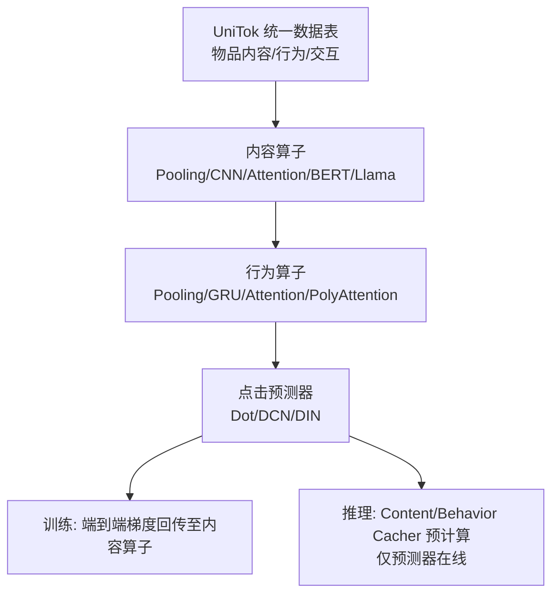
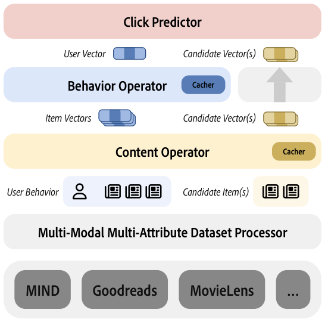

# Legommenders: A Comprehensive Content-Based Recommendation Library with LLM Support (支持 LLM 的内容推荐综合库)

- **会议/期刊**: WWW 2025
- **作者与机构**: Qijiong Liu, Lu Fan, Xiao-Ming Wu（香港理工大学）
- **推荐链路定位**: 召回（matching）+ 精排（ranking）双任务统一
- **研究方向**: 大语言模型推荐 / 冷启动与内容推荐
- **论文原文**: [论文原文链接](https://arxiv.org/abs/2412.15973v1)
- **开源代码**: [开源代码仓库链接](https://github.com/Jyonn/Legommenders)

## TL;DR (1分钟核心速览)

现有内容推荐库（TorchRec/DeepCTR/RecBole/FuxiCTR/Ducho）普遍采用**解耦设计**：先用预训练编码器离线抽取物品向量，再喂给推荐模型，导致内容表征与推荐目标错位、冷启动与偏好漂移应对乏力。Legommenders 将模型拆为**内容算子 + 行为算子 + 点击预测器**三段可插拔模块，首次支持三者**端到端联合训练**，并原生集成 LLM 作为特征编码器与数据生成器。在 MIND 上，端到端 LLM 微调的 DIRE 达 AUC 68.50，较 ID-only DCN（53.92）提升 14.58 个点；推理缓存管线带来最高 50x 评估加速。

## Background & Motivation (背景与核心矛盾)

- **主流范式**: 内容推荐模型由内容算子（编码候选物品与行为序列中的每个物品）、行为算子（融合序列为用户向量）、点击预测器三部分组成；但绝大多数库把内容算子**冻结在离线阶段**，仅把预训练 embedding 当作初始特征。
- **前人局限**: 其一，预训练表征过于通用，与具体推荐场景的目标不对齐，下游只能"将就"使用次优特征；其二，ID-based 直推式学习无法泛化到新物品/新用户，冷启动与偏好漂移场景直接失效。
- **核心洞察 (Key Insight)**: 内容理解应当**直接嵌入推荐管线内部**参与梯度回传——只有让内容编码器"看见"点击信号，表征才会朝推荐目标收敛；同时 LLM 的语义编码能力与数据增强能力可被同一框架统一承载。
- **本文切入点**: 以模块化算子组合 + 端到端训练 + LLM 双角色（编码器/生成器）+ 推理缓存，构建一个可复现、可大规模组合扫描的内容推荐实验平台。

## Method (核心方法设计)

### 1. 整体框架 (Overall Architecture)

数据经 UniTok 统一为「物品内容表 / 用户行为表 / 交互表」三张符合第二范式的解耦表（相比 FuxiCTR、BARS 的宽表合并显著降低冗余，且只需改动物品属性字段即可接入 LLM 增强数据）。训练时，内容算子对候选物品与行为序列逐条编码，行为算子将序列融合为用户向量，点击预测器输出打分并回传梯度至内容算子；推理时启用 content cacher 与 behavior cacher 预计算并缓存全部物品/用户向量，仅保留轻量预测器在线计算。

<figure class="paper-figure" markdown="span">
  <figcaption>图1：Legommenders 包概览。</figcaption>
</figure>

### 2. 关键设计拆解 (Key Designs)

1. **三段式可插拔算子与端到端联合训练**：痛点在于解耦设计使内容表征与推荐目标错位。本文将模型显式分解为 15 种内容算子 × 8 种行为算子 × 9 种点击预测器的笛卡尔组合（1000+ 模型，其中 95% 未被测试或发表），并允许内容算子参与反向传播。其有效性直觉是：内容编码器的梯度直接来自点击/匹配损失，表征空间被"拉向"推荐判别方向，而非停留在通用语义空间。
2. **LLM 双角色支持与分层微调**：LLM 既可作为内容算子（BERT、LLaMA 等 HuggingFace 开源模型），也可作为数据生成器产出增强属性（如 GPT 增强的标题）。训练上采用**冻结底层、微调上层 + LoRA PEFT** 的策略，仅需 `--mode split --layer <N>` 即可切换，相比全量微调获得最高 100x 训练加速。直觉是：底层语言能力通用无需改动，上层语义组合才需适配推荐域。
3. **训练目标、负采样与推理缓存**：匹配任务采用 $K+1$分类的 softmax 交叉熵$\mathcal{L}_{\text{matching}}=-\sum_{(u,i)\in\mathcal{D}}\sum_{i=1}^{K+1}y_{ui}\log\hat{y}_{ui}$，其中$\hat{y}_{ui}=\text{softmax}(f(x_u,x_i))$，负采样由 `neg_count` 控制（如 DIRE 取 4）；排序任务则用 MSE$\mathcal{L}_{\text{ranking}}=\frac{1}{|\mathcal{D}|}\sum_{(u,i)\in\mathcal{D}}(y_{ui}-\hat{r}_{ui})^2$，通过 `use_neg_sampling: false` 关闭负采样。推理阶段缓存机制将重复用户/物品的编码开销摊薄，加速比随内容/行为算子规模与重复率上升而放大，最高达 50x。

## Experimental Setup & Evaluation Protocol (实验设置与评估协议)

- **数据集与预处理**: 库覆盖 15 个数据集（新闻 MIND/PENS/Adressa/Eb-NeRD、图书 Goodreads/Amazon Books、电影 MovieLens/Netflix、音乐 Amazon CDs/Last.fm），论文主实验仅在 MIND 上报告，并额外构造 GPT 增强版 MIND-augmented（沿用 ONCE 的增强数据）。

| 数据集 | 场景 | 变体 | 说明 |
| :--- | :---: | :---: | :--- |
| MIND | 新闻推荐 | Original | 原始标题/类别等属性 |
| MIND-augmented | 新闻推荐 | Augmented | GPT 生成的增强标题属性 |

- **数据划分与防穿越 (Splitting Strategy)**: 论文正文未明确交代 MIND 的具体切分方式（未声明 Leave-One-Out 或全局时间戳切分），仅说明由数据集处理器统一转换，**此为评估协议披露的明显缺口**。
- **排名评测协议 (Ranking Protocol)**: 报告 AUC、MRR、N@5 三项指标；匹配任务采用 $K+1$候选（1 正 +$K$ 负）的采样排序协议，负采样数由 `neg_count` 配置，**未采用 Full-Ranking 全库排序**。
- **对比基线与超参设置**: 基线覆盖 ID-only（NAML-ID、DCN、DIN）、文本内容（DCNtext、DINtext）、内容算子模型（NAML、NRMS、MINER、Fastformer、PLM-NR）与 LLM 模型（DIRE、ONCE）；所有基线共享同一套超参（embedding 维度、注意力头数、学习率等）以保证公平，完整配置在仓库中公开。

## Key Experimental Results (实验关键数据)

### 1. 主实验对比 (Main Results)

MIND 数据集，Original 与 Augmented 两组（AUC / MRR / N@5）：

| 数据 | 模型 | ContentOp | BehaviorOp | Predictor | AUC | MRR | N@5 |
| :--- | :--- | :---: | :---: | :---: | :---: | :---: | :---: |
| Original | NAML-ID | Null | AdditiveAtt | Dot | 50.13 | 23.01 | 22.35 |
| Original | DCN | Null | Pooling | DCN | 53.92 | 25.18 | 24.43 |
| Original | DIN | Null | Null | DIN | 55.95 | 25.88 | 25.95 |
| Original | NAML | CNN | AdditiveAtt | Dot | 61.75 | 30.60 | 31.35 |
| Original | NRMS | Attention | Attention | Dot | 61.71 | 30.20 | 30.98 |
| Original | MINER | BERT | PolyAtt | Attention | 63.88 | 32.19 | 33.04 |
| Original | PLM-NR | BERT | Attention | Dot | 64.08 | 31.24 | 32.35 |
| Original | DIRE | Llama1 | Attention | Dot | **68.50** | **36.21** | **38.11** |
| Original | DIRE | Null(Llama1) | Attention | Dot | 68.10 | 35.33 | 36.91 |
| Augmented | DCNtext | Pooling | Pooling | DCN | 65.77 | 32.86 | 34.10 |
| Augmented | PLM-NR | BERT | Attention | Dot | 65.13 | 32.98 | 34.30 |
| Augmented | ONCE | Llama1 | Attention | Dot | **68.74** | **36.66** | **38.60** |

DIRE 相对最强 ID-only 基线 DIN 的 AUC 提升 `+22.4%`（55.95 → 68.50）；相对 BERT 系最强 PLM-NR 提升 `+6.9%`。

### 2. 消融实验 (Ablation Study)

以 DIRE 为核心做组件级对照（MIND Original）：

| 配置 | 内容算子训练方式 | AUC | MRR | N@5 | ΔAUC |
| :--- | :--- | :---: | :---: | :---: | :---: |
| DIRE（完整） | Llama1 端到端微调 | **68.50** | **36.21** | **38.11** | — |
| w/o 端到端 | Null(Llama1) 解耦抽取 | 68.10 | 35.33 | 36.91 | −0.40 |
| DCNtext（弱内容算子） | Pooling 端到端 | 62.63 | 29.73 | 30.52 | −5.87 |
| NAML（CNN 内容算子） | CNN 端到端 | 61.75 | 30.60 | 31.35 | −6.75 |

### 3. 关键实验发现 (Key Findings)

1. **LLM 编码器是性能主引擎，端到端训练是增益放大器**：DIRE 端到端（68.50）比解耦版（68.10）高 0.40 AUC，而把内容算子从 Llama1 换成 CNN（NAML，61.75）直接掉 6.75 个点——说明内容表征质量贡献远大于联合训练本身，但联合训练在强编码器上仍有稳定正收益。
2. **LLM 数据增强对弱模型收益更大，对强模型趋于饱和**：DCNtext 从 62.63 升至 65.77（+3.14 AUC），NAML 从 61.75 升至 63.88（+2.13），而 ONCE 仅从 68.50 量级微增至 68.74（+0.24）——增强数据主要弥补弱内容算子的语义缺口。
3. **模型复杂度与性能呈单调正相关，但边际递减**：ID-only（50–56）< 文本 Pooling（62–63）< CNN/Attention（61–64）< BERT（63–64）< Llama1（68+），提示在内容推荐中"编码器容量"仍是当前最有效的性能杠杆。

## Highlights & Limitations (亮点、对比与审稿批判)

- **与代表作对比 (vs. Prior Work)**: 相比 RecBole/FuxiCTR 仅接受 ID 特征、Ducho 虽支持多模态但仍是解耦设计，Legommenders 是唯一同时满足「内容感知 + LLM 编码 + 端到端训练 + 快速评估」四项的库（原文 Table 1）；相比 ONCE 等单点 LLM 推荐方法，它提供的是可组合的实验基础设施而非单一模型。
- **可迁移亮点**: 其一，content/behavior cacher 的"训练时动态编码、推理时预计算缓存"模式可迁移到任何级联内容编码的推荐系统，直接削减线上延迟；其二，冻结底层 + LoRA 上层的分层微调配方，为 LLM4Rec 的资源受限场景提供了低成本范式。
- **审稿级局限批判**: 其一，实验仅在 MIND 单数据集上报告，15 个数据集的宣称与 1000+ 模型组合的实证覆盖严重不匹配，且未交代数据划分方式与是否做显著性检验，评估严谨度不足；其二，缓存机制在用户/物品重复率低的场景（如强时效新闻流）加速比会显著衰减，论文未给出加速比随重复率变化的敏感性分析，也未报告 LLM 微调的实际显存与训练时长开销。

## Rating (四维评分)

- **方法创新性 (Novelty)**: ⭐⭐⭐ （算子化分解与端到端联合训练在工程层面有价值，但各组件均为已有方法的重组，缺乏新的理论或算子层面的算法贡献）
- **评估协议与实验扎实度 (Protocol & Experiments)**: ⭐⭐⭐ （仅单数据集主实验、划分方式与显著性检验缺失，采样排序而非全库排序，但基线覆盖较全且超参统一）
- **写作与数学规范度 (Clarity & Rigor)**: ⭐⭐⭐⭐ （模块职责、配置示例与算法伪代码清晰，公式简洁规范，但实验章节篇幅过短、细节披露不足）
- **工业落地与复现价值 (Industrial & Practical Value)**: ⭐⭐⭐⭐⭐ （代码数据文档全开源，1000+ 模型组合与 50x 推理加速对工业级内容推荐实验与部署均有直接价值）

