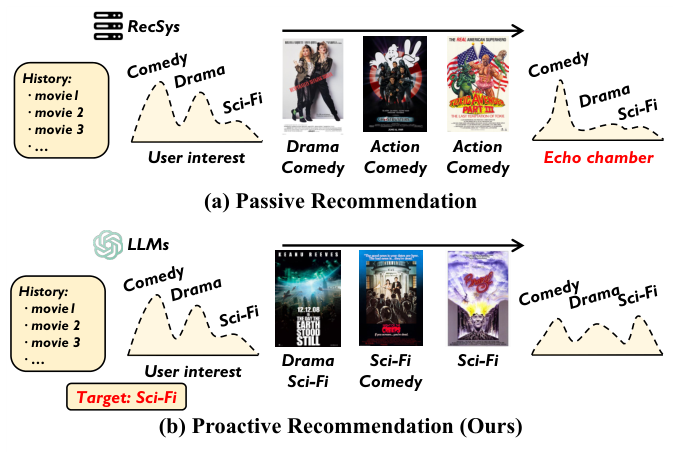
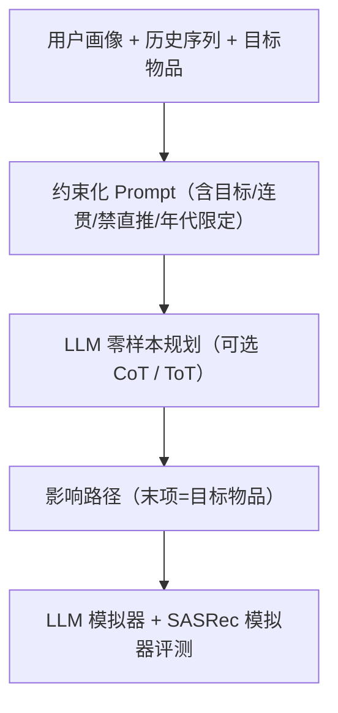

# Leveraging LLMs for Influence Path Planning in Proactive Recommendation (利用大语言模型进行主动推荐中的影响路径规划)

- **会议/期刊**: WWW 2025 (Companion, Short Paper)
- **作者与机构**: Mingze Wang, Shuxian Bi, Wenjie Wang, Chongming Gao, Yangyang Li, Fuli Feng（中国科学技术大学、网络空间研究院）
- **推荐链路定位**: 重排 / 序列级路径规划（多轮曝光序列生成）
- **研究方向**: 大语言模型推荐 / 对话推荐与智能体仿真
- **论文原文**: [https://arxiv.org/abs/2409.04827v2](https://arxiv.org/abs/2409.04827v2)
- **开源代码**: [https://github.com/gnaWeinrE/LLM-IPP](https://github.com/gnaWeinrE/LLM-IPP)

## TL;DR (1分钟核心速览)

传统推荐持续迎合历史兴趣导致"信息茧房"，主动推荐（IRS）试图用一条物品序列（影响路径）把用户兴趣平滑引向目标物品，但 IRS 的 Transformer 序列模型存在**目标物品包含率低于 30%** 与**相邻物品不连贯**两大硬伤。本文提出 LLM-IPP，用提示工程把"必须含目标物品、相邻强相关、不得直推目标、限定数据集年代"等约束写进指令，零样本生成影响路径；并首次构建 LLM 用户模拟器 + SASRec 模拟器双轨评测。在 MovieLens-1M / Last.FM 上，LLM-IPP 的 SR 从 IRS 的 0.268 提升至 1.0，IoI 从 2.68 升至 5.41，LLM 接受度最高提升约 60%。

## Background & Motivation (背景与核心矛盾)

- **主流范式**: 主动推荐把"引导用户兴趣"建模为序列推荐问题，IRS 用 Transformer 从历史序列学习兴趣漂移模式，并编码目标物品特征来逐项生成影响路径。
- **前人局限**: 其一，IRS 生成路径中**目标物品出现概率极低**（MovieLens-1M 上 SR 仅 0.268），路径根本到不了终点；其二，相邻物品**语义连贯性不足**，用户兴趣被"跳跃式"牵引，引导失效。
- **核心洞察 (Key Insight)**: 若强行把目标物品拼接到 IRS 路径末尾（IRS-fix），SR 虽达 1.0，但连贯性与接受度反而下降——说明"含目标"与"连贯"必须**联合优化**，而非事后打补丁。
- **本文切入点**: LLM 具备指令遵循与世界知识（知道导演、题材、叙事风格等元数据之外的关联），可一次性在生成时同时满足"含目标 + 连贯 + 用户可接受"三重约束。

<figure class="paper-figure" markdown="span">
  <figcaption>图1：被动推荐与主动推荐的示意图。</figcaption>
</figure>

## Method (核心方法设计)

### 1. 整体框架 (Overall Architecture)

LLM-IPP 是一个**零样本、免训练**的提示式规划器：输入为用户人口统计特征（性别/年龄/职业）、历史观影序列（标题+题材）与目标物品，经约束化 Prompt 送入 LLM，直接解码出一条长度不少于 5 的影响路径，路径末项即目标物品。核心闭环是"约束注入 → LLM 世界知识推理 → 路径输出 → 双轨模拟器评测"。可选叠加 CoT（末尾追加"Think step by step"）或 ToT（多专家分步思考再汇总）提示增强。

### 2. 关键设计拆解 (Key Designs)

1. **四重硬约束提示（Constraint-Injected Prompting）**：针对 IRS"路径不含目标"的痛点，在 Prompt 中显式写入四条约束——(a) 路径必须连接用户兴趣与目标物品；(b) 禁止直接推荐目标物品，故设最小路径长度；(c) 相邻物品须共享题材/主题/标题等强关联；(d) 物品须满足数据集年代限制（MovieLens 限 2001 年前、Last.FM 限 2011 年前）。这样把"路径可行性"从模型能力问题转化为**指令可满足性问题**，用 LLM 的指令遵循直接兜底 SR。

2. **世界知识驱动的隐式连贯（World-Knowledge Coherence）**：IRS 只能从 ID/题材共现学关联，而 LLM 可调用导演、演员、叙事风格等外部知识构建"题材渐变桥"。案例中路径为 Drama(Paths of Glory) → Comedy/War(Dr. Strangelove) → Drama(Network) → Comedy/Drama(Being There) → Comedy(To Be or Not to Be) → 目标 The Great Dictator，靠"库布里克导演""媒体批判/黑色喜剧"等隐式线索串联，实现题材的平滑过渡而非硬跳。

3. **双轨评测体系与训练目标**：本文无训练损失（零样本），评测侧定义传统指标 $\text{IoI}=\frac{1}{|U|}\sum_u(\log P(i_t^u|seq_u\oplus seq_t^u)-\log P(i_t^u|seq_u))$、$\text{IoR}$、$\text{SR}$ 与 SASRec 接受度（路径物品平均排名），以及 LLM 侧接受度（逐项 0–1 打分）与连贯性（相邻项 -1–1 相关性打分）。推理开销为单次 LLM 调用（ToT 为多次），无负采样、无梯度更新。

## Experimental Setup & Evaluation Protocol (实验设置与评估协议)

- **数据集与预处理**: 过滤掉长度小于 20 的历史序列；目标物品从全库随机采样。

| 数据集 | #Users | #Items | #Interactions(序列数) | 稀疏度/密度 | 特征/场景说明 |
| :--- | :---: | :---: | :---: | :---: | :--- |
| MovieLens-1M | 6,038 | 3,883 | 5,084 | 极稀疏 | 电影，2001 年前，含性别/年龄/职业 |
| Last.FM | 1,892 | 17,632 | 1,297 | 极稀疏 | 音乐人，2011 年前 |

- **数据划分与防穿越 (Splitting Strategy)**: 按 **20% 训练 / 80% 测试** 比例划分；传统基线在训练集训练、测试集评估；LLM-IPP 为**零样本**，直接在测试集评估（无训练泄漏）。
- **排名评测协议 (Ranking Protocol)**: 非全库排序，而是**模拟器打分协议**——SASRec 模拟器输出下一项概率分布，据此计算 SR / IoI / IoR / 接受度；LLM 模拟器（GPT-3.5、GPT-4、Gemini、Llama2-7b、Llama3-8b）对路径逐项打分。
- **对比基线与超参设置**: 基线含 POP（热度）、IRS（SOTA 主动推荐）、IRS-fix（强制补目标物品）；本文方法为 GPT-3.5 / GPT-CoT / GPT-ToT 三档。路径长度约束 ≥5，未报告显著性检验（短论文）。

## Key Experimental Results (实验关键数据)

### 1. 主实验对比 (Main Results)

MovieLens-1M（节选核心列，接受度取 GPT-4 与 Llama3，连贯性取 GPT-4）：

| Method | Acc(GPT-4) | Acc(Llama3) | Coh(GPT-4) | IoI | IoR | SR |
| :--- | :---: | :---: | :---: | :---: | :---: | :---: |
| POP | 0.576 | 0.591 | 0.553 | 0.801 | 193.9 | 0.008 |
| IRS | 0.460 | 0.597 | 0.457 | 2.680 | 651.9 | 0.268 |
| IRS-fix | 0.438 | 0.580 | 0.443 | 2.680 | 651.9 | 1 |
| GPT-3.5 | 0.742 | 0.710 | 0.649 | 5.409 | 1192.9 | 1 |
| GPT-CoT | 0.698 | 0.705 | 0.686 | 5.450 | 1215.6 | 1 |
| **GPT-ToT** | 0.682 | **0.718** | **0.701** | **5.596** | **1240.5** | **1** |

Last.FM（节选）：

| Method | Acc(GPT-4) | Acc(Llama3) | Coh(GPT-4) | IoI | IoR | SR |
| :--- | :---: | :---: | :---: | :---: | :---: | :---: |
| IRS | 0.618 | 0.525 | 0.563 | 0.723 | 516.1 | 0.142 |
| IRS-fix | 0.563 | 0.524 | 0.533 | 0.723 | 516.1 | 1 |
| GPT-3.5 | 0.539 | 0.660 | **0.803** | 6.159 | 1447.5 | 1 |
| GPT-CoT | 0.558 | 0.672 | 0.776 | 6.354 | 1544.5 | 1 |
| **GPT-ToT** | **0.634** | 0.652 | 0.731 | **6.291** | **1546.5** | **1** |

### 2. 消融实验 (Ablation Study)

本文以提示变体替代模块消融（MovieLens-1M，GPT-4 接受度 / GPT-4 连贯性 / IoI）：

| 变体 | Acc(GPT-4) | Coh(GPT-4) | IoI | 说明 |
| :--- | :---: | :---: | :---: | :--- |
| Base (GPT-3.5) | **0.742** | 0.649 | 5.409 | 无推理增强 |
| + CoT | 0.698 | 0.686 | 5.450 | 加"逐步思考" |
| + ToT | 0.682 | **0.701** | **5.596** | 多专家分步探索 |
| w/o 目标约束 (IRS) | 0.460 | 0.457 | 2.680 | 去掉"必含目标" |
| w/o 连贯约束 (IRS-fix) | 0.438 | 0.443 | 2.680 | 事后拼接目标 |

### 3. 关键实验发现 (Key Findings)

1. **目标约束是 SR 的决定性开关**：IRS 的 SR 仅 0.268，加入"必含目标"约束后所有 LLM 变体 SR 均达 1.0，且 IoI 从 2.68 跃升至 5.41–5.60（约 2 倍），说明"路径能到终点"是兴趣引导生效的前提。
2. **连贯性与接受度存在此消彼长**：MovieLens 上 Base 接受度最高（0.742）但连贯性最低（0.649），ToT 反之（0.682 / 0.701）；Last.FM 上该权衡更明显——路径越贴近用户兴趣，物品分布越不均，连贯性越差。这提示实际部署需按业务目标调权。
3. **LLM 世界知识带来超越元数据的收益**：案例中路径借助导演、叙事风格等数据集中不存在的属性完成题材渐变；人工双盲评测中 LLM-IPP 相对 IRS 的偏好率达 63.6%–84.2%，平均 Cohen's kappa 0.63，验证了模拟器结论与真人判断的一致性。

## Highlights & Limitations (亮点、对比与审稿批判)

- **与代表作对比 (vs. Prior Work)**: 与 IRS 的本质区别在于——IRS 用 Transformer 从共现模式"学"路径，受限于 ID 级关联且无法保证终点；LLM-IPP 用指令"约束"路径，把可行性、连贯性、年代合法性一次性写进 Prompt，零样本即超越需训练的 IRS。与 IRS-fix 相比，本文证明"事后补目标"会牺牲连贯性，而"生成时联合约束"才能双赢。
- **可迁移亮点**: (1) 把硬性业务约束（必含项、禁推项、时间窗）显式写入 Prompt 作为"可行性兜底"，可迁移至对话推荐的多轮引导与列表重排；(2) 用 LLM 模拟器 + 传统模型模拟器双轨评测生成式推荐输出，缓解人工评测昂贵的问题。
- **审稿级局限批判**: (1) 评测高度依赖 LLM 模拟器，而 LLM 打分本身存在位置/长度偏置，且 SASRec 模拟器与 LLM 模拟器结论在 Last.FM 接受度上出现分歧（IRS 0.618 vs GPT-3.5 0.539），评测效度存疑；(2) 零样本方案推理成本高（ToT 需多次调用）、路径长度与年代约束需人工按数据集定制，缺乏对冷门/长尾物品的覆盖分析，且未报告延迟与成本数据。

## Rating (四维评分)

- **方法创新性 (Novelty)**: ⭐⭐⭐ （首次将 LLM 引入主动推荐影响路径规划，思路新颖，但本质是提示工程组合，缺少模型层面的机制创新）
- **评估协议与实验扎实度 (Protocol & Experiments)**: ⭐⭐⭐ （双轨模拟器 + 人工双盲评测较完整，但仅两个数据集、无显著性检验、模拟器间结论不一致）
- **写作与数学规范度 (Clarity & Rigor)**: ⭐⭐⭐⭐ （问题定义与指标公式清晰，约束设计交代明确；短论文篇幅下推导与复杂度分析较简略）
- **工业落地与复现价值 (Industrial & Practical Value)**: ⭐⭐⭐ （代码开源、零样本易复现，但 LLM 调用成本与延迟、约束手工定制限制了大规模线上部署）

