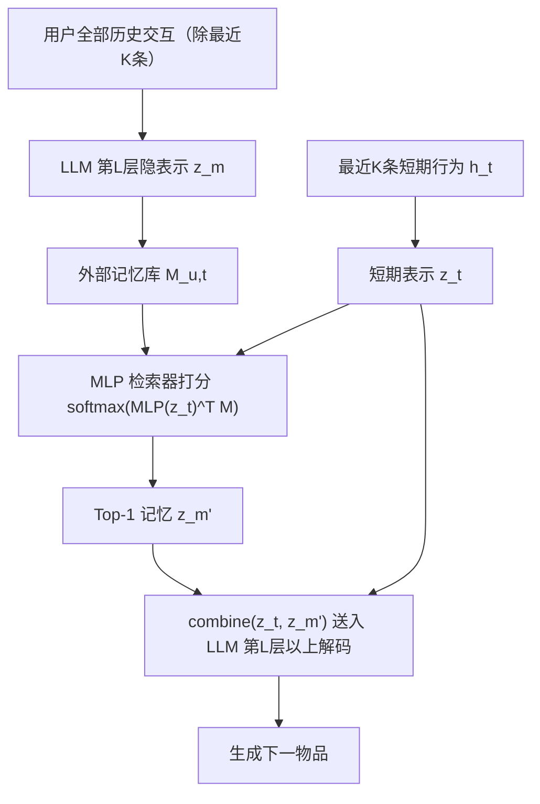
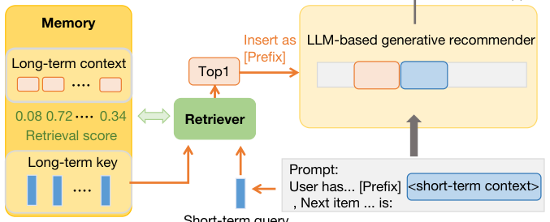

# Leveraging Memory Retrieval to Enhance LLM-based Generative Recommendation (利用记忆检索增强基于 LLM 的生成式推荐)

- **会议/期刊**: WWW Companion 2025 (Short Paper)
- **作者与机构**: Chengbing Wang, Yang Zhang, Fengbin Zhu, Jizhi Zhang, Tianhao Shi, Fuli Feng（中国科学技术大学 / 新加坡国立大学）
- **推荐链路定位**: 端到端生成式（召回即生成）
- **研究方向**: 大语言模型推荐 / 生成式推荐
- **论文原文**: [https://arxiv.org/abs/2412.17593v2](https://arxiv.org/abs/2412.17593v2)
- **开源代码**: 暂未开源

## TL;DR (1分钟核心速览)

LLM 生成式推荐受上下文窗口与算力限制，只能喂入最近 $N$条交互，长期兴趣被整体丢弃。本文提出 AutoMR：把用户全部历史交互的 LLM 第$L$层隐表示存入外部记忆库，用一个 2 层 MLP 检索器以短期表示$z_t$为 query 选出 Top-1 记忆，与$z_t$ 拼接后送入 LLM 上层解码。关键创新是**用"加入该记忆后 ground-truth 物品 PPL 的下降量"自动标注记忆价值**，再以 KL 散度训练检索器，绕开人工设计检索启发式。在 Amazon Book/Movie 上采用 Full-Ranking 协议，Recall@1 相对 BIGRec 提升 3.6%/4.5%。

## Background & Motivation (背景与核心矛盾)

- **主流范式**: 以 BIGRec 为代表的生成式推荐将最近 $N$ 条交互拼成文本指令，微调 LLM 直接自回归生成下一物品，无需候选集与内积检索。
- **前人局限**: ① 上下文窗口与训练开销迫使 $N$ 很小，长期兴趣被截断；② 迁移 ReLLa 式语义检索时，因生成式场景**没有目标物品**可作 query，只能用短期行为检索，结果召回的是"与短期兴趣相似"的冗余信息，无法带来新信号；③ TRSR 用未微调 LLM 总结长期兴趣，但 LLM 并非为推荐而训，总结出的兴趣与推荐目标错位（Book 上几乎不涨）。
- **核心洞察 (Key Insight)**: 人工设计"哪段长期历史有用"的检索启发式极难，但**标注单条记忆是否有用却很容易**——只需看它能否降低目标物品的困惑度。这些标注天然编码了"何种历史对推荐有价值"的模式。
- **本文切入点**: 把检索器从"人工规则"改为"以 PPL 降幅为监督信号的学习模块"，让模型自己学会从记忆中抽取有用信息。

## Method (核心方法设计)

### 1. 整体框架 (Overall Architecture)

框架由 Memory、Retriever、冻结的 LLM 生成器三部分组成，且**只训练检索器**（记忆无参数、LLM 已预调好），因此可即插即用地增强任意已微调的生成式推荐器。离线阶段：对每条历史交互 $h_m$构造指令并前向 LLM，取第$L$层隐表示$z_m$存入用户记忆$M_{u,t}=[z_1,\dots,z_{t-|h_t|}]$（排除最近$K$条短期行为）。在线阶段：短期行为$h_t$同样编码为$z_t$，检索器打分选 Top-1 记忆$z_{m'}$，与$z_t$拼接后从第$L$ 层继续前向解码生成物品。

<figure class="paper-figure" markdown="span">
  <figcaption>图1：所提出的 AutoMR 概览，包括三个关键组件：Memory、Retriever 和基于 LLM 的生成式推荐器（例如 BIGRec）。</figcaption>
</figure>

### 2. 关键设计拆解 (Key Designs)

1. **PPL 降幅自动标注（Data Annotation）**：痛点是没有现成标签告诉检索器"哪条记忆有用"。作者对每条记忆 $z_m$计算其加入前后目标物品$y$ 的似然差，再 softmax 归一化为软标签：
$$s'_m=\mathrm{softmax}([\delta_1,\dots,\delta_m,\dots])_m,\quad \delta_m=\prod_i \mathrm{LLM}^{(L:)}(y_i\mid z_t,z_m;y_{<i})-\prod_i \mathrm{LLM}^{(L:)}(y_i\mid z_t;y_{<i})$$
直觉上 $\delta_m>0$表示该记忆确实补充了短期上下文缺失的信息，$\delta_m\approx 0$ 或为负则是冗余/噪声；softmax 把绝对似然差转成可比较的相对重要性分布，避免不同样本 PPL 量级差异干扰训练。

2. **学习式检索器（Retriever）**：痛点是用余弦语义相似度检索只能召回"像短期兴趣"的历史，无法引入互补信息。检索器改为 $\mathrm{MLP}(z_t)^\top M_{u,t}$ 后 softmax 打分，以 KL 散度对齐上述软标签：
$$\min_\theta \sum \mathrm{KL}\big(S'\,\|\,S\big),\quad s_m=\mathrm{softmax}\big(\mathrm{MLP}(z_t)^\top M_{u,t}\big)_m$$
由于监督信号直接来自"对推荐目标是否有增益"，检索器学到的是**任务导向的相关性**而非语义相似性，这正是它优于 ReLLa 的本质原因。

3. **训练目标、负采样与推理效率**：总损失即检索器的 KL 损失，**无需负采样**（软标签为全记忆上的分布，天然构成 listwise 监督）。记忆表示离线预计算并缓存，在线仅需一次 MLP 前向 + 一次 Top-1 选择，额外开销可忽略；但标注阶段需对每条记忆做一次 LLM 前向，离线成本为 $O(|M_{u,t}|)$ 次前向，是主要工程瓶颈。

## Experimental Setup & Evaluation Protocol (实验设置与评估协议)

- **数据集与预处理**: Amazon Book / Movie，取 2017 年数据，前 10 个月训练、后两段分别验证/测试；序列最大长度 100，最近 10 条为短期特征、其余为长期记忆库；过滤交互数 <5 的物品与长度 <20 的序列。

| 数据集 | 序列上限 | 短期窗口 $K$ | 记忆库 | 场景说明 |
| :--- | :---: | :---: | :---: | :--- |
| Amazon Book | 100 | 10 | 其余历史 | 图书评论，语言理解难度高 |
| Amazon Movie | 100 | 10 | 其余历史 | 电影评论，语义信号更强 |

- **数据划分与防穿越 (Splitting Strategy)**: 全局时间戳切分（按月份），训练/验证/测试严格按时间先后，避免未来交互泄漏。
- **排名评测协议 (Ranking Protocol)**: 无偏 **Full-Ranking**（对全库未交互物品排序），指标 Recall@1、Recall@5、NDCG@5。
- **对比基线与超参设置**: SASRec（传统序列）、BIGRec（生成式）、ReLLa（语义检索长期兴趣，已适配为短期 query）、TRSR（LLM 总结长期兴趣）；LLM 主干 Llama2-7B，AdamW，lr 搜 [1e-3,1e-4,1e-5]，batch 32；检索器为 2 层 MLP、隐维 256，按验证集 Recall@1 早停（patience=10）。

## Key Experimental Results (实验关键数据)

### 1. 主实验对比 (Main Results)

| Dataset | Model | Recall@1 | Recall@5 | NDCG@5 |
| :--- | :--- | :---: | :---: | :---: |
| Book | SASRec | 0.0047 | 0.0214 | 0.0128 |
| Book | ReLLa | 0.0045 | 0.0065 | 0.0055 |
| Book | TRSR | 0.0283 | 0.0351 | 0.0319 |
| Book | BIGRec | 0.0281 | 0.0360 | 0.0323 |
| Book | **AutoMR** | **0.0291** | **0.0379** | **0.0338** |
| Book | Improv. vs BIGRec | +3.6% | +5.3% | +4.6% |
| Movie | SASRec | 0.0329 | 0.0554 | 0.0437 |
| Movie | ReLLa | 0.0029 | 0.0050 | 0.0030 |
| Movie | TRSR | 0.0591 | 0.0637 | 0.0613 |
| Movie | BIGRec | 0.0575 | 0.0616 | 0.0597 |
| Movie | **AutoMR** | **0.0601** | **0.0638** | **0.0621** |
| Movie | Improv. vs BIGRec | +4.5% | +3.6% | +4.0% |

### 2. 消融实验 (Ablation Study)

原文未设标准组件消融，但以"随机检索"作为检索器有效性的对照（图 2 箱线图，多次随机采样）：

| 配置 | Book Recall@1 | Book NDCG@5 | Movie Recall@1 | Movie NDCG@5 |
| :--- | :---: | :---: | :---: | :---: |
| Random Retrieval（中位数） | 低于 AutoMR | 低于 AutoMR | 低于 AutoMR | 低于 AutoMR |
| **AutoMR** | **0.0291** | **0.0338** | **0.0601** | **0.0621** |

关键点：AutoMR 的**第 25 百分位**仍高于随机检索的中位数，说明增益并非采样运气，而是检索器稳定选中了有用记忆。

### 3. 关键实验发现 (Key Findings)

1. **长期兴趣确实有增益，但必须"选对"**：BIGRec → AutoMR 在 Book 上 Recall@1 从 0.0281 升至 0.0291、Movie 上 0.0575 → 0.0601，证明仅靠最近 10 条短期行为存在信息缺口；而 ReLLa 式语义检索在 Movie 上 Recall@1 仅 0.0029（甚至远低于 SASRec），说明"检索相似历史"在生成式场景下会引入同质冗余、反而有害。
2. **学习式检索优于 LLM 总结式长期建模，且在弱语义域更明显**：TRSR 在 Movie 上接近 BIGRec（0.0591 vs 0.0575），但在 Book 上仅与 BIGRec 持平（0.0283 vs 0.0281），作者归因于 LLM 对图书文本的语言理解较弱、总结出的兴趣与推荐目标错位；AutoMR 以推荐目标 PPL 为监督，在 Book 上仍取得 +3.6% 的 Recall@1 提升，说明任务导向监督可弥补 LLM 领域知识不足。
3. **检索到的长期历史可跨越数月**：图 3 显示，在引入长期历史后 Recall@1 提升的样本中，AutoMR 选中的记忆大量分布在 5–10 个月之前的远端区间，而非仅邻近短期窗口，验证了记忆库确实在承担"长程兴趣"而非"短期补充"的角色。

## Highlights & Limitations (亮点、对比与审稿批判)

- **与代表作对比 (vs. Prior Work)**: 与 BIGRec 的本质区别是引入外部记忆 + 可学习检索，突破上下文窗口；与 ReLLa 的区别是放弃"语义相似检索"，改用 PPL 降幅监督的任务导向检索，解决了生成式场景无目标物品可作 query 的根本困难；与 TRSR 的区别是不依赖未微调 LLM 的总结能力，而用已调好的推荐器自身信号做监督。
- **可迁移亮点**: ① "以 ground-truth 物品 PPL 降幅作为上下文片段价值标签"这一自监督标注范式，可直接迁移到长序列建模、RAG 式推荐、prompt 片段选择等任意"上下文预算受限"的场景；② 检索器与 LLM 解耦、只训轻量 MLP 的设计，使方法可作为插件挂载到任意已微调的生成式推荐器上。
- **审稿级局限批判**: ① 标注阶段需对每条记忆各做一次 LLM 前向，历史长度上百时离线成本高昂，论文未给出标注耗时与记忆库规模的实际统计；② 仅取 Top-1 记忆、且只在两个 Amazon 子集上验证，缺少对 Top-k 取值、记忆库规模、以及跨域/冷启动场景的敏感性分析，泛化性证据偏薄。

## Rating (四维评分)

- **方法创新性 (Novelty)**: ⭐⭐⭐⭐ （PPL 降幅自动标注 + 解耦式可学习检索的组合思路新颖，直击生成式推荐无候选 query 的痛点，但单点技术（MLP 检索、KL 蒸馏）本身较常规）
- **评估协议与实验扎实度 (Protocol & Experiments)**: ⭐⭐⭐ （采用无偏 Full-Ranking 与时间切分值得肯定，但仅 2 个数据集、无标准消融、无显著性检验，随机检索对照也仅以箱线图定性呈现）
- **写作与数学规范度 (Clarity & Rigor)**: ⭐⭐⭐⭐ （5 页短文结构紧凑，公式与符号定义清晰，动机—方法—验证链条完整；但记忆库规模、标注复杂度等关键量级未量化）
- **工业落地与复现价值 (Industrial & Practical Value)**: ⭐⭐⭐ （检索器轻量、可插件化部署，在线开销极低；但离线标注成本与未开源代码削弱了直接复现与落地可行性）

