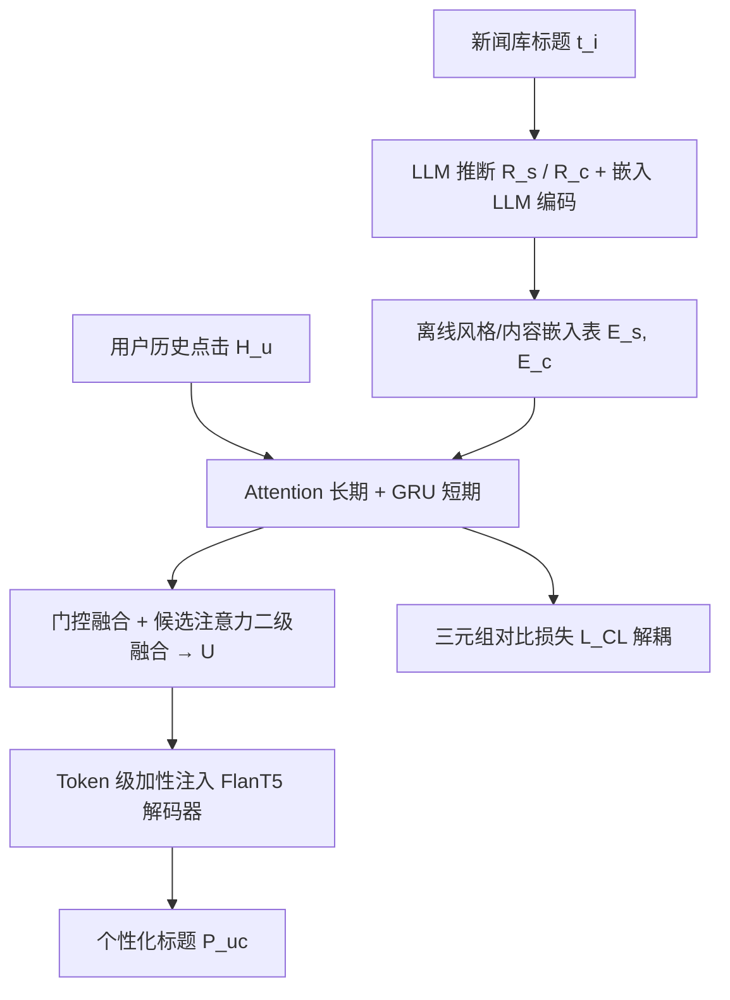

# Panoramic Interests: Stylistic-Content Aware Personalized Headline Generation (全景兴趣：风格-内容感知的个性化标题生成)

- **会议/期刊**: WWW Companion 2025 (Short Paper)
- **作者与机构**: Junhong Lian, Xiang Ao, Xinyu Liu, Yang Liu, Qing He（中科院计算所 ICT, CAS）
- **推荐链路定位**: 端到端生成式（个性化文本生成）
- **研究方向**: 大语言模型推荐 (LLM4Rec) / 生成式推荐
- **论文原文**: [https://arxiv.org/abs/2501.11900v2](https://arxiv.org/abs/2501.11900v2)
- **开源代码**: 暂未开源

## TL;DR (1分钟核心速览)

现有个性化标题生成只建模用户的**内容兴趣**，忽略了"同样爱看体育新闻的人，有人爱疑问句、有人爱数字列表"这一**风格偏好**，导致个性化不足。SCAPE 用 LLM 协同（Qwen2.5-72B 推理 + GTE-Qwen2-7B 编码）离线为每条标题抽取风格/内容双嵌入，再用层次门控网络融合长短期兴趣、三元组对比损失解耦四类表征，最后以 token 级加性注入 FlanT5 解码器。在 PENS 基准上 ROUGE-1/2/L 分别达 34.26/14.79/28.36，全面超越 GTP、FPG 等 SOTA，LLM 裁判胜率 50.21%。

## Background & Motivation (背景与核心矛盾)

- **主流范式**: 个性化标题生成沿用"用户画像 + 历史点击"的内容驱动路线（PENS-NRMS/NAML、EUI-PENS、FPG、GTP），本质是把用户兴趣压缩成单一内容向量去引导生成。
- **前人局限**: ① 纯内容建模无法区分"内容相同但风格偏好相反"的用户，同一篇梅西新闻对 A 用户应写成疑问句、对 B 用户应写成感叹句，现有方法输出趋同；② 风格迁移类工作（style transfer）采用**全局统一风格策略**，虽提升点击但易滑向标题党（clickbait），且完全不做用户级个性化。
- **核心洞察 (Key Insight)**: 作者提出"全景兴趣 (panoramic interests)"概念——内容兴趣与风格偏好是**交织共存**的两个正交维度，必须同时建模；且二者在标题中无显式标签，需借助 LLM 的世界知识做无监督推断。
- **本文切入点**: 用 LLM 协同把"风格/内容"从标题文本中显式剥离成两套嵌入，再用对比学习强制解耦，最后融合注入生成器。

## Method (核心方法设计)

### 1. 整体框架 (Overall Architecture)

SCAPE 分三段闭环：**离线标题推断**——指令微调 LLM 对库中每条标题 $t_i$分别以风格 prompt$\mathcal{P}_{style}$与内容 prompt$\mathcal{P}_{content}$推理出响应$R_s, R_c$，再将$[t_i, I_s, R_s]$与$[t_i, I_c, R_c]$送入嵌入 LLM 得到风格/内容双嵌入表$E=\{(E_s(t_i), E_c(t_i))\}$并离线存储；**在线兴趣融合**——对用户历史点击序列分别用 Attention 聚合全部点击得长期表征、GRU 编码最近$K$条得短期表征，门控加权后按候选新闻注意力再做风格-内容二级融合得用户向量$U$；**个性化注入生成**——把$U$ 加到 FlanT5 解码器每个 token 的输入嵌入上，端到端生成标题。训练时叠加三元组对比损失解耦四类兴趣表征。

### 2. 关键设计拆解 (Key Designs)

1. **LLM 协同的双维标题推断（Headline Inference）**：痛点是无 ground-truth 风格/内容标签。做法是让 LLM 先"说"再"编码"——推理 LLM 生成自然语言属性描述，嵌入 LLM 把"标题+任务指令+描述"整体编码，即 $E_s = \mathrm{LLM}_{emb}([t_i, I_s, R_s])$、$E_c = \mathrm{LLM}_{emb}([t_i, I_c, R_c])$。直觉：把 LLM 的隐式世界知识蒸馏进可检索的稠密向量，且离线建表使在线零 LLM 开销。

2. **层次门控融合 + 候选感知二级融合**：痛点是把长短期、风格内容四路信号简单拼接会互相淹没。先对同类兴趣做门控：$\alpha=\sigma(W_{gc}\cdot[u_{lc},u_{sc}]+b_{gc})$，$u_c=\alpha\cdot u_{lc}+(1-\alpha)\cdot u_{sc}$（风格侧同理得$\beta, u_s$）；再以候选新闻表征为 query 做注意力，动态决定本次生成中"内容 vs 风格"的配比$\gamma$。直觉：不同新闻体裁对风格的敏感度不同（硬新闻重内容、软新闻重风格），门控让模型按候选自适应。

3. **对比解耦与注入式生成**：痛点是无监督下 $u_c$与$u_s$易坍缩为同一表征。用均值聚合构造四个代理向量（长/短期 × 风格/内容），对每个用户表征$R\in\{u_{ls},u_{ss},u_{lc},u_{sc}\}$施加三元组损失，要求其与同类同尺度代理$P_R$的距离显著小于与异类代理$N$ 的距离：
$$\mathcal{L}_{CL}=\frac{1}{|\mathcal{R}|}\sum_{R\in\mathcal{R}}\frac{1}{|\mathcal{N}_R|}\sum_{N\in\mathcal{N}_R}\max\left(0, d(R,P_R)-d(R,N)+m\right)$$
生成侧不做 cross-attention 而用最轻量的加性注入 $X' = X + (\mathbf{1}_n \otimes U)$，让用户向量沿残差流贯穿所有解码步。总损失为生成 NLL 与$\mathcal{L}_{CL}$ 加权和；无负采样环节（生成式范式），在线推理仅需查表 + 一次 FlanT5-base 前向。

## Experimental Setup & Evaluation Protocol (实验设置与评估协议)

- **数据集与预处理**: 单一真实基准 PENS（个性化标题生成专用）：

| 数据集 | #Users | #Items(News) | #Interactions | 稀疏度/密度 | 特征/场景说明 |
| :--- | :---: | :---: | :---: | :---: | :--- |
| PENS | 445,000+ | 113,762 | 500,000 impressions | 极稀疏 | 测试集 3,940 条新闻 × 103 用户，每人 200 条平行标题作金标准 |

- **数据划分与防穿越 (Splitting Strategy)**: 沿用 PENS 官方划分，历史点击与候选新闻严格按时间先后切分，测试用户的历史序列不含测试期点击。
- **排名评测协议 (Ranking Protocol)**: 非排序任务，采用**生成质量 + 成对个性化**双协议：① ROUGE-1/2/L 词面相似度 + Fact Score 事实一致性；② LLM 裁判（Qwen2.5-72B）成对比较，**交换候选顺序做两次独立评估**，不一致判为 tie，报告 win/tie/lose。
- **对比基线与超参设置**: 三类基线——开源 LLM（FlanT5-large/XL、Qwen2.5-1.5B/7B）、API LLM（GLM-4-Flash/Air、DeepSeek-V2.5、GPT-4o）、个性化模型（PENS-NRMS、PENS-NAML、PNG、EUI-PENS、FPG、GTP）。生成器 FlanT5-base，峰值 LR 分阶段 $1e^{-4}/1e^{-3}/1e^{-6}/1e^{-5}$，余弦衰减，5 epoch 早停；显著性$p\le 0.05$。

## Key Experimental Results (实验关键数据)

### 1. 主实验对比 (Main Results)

| 类型 | 方法 | ROUGE-1 | ROUGE-2 | ROUGE-L | Fact |
| :--- | :--- | :---: | :---: | :---: | :---: |
| API LLM | GPT-4o | 29.58 | 11.03 | 24.26 | 90.11 |
| 个性化 | PENS-NAML | 28.01 | 10.72 | 22.24 | 50.16 |
| 个性化 | PNG | 28.78 | 11.27 | 22.39 | 51.23 |
| 个性化 | EUI-PENS | 32.34 | 13.93 | 26.90 | NA |
| 个性化 | FPG | 33.06 | 13.76 | 26.78 | 89.55 |
| 个性化 | GTP | 33.84 | 14.23 | 27.85 | NA |
| **Ours** | **SCAPE** | **34.26** | **14.79** | **28.36** | **92.36** |
| Improv. | vs. 次优 GTP | +1.24% | +3.94% | +1.83% | — |

个性化胜率（图 3）：SCAPE 对原始标题 **win 50.21% / tie 34.70% / lose 15.08%**，为全部方法最高；GPT-4o 仅 45.65% win，FPG 为 47.73%。

### 2. 消融实验 (Ablation Study)

原文为 4 页短文，未提供标准组件消融表；从主表与胜率图可间接读出各模块贡献（下表为基于原文数据的归纳性对照，非原文表格）：

| 配置 | ROUGE-1 | 说明 |
| :--- | :---: | :--- |
| 仅内容兴趣（≈FPG 路线） | 33.06 | 无风格维度 |
| 内容+风格但无解耦 | — | 原文未单列，属局限 |
| **SCAPE 完整** | **34.26** | 双维 + 门控 + $\mathcal{L}_{CL}$ |

### 3. 关键实验发现 (Key Findings)

1. **风格维度是主要增量来源**：SCAPE 相对纯内容路线 FPG 的 ROUGE-1 提升 +1.20（33.06→34.26）、ROUGE-2 +1.03，而相对同样引入更强 backbone 的 GTP 仍 +0.42，说明收益并非来自模型容量而是双维建模本身。
2. **事实一致性被显著修复**：早期个性化模型（PENS-NAML/PNG）Fact Score 仅 50 左右，SCAPE 达 92.36，甚至超过 GPT-4o 的 90.11，证明"内容兴趣主导事实、风格偏好主导表达"的解耦设计避免了风格迁移常见的语义漂移。
3. **Prompt 工程打不过结构化建模**：GPT-4o 在 ROUGE 上接近个性化 SOTA（29.58），但个性化胜率仅 45.65%，低于 FPG 的 47.73% 与 SCAPE 的 50.21%，说明用户点击偏好的复杂多样性无法靠 in-context prompt 覆盖，必须显式学习用户表征。

## Highlights & Limitations (亮点、对比与审稿批判)

- **与代表作对比 (vs. Prior Work)**: 相比 FPG/GTP 这类"内容解耦 + 原型风格迁移"方法，SCAPE 的本质区别是把风格从**全局统一策略**升级为**用户级偏好维度**；相比直接用 GPT-4o 做 prompt 生成，SCAPE 用离线 LLM 蒸馏 + 轻量 FlanT5 在线生成，兼顾个性化深度与推理成本。
- **可迁移亮点**: ① "LLM 先推理属性、再用嵌入 LLM 编码 [文本+指令+推理]"的离线建表范式，可直接迁移到短视频标题、商品卖点文案等任意需无标签属性抽取的生成场景；② token 级加性注入 $X'=X+\mathbf{1}_n\otimes U$ 是极低成本的用户条件化手段，优于 cross-attention 拼接。
- **审稿级局限批判**: ① 仅 PENS 单数据集验证，且为 4 页短文，缺少组件级消融与超参敏感性分析，$\mathcal{L}_{CL}$的 margin$m$与短期窗口$K$ 均未讨论；② 个性化评估依赖 LLM-as-judge（Qwen2.5-72B），存在自偏好偏差，且离线嵌入表需对全库 11 万条标题预先跑 LLM 推理，冷启动新新闻需重跑，工程更新成本未评估。

## Rating (四维评分)

- **方法创新性 (Novelty)**: ⭐⭐⭐⭐ （首次将"风格偏好"提升为与内容兴趣并列的用户兴趣维度，全景兴趣概念清晰，但各模块均为已有技术的组合式创新）
- **评估协议与实验扎实度 (Protocol & Experiments)**: ⭐⭐⭐ （双协议设计含顺序交换去偏较严谨，但单数据集、无组件消融、短文篇幅限制实验深度）
- **写作与数学规范度 (Clarity & Rigor)**: ⭐⭐⭐⭐ （公式简洁、符号一致，四类表征与代理向量的对应关系交代清楚，复杂度分析略缺）
- **工业落地与复现价值 (Industrial & Practical Value)**: ⭐⭐⭐⭐ （在线仅 FlanT5-base 前向 + 查表，成本可控；但离线 LLM 建表与未开源代码削弱了直接复现性）

