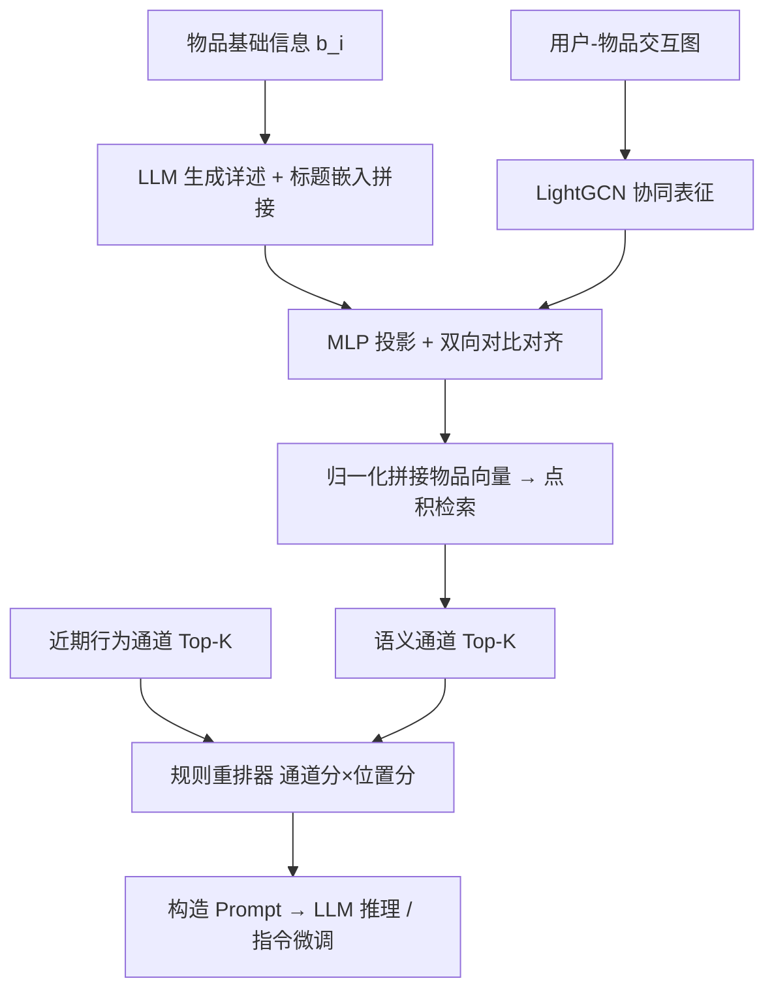

# RALLRec: Improving Retrieval Augmented Large Language Model Recommendation with Representation Learning (用表征学习改进检索增强的大语言模型推荐)

- **会议/期刊**: WWW 2025 (Companion, Short Paper)
- **作者与机构**: Jian Xu, Xiangyu Chen (清华大学); Sichun Luo, Linqi Song (香港城市大学); Haoming Huang (阿里巴巴); Hanxu Hou (东莞理工学院)
- **推荐链路定位**: 召回（RAG 检索阶段）+ 提示构造与重排
- **研究方向**: 大语言模型推荐 / 自监督对比表征学习
- **论文原文**: [https://arxiv.org/abs/2502.06101v2](https://arxiv.org/abs/2502.06101v2)
- **开源代码**: [https://github.com/JianXu95/RALLRec](https://github.com/JianXu95/RALLRec)

## TL;DR (1分钟核心速览)

现有 RAG 式 LLM 推荐（如 ReLLa）仅用物品标题的文本嵌入做检索，忽略协同信号，且检索结果与用户近期兴趣脱节。RALLRec 让 LLM 自动生成物品详述扩充文本语义，用 LightGCN 抽取协同语义，再以 InfoNCE 式自监督把两路表征对齐后拼接检索，最后用"语义相关性 × 时间衰减"的规则重排器融合近期序列。在 BookCrossing/MovieLens/Amazon 三个 CTR 数据集上，AUC 相对最强基线 ReLLa 提升 0.4%–3.3%，全部指标 $p<0.01$ 显著。

## Background & Motivation (背景与核心矛盾)

- **主流范式**: LLMRec 直接把用户历史拼进 prompt 让 LLM 预测；ReLLa 引入 RAG，用文本嵌入检索与目标物品最相关的历史行为来净化 prompt；GPT-FedRec 用 ID 检索器 + 文本检索器的混合 RAG。
- **前人局限**: (1) 检索仅依赖标题级文本嵌入，语义浅薄——两个无关物品可能因名称相似而被误检索，且完全丢弃了用户-物品交互中的协同信号；(2) 检索结果与用户**近期兴趣**脱节，纯相似度检索可能召回"语义像但时间久远"的行为，无法刻画兴趣漂移。
- **核心洞察 (Key Insight)**: 文本语义与协同语义是互补的两个视角，但二者空间尺度不一致，直接拼接并非最优；需先做**表征对齐**再融合，检索质量才会实质提升。
- **本文切入点**: 以"更好的物品表征"为杠杆撬动整个 RAG 链路——生成式详述增强文本、对比学习对齐协同、时间感知重排融合双通道。

## Method (核心方法设计)

### 1. 整体框架 (Overall Architecture)

离线阶段：对每个物品，LLM 依据基础信息 $b_i$与提示模板$p$生成详细描述，取 LLM 隐层得到描述嵌入并与标题嵌入拼接成文本表征；同时用 LightGCN 在交互图上学习协同表征；两路表征经 MLP 投影后做双向对比对齐，最终将「文本 ‖ 协同 ‖ 对齐」三段归一化拼接为物品向量，供点积检索。在线阶段：检索通道给出语义最相关$K$项，时间通道给出最近$K$ 项，重排器按"通道分 × 位置分"融合后填入 prompt；prompt 既可直接零样本推理，也可用于 LoRA 指令微调。

### 2. 关键设计拆解 (Key Designs)

1. **生成式详述 + 双粒度文本表征**：固定模板只含标题，语义深度不足。改为 $\boldsymbol{e}_i^{\text{desc}}=\text{LLM}_{\text{emb}}(t_i^{\text{desc}})$，其中$t_i^{\text{desc}}=\text{LLM}(b_i|p)$，再与标题嵌入拼接$\boldsymbol{e}_i^{\text{text}}=[\boldsymbol{e}_i^{\text{title}}\|\boldsymbol{e}_i^{\text{desc}}]$。直觉：LLM 的世界知识把"标题字符串"升级为"属性语义"，且嵌入可离线复用、零在线开销。

2. **文本-协同双向对比对齐**：两路表征维度与尺度不一致，直接拼接次优。用两层 MLP 投影文本侧，构造对称 InfoNCE：

$$\mathcal{L}_{ssl}=-\mathbb{E}\left[\log\frac{f(\boldsymbol{e}_i^{\text{text}},\boldsymbol{e}_i^{\text{colla}})}{\sum_{v\in\mathcal{V}}f(\boldsymbol{e}_i^{\text{text}},\boldsymbol{e}_v^{\text{colla}})}+\log\frac{f(\boldsymbol{e}_i^{\text{colla}},\boldsymbol{e}_i^{\text{text}})}{\sum_{v\in\mathcal{V}}f(\boldsymbol{e}_i^{\text{colla}},\boldsymbol{e}_v^{\text{text}})}\right]$$

其中 $f(\cdot,\cdot)=\exp(\text{sim}(\text{MLP}(\cdot),\cdot))$，$\text{sim}$ 为余弦相似度。直觉：同一物品的文本视图与协同视图互为正样本，迫使文本空间吸收"共现亲和"信息，使检索向量同时具备语义泛化与行为精度。

3. **时间感知规则重排器与训练目标**：纯相似度检索丢失兴趣漂移。对每个候选赋通道分 $S_c\in\{\alpha,1-\alpha\}$（语义通道 / 时间通道）与位置分$S_{pos}\in\{1,1/2^{\beta},\dots,1/K^{\beta}\}$，总分$\text{Score}_i=S_c^i\cdot S_{pos}^i$，取 Top-$K$。训练侧采用 LoRA + 8-bit 量化指令微调，并用"按时间戳重排检索序列"的数据增广降低顺序敏感性；检索阶段为点积全库比对，无额外负采样开销。

## Experimental Setup & Evaluation Protocol (实验设置与评估协议)

- **数据集与预处理**: 三个公开 CTR 数据集，均采用 `5-core` 过滤长尾用户/物品；MovieLens 取 ML-1M 子集，Amazon 取 Movies & TV 子集。

| 数据集 | #Users | #Items | #Samples | #Fields | #Features |
| :--- | :---: | :---: | :---: | :---: | :--- |
| BookCrossing | 8,723 | 3,547 | 227,735 | 10 | 14,279 |
| MovieLens | 6,040 | 3,952 | 970,009 | 9 | 15,905 |
| Amazon | 14,386 | 5,000 | 141,829 | 6 | 22,387 |

- **数据划分与防穿越 (Splitting Strategy)**: 沿用 ReLLa 协议，以"最新物品之前的历史序列 + 评分"构造 prompt 与 ground-truth，属**按用户时间序留出最后交互**的划分，历史序列最大长度 $K=30$。
- **排名评测协议 (Ranking Protocol)**: 任务为 CTR 二分类预测，报告 AUC / Log Loss / ACC，非全库排序指标；显著性检验采用 $p$-value（阈值$p<0.01$）。
- **对比基线与超参设置**: ID 类基线 DeepFM、xDeepFM、DCN、AutoInt；LLM 类基线 Llama3.1-8B-Instruct 零样本、ReLLa、Hybrid-Score。协同侧用 LightGCN，LoRA + 8-bit 量化微调；重排器 $\alpha\in\{1/2,2/3,4/5\}$，$\beta=1$。

## Key Experimental Results (实验关键数据)

### 1. 主实验对比 (Main Results)

| Model | BookCrossing AUC↑ | BookCrossing LogLoss↓ | MovieLens AUC↑ | MovieLens LogLoss↓ | Amazon AUC↑ | Amazon LogLoss↓ |
| :--- | :---: | :---: | :---: | :---: | :---: | :---: |
| DeepFM | 0.5480 | 0.8521 | 0.7184 | 0.6205 | 0.6419 | 0.8281 |
| DCN | 0.5532 | 0.9356 | 0.7212 | 0.6164 | 0.6369 | 0.7873 |
| AutoInt | 0.5478 | 0.9854 | 0.7138 | 0.6224 | 0.6424 | 0.7640 |
| Llama3.1 (zero-shot) | 0.5894 | 0.6839 | 0.5865 | 0.6853 | 0.7025 | 0.7305 |
| ReLLa | 0.7125 | 0.6458 | 0.7524 | 0.6182 | 0.8401 | 0.5074 |
| Hybrid-Score | 0.7096 | 0.6409 | 0.7646 | 0.6149 | 0.8405 | 0.5065 |
| **RALLRec** | **0.7151** | **0.6359** | **0.7772** | **0.6102** | **0.8463** | **0.4914** |
| Improv.% (vs 最强基线) | +0.36% | −0.78% | +1.65% | −0.76% | +0.69% | −2.98% |

### 2. 消融实验 (Ablation Study)

| 变体 | BookCrossing AUC | MovieLens AUC | Amazon AUC |
| :--- | :---: | :---: | :---: |
| RALLRec (完整) | **0.7151** | **0.7772** | **0.8463** |
| w/o Data Aug. | 0.7108 | 0.7563 | 0.8453 |
| w/o Retrieval | 0.6960 | 0.7687 | 0.8404 |
| w/o IT (指令微调) | 0.5857 | 0.5865 | 0.7120 |

嵌入策略对比（表 4，MovieLens AUC）：Text-based 0.7583 < ID-based 0.7580 ≈ 持平 < Concat. w/o SSL 0.7633 < Concat. w/ SSL 0.7653，验证"拼接 + 对齐"的递进收益。

### 3. 关键实验发现 (Key Findings)

1. **指令微调是绝对瓶颈**：去掉 IT 后 MovieLens AUC 从 0.7772 暴跌至 0.5865（−24.5%），几乎退回零样本水平，说明 RAG 带来的增益必须建立在模型已学会遵循任务格式的前提上；而检索模块的边际贡献（w/o Retrieval 降 1.1%）远小于 IT。
2. **对齐优于简单拼接，拼接优于单模态**：SSL 对齐在 MovieLens 上比无对齐拼接再涨 0.2 个点 AUC，且文本/ID 单模态均明显落后，证明"协同信号补文本、对齐消弭空间错位"的假设成立；数据增广在 MovieLens 上贡献 2.1 个点，是低成本高回报项。
3. **长历史只对会"用"历史的模型有益**：随 $K$ 从 5 增至 30，RALLRec 与 ReLLa 的 AUC 单调上升，而零样本 LLM 因噪声干扰不升反降——说明检索+重排本质是在做"历史去噪"，而非简单堆上下文。

## Highlights & Limitations (亮点、对比与审稿批判)

- **与代表作对比 (vs. Prior Work)**: 相比 ReLLa 仅用标题文本嵌入检索，本文引入生成式详述与协同表征对齐，把"检索什么"从字符串匹配升级为多视角语义匹配；相比 GPT-FedRec 的 ID/文本双检索器**分离**使用，本文在表征层就完成融合，避免两路结果割裂；相比纯 ID 类 CTR 模型，本文借 LLM 世界知识获得跨域语义泛化。
- **可迁移亮点**: (1) "LLM 生成详述 → 嵌入拼接"可作为任意冷启动物品表征的即插即用增强；(2) 规则式"通道分 × 位置分"重排器无需训练即可平衡相关性与时效性，适合工程快速落地。
- **审稿级局限批判**: (1) 评测仅用 AUC/LogLoss/ACC 的 CTR 协议，未做全库 Top-K 排序（HR/NDCG），与真实推荐召回场景存在差距；(2) 重排器为启发式规则，$\alpha,\beta$ 需网格搜索，且 LLM 生成详述带来离线批量推理成本，论文未报告延迟与生成质量波动的敏感性分析。

## Rating (四维评分)

- **方法创新性 (Novelty)**: ⭐⭐⭐ （生成式详述 + 双向对比对齐的组合有新意，但各组件均为成熟技术的工程化拼装，理论深度有限）
- **评估协议与实验扎实度 (Protocol & Experiments)**: ⭐⭐⭐ （三数据集 + $p<0.01$ 显著性 + 消融完整，但仅 CTR 分类指标、缺排序指标与线上验证）
- **写作与数学规范度 (Clarity & Rigor)**: ⭐⭐⭐⭐ （5 页短文结构紧凑，公式与符号定义清晰，重排器设计交代明确）
- **工业落地与复现价值 (Industrial & Practical Value)**: ⭐⭐⭐⭐ （代码开源，嵌入可离线复用、重排零训练成本，但 LLM 详述生成的离线开销需评估）

