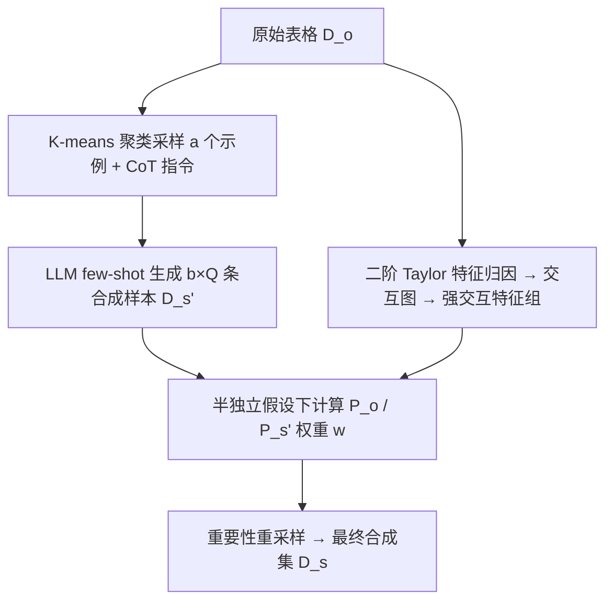
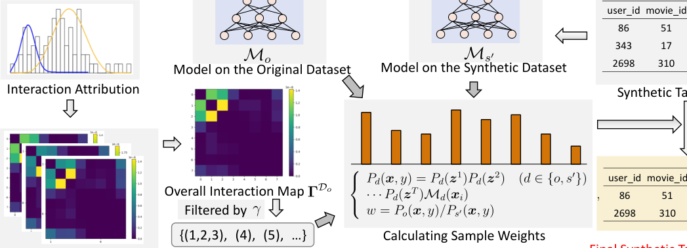

# SampleLLM: Optimizing Tabular Data Synthesis in Recommendations (面向推荐场景的 LLM 表格数据合成优化)

- **会议/期刊**: WWW 2025
- **作者与机构**: Jingtong Gao, Xiaopeng Li, Xiangyu Zhao (香港城市大学) 等；Zhaocheng Du, Yichao Wang, Huifeng Guo, Ruiming Tang (华为诺亚方舟实验室)
- **推荐链路定位**: 数据增强层（服务于召回/精排训练，线上用于冷启动 App 召回）
- **研究方向**: 大语言模型推荐 / 冷启动与长尾推荐
- **论文原文**: [https://arxiv.org/abs/2501.16125v3](https://arxiv.org/abs/2501.16125v3)
- **开源代码**: 暂未开源

## TL;DR (1分钟核心速览)

推荐场景表格数据稀疏且特征语义关联强，传统 GAN/VAE/扩散合成方法高度依赖数据量、无法理解语义；直接用 LLM 生成又因 LLM 内在知识与目标数据集分布错位，导致合成样本分布不一致、多样性差（聚集在少数中心）。本文提出两阶段框架 SampleLLM：第一阶段用 CoT 指令 + K-means 聚类采样示例做 few-shot 生成保证多样性；第二阶段用二阶 Taylor 特征归因提取强交互特征组，在半独立假设下计算重要性权重做重采样对齐分布。在 3 个推荐数据集 + 2 个通用数据集上，AUC/Logloss 全面超越 7 个 SOTA 合成基线，线上华为广告冷启动场景 RPM +2%、ECPM +1.86%。

## Background & Motivation (背景与核心矛盾)

- **主流范式**: 表格数据合成以统计模型（SDV）与深度生成模型（CTGAN/TVAE/TabDDPM）为主，近期 GReaT、REaLTabFormer 将表格转自然语言交给自回归 LLM 生成。
- **前人局限**: ① 深度生成方法高度 data-dependent，在推荐场景的稀疏小数据上难以刻画复杂分布，且用 ID 编码输入，完全丢失特征语义关联；② LLM 直接 few-shot 生成存在固有分布错位，随机选示例会遗漏原数据分布的重要区域，输出塌缩到少数中心（图 1 可视化）。
- **核心洞察 (Key Insight)**: 分布对齐应拆成"输入端多样性"与"输出端重加权"两件事分别解决——示例选择决定 LLM 看到什么，重要性采样决定最终保留什么。
- **本文切入点**: 用聚类采样保证输入示例覆盖全分布，再用特征归因重要性采样按"原数据/合成数据"概率比重采样，把 LLM 引入的偏置校正回来。

## Method (核心方法设计)

### 1. 整体框架 (Overall Architecture)

输入为原始表格 $\mathcal{D}_o$。第一阶段：对$\mathcal{D}_o$做 K-means 聚成$a$簇、每簇随机取 1 个样本组成示例集$E$，与经 CoT 迭代精炼的指令$I$拼接送入 LLM（Llama-3-70b-instruct-awq INT4），每次生成$b$条、重复$Q$次得到临时合成集$\mathcal{D}_{s'}$。第二阶段：在$\mathcal{D}_o$上训练预测模型，用二阶 Taylor 特征归因构建交互图，阈值$\gamma$聚类出强交互特征组；再分别统计$\mathcal{D}_o$与$\mathcal{D}_{s'}$上特征组频率与判别概率，算权重$w$后做重要性重采样得到最终$\mathcal{D}_s$。

<figure class="paper-figure" markdown="span">
  <figcaption>图2：SampleLLM的整体结构。(a) 第一阶段，将人工设计的指令和通过聚类采样提取的𝑎个样本作为LLM的输入，生成𝑏个合成样本。该过程重复𝑄次。(b) 第二阶段，对合成样本采用一种新颖的基于特征归因的重要性采样方法。</figcaption>
</figure>

### 2. 关键设计拆解 (Key Designs)

1. **聚类采样示例选择（Cluster Sampling）**：随机 few-shot 示例只覆盖原分布局部，LLM 输出随之塌缩。改为 $E=\{g(\text{clu}_i)\}_{i=1}^{a}$，其中$\{\text{clu}_i\}=h(\mathcal{D}_o,a)$为 K-means 簇、$g$为簇内随机取点。直觉：每个示例代表分布的一个区域，$a$个示例即$a$ 个"分布锚点"，从输入端强制 LLM 的输出覆盖全空间。

2. **特征归因重要性采样（Feature-Attribution Importance Sampling）**：精确联合分布 $P(\boldsymbol{x}_i)=P(x^1_i,\dots,x^K_i)P(y_i|\boldsymbol{x}_i)$在高维下不可估；全独立假设又严重失真。本文取折中：用二阶 Taylor 近似量化特征$i,j$ 的交互强度
$$\boldsymbol{\Gamma}_{i,j}(\boldsymbol{x})=\mathbb{E}_{\boldsymbol{x}\sim\mathcal{D}_b}\left[(x_i-x^b_i)(x_j-x^b_j)\frac{\partial^2 f(\boldsymbol{x}^b)}{\partial x_i\partial x_j}\right]$$
对全数据集求和取绝对值 $\boldsymbol{\Gamma}_{\mathcal{D}_o}=\sum_{\boldsymbol{x}}|\boldsymbol{\Gamma}(\boldsymbol{x})|$，超过阈值$F_\gamma=\gamma\cdot\max(\boldsymbol{\Gamma}_{\mathcal{D}_o})$的特征对合并为强交互组$\boldsymbol{z}_t$，得到半独立分解$P_d(\boldsymbol{x},y)=\prod_{t}P_d(\boldsymbol{z}_t)\cdot\mathcal{M}_d(\boldsymbol{x})$。最终权重$w=P_o(\boldsymbol{x},y)/P_{s'}(\boldsymbol{x},y)$，按$w$重采样。直觉：只对真正强耦合的特征组建模联合频率，其余按边缘频率相乘，在$O(K)$与$O(2^K)$ 之间取得可算且不失真的平衡。

3. **训练目标、负采样与推理效率**：本文不训练生成器，无传统推荐损失；下游用简单 DNN（层数 1–4、隐层 16–128 网格搜索）作为预测模型 $\mathcal{M}$，其输出即判别概率$\mathcal{M}(\boldsymbol{x}_i)=P(y_i|\boldsymbol{x}_i)$。合成阶段为离线一次性开销（LLM 推理$Q$ 轮 + 一次归因统计），线上仅需每周增量更新合成样本，不引入在线推理延迟。

## Experimental Setup & Evaluation Protocol (实验设置与评估协议)

- **数据集与预处理**: 3 个推荐 CTR 数据集 + 2 个通用数据集，均按 8:1:1 划分：

| 数据集 | #Train | #Valid | #Test | 任务/场景说明 |
| :--- | :---: | :---: | :---: | :--- |
| ML-1M | 800,167 | 100,020 | 100,022 | 电影推荐 CTR，离散稀疏强相关特征 |
| Amazon | 658,827 | 82,353 | 82,354 | 电商评论 CTR |
| Douban | 1,348,399 | 168,549 | 168,551 | 豆瓣推荐 CTR |
| HELOC | 8,367 | 1,045 | 1,047 | 二分类，数据稀缺 |
| Covertype | 464,809 | 58,101 | 58,102 | 多分类 |

- **数据划分与防穿越 (Splitting Strategy)**: 比例划分（8:1:1），沿用前人设置，未采用时间戳切分。
- **排名评测协议 (Ranking Protocol)**: 非排序评测，采用 CTR 预测的 AUC / Logloss（Covertype 用 weighted Precision/Recall/F1）。两种效用协议：**Augmentation Utility**（原训练集 + 10% 合成数据混合训练）与 **MLE Utility**（仅用 10% 合成数据替代真实训练集）。
- **对比基线与超参设置**: 7 个基线 PATE-GAN / ADS-GAN / CTGAN / TVAE / TabDDPM / GReaT / REaLTabFormer；LLM 为 Llama-3-70b-instruct-awq (INT4)；每实验跑 10 次取均值，双侧 t-test $p<0.05$ 显著性检验。

## Key Experimental Results (实验关键数据)

### 1. 主实验对比 (Main Results)

Augmentation Utility（原数据 + 10% 合成，节选核心指标）：

| Approach | ML-1M AUC↑ | ML-1M Logloss↓ | Amazon AUC↑ | Douban AUC↑ | HELOC AUC↑ | Covertype F1↑ |
| :--- | :---: | :---: | :---: | :---: | :---: | :---: |
| Original (无合成) | 0.8173 | 0.5163 | 0.7075 | 0.8016 | 0.7638 | 0.7250 |
| CTGAN | 0.8148 | 0.5156 | 0.7027 | 0.8016 | 0.7677 | 0.7295 |
| TVAE | 0.8143 | 0.5162 | 0.7031 | 0.8019 | 0.7701 | 0.7305 |
| TabDDPM | 0.8141 | 0.5159 | 0.7036 | 0.8020 | 0.7704 | 0.7299 |
| GReaT | 0.8153 | 0.5198 | 0.7040 | 0.8021 | 0.7703 | 0.7317 |
| REaLTabFormer | 0.8156 | 0.5182 | 0.7041 | 0.8022 | 0.7707 | 0.7264 |
| **SampleLLM** | **0.8180\*** | **0.5140\*** | **0.7082\*** | **0.8027\*** | **0.7732\*** | **0.7364\*** |
| Improv. vs 最优基线 | +0.29% | -1.15% | +0.58% | +0.06% | +0.32% | +0.64% |

MLE Utility（仅用 10% 合成数据训练）中 SampleLLM 同样全面最优：ML-1M AUC 0.5668（最优基线 REaLTabFormer 0.5574）、Amazon 0.5922、Douban 0.7590、HELOC 0.7652、Covertype F1 0.7086，且 HELOC 上甚至超过 Original（0.7638）。

### 2. 消融实验 (Ablation Study)

Douban 数据集 Augmentation Utility + SDV 分布相似度：

| 变体 | AUC↑ | Logloss↓ | SDV Similarity↑ |
| :--- | :---: | :---: | :---: |
| SampleLLM 完整 | **0.8027** | **0.5139** | **94.83%** |
| w/o LLM（换 TabDDPM） | 0.8015 | 0.5150 | 92.32% |
| w/o Cluster Sampling | 0.8020 | 0.5145 | 94.13% |
| w/o Importance Sampling | 0.8022 | 0.5141 | 93.26% |

### 3. 关键实验发现 (Key Findings)

1. **LLM 语义建模是收益主源，但必须配合对齐**：去掉 LLM 换 TabDDPM 后 AUC 掉 0.0012、SDV 相似度掉 2.51 个百分点，降幅最大；说明 LLM 对特征语义关系的刻画是第二阶段重要性采样能生效的前提（两数据集分布越接近，重加权越准）。
2. **两个对齐模块互补且不可替代**：去掉聚类采样 AUC 降 0.0007、去掉重要性采样降 0.0005，但 t-SNE 显示前者导致合成点过度集中、后者导致区域密度严重偏离原分布——即二者分别修复"覆盖度"与"密度"两类偏差。
3. **合成数据无法完全替代真实数据，但在稀缺场景可反超**：MLE 协议下几乎所有方法都劣于 Original（ML-1M 掉幅最大，因特征离散稀疏强相关），唯独 SampleLLM 在 HELOC 上以 0.7652 超过 Original 的 0.7638，印证小样本场景下合成增强的价值；线上冷启动 App 召回场景 RPM +2%、ECPM +1.86%。

## Highlights & Limitations (亮点、对比与审稿批判)

- **与代表作对比 (vs. Prior Work)**: 相比 CTGAN/TVAE/TabDDPM 等纯数据驱动方法，本文引入 LLM 语义理解解决 ID 编码丢失特征关联的问题；相比 GReaT/REaLTabFormer 这类"表格转文本"LLM 方法，本文首次显式处理 LLM 与目标数据集的分布错位，用聚类示例 + 归因重采样双向校正，而非仅靠 prompt 工程。
- **可迁移亮点**: ① 二阶 Taylor 特征归因提取强交互特征组，可迁移到任何需要"半独立分解高维联合分布"的场景（如特征选择、采样纠偏）；② 聚类采样选 few-shot 示例是低成本通用技巧，可直接用于 LLM 数据增强的 prompt 构造。
- **审稿级局限批判**: ① 主实验提升幅度极小（AUC 绝对增益多在 0.001 量级），且未报告方差/置信区间，10% 合成比例下的收益是否稳健存疑；② 第二阶段依赖在目标数据上训练预测模型并计算二阶 Hessian，特征维度高时归因开销与阈值 $\gamma$ 敏感性未做分析；③ 数据划分为随机 8:1:1 而非时间切分，CTR 场景存在特征穿越风险，评估协议偏宽松。

## Rating (四维评分)

- **方法创新性 (Novelty)**: ⭐⭐⭐⭐ （首次将"分布对齐"显式引入 LLM 表格合成，二阶归因 + 半独立假设的组合有理论直觉支撑）
- **评估协议与实验扎实度 (Protocol & Experiments)**: ⭐⭐⭐ （5 数据集 + 线上 A/B 较完整，但随机划分有穿越风险、提升幅度小且缺方差报告）
- **写作与数学规范度 (Clarity & Rigor)**: ⭐⭐⭐⭐ （公式推导链条清晰，半独立假设的动机交代充分，伪代码置于附录）
- **工业落地与复现价值 (Industrial & Practical Value)**: ⭐⭐⭐⭐ （华为广告冷启动已线上验证 +2% RPM，离线合成不增在线延迟；但代码未开源、依赖 70B LLM 推理成本较高）

