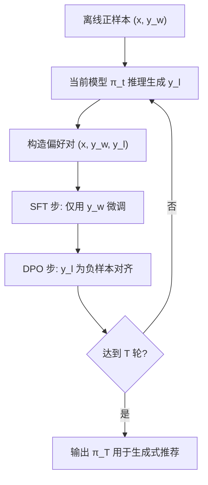

# SPRec: Self-Play to Debias LLM-based Recommendation (自对弈去偏的大模型推荐)

- **会议/期刊**: WWW 2025
- **作者与机构**: Chongming Gao, Ruijun Chen, Shuai Yuan, Kexin Huang, Yuanqing Yu, Xiangnan He (USTC / HKUST / Tsinghua)
- **推荐链路定位**: 端到端生成式（LLM 指令微调 + 偏好对齐）
- **研究方向**: 大语言模型推荐 / 去偏与公平性
- **论文原文**: [https://arxiv.org/abs/2412.09243v3](https://arxiv.org/abs/2412.09243v3)
- **开源代码**: [https://github.com/RegionCh/SPRec](https://github.com/RegionCh/SPRec)

## TL;DR (1分钟核心速览)

LLM 推荐经 SFT 后已存在流行度偏差，而引入 DPO 做偏好对齐会因反向 KL 的 mode-seeking 特性把推荐进一步压缩到少数热门物品（token 级与 item 级同质化）。本文提出 SPRec：每轮迭代先 SFT 再 DPO，把**上一轮模型自身的预测输出当作负样本**，等价于用模型 logits 对 DPO 损失做自适应重加权，无需外部知识即可抑制被过度推荐的物品。在 MovieLens/Goodreads/CDs/Steam 四个数据集上，DivRatio 从 BIGRec 的 0.194 提升至 0.281（MovieLens），ORRatio 从 0.256 降至 0.151，同时 HR/NDCG 全面领先。

## Background & Motivation (背景与核心矛盾)

- **主流范式**: LLM 推荐以 SFT（如 BIGRec 的指令微调）注入协同信号，近期工作（DMPO/SDPO/RosePO）再叠加 DPO 用离线正负对做偏好对齐。
- **前人局限**: (1) SFT 仅用正样本、以正向 KL 拟合经验分布，本身偏向高频物品；(2) DPO 优化反向 KL，具有 mode-seeking 性质，会把概率质量堆到分布尖峰上，使推荐几乎全部集中于最热门物品，加剧 filter bubble。
- **核心洞察 (Key Insight)**: 作者从理论上给出 DPO 最优策略闭式解 $\pi^*_\theta(y|x)\propto\pi_{\text{ref}}(y|x)\cdot(p_{\mathcal{D}}(y|x)/q_{\mathcal{D}}(y|x))^{1/\beta}$；当负样本均匀采样$q_{\mathcal{D}}=\mathcal{U}$且$0<\beta<1$时，最优策略被$p_{\mathcal{D}}$的流行度直接放大，$\beta\to0$ 时退化为只推最热物品。冷启动实验（图 2）证实：SFT 轻微偏向 group 4，DPO 后推荐几乎全部塌缩到最热门组。
- **本文切入点**: 既然偏差来自 DPO 学出的"尖峰"，就让模型与自己的输出对弈——用上一轮预测作负样本，把尖峰自适应压平。

## Method (核心方法设计)

### 1. 整体框架 (Overall Architecture)

SPRec 是一个多轮自对弈微调框架，每轮迭代依次执行三步：(1) **数据构造**：对每条离线正样本 $(x_i,y_i^w)$，用当前模型$\pi_{\theta_t}$推理生成推荐结果作为负样本$y_i^l$，组成偏好对；(2) **SFT 步**：仅用正样本对$\pi_{\theta_t}$做指令微调，维持对真实偏好的拟合（防止过度去偏损伤准确率）；(3) **DPO 步**：用构造的偏好对做偏好对齐得到$\pi_{\theta_{t+1}}$。该流程与任意 LLM 推荐 backbone 解耦，可直接替换 BIGRec 等框架的训练环节。

### 2. 关键设计拆解 (Key Designs)

1. **自对弈负采样 (Self-Play Negative Sampling)**：痛点是用均匀随机负样本时 DPO 无法压制热门物品。本文将第 $t+1$轮负样本改为从模型自身分布采样$y_l\sim\pi_{\theta_t}(\cdot|x)$，得到 SPDPO 目标：
$$\mathcal{L}_{\text{SPDPO}}=-\mathbb{E}_{(x,y_w)\sim\mathcal{D},\,y_l\sim q_{\mathcal{D}}(\cdot|x)}\frac{\pi_{\theta_t}(y_l|x)}{q_{\mathcal{D}}(y_l|x)}\,\ell(\pi_\theta;\pi_{\theta_t};x,y_w,y_l)$$
当 $q_{\mathcal{D}}=\mathcal{U}=1/|\mathcal{I}|$时，该损失即"以$\pi_{\theta_t}(y_l|x)$ 为权重的 DPO 损失"。直觉：模型越偏爱的物品被采为负样本的概率越高、权重越大，从而被更强地压低，形成负反馈式的自适应去偏，且无需预设目标分布或外部模型。

2. **SFT+DPO 交替而非纯 DPO**：消融显示去掉 SFT 后 NDCG 随迭代持续下滑（图 5），说明纯自对弈会把"去偏"推向过度、牺牲准确率。每轮插入 SFT 相当于给模型一个"锚点"，把正样本的排序重新拉回，使去偏与保真在迭代中动态平衡——这与 Llama 3 后训练中 SFT→DPO 的实践一致。

3. **训练目标、负采样与推理效率**：总损失即上述 SPDPO（可扩展为多负样本，采用 beam search 采样 $2N$个输出去重后取 top-$N$）；负采样为**模型自采样（非均匀、非 in-batch）**，无需人工难负样本挖掘。推理阶段与标准 LLM 生成式推荐完全一致（按 BIGRec 协议对全物品空间打分排序），无额外在线开销，代价仅在训练期多出$T$ 轮前向生成。

## Experimental Setup & Evaluation Protocol (实验设置与评估协议)

- **数据集与预处理**: 四个真实数据集，过滤交互序列少于 10 条的用户；每数据集训练/验证/测试各采样 4096/512/1000 条以保证 LLM 方法可比。类别侧取训练集中 top-10 热门类别并剔除层级包含关系（如 FPS 与 Shooting）。

| 数据集 | #Users | #Items | #Interactions | 稀疏度/密度 | 特征/场景说明 |
| :--- | :---: | :---: | :---: | :---: | :--- |
| MovieLens | 约 6k | 约 3.7k | 约 1M | 稀疏 | 电影，含类型标签 |
| Goodreads | 约 8k | 约 8k | 约 0.8M | 稀疏 | 图书，含类别 |
| CDs_and_Vinyl | 约 5k | 约 4k | 约 0.1M | 极稀疏 | Amazon 音乐，含类目 |
| Steam | 约 5k | 约 3k | 约 0.1M | 极稀疏 | 游戏，含标签 |

- **数据划分与防穿越 (Splitting Strategy)**: 按时间戳 **8:1:1 比例划分**，保证训练/验证/测试互斥、无数据泄漏。
- **排名评测协议 (Ranking Protocol)**: 遵循 BIGRec，LLM 生成预测物品后对**全物品空间**计算得分与排名（Full-Ranking 式生成-匹配），并将生成串对齐到数据集中精确物品。
- **对比基线与超参设置**: 传统序列模型 SASRec；SFT 类 BIGRec、RW（类别重加权）、D3（解码去偏）；DPO 类 DMPO、SDPO、RosePO。指标含准确率 HR@5/NDCG@5、多样性 DivRatio、过度推荐 ORRatio、公平性 MGU（类别分布失配）。

## Key Experimental Results (实验关键数据)

### 1. 主实验对比 (Main Results)

| 数据集 | 模型 | DivRatio↑ | ORRatio↓ | MGU↓ | HR↑ | NDCG↑ |
| :--- | :--- | :---: | :---: | :---: | :---: | :---: |
| MovieLens | BIGRec | 0.1939 | 0.2561 | 0.0620 | 0.0347 | 0.0281 |
| MovieLens | SDPO | 0.1816 | 0.2449 | 0.0462 | 0.0310 | 0.0258 |
| MovieLens | RosePO | 0.1857 | 0.2378 | 0.0538 | 0.0290 | 0.0244 |
| MovieLens | **SPRec** | **0.2806** | **0.1510** | 0.0432 | **0.0388** | **0.0319** |
| Goodreads | BIGRec | 0.1420 | 0.3170 | 0.0175 | 0.0310 | 0.0236 |
| Goodreads | SDPO | 0.1580 | 0.3270 | 0.0161 | 0.0420 | 0.0315 |
| Goodreads | **SPRec** | **0.2090** | **0.2170** | **0.0099** | 0.0330 | 0.0250 |
| CDs | BIGRec | 0.3198 | 0.2597 | 0.0461 | 0.0132 | 0.0130 |
| CDs | **SPRec** | **0.3859** | **0.1670** | 0.0242 | **0.0143** | **0.0140** |
| Steam | BIGRec | 0.1940 | 0.3910 | 0.0650 | 0.0780 | 0.0766 |
| Steam | DMPO | 0.2270 | 0.2990 | 0.0443 | 0.0850 | 0.0834 |
| Steam | **SPRec** | **0.2930** | **0.2560** | 0.0367 | **0.0910** | **0.0893** |

MovieLens 上相对 BIGRec：DivRatio **+44.7%**、ORRatio **−41.0%**、HR **+11.8%**、NDCG **+13.5%**；Steam 上 HR **+16.7%**、NDCG **+16.6%**。

### 2. 消融实验 (Ablation Study)

| 数据集 | 变体 | DivRatio↑ | ORRatio↓ | MGU↓ | HR↑ | NDCG↑ |
| :--- | :--- | :---: | :---: | :---: | :---: | :---: |
| MovieLens | w/o SFT | 0.3020 | 0.0837 | 0.0198 | 0.0184 | 0.0149 |
| MovieLens | w/o DPO | 0.1959 | 0.2714 | 0.0637 | 0.0316 | 0.0260 |
| MovieLens | with RN | 0.2194 | 0.2224 | 0.0544 | 0.0286 | 0.0230 |
| MovieLens | **SPRec** | 0.2806 | 0.1510 | 0.0432 | **0.0388** | **0.0319** |
| Goodreads | w/o SFT | 0.2010 | 0.2390 | 0.0044 | 0.0270 | 0.0206 |
| Goodreads | with RN | 0.1380 | 0.3380 | 0.0188 | 0.0420 | 0.0310 |
| Goodreads | **SPRec** | 0.2090 | 0.2170 | 0.0099 | 0.0330 | 0.0250 |

### 3. 关键实验发现 (Key Findings)

1. **自对弈负样本是去偏主引擎**：将负样本换成随机采样（with RN）后，MovieLens 的 DivRatio 从 0.281 掉到 0.219、ORRatio 从 0.151 升到 0.222，Goodreads 的 MGU 从 0.0099 恶化到 0.0188——证明收益并非来自"多训练几轮"，而是来自负样本分布与模型偏好对齐。
2. **SFT 是准确率的保险丝**：去掉 SFT 后 DivRatio 反而最高（0.302），但 HR 从 0.0388 崩到 0.0184、NDCG 从 0.0319 跌到 0.0149，说明纯自对弈会过度压制、牺牲保真；SFT+DPO 交替才实现"去偏不掉点"。
3. **负样本数量与随机污染比例单调影响公平性**：图 6 显示随机负样本比例从 0 升到 1 时 DivRatio 与 NDCG 同步下滑；图 7 显示负样本数 $N$ 从 2 增至 5 时准确率基本持平而 DivRatio/ORRatio/MGU 持续改善，说明自对弈负采样可与多负样本 DPO 正交叠加。

## Highlights & Limitations (亮点、对比与审稿批判)

- **与代表作对比 (vs. Prior Work)**: 相比 BIGRec（纯 SFT，偏差内生于交叉熵）、DMPO/SDPO（随机或多负样本 DPO，反而放大 mode-seeking）、RosePO（依赖语义负采样，仅在 CDs 等特定数据结构上有效），SPRec 的核心差异是**负样本分布随训练动态演化**，不依赖预设目标分布、外部模型或人工规则，跨数据集泛化更稳。
- **可迁移亮点**: (1) "用上一轮模型输出作负样本 + 按模型概率重加权损失"这一自对弈范式可迁移到任何生成式召回/重排的偏好对齐；(2) 每轮插入 SFT 锚点以平衡去偏与保真的工程技巧，对 RLHF/DPO 类推荐后训练普遍适用。
- **审稿级局限批判**: (1) 训练需 $T$ 轮"生成负样本 + SFT + DPO"，每轮都要对全训练集做 LLM 推理，训练开销显著高于单次 DPO，论文未给出 wall-clock 对比；(2) 仅处理 DPO 阶段偏差，SFT 交叉熵本身的流行度偏差未触及，且优化停留在单物品预测层面，未涉及序列级/列表级长期对齐。

## Rating (四维评分)

- **方法创新性 (Novelty)**: ⭐⭐⭐⭐ （从反向 KL 的 mode-seeking 给出 DPO 放大流行度偏差的闭式解释，自对弈重加权机制简洁且有理论支撑）
- **评估协议与实验扎实度 (Protocol & Experiments)**: ⭐⭐⭐⭐ （四数据集 + 准确率/多样性/公平性多指标 + 消融与超参分析完整，但仅 1000 条测试样本、缺少显著性检验）
- **写作与数学规范度 (Clarity & Rigor)**: ⭐⭐⭐⭐ （定理与重加权推导清晰，SFT/DPO/SPRec 三者对比图直观；部分符号在正文与附录间略有跳跃）
- **工业落地与复现价值 (Industrial & Practical Value)**: ⭐⭐⭐⭐ （代码开源、推理零额外开销、与现有 LLM 推荐框架解耦；但多轮训练成本与生成式全库排序的线上延迟仍是落地门槛）

