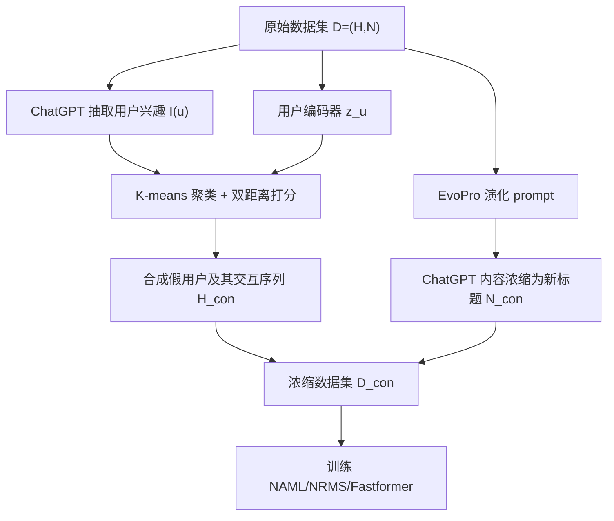
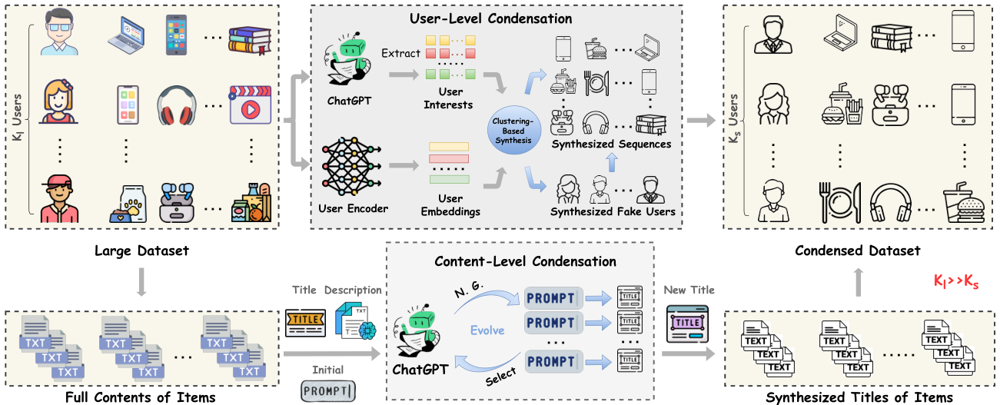

# TF-DCon: Leveraging Large Language Models (LLMs) to Empower Training-Free Dataset Condensation for Content-Based Recommendation (借助大语言模型实现免训练的内容推荐数据集浓缩)

- **会议/期刊**: WWW 2025 (TheWebConf'25, full version)
- **作者与机构**: Jiahao Wu, Qijiong Liu, Hengchang Hu, Wenqi Fan, Shengcai Liu, Qing Li, Xiao-Ming Wu, Ke Tang（南方科技大学、香港理工大学、新加坡国立大学）
- **推荐链路定位**: 训练数据侧（数据浓缩/训练加速），服务于召回与排序模型的离线训练
- **研究方向**: 大语言模型推荐 / 冷启动与长尾推荐（数据效率视角）
- **论文原文**: [https://arxiv.org/abs/2310.09874v5](https://arxiv.org/abs/2310.09874v5)
- **开源代码**: 暂未开源（原文称 code and data will be made available on request）

## TL;DR (1分钟核心速览)

内容推荐（CBR）模型依赖百万级用户-物品交互与长文本训练，周期性重训成本不可持续。本文首次把**数据集浓缩**引入文本 CBR：用 ChatGPT 做**内容级浓缩**（把标题+摘要+类目压成一条信息量高的新标题，并用提示演化 EvoPro 自动调优 prompt）与**用户级浓缩**（ChatGPT 抽取用户兴趣 + 用户嵌入双距离 K-means 聚类，合成假用户并合并其历史交互）。整个流程是**前向式、免双层迭代优化**的。在 MIND/Goodreads/MovieLens 上，MIND 仅保留 5% 数据即达原性能 97.22%（NAML），训练加速约 5×。

## Background & Motivation (背景与核心矛盾)

- **主流范式**: 文本 CBR（NAML/NRMS/Fastformer）用 CNN/Attention/预训练语言模型编码标题、摘要、类目，再层级聚合用户历史；性能强但训练集动辄上亿交互，且线上需周期性重训。
- **前人局限**: 现有数据集浓缩（DC、GCond、DosCond、TextEmbed）均面向图像/图/文本嵌入等**连续数据**，把浓缩写成嵌套双层优化 $\min_{\mathcal{S}}\mathcal{L}(f_{\theta^{\mathcal{S}}}(\mathcal{D}))$s.t.$\theta^{\mathcal{S}}=\arg\min_\theta \mathcal{L}(f_\theta(\mathcal{S}))$，外层的梯度无法生成**离散文本**；且这些方法只做分类任务，无法保留用户-物品的偏好结构。
- **核心洞察 (Key Insight)**: 推荐数据集的体积瓶颈其实在**用户侧交互**（MIND 中用户部分 106MB vs 物品内容 10MB），而不同用户兴趣高度冗余——一个合成用户可代表 $M$ 个兴趣相近的真实用户；文本侧则可由 LLM 直接"重写"而非"求梯度"。
- **本文切入点**: 把浓缩从"反向优化"改成"LLM 前向生成"，内容与用户两级同时压缩，彻底去掉合成集上的迭代训练。

## Method (核心方法设计)

### 1. 整体框架 (Overall Architecture)

输入原始数据集 $\mathcal{D}=(\mathcal{H},\mathcal{N})$。先由 ChatGPT 从每个用户历史$h(u)$抽取兴趣集$\mathcal{I}(u)$，同时用已训练好的用户编码器得到$z_u=f_\theta(h(u),\mathcal{N})$；两路表征送入 K-means 得到$K_s$个簇心即合成用户，再按"嵌入距离 + 兴趣距离"打分挑选 top-$m$真实用户的历史并集作为该假用户的交互序列。另一侧，ChatGPT 在 EvoPro 演化出的最优 prompt 下把每个物品的全部内容压成一条新标题。两级产物拼成浓缩集$\mathcal{D}_{con}=(\mathcal{H}_{con},\mathcal{N}_{con})$，直接用于训练任意 CBR 模型，测试阶段仍用原始用户与物品。

<figure class="paper-figure" markdown="span">
  <figcaption>图 2：所提方法概览。该方法的整体流程见算法 1，提示演化的细节见算法 2。“N. G.”表示“下一个生成的提示候选”。给定一个提示，内容级浓缩与用户兴趣抽取的实例见图 3。</figcaption>
</figure>

### 2. 关键设计拆解 (Key Designs)

1. **内容级浓缩 + 提示演化 EvoPro（让 LLM 适配推荐域）**：手工 prompt 难以稳定产出"信息不丢"的标题。EvoPro 把初始 prompt 记为 $gen_0$，每轮让 ChatGPT 基于$gen_{i-1}$生成$N$个候选，用"浓缩标题与原内容的文本嵌入相似度之和"打分选优：$s=\sum_{c_i\in\mathcal{C}}\mathrm{Sim}\big(f_{enc}(c_i),f_{enc}(\mathrm{LLM}(prompt,c_i))\big)$。直觉是：与原文语义最接近的浓缩标题保留信息最多，等价于用 LLM 自身做无梯度的"信息保真"筛选。

2. **聚类式用户合成（把偏好结构写进浓缩集）**：仅压缩文本会丢掉用户-物品偏好。本文对 $z_u$做 K-means 得簇心$c_i$，并对兴趣嵌入$e_u=f_{pool}(f_{PLM}(\mathcal{I}(u)))$求簇心$c_i'$，定义选择分数$d_u=\mathrm{Dis}(z_u,c_i)+\alpha\cdot\mathrm{Dis}(e_u,c_i')$，簇内升序取 top-$m$合并历史$h(u_s)=\bigcup_{i=1}^{m}h(u_i)$。$\alpha$ 平衡"行为相似"与"兴趣相似"，使合成用户既覆盖主流偏好又不被单一信号带偏。

3. **训练目标、负采样与推理效率**：本文**不引入新的浓缩损失**——这正是卖点。下游仍用标准 CBR 训练目标（BPR 类 pairwise 损失，负采样比 4），浓缩阶段复杂度为 $O(1)$（一次前向），而 DC 为$\tau_i\cdot\tau_o$、DosCond 为$\tau_o$。推理侧无额外开销，收益全部体现在训练时长上。

## Experimental Setup & Evaluation Protocol (实验设置与评估协议)

- **数据集与预处理**:

| 数据集 | #Users | #Items | #Interactions(正/负) | 密度 | 特征/场景说明 |
| :--- | :---: | :---: | :---: | :---: | :--- |
| MIND | 94,057 | 65,238 | 347,727 / 8,236,715 | 0.0057% | 新闻，title+abstract+category，avg. 45.42 tok |
| Goodreads | 23,089 | 16,833 | 273,888 / 485,233 | 0.0705% | 图书，书名+简介，avg. 35.37 tok |
| MovieLens | 943 | 1,682 | 48,884 / 17,431 | 3.0820% | 电影，片名+描述，avg. 34.80 tok |

- **数据划分与防穿越 (Splitting Strategy)**: 采用 `80%/10%/10%` **比例划分**；浓缩只在训练集上进行，验证/测试沿用原始用户与物品内容，避免信息泄漏。
- **排名评测协议 (Ranking Protocol)**: 沿用 NAML/NRMS 惯例的**采样排序**（每正样本配 4 负样本），指标为 NDCG@K 与 Recall@K（Goodreads/MovieLens 取 K=1,5；MIND 取 K=5,10），并以 "Quality" = 浓缩集指标 / 原始集指标 的均值衡量保真度。
- **对比基线与超参设置**: 基线为 Random（随机选用户+随机截断 token）、Majority（选高活跃用户+随机截断）、TextEmbed（嵌入式浓缩，仅用于效率对比）；骨干为 NAML/NRMS/Fastformer，内容编码维度 256、用户编码维度 64，Adam lr=5e-3，5 次独立运行取均值，单卡 RTX 3090。

## Key Experimental Results (实验关键数据)

### 1. 主实验对比 (Main Results)

MIND（$r=5\%$）与 Goodreads（$r=27\%$）代表性结果：

| 数据集 | 模型 | 指标 | Random | Majority | **TF-DCon** | Original | Quality |
| :--- | :--- | :--- | :---: | :---: | :---: | :---: | :---: |
| MIND | NAML | N@5 | 0.3470 | 0.3466 | **0.3691** | 0.3783 | **97.22%** |
| MIND | NAML | R@5 | 0.5670 | 0.5697 | **0.6150** | 0.6270 | — |
| MIND | NRMS | N@5 | 0.3225 | 0.3225 | **0.3597** | 0.3608 | **99.38%** |
| MIND | Fastformer | N@5 | 0.3425 | 0.3350 | **0.3637** | 0.3645 | **99.29%** |
| Goodreads | NAML | N@1 | 0.5197 | 0.5057 | **0.5411** | 0.6462 | **90.49%** |
| Goodreads | NRMS | N@1 | 0.5399 | 0.5094 | **0.5453** | 0.6439 | **91.01%** |
| MovieLens | NAML | N@1 | 0.8241 | 0.8367 | **0.8484** | 0.8280 | **103.15%** |
| MovieLens | Fastformer | N@5 | 0.8254 | 0.8318 | **0.8429** | 0.8145 | **105.22%** |

效率对比（NAML，含浓缩耗时）：MIND 上 TextEmbed 450.02 min / N@1=0.2678，TF-DCon **67.46 min / 0.3071**；MovieLens 上 64.58 min → **0.47 min**，且 N@1 从 0.7128 升至 0.8484。

### 2. 消融实验 (Ablation Study)

| 配置 | 压缩率 | NAML Quality | NRMS Quality | Fastformer Quality |
| :--- | :---: | :---: | :---: | :---: |
| 仅内容级（MIND） | 39% | 98.39% | 99.30% | 99.67% |
| 仅用户级（MIND） | 2% | 93.75% | 96.38% | 97.34% |
| 仅用户级（Goodreads） | 22% | 92.09% | 93.31% | 92.84% |
| 仅用户级（MovieLens） | 15% | 101.61% | 100.83% | 103.76% |
| 两级联合（MIND） | 5% | 97.22% | 99.38% | 99.29% |
| 兴趣替换为随机 token（MIND, NAML N@1） | — | 0.2978 vs **0.3071** | 0.2916 vs **0.2997** | 0.2898 vs **0.3022** |

### 3. 关键实验发现 (Key Findings)

1. **压缩收益主要来自用户侧而非文本侧**：MIND 上用户部分从 106,614 KB 压到 2,139 KB（2%），物品内容仅压到 39%；仅用户级浓缩即可在 Fastformer 上以 2% 数据保住 97.34% 性能，说明用户兴趣冗余度远高于文本冗余度。
2. **小数据集上浓缩反而"去噪增益"**：MovieLens 上 TF-DCon 的 Quality 达 103.15%/105.22%（>100%），作者归因于原始集过小、浓缩集充当了精炼去噪版本；而 Goodreads 仅约 91%，因用户兴趣冗余度低（$M\gg N$），合成用户覆盖能力受限。
3. **EvoPro 与 LLM 规模均有稳定正收益**：Llama-2-7b 下 prompt 从 $gen_0\to gen_2$，MIND N@1 由 0.2902 升至 0.2993、Goodreads N@1 由 0.5098 升至 0.5258，逐代单调提升；ChatGPT 版（0.3071）仍最优，但小模型已接近，说明方法不依赖超强 LLM。此外$\alpha\in(0,1)$ 普遍最优，验证兴趣信号与行为信号需互补而非替代。

## Highlights & Limitations (亮点、对比与审稿批判)

- **与代表作对比 (vs. Prior Work)**: 相比 DC/GCond/DosCond 的双层梯度匹配，本文把浓缩复杂度从 $\tau_i\cdot\tau_o$降到$O(1)$ 且能生成**离散文本**；相比 TextEmbed 这类嵌入式文本浓缩，本文保留原始文本形态，因而浓缩集可跨 NAML/NRMS/Fastformer 架构复用（表 5 显示跨模型迁移性能几乎无损）；相比 DConRec 的 ID-based 优化式浓缩，本文面向内容侧且免训练。
- **可迁移亮点**: (1) "用嵌入相似度给 LLM 输出打分来自动选 prompt"是零梯度的通用 prompt 调优套路，可迁移到 LLM 做特征增强/样本合成；(2) "嵌入距离 + 语义兴趣距离"的双距离聚类打分可直接用于跨域用户对齐或冷启动用户聚类。
- **审稿级局限批判**: (1) 浓缩依赖 ChatGPT API，成本随数据集规模**线性增长**且受网络延迟影响，小数据集上"省下的训练算力"可能抵不过 API 开销；(2) 用户级浓缩需先用已训练好的用户编码器，存在"先有鸡还是先有蛋"的冷启动依赖，且开源 LLM 版本性能仍明显落后于 ChatGPT。

## Rating (四维评分)

- **方法创新性 (Novelty)**: ⭐⭐⭐⭐ （首次把数据集浓缩引入文本 CBR，用前向 LLM 生成替代双层优化，思路干净且有复杂度分析支撑）
- **评估协议与实验扎实度 (Protocol & Experiments)**: ⭐⭐⭐⭐ （三数据集 × 三骨干 × 五随机种子，含内容/用户级消融、$\alpha$/$K$ 敏感性、跨 LLM 与毒性检查，但仅采样排序、缺全库排序与线上验证）
- **写作与数学规范度 (Clarity & Rigor)**: ⭐⭐⭐⭐ （算法 1–3 与复杂度表清晰，公式简洁；但核心贡献偏工程组合，理论刻画较薄）
- **工业落地与复现价值 (Industrial & Practical Value)**: ⭐⭐⭐⭐ （5× 训练加速、5% 数据保 97% 性能对周期性重训极具吸引力，但代码未开源且 API 成本模型需实测）

