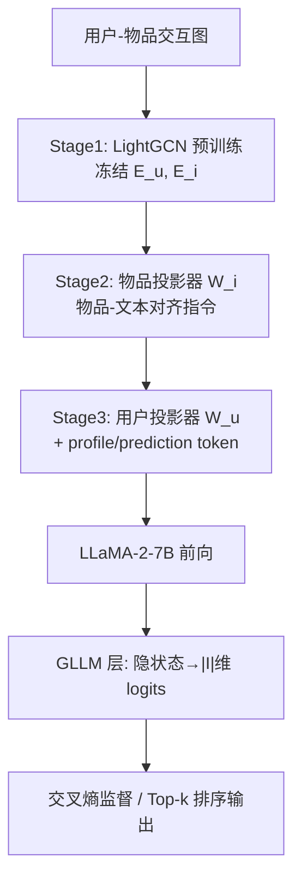
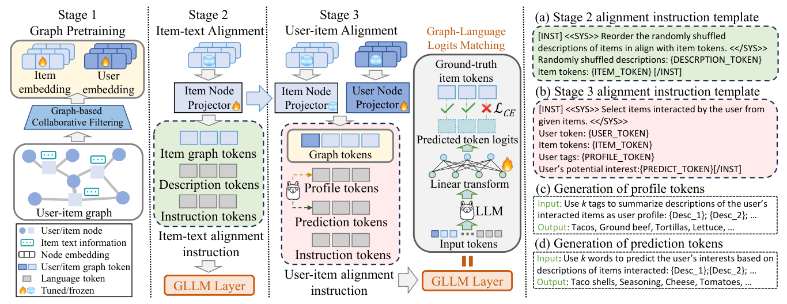

# Training Large Recommendation Models via Graph-Language Token Alignment (通过图-语言 Token 对齐训练大推荐模型)

- **会议/期刊**: WWW Companion 2025 (Short Paper)
- **作者与机构**: Mingdai Yang, Xiaolong Liu, Chen Wang, Philip S. Yu (UIC)；Zhiwei Liu, Liangwei Yang (Salesforce AI Research)；Hao Peng (北航)
- **推荐链路定位**: 端到端生成式召回/排序
- **研究方向**: 大语言模型推荐 / 协同过滤
- **论文原文**: [https://arxiv.org/abs/2502.18757v1](https://arxiv.org/abs/2502.18757v1)
- **开源代码**: 暂未开源（仅使用量化版 LLaMA-2-7B 权重 [TheBloke/Llama-2-7B-GPTQ](https://huggingface.co/TheBloke/Llama-2-7B-GPTQ)）

## TL;DR (1分钟核心速览)

直接让 LLM 生成物品名会带来"自由文本歧义 + 幻觉物品"，而把 LLM 仅当特征增强器又浪费其推理能力。GLTA 用线性投影器把 LightGCN 预训练的用户/物品节点嵌入映射进 LLaMA-2 词表空间，再以 GLLM 层将 LLM 末层隐状态直接投影为 $|\mathcal{I}|$ 维物品 logits 做交叉熵监督，实现"输出即物品 ID"的端到端推荐。在 Goodreads/Amazon/MovieLens 三数据集 Full-Ranking 协议下，NDCG@10 相对最强基线 RLMRec-Con 分别提升 14.28%/39.66%/185.16%。

## Background & Motivation (背景与核心矛盾)

- **主流范式**: 图协同过滤（LightGCN/HCCF）擅长挖掘交互结构但读不懂文本语义；LLM4Rec 则分两派——直接把 LLM 当推荐器生成物品文本，或把 LLM 嵌入当辅助特征喂给图模型。
- **前人局限**: 其一，LLM 自由生成物品名时，相似物品（如同名不同版本）难以精确回映射到物品 ID，且会凭空捏造不存在的物品（幻觉）；其二，RLMRec 一类方法虽引入 LLM 语义，但最终打分仍由 LightGCN 骨干完成，LLM 的推理能力被闲置。
- **核心洞察 (Key Insight)**: 若能把图节点嵌入"翻译"成 LLM 词表里的 token，则 LLM 的每一次 next-token 预测天然对应一个真实物品，歧义与幻觉从输出形式上被根除。
- **本文切入点**: 用"节点投影器 + logits 匹配层"替代"文本生成 + 后处理解析"，让 LLM 真正承担端到端推荐决策。

## Method (核心方法设计)

### 1. 整体框架 (Overall Architecture)

GLTA 分三阶段串行：**Stage 1 图预训练**用 LightGCN 在用户-物品图上得到并冻结节点嵌入 $\mathbf{E}_u,\mathbf{E}_i$；**Stage 2 物品-文本对齐**用线性投影器把物品节点映射为物品 token，并通过"重排打乱后的物品描述"指令让 LLM 学会将物品 token 与其语义描述绑定；**Stage 3 用户-物品对齐**再把用户节点投影为用户 token，与 LLM 生成的 profile token、prediction token 及物品 token 拼进同一指令模板，由 GLLM 层输出物品 logits 并以交叉熵监督。训练时仅微调两个投影器与 GLLM 层，LLM 与图嵌入全程冻结，推理时直接取 logits 排序。

<figure class="paper-figure" markdown="span">
  <figcaption>图2：GLTA框架包含三个阶段：图预训练、物品-文本对齐和用户-物品对齐。指令模板展示在图的右侧，并附有画像与预测token的生成过程。</figcaption>
</figure>

### 2. 关键设计拆解 (Key Designs)

1. **双阶段节点-语言 Token 对齐（Item-text & User-item Alignment）**：图嵌入与语言嵌入分处两个空间，直接拼接无法被 LLM 理解。作者用两个线性投影器 $\mathbf{V}_i=\mathbf{W}_i\mathbf{E}_i+\mathbf{b}_i$、$\mathbf{V}_u=\mathbf{W}_u\mathbf{E}_u+\mathbf{b}_u$ 将节点映射进 LLM 词表维度；Stage 2 先单独对齐物品，使物品 token 获得语义锚点，Stage 3 再对齐用户，从而让用户 token 落在"已被语义标定"的物品 token 邻域中。这种"先物品后用户"的课程式顺序是性能关键（消融中移除任一阶段均掉点）。

2. **Graph-Language Logits Matching (GLLM)**：这是消除歧义的核心。LLM 末层隐状态经线性层变为 $\mathbf{Z}_{ui}\in\mathbb{R}^{L\times|\mathcal{I}|}$，直接对真实物品 ID 做逐位置交叉熵：
$$\mathcal{L}_{CE}=-\frac{1}{L}\sum_{t=1}^{L}\log\frac{\exp(\mathbf{Z}_i[t,y^+_{i,t}])}{\sum_{j=1}^{|\mathcal{I}|}\exp(\mathbf{Z}_i[t,j])}$$
由于输出维度被约束为物品全集，模型在结构上不可能生成不存在的物品；同时监督信号直接来自物品 ID 而非文本匹配，避免了"生成对了名字但映射错了 ID"的误差累积。

3. **训练目标、负采样与推理效率**：总损失即上述 $\mathcal{L}_{CE}$，**无需显式负采样**——分母对全物品集归一化，天然构成全库 softmax。由于用户交互数未必等于序列长度$L$，仅对前$k$个位置用随机打乱的$k$ 个真实交互物品做监督。推理时取 logits 排序而非自回归解码，且只微调投影器与 GLLM 层（LLM 冻结 + GPTQ 量化），训练开销远低于全参微调。

## Experimental Setup & Evaluation Protocol (实验设置与评估协议)

- **数据集与预处理**:

| 数据集 | #Users | #Items | #Interactions | 密度 | 特征/场景说明 |
| :--- | :---: | :---: | :---: | :---: | :--- |
| Goodreads | 10,131 | 10,725 | 478,334 | 0.440% | 历史类图书 + 书籍描述 |
| Amazon | 1,032 | 17,609 | 30,510 | 0.168% | 食品杂货 + 商品描述 |
| MovieLens | 6,040 | 3,706 | 1,000,209 | 4.468% | 电影，以类型(genre)充当描述 |

- **数据划分与防穿越 (Splitting Strategy)**: 原文未明确交代划分细节（短论文篇幅所限），仅说明测试阶段对测试用户的全未交互物品排序，属隐式反馈标准设定。
- **排名评测协议 (Ranking Protocol)**: 无偏 **Full-Ranking**——对每个测试用户在其全部未交互物品上排序，指标为 P@5/P@10、N@5/N@10。
- **对比基线与超参设置**: 三组基线——纯交互图模型（LightGCN、HCCF）、图+文本对齐（LightGCN+、HCCF+，用 InfoNCE 对齐句向量）、LLM 增强（RLMRec-Con、RLMRec-Gen）。LLM 采用量化 LLaMA-2-7B，优化器 Adam，图嵌入维度 $d$ 与 LLM 隐维对齐。

## Key Experimental Results (实验关键数据)

### 1. 主实验对比 (Main Results)

| 数据集 | 方法 | P@5 | P@10 | N@5 | N@10 |
| :--- | :--- | :---: | :---: | :---: | :---: |
| Goodreads | LightGCN | 0.1999 | 0.1618 | 0.2346 | 0.2352 |
| | HCCF+ | 0.2034 | 0.1641 | 0.2379 | 0.2483 |
| | RLMRec-Con | 0.2062 | 0.1676 | 0.2441 | 0.2542 |
| | **GLTA** | **0.2465** | **0.1882** | **0.2722** | **0.2905** |
| | Improv. | +19.54% | +12.29% | +11.51% | +14.28% |
| Amazon | LightGCN | 0.0204 | 0.0139 | 0.0301 | 0.0305 |
| | HCCF+ | 0.0217 | 0.0156 | 0.0310 | 0.0315 |
| | RLMRec-Con | 0.0227 | 0.0142 | 0.0348 | 0.0358 |
| | **GLTA** | **0.0359** | **0.0236** | **0.0499** | **0.0500** |
| | Improv. | +58.14% | +51.28% | +43.39% | +39.66% |
| MovieLens | LightGCN | 0.0470 | 0.0426 | 0.0463 | 0.0466 |
| | HCCF+ | 0.0516 | 0.0436 | 0.0486 | 0.0488 |
| | RLMRec-Con | 0.0499 | 0.0460 | 0.0488 | 0.0492 |
| | **GLTA** | **0.0968** | **0.0821** | **0.1162** | **0.1403** |
| | Improv. | +83.68% | +78.48% | +138.11% | +185.16% |

### 2. 消融实验 (Ablation Study)

| 变体 | Goodreads P@5 / N@5 | Amazon P@5 / N@5 | MovieLens P@5 / N@5 |
| :--- | :---: | :---: | :---: |
| w/o both (PF & PD) | 0.2462 / 0.2705 | 0.0316 / 0.0408 | 0.0736 / 0.0658 |
| w/o Profile token | 0.2466 / 0.2668 | 0.0318 / 0.0414 | 0.0763 / 0.0713 |
| w/o Prediction token | 0.2467 / 0.2688 | 0.0341 / 0.0449 | 0.0860 / 0.0761 |
| **GLTA (full)** | **0.2465 / 0.2722** | **0.0359 / 0.0499** | **0.0968 / 0.1162** |

（另：移除 item-text 对齐 `w/o IA` 或 user-item 对齐 `w/o UA` 均在三个数据集上稳定掉点，见图 3；将 GLLM 换成自回归推理 AR 或首 logit 优化 FL 均显著劣化，见图 4。）

### 3. 关键实验发现 (Key Findings)

1. **稠密交互场景收益最大**：MovieLens 密度 4.468%，GNN 基线受过度平滑拖累（LightGCN N@10 仅 0.0466），GLTA 的 N@10 达 0.1403（+185%），说明 LLM 推理恰好补上了图模型在稠密图上的表征坍缩短板。
2. **profile/prediction token 的增益与物品多样性正相关**：MovieLens 上移除二者使 N@5 从 0.1162 跌至 0.0658（近乎腰斩），而 Goodreads（单一历史类图书）上几乎无损，证明 LLM 生成 token 的价值来自"捕捉物品间细粒度差异"，物品同质时收益有限。
3. **推荐不需要自回归**：AR 推理显著劣于 GLLM 的并行 logits 排序，说明物品序列的上下文连续性远弱于自然语言，且训练（描述+协同信号）与自回归推理模式不一致会放大误差。

## Highlights & Limitations (亮点、对比与审稿批判)

- **与代表作对比 (vs. Prior Work)**: 相比 RLMRec（LLM 仅作辅助特征、骨干仍是 LightGCN），GLTA 让 LLM 真正输出决策；相比 GraphGPT/TALLRec 式"生成文本再解析"，GLLM 把输出空间硬约束为物品全集，从结构上消灭幻觉；相比全参微调 LLM，仅训投影器 + GLLM 层大幅降低开销。
- **可迁移亮点**: ①"冻结图嵌入 + 轻量投影器 + 全库 softmax"的范式可低成本迁移到任何已有 CF 骨干；②用 LLM 生成 profile/prediction token 作为软提示，是一种无需额外标注的用户画像增强技巧。
- **审稿级局限批判**: ①短论文未交代数据划分细节与显著性检验，且 Amazon 仅 1,032 用户，Full-Ranking 下的绝对指标偏低，统计稳健性存疑；②输出层维度绑定 $|\mathcal{I}|$，物品数达百万级时 GLLM 的$L\times|\mathcal{I}|$ logits 与全库 softmax 显存/时延不可忽视，论文未给出推理开销实测；③MovieLens 用 genre 充当"描述"，语义信息极稀疏，可能高估了对齐模块在真实富文本场景的增益。

## Rating (四维评分)

- **方法创新性 (Novelty)**: ⭐⭐⭐⭐ （"节点投影 + logits 匹配"思路简洁有效，从输出形式上根除幻觉，但投影器与对齐指令本身借鉴 GraphGPT，增量偏工程化）
- **评估协议与实验扎实度 (Protocol & Experiments)**: ⭐⭐⭐ （采用无偏 Full-Ranking 且基线覆盖三组较全面，但划分细节缺失、无显著性检验、Amazon 规模偏小）
- **写作与数学规范度 (Clarity & Rigor)**: ⭐⭐⭐⭐ （三阶段框架与公式表述清晰、图示直观，5 页短文信息密度高，但部分符号与指令模板细节略简）
- **工业落地与复现价值 (Industrial & Practical Value)**: ⭐⭐⭐ （仅微调投影器 + 量化 LLM 的思路利于落地，但未开源、百万级物品的 logits 开销与推理时延缺乏实测支撑）

