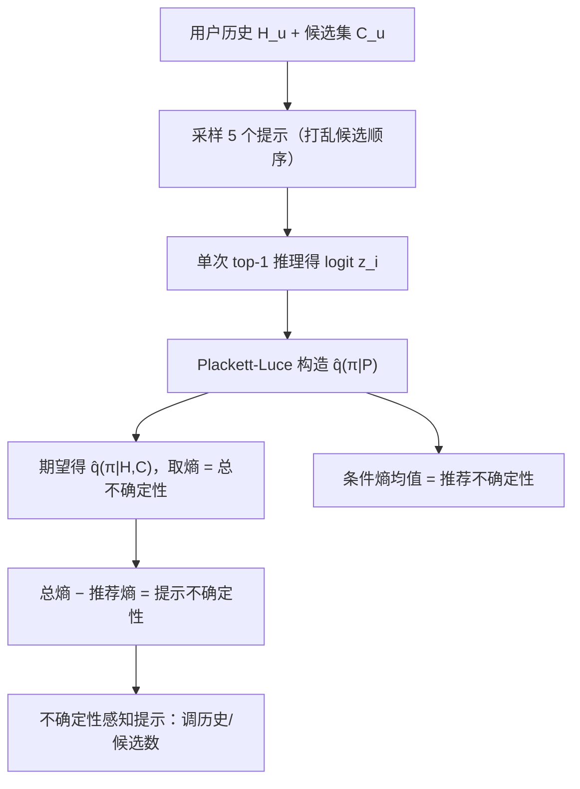

# Uncertainty Quantification and Decomposition for LLM-based Recommendation (面向 LLM 推荐的不确定性量化与分解)

- **会议/期刊**: WWW 2025
- **作者与机构**: Wonbin Kweon, Sanghwan Jang, SeongKu Kang, Hwanjo Yu (POSTECH / Korea University)
- **推荐链路定位**: 重排（LLM 列表式排序阶段）
- **研究方向**: 大语言模型推荐 / 多任务学习与列表级重排
- **论文原文**: [https://arxiv.org/abs/2501.17630v2](https://arxiv.org/abs/2501.17630v2)
- **开源代码**: [https://github.com/WonbinKweon/UNC_LLM_REC_WWW2025](https://github.com/WonbinKweon/UNC_LLM_REC_WWW2025)

## TL;DR (1分钟核心速览)

LLM 列表式重排虽强，但同一用户历史与候选集下，仅改动词、候选顺序或历史长度，生成排名就会剧烈波动（零样本 NDCG@20 变异系数约 0.3，微调后仍有 10–20%），而传统推荐模型不存在此问题。本文把"预测不确定性"引入 LLM 推荐：用 Plackett-Luce 模型以 top-1 logit 单次推理近似整个 $|\mathcal{C}_u|!$ 排名空间的预测分布并取熵，再借提示隐变量把总熵分解为**推荐不确定性**与**提示不确定性**。在 MovieLens-1M / Amazon Grocery / Steam 上，该指标在 21 个评估单元中 18 个优于 Label Prob.、Semantic Unc.、MC-Dropout 等基线；据此做不确定性感知提示，Llama3-8B 的 N@20 从 0.4231 升至 0.4965（+17.3%）。

## Background & Motivation (背景与核心矛盾)

- **主流范式**: 检索增强 + 列表式重排成为 LLM 推荐 SOTA——候选生成器召回 $\mathcal{C}_u$，LLM 依据用户历史$\mathcal{H}_u$与候选文本一次性输出完整排名$\pi_u$。
- **前人局限**: 其一，LLM 推荐存在**生成波动性**，同一输入下随机采样或轻微改动词即导致排名大幅漂移，可靠性无从度量；其二，现有不确定性估计（分类、多选题 QA）依赖可枚举输出空间，而排名空间大小为 $|\mathcal{C}_u|!$（20 候选即$2.4\times10^{18}$），自回归概率无法覆盖。
- **核心洞察 (Key Insight)**: 作者用变异系数 $\sigma_{\text{ndcg}}/\mu_{\text{ndcg}}$ 量化发现波动普遍存在且**与性能负相关**——N@20 最高的用户组 G1 排名方差最低，G4 最高（图 3）。即"生成越稳定，推荐越准"，波动本身可作为可靠性信号。
- **本文切入点**: 用 Plackett-Luce 以 top-1 概率近似排名分布，把不可枚举的熵估计压缩为单次推理，再通过提示隐变量做贝叶斯式熵分解，定位不确定性来源。

## Method (核心方法设计)

### 1. 整体框架 (Overall Architecture)

对每个用户，从提示分布 $q(\mathcal{P}_u|\mathcal{H}_u,\mathcal{C}_u)$采样 5 个提示（随机打乱候选位置），每个提示仅做一次"下一个最想看哪部"的 top-1 推理得到候选 logit$z_i$；用 Plackett-Luce 由$z_i$构造该提示下的完整排名分布$\hat{q}(\pi_u|\mathcal{P}_u)$，对 5 个提示取期望得$\hat{q}(\pi_u|\mathcal{H}_u,\mathcal{C}_u)$，其熵即总预测不确定性；同时计算各提示条件熵的均值作为推荐不确定性，二者之差即提示不确定性。最终用分解结果指导个性化调整历史长度与候选数量。

### 2. 关键设计拆解 (Key Designs)

1. **Plackett-Luce 单次推理的排名分布估计**：痛点是要覆盖 $|\mathcal{C}_u|!$ 个排名需天文数字次推理。本文将提示改为"Which movie would I like to watch next most?"，取候选索引的 logit，按无放回采样概率构造排名分布：
$$\hat{q}(\pi_u|\mathcal{P}_u)=\prod_{k=1}^{K}\frac{\exp(z_{\pi_{u,k}})}{\sum_{l\in\mathcal{N}_k}\exp(z_l)}$$
仅保留 top-$K$ 项以避免概率下溢。直觉上，PL 模型把"整条排名"的概率分解为逐位选择的连乘，单次前向即可获得全空间分布的解析近似，且无放回采样可用 exponential-sort 在毫秒级完成。

2. **基于提示隐变量的熵分解**：痛点是用 BNN 式多模型集成分解 aleatoric/epistemic 需部署多个 LLM，成本不可行。本文引入提示隐变量 $\mathcal{P}_u$，利用互信息恒等式：
$$\underbrace{\mathrm{H}[q(\pi_u|\mathcal{H}_u,\mathcal{C}_u)]}_{\text{总不确定性}}=\underbrace{\mathrm{I}[\mathcal{P}_u,\pi_u]}_{\text{提示不确定性}}+\underbrace{\mathbb{E}_{q(\mathcal{P}_u)}[\mathrm{H}[q(\pi_u|\mathcal{P}_u)]]}_{\text{推荐不确定性}}$$
第一项衡量"换提示就换答案"的敏感度，是 LLM 推荐特有；第二项是提示中性化后的内在推荐难度。单模型、同批推理即可完成分解，无需集成。

3. **训练目标、负采样与推理效率**：本文不训练新排序模型，微调阶段沿用 next-token prediction 预测真实物品索引（LoRA，$r=\alpha=16$，lr$2\times10^{-5}$，20/10 epochs）。不确定性估计本身免负采样，推理开销与 Label Prob.、Verb. 1S top-1 持平（均 5 次推理），而 Semantic Unc.、MC-Dropout、BNN 需 25 次推理或 5 模型集成。

## Experimental Setup & Evaluation Protocol (实验设置与评估协议)

- **数据集与预处理**:

| 数据集 | #Users | #Items | #Interactions | 稀疏度 | 场景说明 |
| :--- | :---: | :---: | :---: | :---: | :--- |
| MovieLens 1M | 6,040 | 3,883 | 1,000,207 | 95.74% | 电影，20-core |
| Amazon Grocery | 21,027 | 18,857 | 358,602 | 99.91% | 杂货，10-core |
| Steam | 38,503 | 6,267 | 1,722,038 | 99.29% | 游戏，20-core |

- **数据划分与防穿越**: `Leave-One-Out`——最后一项测试、倒数第二项验证，其余构造 $\mathcal{H}_u$。
- **排名评测协议**: 候选集大小 20，微调场景由 BPR-MF 召回且保证含真实物品；零样本场景随机召回。指标为 Kendall's $\tau$@K 与 Concordance Index C@K，检验"低不确定性是否对应高 N@K"，而非直接比较 N@20。
- **对比基线与超参设置**: Label Prob.、Semantic Unc.、Verb. 1S top-1、MC-Dropout、BNN（5 模型集成，非直接对手）；基座为 Llama3-8B / Gemma-7B / Mistral-7B 及 GPT-3.5-Turbo 零样本；LoRA 微调，单卡 A100-80G。

## Key Experimental Results (实验关键数据)

### 1. 主实验对比 (Main Results)

微调排序场景（节选 C@20 与 $\tau$@20，最优加粗）：

| 模型 | 方法 | ML-1M $\tau$@20 | ML-1M C@20 | Amazon$\tau$@20 | Amazon C@20 | Steam C@20 |
| :--- | :--- | :---: | :---: | :---: | :---: | :---: |
| Llama3-8B | Label Prob. | 0.2291 | 0.6243 | 0.2981 | 0.6612 | 0.9534 |
| Llama3-8B | Semantic Unc. | 0.2391 | 0.6336 | 0.2980 | 0.6506 | 0.9518 |
| Llama3-8B | MC-Dropout | 0.2478 | 0.6356 | 0.2931 | 0.6635 | 0.9558 |
| Llama3-8B | **Ours** | **0.2639** | **0.6423** | **0.3399** | **0.6890** | **0.9590** |
| Gemma-7B | Label Prob. | 0.1834 | 0.5968 | 0.2489 | 0.6323 | 0.9539 |
| Gemma-7B | **Ours** | **0.2183** | **0.6166** | **0.2949** | **0.6599** | **0.9588** |
| Mistral-7B | Label Prob. | 0.2275 | 0.6164 | 0.3031 | 0.6655 | 0.9489 |
| Mistral-7B | **Ours** | **0.2494** | **0.6331** | **0.3516** | **0.6966** | **0.9588** |

零样本场景同样全面领先（如 GPT-3.5-Turbo 在 Amazon 上 $\tau$@20 由 0.1762 升至 0.2227）；21 个评估单元中 18 个最优，且与 5 模型集成的 BNN 相当甚至更优。

### 2. 消融实验 (Ablation Study)

不确定性感知提示的效果（MovieLens 1M，微调）：

| 策略 | 模型 | N@20 (default → unc.-aware) | 总不确定性 | 平均历史/候选数 |
| :--- | :--- | :---: | :---: | :---: |
| 历史数调整 | Llama3-8B | 0.4231 → **0.4965** | 2.485 → 1.945 | 20 → 20.23 |
| 历史数调整 | Gemma-7B | 0.3998 → **0.4717** | 3.041 → 2.034 | 20 → 20.86 |
| 历史数调整 | Mistral-7B | 0.4001 → **0.4843** | 2.914 → 1.956 | 20 → 19.41 |
| 候选数调整 | Llama3-8B | 0.0658 → **0.0704** | 2.371 → 1.694 | 20 → 20.46 |
| 候选数调整 | Mistral-7B | 0.0612 → **0.0669** | 1.989 → 1.300 | 20 → 19.78 |

### 3. 关键实验发现 (Key Findings)

1. **不确定性是可靠性的有效代理**：Steam 上 C@20 超过 0.95，说明"低熵排名更准"几乎单调成立；且本文方法在同等推理次数下优于需 5 倍推理的 Semantic Unc. 与 MC-Dropout，逼近 5 模型集成的 BNN。
2. **分解揭示 LLM 特有瓶颈**：随微调 epoch 增加，推荐不确定性占比下降而性能上升（O1）；模型越大提示不确定性占比越低（O2）；历史数超过 25 后推荐不确定性上升、N@20 反降（O3）；候选数超过 20 后提示不确定性因排列空间爆炸而急升，抵消了"召回更全"的收益（O4）——这为"更多历史/候选未必更好"提供了熵视角解释。
3. **不确定性可反向驱动提示优化**：仅对 top-5% 高不确定用户调整历史数，Llama3-8B N@20 提升 17.3%，而平均 token 数几乎不变（20→20.23），说明收益来自"选对提示"而非"堆更多上下文"。

## Highlights & Limitations (亮点、对比与审稿批判)

- **与代表作对比 (vs. Prior Work)**: 相比 Semantic Unc.（多次采样计数）与 MC-Dropout（多次 dropout 推理），本文用 PL 模型把排名分布估计压缩到单次推理；相比 BNN 需 5 个 LLM 集成，本文单模型即可完成熵分解，且分解维度（提示 vs. 推荐）是推荐任务独有的，分类/QA 的不确定性框架无法直接迁移。
- **可迁移亮点**: (1) 用 PL/exponential-sort 在组合空间上做单次推理的分布近似，可迁移到任何列表生成任务的置信度估计；(2) "低不确定性样本优先信任/高不确定性样本改提示"可作为 LLM 重排的在线路由或主动学习信号。
- **审稿级局限批判**: (1) 不确定性估计仍需 5 次提示采样推理，在线高 QPS 场景成本不可忽视，作者亦在附录承认此负担；(2) 提示采样仅限 5 个预定义模板，未覆盖用户画像、物品属性等更丰富输入变化，且实验限于 20 候选的小规模重排，未验证千级候选或真实工业流量。

## Rating (四维评分)

- **方法创新性 (Novelty)**: ⭐⭐⭐⭐ （首次将预测熵引入 LLM 列表推荐，PL 近似 + 提示隐变量分解思路简洁且有理论依据）
- **评估协议与实验扎实度 (Protocol & Experiments)**: ⭐⭐⭐⭐ （3 数据集 × 4 基座 × 零样本/微调双场景，18/21 单元最优，但缺少线上 A/B 与大候选规模验证）
- **写作与数学规范度 (Clarity & Rigor)**: ⭐⭐⭐⭐ （熵分解推导清晰、算法伪代码完整，PL 近似的误差界未严格分析）
- **工业落地与复现价值 (Industrial & Practical Value)**: ⭐⭐⭐⭐ （代码与权重开源，推理开销与基线持平，可直接作为 LLM 重排的可靠性门控，但 5 次采样成本需工程优化）

