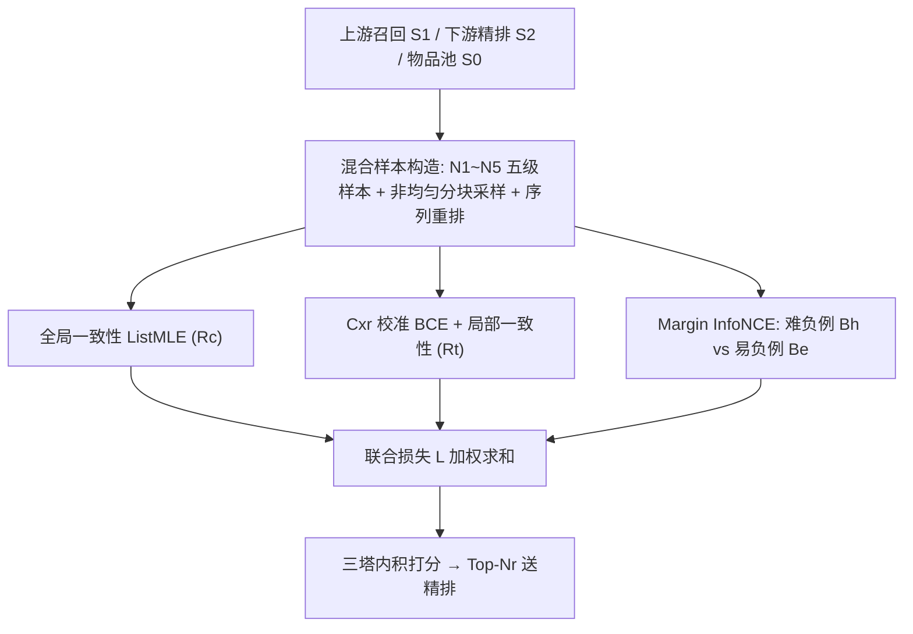
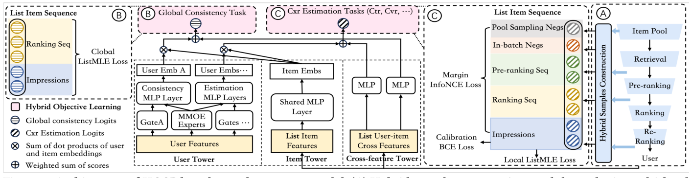

# A Hybrid Cross-Stage Coordination Pre-ranking Model for Online Recommendation Systems (面向在线推荐系统的混合跨阶段协同粗排模型)

- **会议/期刊**: WWW Companion 2025 (工业 track)
- **作者与机构**: Binglei Zhao, Houying Qi, Guang Xu, Mian Ma, Xiwei Zhao, Feng Mei, Sulong Xu, Jinghe Hu（京东 JD.com）
- **推荐链路定位**: 粗排 (Pre-ranking)
- **研究方向**: 多任务学习与列表级重排 / 去偏与工业架构
- **论文原文**: [https://arxiv.org/abs/2502.10284v1](https://arxiv.org/abs/2502.10284v1)
- **开源代码**: 暂未开源（论文提供伪代码）

## TL;DR (1分钟核心速览)

级联推荐中粗排长期被当作孤立阶段，或仅单向模仿精排分数，导致样本选择偏差 (SSB) 与马太效应加剧、长尾精度塌陷。本文提出 HCCP，从**上游召回 + 下游精排/重排**全链路采集多级未曝光样本（精排序列、粗排后段序列、in-batch 负例、池采样负例），并用 **Margin InfoNCE** 显式区分"难负例中潜藏的正例"与"易负例"，联合优化列表级一致性与长尾精度。在淘宝公开集与京东生产集上全面超越 COPR/Rethink，线上 7 天 A/B 取得 **UCVR +14.9%、UCTR +1.3%**，TP99 延迟仅增 0.73%。

## Background & Motivation (背景与核心矛盾)

- **主流范式**: 粗排采用三塔/双塔向量内积模型，从 $10^5$级召回候选中筛出$10^3$ 级送入精排；近年工作（COPR、Rethink）主打与精排的**分数/序一致性蒸馏**。
- **前人局限**: ① 一致性方法只依赖下游日志，而下游输入本身来自粗排输出，形成闭环反馈，**SSB 与马太效应被进一步放大**；② 精排对头部物品预测准、对长尾预测差，COPR 对所有物品一视同仁、Rethink 直接丢弃长尾，二者都损害粗排长尾精度。
- **核心洞察 (Key Insight)**: 未曝光数据并非无信息——下游序列携带精排对头部物品的准确 CTR/CVR 先验，上游召回序列携带高相关但未曝光的候选（其中**潜藏正例**）。作者实测发现粗排在 $K>600$ 时 ASH@K 反超精排（图 4），说明粗排在长尾区段有独立价值，不应盲目对齐。
- **本文切入点**: 把粗排从"孤立阶段"改造为"上游与下游之间的桥"，用全链路多级样本 + 难度感知对比损失同时拿到一致性与长尾精度。

## Method (核心方法设计)

### 1. 整体框架 (Overall Architecture)

基座为三塔（User / Item / Cross-feature）MMoE 结构，User 塔多任务输出 CTR、CVR、多样性。训练时先由在线服务与离线采样共同构造五类样本：$N_1$曝光样本（有明确反馈）、$N_2$精排未曝光序列、$N_3$粗排后段序列、$N_4$list-wise in-batch 负例、$N_5$池采样负例；再以 list-wise 格式组织，使同一请求的样本落在同一 batch 内。目标侧分三支：全局一致性（ListMLE on$R_c$）、Cxr 任务的校准 + 局部一致性、以及 Margin InfoNCE 负例学习，四者加权联合。推理时仅走三塔内积，几乎零额外延迟。

<figure class="paper-figure" markdown="span">
  <figcaption>图2：基于三塔模型的HCCP架构。(A) 混合样本构建模块，用于从上游和下游获取多级未曝光样本；(B) 一致性任务，用于增强粗排对头部物品的排序能力；(C) 在cxr（ctr、cvr等）预估任务中的混合优化，用于提升长尾精度并缓解SSB问题。(B)和(C)属于混合目标学习，其联合优化实现粗排的跨阶段协同。</figcaption>
</figure>

### 2. 关键设计拆解 (Key Designs)

1. **非均匀分块采样 + 序列重排（构造"最优引导真值"）**：直接把精排原始序当标签会被长尾低质预测污染。作者将精排序列切成 $m=7$个不等长 chunk，采样率从头到尾递减（$0.5, 0.125, 0.1, 0.05, 0.025, 0.01, 0.005$），并按$r^{c}=r-(e+l_{clk})\cdot N_r$ 重排，使序列呈"点击 → 未点曝光 → 未曝光"三段式，段内保留原相对序。这样既保住头部细粒度一致性，又保留重排带来的多样性与上下文信息，同时避免长尾被精排错误序带偏。

2. **Margin InfoNCE（难度感知的负例对比损失）**：$N_2/N_3$是难负例但可能含正例，$N_4/N_5$是易负例，传统 InfoNCE 不区分二者。作者在角度空间引入加性 margin$\phi(\theta)=\cos\theta-m$，仅作用于难负例：

$$\mathcal{L}^{t}_{neg}=-\frac{1}{|U|}\sum_{u\in U}\sum_{j\in B_t}\log\frac{e^{v^{t}_{j}\phi(\theta_j)/\tau}}{e^{v^{t}_{j}\phi(\theta_j)/\tau}+\sum_{i\in B_h}e^{v^{t}_{i}\phi(\theta_i)/\tau}+\sum_{k\in B_e}e^{v^{t}_{k}\cos\theta_k/\tau}}$$

其中 $B_h=B_r\cup B_p$（难负例）、$B_e=B_i\cup B_c$（易负例）。附录给出梯度证明：当负例分数$y_n\to 0$时，Margin 损失的梯度$f(y_n)$小于 BCE 的$g(y_n)$，即对"疑似正例的难负例"降分更温和，从而把潜藏正例从难负例中"捞"出来。

3. **训练目标、负采样与推理效率**：总损失 $\mathcal{L}=\lambda_c\mathcal{L}_c+\sum_t\lambda_t(\mathcal{L}^{t}_{cali}+\alpha\mathcal{L}^{t}_{cons}+\beta\mathcal{L}^{t}_{neg})$，权重取$\lambda_c=0.05$、$\lambda_{clk}=0.98$、$\lambda_{ord}=0.2$、$\lambda_{div}=0.1$、$\alpha=0.05$、$\beta=0.5$，$m=0.9$、$\tau=0.1$。负采样为混合式：list-wise in-batch（规模$|U|\times|R_t|$，远大于传统$|U|$）+ 每请求 10 个池采样负例，**免额外 hard-negative 挖掘**。数据量从 0.395B 膨胀到 4.747B，但 list-wise 组织使离线训练复杂度反而下降；线上 TP99 仅 +0.73%。

## Experimental Setup & Evaluation Protocol (实验设置与评估协议)

- **数据集与预处理**:

| 数据集 | #Users | #Items | #Interactions | 稀疏度/密度 | 特征/场景说明 |
| :--- | :---: | :---: | :---: | :---: | :--- |
| Taobao (公开) | 未披露 | 未披露 | 26M 曝光日志 / 8 天 | — | 仅曝光，用 DIN 作精排教师 |
| JD Production | 十亿级请求 | 全量商品 | 0.395B→4.747B（含未曝光） | — | 京东首页全链路一周采样，含 $S_0\sim S_2$ 多级数据 |

- **数据划分与防穿越 (Splitting Strategy)**: JD 生产集按**全局时间戳切分**——训练用一周点击请求，验证用一周后某一天的粗排候选，严格防穿越；淘宝集沿用公开划分。
- **排名评测协议 (Ranking Protocol)**: 采用**全库候选 Top-K 命中**协议（非采样排序），指标为 ISH/ISPH/ASH/ASPH@K（$K=10,100,1000,2000$），覆盖头/中/长尾；一致性用 MAP@K、NDCG@K（以精排 Top-K 为相对真值，$K=2000$ 因精排长尾不准而不测）。淘宝集因仅有曝光，用 AUC + ISH@2/5。
- **对比基线与超参设置**: G1（仅曝光：Base、Base+ListNet）、G2（曝光+精排序：Base+ListMLE）、G3（含未曝光样本：COPR、Rethink、HCCP 各消融版）。MMoE 专家数 8，三塔内积维度未披露；未报告显著性检验。

## Key Experimental Results (实验关键数据)

### 1. 主实验对比 (Main Results)

JD 生产集（表中为相对 Base 的**绝对提升百分点**，加粗为最优）：

| 方法 | ISH@10 | ISH@100 | ISH@1000 | ISPH@100 | ASH@100 | ASH@1000 | ASPH@1000 | ASPH@2000 |
| :--- | :---: | :---: | :---: | :---: | :---: | :---: | :---: | :---: |
| Base+ListNet | 0.09 | -0.26 | -1.48 | -0.67 | 0.33 | 0.46 | 2.92 | 3.53 |
| Base+ListMLE | 0.20 | 1.17 | 0.19 | -0.22 | 0.35 | 1.17 | 3.98 | 5.56 |
| COPR | 1.56 | 8.19 | 14.10 | 8.79 | 7.21 | 16.18 | 23.42 | 24.69 |
| Rethink | 4.49 | 16.10 | 19.05 | 29.74 | 9.00 | 16.74 | 31.69 | 29.36 |
| **HCCP (Ours)** | **9.09** | **22.21** | **21.31** | **40.07** | **26.43** | **25.96** | **38.68** | **34.19** |

淘宝公开集：

| 方法 | AUC | Impr. | ISH@2 | Impr. | ISH@5 | Impr. |
| :--- | :---: | :---: | :---: | :---: | :---: | :---: |
| Base | 0.7515 | - | 0.4947 | - | 0.7531 | - |
| COPR | 0.7713 | +1.98pp | 0.4986 | +0.39pp | 0.7567 | +0.36pp |
| Rethink | 0.7791 | +2.77pp | 0.5102 | +1.55pp | 0.7621 | +0.90pp |
| **HCCP** | **0.7807** | **+2.92pp** | **0.5151** | **+2.04pp** | **0.7675** | **+1.44pp** |

### 2. 消融实验 (Ablation Study)

JD 生产集关键指标（相对 Base 的绝对提升 pp）：

| 变体 | ISH@100 | ISPH@100 | ASH@1000 | ASPH@2000 | MAP@100 | NDCG@10 |
| :--- | :---: | :---: | :---: | :---: | :---: | :---: |
| w/o Up（仅全局一致性） | 7.90 | 7.95 | 12.93 | 22.70 | 4.06 | 3.63 |
| w/o PRC（去掉 $N_2/N_3$ 难负例） | 11.65 | 13.30 | 14.92 | 26.29 | 3.93 | 3.98 |
| w/o Neg（去掉 $N_4/N_5$ 易负例） | 20.27 | 34.71 | 22.36 | 32.06 | 4.65 | 4.29 |
| w/o Margin（退化为普通 InfoNCE） | 21.76 | 39.23 | 24.36 | 30.08 | 4.11 | 7.46 |
| **HCCP (Ours)** | **22.21** | **40.07** | **25.96** | **34.19** | **4.29** | **7.60** |

### 3. 关键实验发现 (Key Findings)

1. **一致性只是"及格线"，长尾才是增益主源**：HCCP 相对 Rethink 在 ISPH@100 上从 29.74 拉到 40.07（+10.3pp），而 MAP@1000 上 HCCP 仅 -0.11、Rethink 为 -2.44——说明盲目对齐精排尾部序会反噬粗排，本文的"软对齐 + 长尾独立优化"才是正解。
2. **难负例必须"区别对待"**：去掉 Margin 后 ASPH@2000 从 34.19 掉到 30.08（-4.1pp），是消融中长尾损失最大的一项；而 w/o PRC 与 w/o Neg 分别损失约 8pp 与 2pp，证明难负例（$N_2/N_3$）贡献更大但更需难度感知损失来"解毒"。
3. **线上增益主要来自长尾 CVR**：7 天 A/B 中一致性模块贡献 UCVR +7.1%，长尾优化再叠加 +7.8%；分频次分析（图 6）显示中长尾物品 CVR 提升显著高于头部，与 UCVR 增幅远大于 UCTR（14.9% vs 1.3%）相互印证。

## Highlights & Limitations (亮点、对比与审稿批判)

- **与代表作对比 (vs. Prior Work)**: COPR 用 chunk 采样 + pairwise 一致性，但把所有物品等权、且只用下游日志；Rethink 用 list-wise 蒸馏覆盖粗排候选，但硬对齐精排序、丢弃长尾。HCCP 的本质差异是**把上游召回也纳入监督信号**，并用 margin 把"未曝光≠负例"这一事实写进损失函数，从"单向模仿"转为"双向桥接"。
- **可迁移亮点**: ① 非均匀分块采样 + 三段式重排，可直接复用于任何"用强模型序监督弱模型"的蒸馏场景；② Margin InfoNCE 的"难/易负例分通道 + 仅难负例加 margin"设计，可迁移到召回双塔的负采样训练。
- **审稿级局限批判**: ① 淘宝集缺未曝光数据，与工业场景存在 gap，公开集结论说服力有限，且未报告显著性检验；② 超参（margin $m$、全局一致性权重$\lambda_c$）作者自承"较为敏感"，但未给出敏感性曲线；③ 线上仅报 UCVR/UCTR，缺 GMV、停留时长等长期指标，无法排除短期指标透支。

## Rating (四维评分)

- **方法创新性 (Novelty)**: ⭐⭐⭐⭐ （"跨阶段桥接"视角 + Margin InfoNCE 的梯度分析有理论支撑，但组件多为已有技术的巧妙组合）
- **评估协议与实验扎实度 (Protocol & Experiments)**: ⭐⭐⭐⭐ （公开集 + 十亿级生产集 + 7 天线上 A/B + 完整消融，唯缺显著性检验与公开集未曝光数据）
- **写作与数学规范度 (Clarity & Rigor)**: ⭐⭐⭐⭐ （损失设计与附录梯度推导清晰，但部分符号（如 $B_h$ 在正文与附录定义不一致）略有瑕疵）
- **工业落地与复现价值 (Industrial & Practical Value)**: ⭐⭐⭐⭐⭐ （TP99 仅 +0.73%、可插拔到任意粗排模型、线上全量部署，工业价值极高；可惜未开源仅给伪代码）

