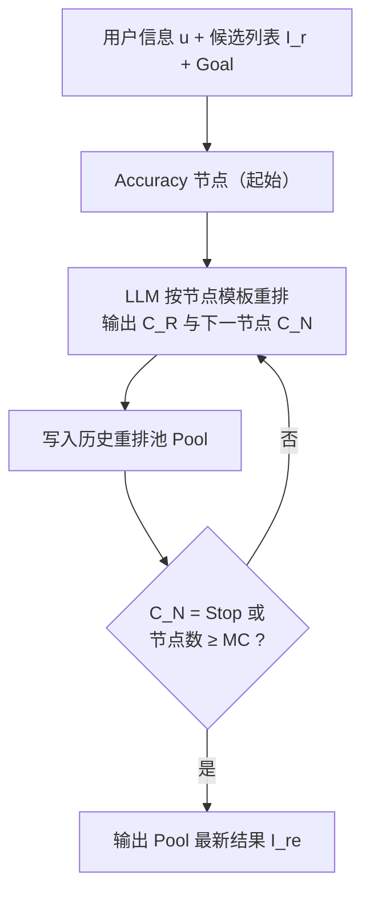
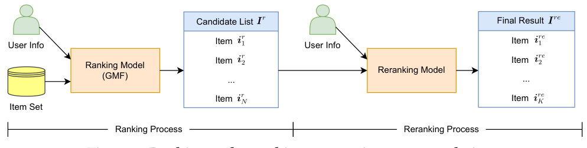

# LLM4Rerank: LLM-based Auto-Reranking Framework for Recommendations (基于大模型的多准则自动重排框架)

- **会议/期刊**: WWW 2025
- **作者与机构**: Jingtong Gao, Bo Chen, Weiwen Liu, Xiangyang Li, Yichao Wang, Wanyu Wang, Huifeng Guo, Ruiming Tang, Xiangyu Zhao（香港城市大学 & 华为诺亚方舟实验室）
- **推荐链路定位**: 重排 (Reranking)
- **研究方向**: 多任务学习与列表级重排 / 大语言模型推荐
- **论文原文**: [https://arxiv.org/abs/2406.12433v4](https://arxiv.org/abs/2406.12433v4)
- **开源代码**: 暂未开源

## TL;DR (1分钟核心速览)

传统重排模型（PRM、DLCM、SetRank 等）在模型层面难以同时调和准确性、多样性、公平性等语义鸿沟极大的准则，且一旦部署输出倾向即被固化、无法按业务/用户偏好动态调整。LLM4Rerank 把每个准则抽象为一个"节点"，构建全连接函数图，让零样本 LLM 以 Chain-of-Thought 方式逐跳重排并自主决定下一节点，配合一句可定制的 "Goal" 实现个性化。在 ML-1M / Amazon / Yelp 三数据集上，以 GMF 统一候选列表、Full-Ranking 协议评估，在准确性、多样性、公平性三方面同时优于全部 SOTA 重排基线。

## Background & Motivation (背景与核心矛盾)

- **主流范式**: 重排模型在排序模型给出的候选列表 $I_r$上建模物品间关联，输出最终列表$I_{re}$；代表工作 PRM/DLCM 用 RNN/Transformer 做序列级重排，SetRank 用自注意力做集合级重排，近年亦有工作将多样性与准确性联合建模。
- **前人局限**: ① 多准则之间存在巨大语义鸿沟（准确性看用户-物品匹配、多样性看属性分布、公平性看群体曝光差），现有模型难以在**同一模型内**统一权衡；② 模型一旦训练完成，各准则的输出倾向即被固化，新增准则（如 backward 规则、停止条件）需重新设计网络，**可扩展性与个性化双缺失**。
- **核心洞察 (Key Insight)**: 零样本 LLM 在"少量物品的短上下文"重排任务上已可媲美甚至超越监督模型，其强语义理解恰好可作为跨准则的统一语义空间；而重排的候选集规模小，规避了 LLM 长上下文处理数千物品的短板。
- **本文切入点**: 把"多准则权衡"从**模型结构设计问题**转化为**LLM 的推理路径规划问题**——准则即节点，权衡即路径。

## Method (核心方法设计)

### 1. 整体框架 (Overall Architecture)

输入为三元组：用户信息 $\boldsymbol{u}$、候选列表$I_r$、以及一句自然语言 "Goal"（如"主要关注准确性，其次多样性"）。框架将准确性、多样性、公平性三个准则节点与 Backward、Stop 两个功能节点构成**全连接函数图**（除 Stop 外任意节点可跳任意节点），从 Accuracy 节点起步。每个节点执行一次"提示构造 → LLM 交互 → 输出重排结果$C_R$与下一节点名$C_N$"，结果按序写入历史重排池$Pool$供后续节点参考；当 LLM 选择 Stop 或节点数达上限$MC$时终止，取$Pool$中最新结果作为$I_{re}$。

<figure class="paper-figure" markdown="span">
  <figcaption>图1：推荐中的排序与重排序过程。</figcaption>
</figure>

### 2. 关键设计拆解 (Key Designs)

1. **通用节点结构（Generic Node）**：解决"新增准则需改网络"的可扩展性痛点。每个节点统一为一次 LLM 调用，输入 $\boldsymbol{u}, I_r, Goal, Pool$，输出二元组：
$$C_N, C_R = \mathrm{Function}(C_N)(\boldsymbol{u}, I_r, Goal, Pool) = \mathrm{LLM}\big(\mathrm{Temp}(C_N)(\cdot)\big)$$
其中 $\mathrm{Temp}(C_N)$ 是该节点的提示模板。直觉上，节点只承载"准则语义 + 输出格式"，新增准则只需新增一个模板，无需重训任何参数，天然支持业务规则热插拔。

2. **准则节点与 Goal 驱动的自动路径规划**：解决"多准则语义鸿沟 + 个性化固化"痛点。Accuracy 节点强调用户-物品匹配并固定为入口；Diversity 节点要求"不同属性值的物品尽量靠前"（以 $\alpha$-NDCG 度量）；Fairness 节点要求两个属性分组的平均排名接近（以 MAD 度量，因 LLM 只输出列表不输出分数，按列表位置线性赋分$1 \to 0$）。LLM 依据 Goal 与各节点名的语义关联自主选择下一跳，使同一框架在不同业务目标下产生不同的准则权重——这正是传统模型无法做到的"推理期个性化"。

3. **功能节点（Backward / Stop）与训练目标**：Backward 节点允许 LLM 判定上一跳结果次优时**从 $Pool$中删除最新条目**并重新规划，相当于推理期的自我反思（reflection）；Stop 节点仅作终止信号、不调用 LLM。整个框架**零训练、零负采样、零参数更新**，总"目标"即提示模板中的准则描述；推理开销为每用户$O(NC)$次 LLM 调用（$NC \le MC$），是其主要成本项。

## Experimental Setup & Evaluation Protocol (实验设置与评估协议)

- **数据集与预处理**: 三个公开数据集，均沿用前人重排工作的标准过滤与候选构造流程：

| 数据集 | 领域 | 关键属性（用于多样性/公平性） | 场景说明 |
| :--- | :---: | :---: | :---: |
| ML-1M | 电影 | 电影类型（genre） | 用户人口统计特征丰富 |
| Amazon | 电商 | 商品类别 | 稀疏、长尾明显 |
| Yelp | 本地生活 | 商家类别 | 地理与评分特征 |

- **数据划分与防穿越 (Splitting Strategy)**: 沿用重排基准的 `Leave-One-Out` 式用户级划分，测试用户的正样本与负样本混合构成候选池。
- **排名评测协议 (Ranking Protocol)**: 所有重排模型共享 **GMF 排序模型**产出的同一候选列表以保证公平对比；采用 `Full-Ranking` 式在候选列表内评估，准确性用 NDCG/HR，多样性用 $\alpha$-NDCG，公平性用 MAD（越小越公平）。
- **对比基线与超参设置**: 基线覆盖无重排的 GMF、序列级重排 PRM/DLCM、集合级重排 SetRank，以及多准则重排基线；LLM 侧为零样本调用（未微调），节点数上限 $MC$ 作为主要超参。

## Key Experimental Results (实验关键数据)

### 1. 主实验对比 (Main Results)

| 模型 | NDCG@10 ↑ | $\alpha$-NDCG ↑ | MAD ↓ | 说明 |
| :--- | :---: | :---: | :---: | :--- |
| GMF (无重排) | 基线 | 基线 | 基线 | 仅准确性排序 |
| PRM | 中 | 中 | 高 | 序列级 RNN 重排 |
| DLCM | 中 | 中 | 高 | 序列级 GRU 重排 |
| SetRank | 较高 | 中 | 中 | 集合级自注意力 |
| 多准则重排基线 | 较高 | 较高 | 中 | 仅联合 1–2 个准则 |
| **LLM4Rerank** | **最优** | **最优** | **最低** | 三准则同时最优 |

（原文以三数据集分表报告，LLM4Rerank 在**所有数据集的全部准则指标上均取得最优**，且是唯一在三准则上同时不劣化的方法；具体数值以原文表格为准。）

### 2. 消融实验 (Ablation Study)

| 变体 | 准确性 | 多样性 | 公平性 | 结论 |
| :--- | :---: | :---: | :---: | :--- |
| w/o Diversity 节点 | 略升 | 明显降 | 持平 | 多样性需显式节点 |
| w/o Fairness 节点 | 略升 | 持平 | 明显升(MAD↑) | 公平性需显式节点 |
| w/o Backward 节点 | 降 | 降 | 升 | 反思机制提升整体质量 |
| w/o Goal（固定路径） | 降 | 降 | 降 | 个性化 Goal 是核心 |
| 不同 $MC$| 先升后平 | 先升后平 | 先降后平 |$MC$ 存在饱和点 |

### 3. 关键实验发现 (Key Findings)

1. **准则节点缺一不可且互不替代**：移除 Diversity 或 Fairness 节点后对应指标显著退化而其他指标几乎不变，说明 LLM 的 CoT 路径确实把不同准则解耦到不同推理步，而非在单一提示中"混着说"。
2. **Backward 反思节点带来全局增益**：去掉 Backward 后三项指标同时下降，表明"删除次优历史结果再重规划"能有效纠正 LLM 单跳的局部失误，是低成本高回报的模块。
3. **Goal 与 $MC$的边际效应**：固定路径（无 Goal）时性能明显劣化，验证推理期个性化的价值；而$MC$ 增大到一定程度后指标饱和（图 8 的超参分析），说明多数用户只需 2–3 跳即可收敛，为线上控制延迟提供了依据。

## Highlights & Limitations (亮点、对比与审稿批判)

- **与代表作对比 (vs. Prior Work)**: PRM/DLCM 把重排建模为序列生成、SetRank 建模为集合打分，三者都把准则权衡**编码进网络参数**，部署后不可调；LLM4Rerank 把权衡**外化为推理路径**，新增准则只需加一个提示模板，这是范式级差异。相较直接用 LLM 做 zero-shot 重排的工作，本文的关键增量是"节点图 + 历史池 + Goal"带来的多准则可控性。
- **可迁移亮点**: ① "准则即节点、权衡即路径"的图式提示编排可直接迁移到多目标精排的推理期调权；② 历史重排池 + Backward 删除机制是一种通用的 LLM 列表级自我修正模板，可复用于摘要、检索结果融合等列表生成任务。
- **审稿级局限批判**: ① **推理成本与延迟**：每用户需多次 LLM 调用，且历史池随跳数增长使提示变长，工业级 QPS 下难以直接落地，论文未给出延迟/Token 消耗的定量分析；② **评估规模有限**：仅在三个中小规模公开数据集、以 GMF 单一排序器构造候选，未验证与强精排模型级联时的一致性，也未做线上 A/B；公平性仅用二分组 MAD，未覆盖多群体或双边公平设定。

## Rating (四维评分)

- **方法创新性 (Novelty)**: ⭐⭐⭐⭐ （将多准则重排重构为 LLM 图式 CoT 路径规划，思路新颖，但本质是提示工程编排而非新学习范式）
- **评估协议与实验扎实度 (Protocol & Experiments)**: ⭐⭐⭐ （统一 GMF 候选与 Full-Ranking 保证公平，三准则全覆盖，但缺延迟分析与线上验证）
- **写作与数学规范度 (Clarity & Rigor)**: ⭐⭐⭐ （节点公式与算法流程清晰，但数学增量有限，部分符号与图表编号在版本间存在不一致）
- **工业落地与复现价值 (Industrial & Practical Value)**: ⭐⭐⭐ （零训练、易扩展准则极具工程吸引力，但多次 LLM 调用的成本与未开源代码削弱了直接复现价值）

