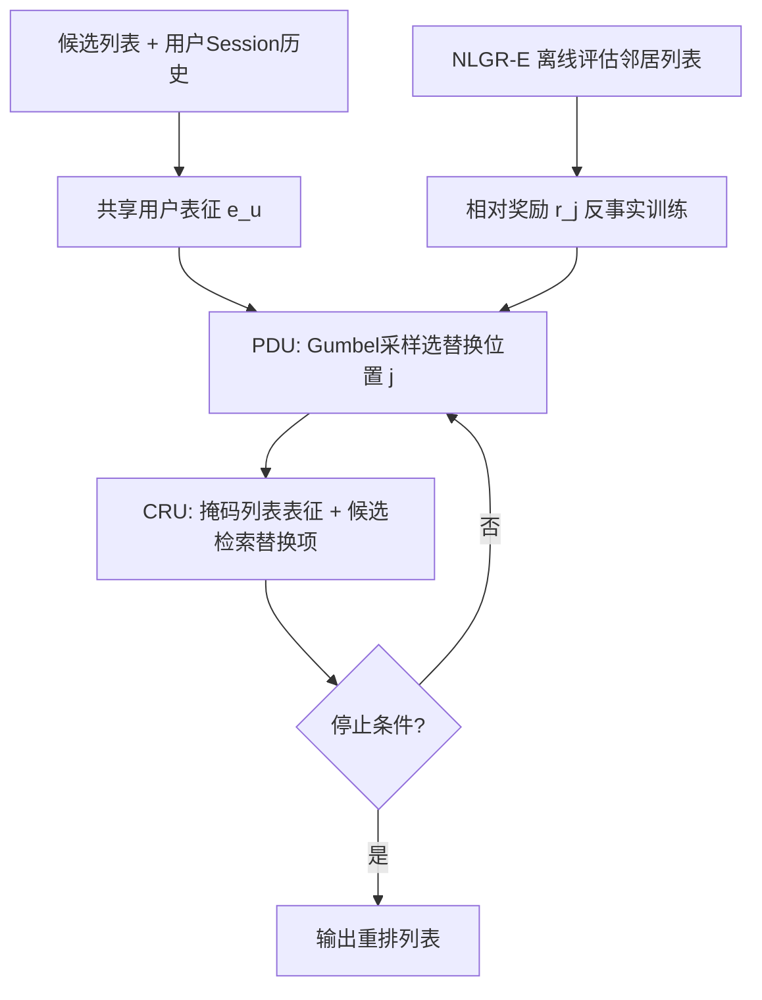
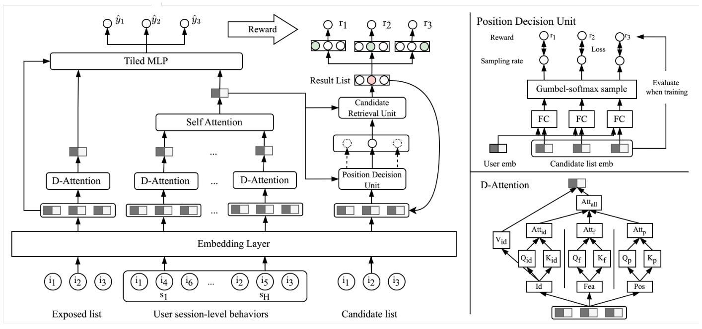

# NLGR: Utilizing Neighbor Lists for Generative Rerank in Personalized Recommendation Systems (利用邻居列表的生成式重排)

- **会议/期刊**: WWW 2025 (Industry Track)
- **作者与机构**: Shuli Wang, Xue Wei, Senjie Kou, Chi Wang, Wenshuai Chen, Qi Tang, Yinhua Zhu, Xiong Xiao, Xingxing Wang（美团）
- **推荐链路定位**: 重排（Reranking）
- **研究方向**: 多任务学习与列表级重排 / 生成式推荐
- **论文原文**: [https://arxiv.org/abs/2502.06097v2](https://arxiv.org/abs/2502.06097v2)
- **开源代码**: 暂未开源

## TL;DR (1分钟核心速览)

重排的组合空间搜索中，评估器（拟合列表效用）与生成器（把任意列表变换为最优列表）存在**目标不一致**，生成器易退化为拟合曝光分布；且逐项自回归解码只看前文、忽略后项信息。NLGR 保留 evaluator-generator 范式，但用**邻居列表的相对奖励**做反事实训练，让生成器感知优化方向，并设计**采样式非自回归生成**（PDU 选位置 + CRU 检索替换项）实现列表间灵活跳转。在 Taobao Ad 与美团工业数据上，AUC 达 0.6344/0.8349、NDCG@10 达 0.2323/0.2857，HR@10% 相对 GRN 提升近一倍；线上 A/B 的 CTR +3.25%、GMV +3.07%，超时率零增长。

## Background & Motivation (背景与核心矛盾)

- **主流范式**: 现代推荐系统采用 matching→ranking→reranking 三段式；重排因组合空间 $O(A_m^n)$ 爆炸，主流采用 evaluator-generator 两段架构——生成器产出可行列表，评估器按列表效用挑选。
- **前人局限一（目标不一致）**: 评估器拟合列表级 pCTR/pCVR，生成器却要把任意列表变换为最优列表，二者目标错位，指导信号难以传递，极端情况下生成器只拟合曝光分布而非在组合空间寻优。
- **前人局限二（逐项解码短视）**: Seq2Slate/GRN 式逐项自回归生成只依赖前序 item，忽略后续 item 信息，难以达到列表全局最优；而 PRM/MIR 等 list-wise 方法存在 evaluation-before-reranking 问题，贪心重排同样无法在组合空间优化。
- **核心洞察 (Key Insight)**: 若能让生成器"看见"当前列表与其邻居列表（仅差 1 个 item）的**相对收益差**，即可把评估器的绝对打分转化为可感知的优化梯度方向，从而弥合目标不一致。
- **本文切入点**: 用邻居列表构造反事实奖励对齐生成器目标，并用采样式非自回归生成替代逐项解码，兼顾全局视野与推理效率。

## Method (核心方法设计)

### 1. 整体框架 (Overall Architecture)

NLGR 由评估器 NLGR-E 与生成器 NLGR-G 组成，二者共享用户表征分支。NLGR-E 以曝光列表与用户 session 级历史列表为输入，经 D-Attention 解耦特征后输出列表级 pCTR/pCVR；NLGR-G 以候选列表（通常为精排列表）为输入，通过 PDU 决定待替换位置、CRU 从候选集中检索替换项，可反复迭代直至收敛。训练阶段 NLGR-E 模拟人类反馈为 NLGR-G 的邻居列表打分并构造相对奖励；**线上仅部署 NLGR-G**，评估器只用于离线指导，故推理开销与普通重排模型相当。

<figure class="paper-figure" markdown="span">
  <figcaption>图2：NLGR的整体架构。</figcaption>
</figure>

### 2. 关键设计拆解 (Key Designs)

1. **邻居列表反事实训练（解决目标不一致）**：对候选列表 $L_o$的每个位置$j$采样替换项构造邻居列表$L_j^*$，用 NLGR-E 评估后经业务加权$w=k_1 L_{ctr}+k_2 L_{ctr}L_{cvr}$与分段指数函数映射为奖励，再取**相对奖励**$r_j = r_j - r_o$聚合为反事实损失$\mathcal{L}_{G1}=-\sum_{j=1}^{m} r_j$。直觉：绝对打分只告诉生成器"好不好"，相对打分告诉它"往哪个方向改更好"，从而在组合空间中形成可优化的梯度场。

2. **采样式非自回归生成（解决逐项短视）**：PDU 用 FC 计算各位置选中 logit $h_j$，经 Gumbel-softmax$r_{p,j}=\mathrm{softmax}((\log h_j+n)/\tau)$采样位置（前向取 argmax、反向可导）；CRU 对掩码列表做自注意力得$e_{mask_j}$，与候选表征$e_{c_k}$ 打分后同样 Gumbel 采样选出替换项。相比逐项解码，该方式一次决策"改哪里+换成谁"，可跨列表跳转，天然具备全局视野。

3. **辅助位置损失与训练目标**：为稳定生成过程，用相对奖励归一化后作为 PDU 的软标签，引入交叉熵 $\mathcal{L}_{G2}=-\sum_j \mathrm{Norm}(r_j)\log r_{p,j}$，总损失$\mathcal{L}_G=\frac{1}{|B|}\sum_B(\mathcal{L}_{G1}+\alpha\mathcal{L}_{G2})$，$\alpha=0.2$。评估器用曝光日志的点击/转化标签做 BCE 训练（式 12）。生成器训练依赖评估器在线下构造反事实奖励，**无需负采样**；线上仅前向生成，无额外计算。

## Experimental Setup & Evaluation Protocol (实验设置与评估协议)

- **数据集与预处理**:

| 数据集 | #Users | #Items | #Interactions | 稀疏度/密度 | 特征/场景说明 |
| :--- | :---: | :---: | :---: | :---: | :--- |
| Taobao Ad | 1,141,729 | 99,815 | 26,557,961 | 8 天日志 | 展示广告，user/timestamp/behavior/brand/category 五特征 |
| Meituan | 130,648,310 | 14,054,691 | 1,331,247,488 | 30 天日志 | 外卖工业数据，239 特征，click+conversion 双标签，同页 item 为一条记录 |

- **数据划分与防穿越 (Splitting Strategy)**: 美团工业数据按 **9:1 比例划分**训练/测试；Taobao Ad 沿用公开数据集设定。重排列表长度：Taobao 为 5（全排列 120），美团从 12 项精排列表中选 4 项（全排列 $A_{12}^4=11{,}880$）。
- **排名评测协议 (Ranking Protocol)**: 评估器用 AUC / LogLoss / NDCG@5 / NDCG@10；生成器用 **HR@10% 与 HR@1%**——仅当生成列表被 NLGR-E 排进全部候选列表前 10%/1% 时记 1，衡量评估器-生成器一致性（该指标仅对 evaluator-based 重排有意义）。
- **对比基线与超参设置**: 三组基线——point-wise（DNN、DeepFM）、list-wise（PRM、MIR）、生成式（GRN、DCDR）；Adam 优化器，lr=0.001，batch=1024，embedding 维度 $d=8$，tiled MLP 隐层 (1024,256,128)，$\alpha=0.2$，实验重复 5 次取均值。

## Key Experimental Results (实验关键数据)

### 1. 主实验对比 (Main Results)

| Dataset | Metric | DNN | DeepFM | PRM | MIR | GRN | DCDR | **NLGR** | Improv.% (vs 次优) |
| :--- | :--- | :---: | :---: | :---: | :---: | :---: | :---: | :---: | :---: |
| Taobao Ad | AUC | 0.5869 | 0.5871 | 0.6052 | 0.6047 | 0.6101 | 0.6217 | **0.6344** | +2.04% |
| Taobao Ad | LogLoss | 0.1878 | 0.1866 | 0.1842 | 0.1853 | 0.1820 | 0.1792 | **0.1749** | -2.40% |
| Taobao Ad | NDCG@10 | 0.1527 | 0.1548 | 0.1805 | 0.1769 | 0.1896 | 0.2038 | **0.2323** | +13.98% |
| Taobao Ad | NDCG@5 | 0.1092 | 0.1110 | 0.1206 | 0.1193 | 0.1273 | 0.1453 | **0.1830** | +25.95% |
| Meituan | AUC | 0.7034 | 0.7070 | 0.8096 | 0.8031 | 0.8034 | 0.8181 | **0.8349** | +2.05% |
| Meituan | LogLoss | 0.1162 | 0.1162 | 0.1096 | 0.1102 | 0.1102 | 0.1087 | **0.1039** | -4.42% |
| Meituan | NDCG@10 | 0.2015 | 0.2019 | 0.2743 | 0.2742 | 0.2744 | 0.2793 | **0.2857** | +2.29% |
| Meituan | NDCG@5 | 0.1569 | 0.1580 | 0.2378 | 0.2365 | 0.2353 | 0.2400 | **0.2431** | +1.29% |

生成器一致性（HR）对比：

| Model | Taobao HR@10% | Taobao HR@1% | Meituan HR@10% | Meituan HR@1% |
| :--- | :---: | :---: | :---: | :---: |
| PRM | 0.1125 | 0.0794 | 0.5702 | 0.4412 |
| GRN | 0.2160 | 0.0829 | 0.7386 | 0.5783 |
| DCDR | 0.2159 | 0.0835 | 0.7573 | 0.5802 |
| **NLGR** | **0.4091** | **0.3220** | **0.8369** | **0.7523** |

### 2. 消融实验 (Ablation Study)

| 变体 | Meituan HR@10% | Meituan HR@1% | 说明 |
| :--- | :---: | :---: | :--- |
| NLGR (完整) | **0.8369** | **0.7523** | — |
| w/o 相对奖励 $r$ | 0.7562 | 0.5809 | 直接用评估器绝对预测值替代相对奖励 |
| w/ 自回归生成 (AG) | 0.8142 | 0.7047 | 用 pointer network 替换采样式非自回归生成 |
| w/o $\mathcal{L}_{G2}$ | 0.8255 | 0.7198 | 移除 PDU 辅助交叉熵损失 |

超参敏感性：$\alpha$从 0→0.2 时 HR@10% 由 0.7562 升至 0.8369，继续增大则回落；$\beta$（每位置邻居采样次数）从 0.1→1 快速提升，$\beta\ge1$ 后趋于饱和。

### 3. 关键实验发现 (Key Findings)

1. **邻居列表训练是最大贡献项**：移除相对奖励后 HR@10%/HR@1% 分别下降 8.0%/17.2%，远超其他消融，证明目标不一致问题确为生成式重排的核心瓶颈，相对奖励是把评估器知识"翻译"为生成器梯度的关键。
2. **非自回归生成显著优于逐项解码**：替换为 pointer network 后 HR@10%/HR@1% 下降 2.2%/4.8%，说明"选位置+检索替换项"的跳转式生成比顺序解码更能覆盖组合空间；同时 DCDR 虽为强生成基线，但缺乏全局视野，HR@10% 仅 0.7573，被 NLGR 的 0.8369 大幅超越。
3. **线上收益与零额外开销并存**：美团 A/B 五周实验中 CTR +3.25%、GMV +3.07%，推理耗时仅增加 1.6ms 且超时率 0.0%，验证了"评估器仅离线、生成器线上单塔"的部署设计在工业规模下可行。

## Highlights & Limitations (亮点、对比与审稿批判)

- **与代表作对比 (vs. Prior Work)**: 相比 GRN（同样 evaluator-generator 但生成器以列表为输入、存在 evaluation-before-reranking 问题），NLGR 用相对奖励显式对齐目标；相比 DCDR（扩散生成但缺乏全局视野），NLGR 的采样跳转机制直接建模组合空间邻域；相比 PRM 的贪心重排，NLGR 在 HR@10% 上从 0.5702 提升至 0.8369，证明贪心策略无法替代组合优化。
- **可迁移亮点**: (1) "邻居列表相对奖励"可迁移到任何 evaluator-generator 架构（如生成式召回、对话重排）以缓解目标错位；(2) PDU+CRU 的"先定位再检索"非自回归范式可复用于序列生成类任务以降低解码延迟。
- **审稿级局限批判**: (1) 生成器训练强依赖评估器质量，若评估器在分布外列表上偏差大，相对奖励可能引入系统性误导，论文未给出评估器误差传播的敏感性分析；(2) 邻居列表构造需对每个位置采样 $\beta$ 次，离线训练成本随列表长度线性增长，且 HR 指标本身依赖评估器自评，存在"自洽性"评估循环的风险。

## Rating (四维评分)

- **方法创新性 (Novelty)**: ⭐⭐⭐⭐ （首次显式提出并解决重排中 evaluator-generator 目标不一致问题，相对奖励+非自回归跳转生成组合新颖）
- **评估协议与实验扎实度 (Protocol & Experiments)**: ⭐⭐⭐⭐ （公开+工业双数据集、离线+五周线上 A/B、消融与超参分析完整，但 HR 依赖评估器自评略有循环）
- **写作与数学规范度 (Clarity & Rigor)**: ⭐⭐⭐⭐ （公式与模块职责清晰，Gumbel-softmax 推导规范，但部分符号如 $r_j$与$r_j^*$ 复用易混淆）
- **工业落地与复现价值 (Industrial & Practical Value)**: ⭐⭐⭐⭐⭐ （美团全量部署、线上 CTR/GMV 双涨且零超时增量，工程价值极高；可惜未开源）

