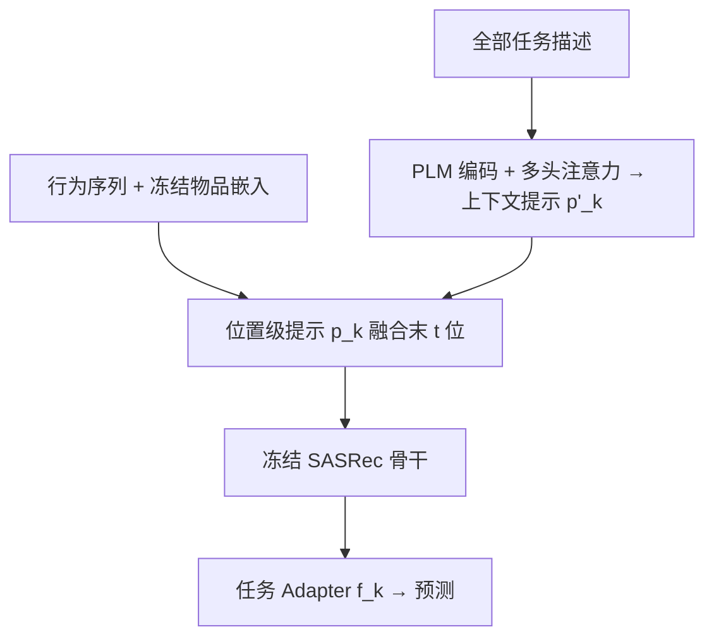
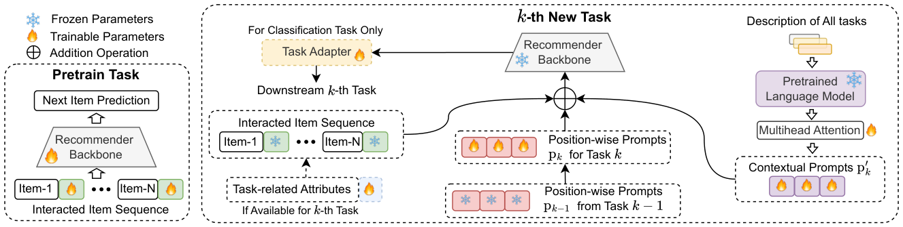

# PCL: Prompt-based Continual Learning for User Modeling in Recommender Systems (基于提示的推荐系统用户建模持续学习框架)

- **会议/期刊**: WWW Companion 2025 (Short Paper)
- **作者与机构**: Mingdai Yang 等，University of Illinois at Chicago & Amazon & The Ohio State University
- **推荐链路定位**: 精排（多任务用户表征学习）
- **研究方向**: 多任务学习与列表级重排 / CTR 预估与特征交叉
- **论文原文**: [https://arxiv.org/abs/2502.19628v1](https://arxiv.org/abs/2502.19628v1)
- **开源代码**: 暂未开源

## TL;DR (1分钟核心速览)

电商用户建模中，MTL 面临优化失衡且新任务需全量重训，CL 则受灾难性遗忘困扰。本文提出 PCL：冻结 SASRec 骨干与物品嵌入，为每个下游任务学习**位置级提示**作为外部记忆，并用**上下文提示**（PLM 编码任务描述 + 多头注意力建模任务间关系）引导提示微调。在 Tenrec/MovieLens 的 4 任务序列上，PCL 仅保留 1 份骨干即在 8 个任务中 6 个最优，且优于使用全部任务标签的 MTL 上界。

## Background & Motivation (背景与核心矛盾)

- **主流范式**: 工业界用 MTL（MMoE/PLE 类）共享底层同时优化多业务目标，或用 CL 按任务顺序增量学习以避免全量重训。
- **前人局限**: ① MTL 存在优化失衡（梯度冲突），且新任务到来必须连同历史任务全量重训，成本高甚至不可行；② CL 代表工作 CONURE 为每任务训练部分参数，压缩了单任务可学习容量；TERACON 用软掩码+函数正则约束更新，但需持续更新骨干与所有历史任务 adapter，计算低效。
- **核心洞察 (Key Insight)**: 提示微调只需更新极少量参数即可适配新任务，天然适合作为"每任务外部记忆"；但用户建模任务（年龄预测 vs. 下一点赞物品预测）比文本/图像分类**更异构**，特征分布差异剧烈，直接套用 NLP 提示范式不够。
- **本文切入点**: 用位置级提示继承历史知识 + 上下文提示显式建模任务间关系，在冻结骨干上实现"学新不忘旧"。

## Method (核心方法设计)

### 1. 整体框架 (Overall Architecture)

先在自监督下一物品预测任务 $T_1$上预训练 SASRec 骨干$\mathcal{M}$与物品嵌入表$\mathbf{N}\in\mathbb{R}^{|\mathcal{I}|\times d}$，此后**骨干与嵌入全部冻结**。对每个下游任务$T_k$，仅学习位置级提示$\mathbf{p}_k$与任务 adapter$f_k$；同时用冻结的句子 Transformer 编码全部任务描述得到$\mathbf{E}_T$，经多头注意力生成上下文提示$\mathbf{p}'_k$ 注入序列末端。训练时仅优化提示与 adapter，推理时按任务取对应提示即可，无需重训。

<figure class="paper-figure" markdown="span">
  <figcaption>图1：PCL的整体框架。在下游任务中，骨干模型和物品嵌入被冻结。</figcaption>
</figure>

### 2. 关键设计拆解 (Key Designs)

1. **位置级提示（Position-wise Prompts）**：痛点是为每任务保留独立参数会挤占学习容量，而全量微调又会遗忘。做法是只对行为序列**最近 $t$ 个物品**做提示融合（近期交互更能反映当前偏好），其余位置保持冻结：
$\mathbf{E}^{s_u}_k = \mathbf{E}^{s_u}_1[:{-t},:]\ \|\ (\mathbf{E}^{s_u}_1[{-t}:,:]\oplus\mathbf{p}_k[{-t}:,:])$其中$\oplus$为逐元素加。全部任务的提示总开销仅$|\mathcal{T}|\times n\times d$，相对骨干与$|\mathcal{I}|\times d$嵌入表可忽略。$T_3$起提示以$\mathbf{p}_{k-1}$ 初始化，实现知识跨任务继承。

2. **上下文提示（Contextual Prompts）**：痛点是位置级提示彼此独立、无法利用任务间关联。将任务描述（任务名、输入/输出格式、评估指标）经 PLM 编码为 $\mathbf{E}_T$，用多头注意力自适应学习任务关系：
$\mathbf{P}_T=\mathrm{Concat}(\mathrm{head}_1,\dots,\mathrm{head}_h)\mathbf{W}_O,\quad \mathrm{head}_m=\mathrm{Attention}(\mathbf{E}_T\mathbf{W}^Q_m,\mathbf{E}_T\mathbf{W}^K_m,\mathbf{E}_T\mathbf{W}^V_m)$再以强度$\lambda$注入序列末端：$\mathbf{E}'^{s_u}_k=\mathbf{E}^{s_u}_k[:{-t},:]\ \|\ (\mathbf{E}^{s_u}_k[{-t}:,:]+\lambda\mathbf{p}'_k)$。直觉是让"相似任务共享提示方向"，缓解异构任务间的负迁移。

3. **训练目标与推理效率**：链接预测任务用 BCE 损失，属性分类用交叉熵 $\mathcal{L}_{CE}(f_k(\mathcal{M}(\mathbf{E}'^{s_u}_k)),y^u_k)$；优化器 Adam，无负采样设计（沿用 SASRec 训练范式）。推理时每任务仅需一次前向 + 对应提示查表，无额外重训开销。

## Experimental Setup & Evaluation Protocol (实验设置与评估协议)

- **数据集与预处理**: 均做下采样以构造更严苛的稀疏评测环境。

| 数据集 | #Users | #Items | 任务构成 | 场景说明 |
| :--- | :---: | :---: | :---: | :--- |
| Tenrec | 15,046 | 16,475 | $T_1$下一物品 /$T_2$下一点赞 /$T_3$下一类目 /$T_4$ 年龄 | Kandian 新闻短视频，序列长 50 |
| MovieLens | 20,741 | 10,033 | $T_1$下一点击 /$T_2$四星 /$T_3$五星 /$T_4$ 类型 | 序列长 50 |

- **数据划分与防穿越 (Splitting Strategy)**: 按任务序列增量划分，$T_1$为自监督预训练任务，$T_2\sim T_4$ 依次到达；未采用 Leave-One-Out。
- **排名评测协议 (Ranking Protocol)**: **MovieLens 用 batch-ranking，Tenrec 用 all-ranking（全库排序）**，指标为 HR@5/HR@10；分类任务用 Acc。
- **对比基线与超参设置**: 单目标基线 SASRec / SinMo / FineAll / Teracon；MTL 基线 MTL / MMoE / MTL+ / MMoE+（后两者用多梯度下降 MGDA 动态加权）。骨干 SASRec，嵌入维度 $d$与提示长度$n$沿用骨干配置，提示强度$\lambda$ 为超参。

## Key Experimental Results (实验关键数据)

### 1. 主实验对比 (Main Results)

| 方法 | Tenrec $T_2$HR@5 | Tenrec$T_3$Acc | Tenrec$T_4$Acc | ML$T_2$HR@5 | ML$T_3$HR@5 | ML$T_4$ Acc | #B | #F |
| :--- | :---: | :---: | :---: | :---: | :---: | :---: | :---: | :---: |
| SASRec | 0.6613 | 0.3329 | 0.7722 | 0.3007 | 0.2859 | 0.4783 | 4 | 1 |
| SinMo | 0.1083 | 0.0581 | 0.7553 | 0.0937 | 0.0890 | 0.4696 | 1 | 1 |
| FineAll | 0.6832 | 0.3409 | 0.7837 | 0.3291 | 0.3015 | 0.4812 | 4 | 1 |
| Teracon | 0.6390 | 0.3071 | 0.7725 | 0.2878 | 0.4297 | 0.3540 | 1 | 1 |
| MTL | 0.6968 | 0.3285 | 0.7447 | 0.3036 | 0.3002 | 0.4744 | 1 | 4 |
| MMoE | 0.6884 | 0.3227 | 0.7385 | 0.2521 | 0.2460 | 0.4609 | 1 | 4 |
| MTL+ | **0.7043** | 0.3528 | 0.7434 | 0.3106 | 0.3020 | 0.4759 | 1 | 4 |
| MMoE+ | 0.6823 | **0.3551** | 0.6166 | 0.2659 | 0.2481 | 0.4716 | 1 | 4 |
| **PCL** | 0.6936 | 0.3466 | **0.7974** | **0.3315** | **0.3155** | 0.4634 | **1** | **1** |

PCL 在 8 个任务中 6 个取得单目标基线最优（$T_2$HR@5 较 FineAll +1.5%，$T_3$Acc +1.7%，$T_4$ Acc +1.7%），且仅保留 1 份骨干。

### 2. 消融实验 (Ablation Study)

| 变体 | Tenrec $T_2$HR@5 | Tenrec$T_3$Acc | Tenrec$T_4$Acc | ML$T_2$HR@5 | ML$T_3$HR@5 | ML$T_4$ Acc |
| :--- | :---: | :---: | :---: | :---: | :---: | :---: |
| w/o $\mathbf{P}_T$（去上下文提示） | 0.6927 | 0.3404 | 0.7908 | 0.3259 | 0.3083 | 0.4431 |
| w/o PLM（随机初始化上下文提示） | 0.6871 | 0.3347 | 0.7886 | 0.3269 | 0.3055 | 0.4566 |
| **PCL** | **0.6936** | **0.3449** | **0.7974** | **0.3315** | **0.3155** | **0.4634** |

### 3. 关键实验发现 (Key Findings)

1. **上下文提示的增益主要来自 PLM 语义编码而非注意力本身**：去掉 PLM 随机初始化后，MovieLens $T_4$从 0.4634 掉到 0.4566（-1.5%），而仅去$\mathbf{P}_T$ 掉到 0.4431（-4.4%），说明"任务描述文本 + 注意力"二者缺一不可，且任务关系建模比单纯增加参数更关键。
2. **任务顺序鲁棒性极强**：遍历全部下游任务排列后，两数据集上从最优到最差顺序的平均性能退化仅 **1.20%**，验证了独立提示作为外部记忆确实隔离了任务间干扰。
3. **冷启动与通用表征双重收益**：在 Tenrec 屏蔽 50% 物品为冷启动后，PCL 收敛更快且终值更高（$T_2$无 adapter 时优势最明显）；将 PCL 提示微调产出的用户隐向量作为固定特征喂给单隐层 MLP 做$T_4$，Acc 达 0.7821，优于自监督预训练表征 0.7784 与随机初始化 0.7723，且收敛轮数从 7.0 降至 6.2。

## Highlights & Limitations (亮点、对比与审稿批判)

- **与代表作对比 (vs. Prior Work)**: 相比 CONURE 的"分参数"与 TERACON 的"正则约束 + 全 adapter 更新"，PCL 用提示把"每任务记忆"与"骨干共享"解耦，参数量与计算量都低一个量级；相比 MTL+ 需全部任务标签联合优化，PCL 在训练目标时**看不到其他任务标签**却仍多数胜出，这是最有说服力的对比。
- **可迁移亮点**: ① "只对序列末 $t$ 位做提示融合"的稀疏注入策略，可直接迁移到长行为序列的轻量适配；② 用 PLM 编码任务描述 + 注意力生成任务提示，可复用到多场景/跨域推荐的场景 embedding 生成。
- **审稿级局限批判**: ① 仅 5 页短文，任务数最多 4 个，未验证任务数增长到数十个时提示表 $|\mathcal{T}|\times n\times d$与任务注意力$O(|\mathcal{T}|^2 d)$的扩展性；② 评测以 HR/Acc 为主，缺少 NDCG 等排序质量指标与线上 A/B，且 MovieLens 用 batch-ranking 与 Tenrec 用 all-ranking 协议不统一，跨数据集结论可比性打折；③ 提示强度$\lambda$与融合长度$t$ 的敏感性分析缺失。

## Rating (四维评分)

- **方法创新性 (Novelty)**: ⭐⭐⭐⭐ （首次将提示微调用于推荐持续用户建模，位置级+上下文双提示设计针对异构任务有明确动机）
- **评估协议与实验扎实度 (Protocol & Experiments)**: ⭐⭐⭐ （双数据集+全排列鲁棒性+冷启动+通用表征四组 RQ 较完整，但缺 NDCG、缺超参敏感性、协议不统一）
- **写作与数学规范度 (Clarity & Rigor)**: ⭐⭐⭐⭐ （公式简洁、符号一致，5 页篇幅内把框架与实验讲清，但部分符号如 $\mathbf{E}^{s_u}_1$与$\mathbf{E}^{s_u}_k$ 的层级关系需读者自行推断）
- **工业落地与复现价值 (Industrial & Practical Value)**: ⭐⭐⭐⭐ （冻结骨干+单份模型+提示查表，落地成本极低，冷启动与通用表征场景直接可用；可惜未开源）

