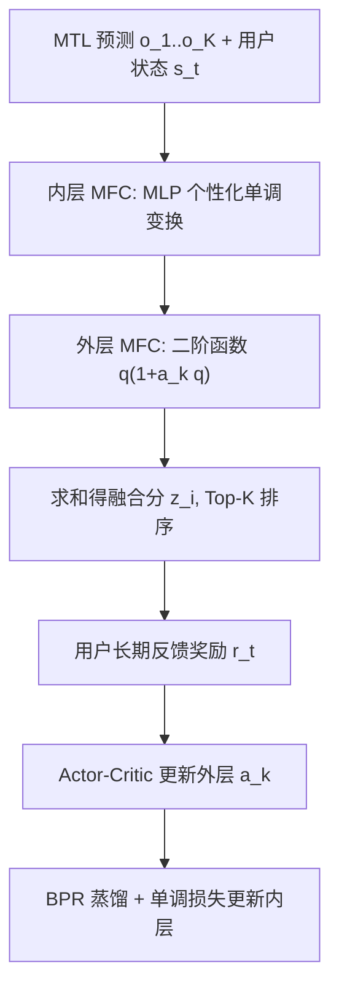

# xMTF: A Formula-Free Model for Reinforcement-Learning-Based Multi-Task Fusion in Recommender Systems (面向推荐系统多任务融合的免公式强化学习模型)

- **会议/期刊**: WWW 2025
- **作者与机构**: Yang Cao, Xiaoshuang Chen, Kaiqiao Zhan, Ben Wang (快手科技)；Changhao Zhang (北京大学，快手实习)
- **推荐链路定位**: 重排（多任务融合打分阶段）
- **研究方向**: 多任务学习与列表级重排 / 强化学习与动态探索推荐
- **论文原文**: [https://arxiv.org/abs/2504.05669v1](https://arxiv.org/abs/2504.05669v1)
- **开源代码**: [https://github.com/zxcvbnm678122/xMTFwww2025](https://github.com/zxcvbnm678122/xMTFwww2025)

## TL;DR (1分钟核心速览)

推荐系统多任务融合（MTF）长期依赖预定义公式（如加权和、对数加权），RL 只能调几个系数，搜索空间被公式锁死。本文基于 Sprecher 表示定理证明任意单调融合函数可分解为单变量单调函数之和，提出可学习单调融合单元 MFC 替代公式，并用「RL 外层 + 监督内层」的两阶段混合训练（TSH）解决高维动作训练难题。在 KuaiRand 离线模拟器上总观看时长从 1194.7s 提升至 1279.7s（+7.1%），线上日观看时长 +0.833%。

## Background & Motivation (背景与核心矛盾)

- **主流范式**: 推荐系统分 MTL（预测点击率、点赞率等多目标）与 MTF（融合为单一排序分）两段；MTF 因缺乏逐物品的整体满意度标签，近年普遍用 RL 将融合系数作为动作、以长期留存/观看时长为奖励来优化。
- **前人局限**: 现有 RL-based MTF 全是「公式法」——预定义 $z_i=\sum_k a_k o_{ki}$或$z_i=\sum_k a_k\log(o_{ki}+\beta_k)$，RL 仅优化$K$ 个系数。其一，不同公式导致结果差异大且难以选择，不同用户可能适配不同公式；其二，预定义公式把搜索空间压缩到极低维，成为性能瓶颈。
- **核心洞察 (Key Insight)**: 融合函数必须对每个预测单调递增（预测分升高不应使融合分下降），这是 MTF 的内在结构。而 Sprecher 表示定理保证：任意单调函数都可写成 $f(o_1,\dots,o_K)=g(\sum_k h_k(o_k))$，即「单变量单调函数之和再套单调外层」。
- **本文切入点**: 把 $h_k$ 做成可学习的参数化单调网络（MFC），彻底抛弃预定义公式，将个性化从「几个系数」扩展到「整条融合函数」。

## Method (核心方法设计)

### 1. 整体框架 (Overall Architecture)

xMTF 接收 MTL 输出的 $K$个预测$o_{ki}$与用户状态$\boldsymbol{s}_t$，每个预测经一个 MFC 做个性化单调变换得到$\tilde{q}_{ki}$，求和得融合分$\tilde{z}_i=\sum_k\tilde{h}_k(o_{ki},\boldsymbol{s}_t;\theta_k)$（外层单调函数$g$ 因不影响排序被省略）。训练上，MFC 被拆成「参数多的内层 MLP」与「参数少的外层二阶函数」：外层用 actor-critic RL 优化长期奖励，内层用 BPR 损失蒸馏外层输出，同时施加成对单调性损失。线上以流式方式在用户会话结束时增量训练并部署。

### 2. 关键设计拆解 (Key Designs)

1. **单调融合单元 MFC（免公式化的核心）**：痛点是用固定公式限制表达力。MFC 定义为 $\tilde{q}_{ki}=\tilde{h}_k(o_{ki},\boldsymbol{s}_t;\theta_k)$，以用户状态为额外输入实现「个性化函数」而非「个性化系数」。单调性不靠结构约束而靠成对损失软约束：$\mathcal{L}_{\text{mono},k}=\sum_{i,j\in\Omega_t}\mathbb{I}_{o_{ki}<o_{kj}}\max\{0,\tilde{h}_k(o_{ki})-\tilde{h}_k(o_{kj})\}$。直觉上，该损失只在违反序关系时惩罚，等价于对每个预测学一条保序的校准曲线，既保留可解释性又不牺牲表达力。

2. **两阶段混合训练 TSH（解决高维动作难题）**：若把全部 $\theta_k$当 RL 动作，维度爆炸导致训练不可行。作者将$\theta_k=(\theta_k^I,a_k)$分解为级联单调两段：内层$\tilde{q}_{ki}^I=\tilde{h}_k^I(o_{ki},\boldsymbol{s}_t;\theta_k^I)$（MLP，参数多），外层$\tilde{q}_{ki}=\tilde{h}_k^O(\tilde{q}_{ki}^I;a_k)=\tilde{q}_{ki}^I(1+a_k\tilde{q}_{ki}^I)$（标量$a_k$，即 RL 动作）。关键论证：外层取简单函数不损失表达力，因任意$\tilde{h}_k$都可通过令$\tilde{h}_k^I=\alpha(\tilde{h}_k)$（$\alpha$为外层反函数）等价实现。外层用标准 actor-critic：$\mathcal{L}_{\text{critic}}=[Q(\boldsymbol{s}_t,\boldsymbol{a}_t;\phi)-(r_t+\gamma Q(\boldsymbol{s}_{t+1},\mu(\boldsymbol{s}_{t+1};\xi^-);\phi^-))]^2$。

3. **知识蒸馏式内层监督与总损失**：内层无直接标签，故以外层融合分 $\tilde{z}_i$为教师，用 BPR 对齐内层和分$\tilde{z}_i^I$的排序：$\mathcal{L}_{\text{transfer}}=-\sum_{i,j}\mathbb{I}_{\tilde{z}_i<\tilde{z}_j}\log\sigma(\tilde{z}_j^I-\tilde{z}_i^I)$。总损失$\mathcal{L}^I=\lambda\sum_k\mathcal{L}_{\text{mono},k}^I+(1-\lambda)\mathcal{L}_{\text{transfer}}$。该设计让外层持续按长期满意度「纠偏」，内层以大容量吸收知识，避免直接对高维参数做 RL。推理仅需前向 MLP，无额外负采样开销。

## Experimental Setup & Evaluation Protocol (实验设置与评估协议)

- **数据集与预处理**: 采用快手公开数据集 KuaiRand，含 27,285 用户、32,038,725 物品，考虑点击、长观看、点赞、关注、评论、分享 6 类反馈；MTL 统一用 MMoE 生成预测以隔离 MTF 变量。

| 数据集 | #Users | #Items | #Interactions | 稀疏度/密度 | 特征/场景说明 |
| :--- | :---: | :---: | :---: | :---: | :--- |
| KuaiRand | 27,285 | 32,038,725 | 全量曝光日志 | 极稀疏 | 短视频，6 类反馈 + 用户/物品上下文 |

- **数据划分与防穿越 (Splitting Strategy)**: 非传统切分，而是构建**离线模拟器**作为环境：按请求序列回放，模拟器依据推荐结果生成反馈并按「满意度耗尽即退出」规则决定是否发下一请求，评估完整会话的长期回报。
- **排名评测协议 (Ranking Protocol)**: 以**会话级 Total Watch Time（总观看时长，秒）** 为长期奖励指标，每实验 20 次试验取均值与标准差，属模拟器全流程排序评估而非单点 Full-Ranking。
- **对比基线与超参设置**: CEM（非个性化黑盒优化，两种公式）、TD3、BatchRL-MTF、TSCAC、MR-MPL（各配两种公式，共 8 个 RL 基线）；actor/critic 统一五层 MLP，$\lambda=0.4$。

## Key Experimental Results (实验关键数据)

### 1. 主实验对比 (Main Results)

| 方法 | Total Watch Time (s) | 相对 xMTF |
| :--- | :---: | :---: |
| CEM-1 | 897.5 (±12.3) | -29.9% |
| CEM-2 | 931.2 (±13.5) | -27.2% |
| TD3-2 | 1129.1 (±14.8) | -11.8% |
| BatchRL-MTF-2 | 1185.4 (±12.6) | -7.4% |
| TSCAC-2 | 1194.7 (±12.4) | -6.6% |
| MR-MPL-2 | 1189.6 (±12.3) | -7.0% |
| **xMTF** | **1279.7 (±12.9)** | — |

线上 A/B（vs. UNEX-RL，7 天，置信区间 ±0.11%）：日观看时长 **+0.833%**、播放次数 +0.583%、评论 +2.391%、分享 +2.205%，作者称 0.1% 即显著、0.833% 为年内最大提升之一。

### 2. 消融实验 (Ablation Study)

| 变体 | Total Watch Time (s) | 说明 |
| :--- | :---: | :--- |
| xMTF 完整 | **1279.7** | 内外层 + 单调损失 |
| w/o outer stage | 1092.8 | 去掉 RL，退化为纯监督 |
| w/o inner stage | 1106.3 | 退化为公式法 $z_i=\sum o_{ki}(1+a_k o_{ki})$ |
| $\lambda=0$（无单调损失） | 732.8 | 单调性完全丢失 |
| $\lambda=0.1$ | 1073.2 | 单调性弱 |
| $\lambda=0.9$ | 1254.4 | 单调性强但蒸馏被削弱 |
| $\lambda=1$（仅单调损失） | 1103.1 | 无监督信号 |

### 3. 关键实验发现 (Key Findings)

1. **免公式化带来最大增益**：xMTF 较最强公式法基线 TSCAC-2 提升 7.1%，而所有公式法基线内部因公式不同波动达 40–60s（如 TD3-1 vs TD3-2 差 40.4s），说明公式选择本身就是瓶颈，扩大搜索空间比调系数更关键。
2. **单调性是性能命门**：$\lambda=0$时性能暴跌至 732.8s（较$\lambda=0.4$下降 42.7%），可视化显示此时 MFC 输出与输入无单调关系；$\lambda=0.4$在「保序」与「蒸馏信号强度」间取得最佳平衡，$\lambda=0.9/1$因削弱$\mathcal{L}_{\text{transfer}}$ 反而回落。
3. **内外层缺一不可且分工明确**：去外层（无 RL）损失 14.6%，证明长期满意度建模不可替代；去内层（退化为公式法）损失 13.6%，证明大容量个性化函数是表达力来源——二者分别对应「优化目标」与「函数空间」两个维度。

## Highlights & Limitations (亮点、对比与审稿批判)

- **与代表作对比 (vs. Prior Work)**: 相较 BatchRL-MTF/TSCAC/UNEX-RL 等公式法，本文首次将 MTF 从「调系数」升级为「学函数」，且用表示定理给出理论合法性；相较 CEM 等非个性化方法，MFC 以用户状态为输入实现请求级个性化函数。
- **可迁移亮点**: (1) 「软单调损失 + 成对比较」可在任意需要保序约束的打分融合场景复用；(2) 「少参数外层做 RL、多参数内层做蒸馏」的两阶段范式，可迁移到任何高维动作的 RL 排序问题。
- **审稿级局限批判**: (1) 离线评估依赖自建模拟器，其退出规则与反馈生成逻辑强假设，离线 7.1% 与线上 0.833% 的落差提示模拟器可能高估增益；(2) 外层二阶函数形式与 $\lambda$ 均需人工设定，且线上需流式重训（冷启收敛约 2 天），工程与超参敏感度成本不低。

## Rating (四维评分)

- **方法创新性 (Novelty)**: ⭐⭐⭐⭐ （首次用 Sprecher 定理把 MTF 从公式法推向免公式函数学习，理论动机扎实）
- **评估协议与实验扎实度 (Protocol & Experiments)**: ⭐⭐⭐⭐ （离线模拟器 + 7 天线上 A/B 双验证，消融与 $\lambda$ 敏感性完整，但模拟器假设偏强）
- **写作与数学规范度 (Clarity & Rigor)**: ⭐⭐⭐⭐ （表示定理与两阶段分解论证清晰，公式紧凑；外层函数选择的理论充分性略简）
- **工业落地与复现价值 (Industrial & Practical Value)**: ⭐⭐⭐⭐⭐ （快手亿级用户全量部署、代码开源、推理仅前向 MLP，落地价值极高）

