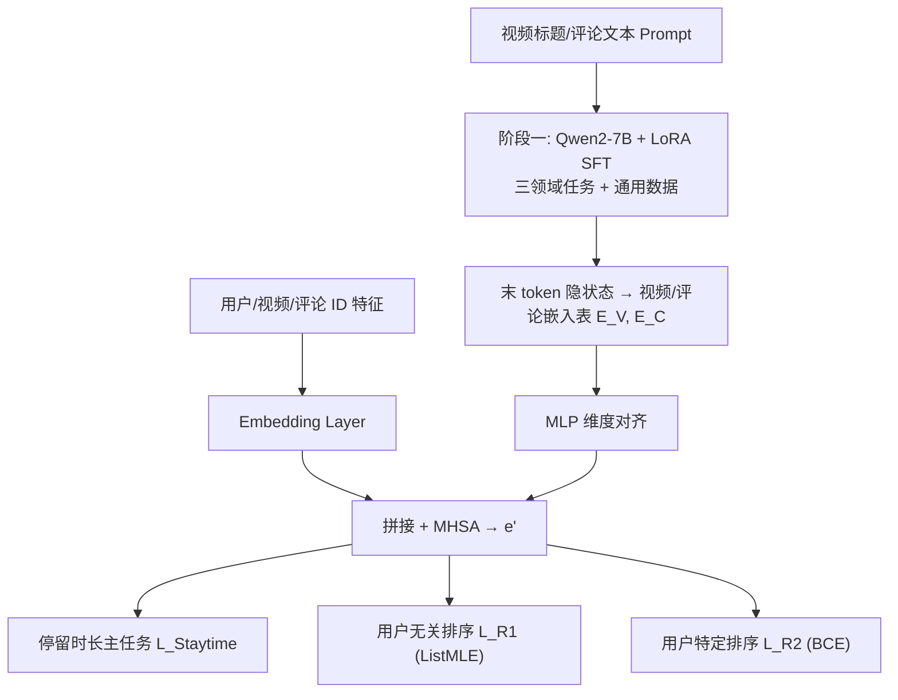
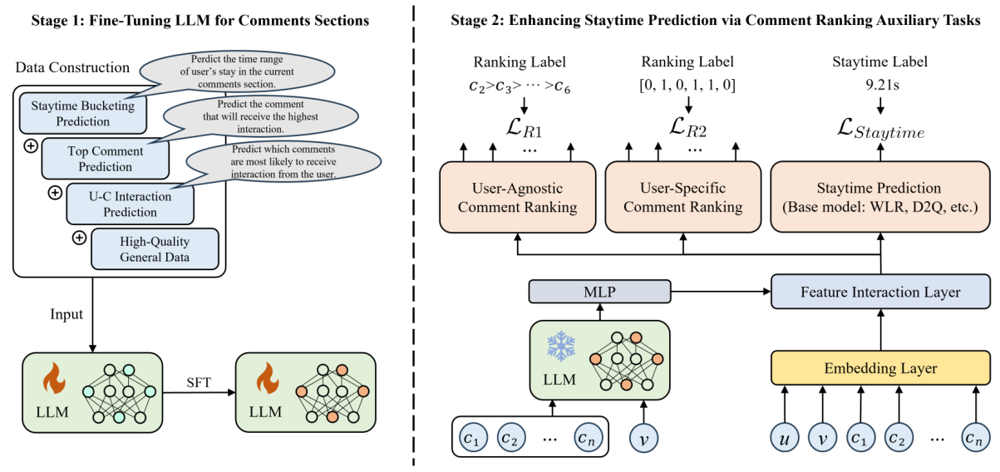

# Comment Staytime Prediction with LLM-enhanced Comment Understanding (基于 LLM 增强评论理解的评论区停留时长预测)

- **会议/期刊**: WWW 2025 (Industry Track)
- **作者与机构**: Changshuo Zhang, Zihan Lin, Shukai Liu, Yongqi Liu, Han Li（快手科技）
- **推荐链路定位**: 精排（多目标模型中的停留时长预估子任务）
- **研究方向**: 多模态推荐与内容理解 / 大语言模型推荐
- **论文原文**: [论文原文链接](https://arxiv.org/abs/2504.01602v1)
- **开源代码**: [开源代码仓库链接](https://github.com/lyingCS/LCU)

## TL;DR (1分钟核心速览)

短视频评论区停留时长（staytime）是用户兴趣建模的关键信号，但现有 watchtime 预测方法无法刻画"多条评论之间的关联"与"单条评论粒度的交互反馈"。本文开源首个视频-评论交互数据集 KuaiComt（3.4 万用户、1635 万条评论），并提出两阶段框架 LCU：先用三个评论区领域任务对 Qwen2-7B 做 LoRA 微调并导出视频/评论嵌入表，再将其与传统特征拼接，辅以"用户无关评论排序（ListMLE）"与"用户特定评论排序（BCE）"两个辅助任务。在 KuaiComt 时间切分协议下，LCU 对 5 个基座模型全部带来一致提升（如 LCU-D2Q 的 XAUC 0.6135→0.6154、NDCG@5 0.4374→0.4502），线上 A/B 停留时长 +1.27%、曝光数 +0.81%。

## Background & Motivation (背景与核心矛盾)

- **主流范式**: 视频推荐中的时长建模长期沿用 watchtime 预测（WLR、NDT、PCR、D2Q 等），通过加权回归或时长分桶去偏来估计"用户看视频多久"。
- **前人局限**: 其一，watchtime 无法归因到具体内容片段，而评论区停留时长天然与"某几条评论"强相关，粒度错配；其二，watchtime 模型完全忽略评论之间的相互影响（一条高赞评论会改变后续评论的阅读意愿），也忽略点赞/回复这类细粒度反馈信号。
- **核心洞察 (Key Insight)**: 作者在 KuaiComt 上做了千万级样本分析（图 2）：Top-5 评论平均点赞数上升时停留时长先降后稳（约 4 万赞处拐点），说明评论区"成熟度"决定用户翻找成本；评论交互数在 20 次以内与停留时长正相关，超过 30 次后出现非线性的先降后升。二者均呈显著非线性。
- **本文切入点**: 既然停留时长由"评论文本语义 + 细粒度交互结构"共同决定，就用 LLM 补语义、用评论排序辅助任务补结构，二者作为插件挂到任意基座模型上。

## Method (核心方法设计)

### 1. 整体框架 (Overall Architecture)

LCU 是两阶段、模型无关（model-agnostic）的框架。**阶段一**：构造三类评论区领域任务（停留时长分桶预测、Top 评论预测、用户-评论交互预测），与 alpaca-gpt4 通用数据按 1:1:1:3 混合，用 LoRA 对 Qwen2-7B 做 SFT，取每条视频 prompt 与评论 prompt 的**最后一个 token 隐状态**作为嵌入，离线落成视频嵌入表 $E_V$与评论嵌入表$E_C$。**阶段二**：在线精排时按 ID 查表取出视频嵌入与采样评论嵌入，经 MLP 对齐维度后与常规特征嵌入拼接，过 MHSA 得到统一表示$e'$，再分三头输出：停留时长主任务、用户无关排序、用户特定排序。该表示可直接喂给 WLR/D2Q 等任意基座，故 LCU 表现为"嵌入增强 + 辅助任务"的通用外挂。

<figure class="paper-figure" markdown="span">
  <figcaption>图3：LCU的整体框架。第一阶段，设计评论区内的三个领域特定任务用于微调LLM。第二阶段，将LLM对视频和评论的嵌入与传统模型的特征嵌入相结合。利用用户无关和用户特定的评论排序辅助任务来增强停留时间预测。</figcaption>
</figure>

### 2. 关键设计拆解 (Key Designs)

1. **LLM 领域微调与嵌入表导出（补语义）**：通用 LLM 不懂"评论区"这一场景，直接拿原始文本嵌入与停留时长几乎无关。本文不改 LLM 结构，而是把业务信号转成三个生成式任务做 SFT，使末 token 隐状态在语义空间中编码"这条评论会不会火、这个用户会不会互动、这个评论区会待多久"。嵌入抽取为 $e_v = \mathrm{LLM}(I_V(v))[-1],\ e_c = \mathrm{LLM}(I_C(c))[-1]$。直觉上，末 token 汇聚全序列信息，等价于一个被业务目标"定向蒸馏"过的文本编码器，且离线批量生成后在线零 LLM 推理开销。

2. **双粒度评论排序辅助任务（补结构）**：直接回归点赞/回复数极不稳定（长尾、量纲大），故改为排序。用户无关任务用 ListMLE 建模评论流行度的相对次序：
$$\mathcal{L}_{R_1} = -\log \prod_{i=1}^{n} \frac{\exp(\hat{y}^{(1)}_i)}{\sum_{j=i}^{n}\exp(\hat{y}^{(1)}_j)}$$
用户特定任务则退化为二分类，用 BCE 预测"当前用户是否会与该评论互动"：$\mathcal{L}_{R_2} = -\frac{1}{N}\sum_{i}\left[y_i\log\hat{y}^{(2)}_i + (1-y_i)\log(1-\hat{y}^{(2)}_i)\right]$。前者提供群体层面的"评论质量先验"，后者提供个体层面的"偏好对齐"，恰好对应动机分析中"评论区成熟度"与"个人交互强度"两条非线性因素。

3. **训练目标与推理效率**：总损失为加权和 $\mathcal{L}_{total} = \mathcal{L}_{Staytime} + \lambda_1\mathcal{L}_{R_1} + \lambda_2\mathcal{L}_{R_2}$，$\lambda_1,\lambda_2 \in \{10^{-4},\dots,1\}$ 网格搜索。每个样本采样 6 条评论（Top-7 热门评论 ∪ 用户实际互动评论），属 hard-negative 式的难例采样而非均匀负采样。在线侧仅做嵌入查表 + MLP + MHSA，LLM 完全离线，工程代价可控。

## Experimental Setup & Evaluation Protocol (实验设置与评估协议)

- **数据集与预处理**: KuaiComt 采集自快手 2023 年 10 月日志，仅保留有正反馈（点赞/回复）的评论曝光，并做匿名化。

| 数据集 | #Users | #Videos | #Comments | #Open-C | #Inter-C | 特征/场景说明 |
| :--- | :---: | :---: | :---: | :---: | :---: | :--- |
| KuaiComt | 34,701 | 82,452 | 16,352,904 | 16,033,443 | 1,002,672 | 视频标题 + 评论文本 + 交互日志 |

- **数据划分与防穿越 (Splitting Strategy)**: 过滤"评论区未打开"的样本，仅在有评论区曝光空间内预测；按**全局时间戳切分**为 4:1:1，保证用户画像不穿越。
- **排名评测协议 (Ranking Protocol)**: 相关性排序任务以 $r_{u,v}=\mathbb{I}(st_{u,v} > st_{0.7})$ 定义正样本（70 分位停留时长为阈值），在候选视频集合内排序，报告 GAUC / MRR / NDCG@{1,3,5} / Staytime@{1,3,5}；时长回归任务报告 RMSE / MAE / XGAUC / XAUC。
- **对比基线与超参设置**: 5 个基座 VR、WLR、NDT、PCR、D2Q，LCU 逐一挂载形成 5 个变体；LLM 为 Qwen2-7B + LoRA，15,000 样本训练 1 epoch；每样本采样 6 条评论；显著性检验 $p<0.05$。

## Key Experimental Results (实验关键数据)

### 1. 主实验对比 (Main Results)

相关性排序（节选，完整见原文表 2）：

| Method | GAUC | MRR | NDCG@5 | Staytime@5 |
| :--- | :---: | :---: | :---: | :---: |
| VR | 0.6611 | 0.5932 | 0.4226 | 9.1000 |
| LCU-VR | 0.6641 | 0.6052 | 0.4374 | 9.4078 |
| WLR | 0.6726 | 0.6242 | 0.4542 | 9.5337 |
| LCU-WLR | 0.6746 | 0.6296 | 0.4611 | 9.6904 |
| NDT | 0.6564 | 0.6104 | 0.4419 | 9.2236 |
| PCR | 0.5839 | 0.5588 | 0.3961 | 8.6482 |
| D2Q | 0.6675 | 0.6089 | 0.4374 | 9.2364 |
| **LCU-D2Q** | **0.6707** | **0.6189** | **0.4502** | **9.5281** |

时长回归（节选，完整见原文表 3）：

| Method | RMSE↓ | MAE↓ | XGAUC | XAUC |
| :--- | :---: | :---: | :---: | :---: |
| VR | 8.9727 | 5.5980 | 0.5315 | 0.6058 |
| LCU-VR | 8.9386 | 5.5511 | 0.5357 | 0.6076 |
| WLR | 10.6889 | 5.8677 | 0.5340 | 0.6019 |
| PCR | 36.1302 | 14.9512 | 0.5365 | 0.5717 |
| D2Q | 10.2693 | 5.0938 | 0.5467 | 0.6135 |
| **LCU-D2Q** | **10.2500** | **5.0721** | **0.5489** | **0.6154** |

### 2. 消融实验 (Ablation Study)

| 变体 | NDCG@5 | Staytime@5 | MAE↓ | XAUC |
| :--- | :---: | :---: | :---: | :---: |
| LCU-WLR | 0.4611 | 9.6904 | 5.8060 | 0.6043 |
| w/o SFT | 0.4562 | 9.5427 | 5.8536 | 0.6036 |
| w/o $\mathcal{L}_{R_1}$ | 0.4590 | 9.6638 | 5.8904 | 0.6036 |
| w/o $\mathcal{L}_{R_2}$ | 0.4595 | 9.6726 | 5.9519 | 0.6040 |
| LCU-D2Q | 0.4502 | 9.5281 | 5.0821 | 0.6154 |
| w/o SFT | 0.4467 | 9.4995 | 5.0933 | 0.6142 |
| w/o $\mathcal{L}_{R_1}$ | 0.4485 | 9.5090 | 5.0920 | 0.6151 |
| w/o $\mathcal{L}_{R_2}$ | 0.4491 | 9.5125 | 5.1372 | 0.6138 |

### 3. 关键实验发现 (Key Findings)

1. **SFT 是最大贡献项，且对强基座更关键**：去掉 SFT 后 LCU-WLR 的 Staytime@5 从 9.6904 掉到 9.5427（-1.5%），LCU-D2Q 的 NDCG@5 从 0.4502 掉到 0.4467，说明"业务定向微调"比"直接用通用 LLM 嵌入"重要得多，通用语义与停留时长之间存在明显语义鸿沟。
2. **两个排序任务互补而非冗余**：去掉 $\mathcal{L}_{R_2}$对 MAE 伤害最大（LCU-WLR 5.8060→5.9519，+2.5%；LCU-D2Q 5.0821→5.1372），而$\mathcal{L}_{R_1}$ 的移除主要拖累排序类指标，印证"用户特定任务管个体时长精度、用户无关任务管群体排序质量"的分工。
3. **冷启动与评论数量双重验证嵌入价值**：按训练集曝光频次分桶后，LCU 在 "None"（零曝光冷启视频）组上相对基座的 XAUC 与 NDCG@5 提升最显著，说明 LLM 嵌入提供了不依赖 ID 协同信号的内容先验；评论采样数从 0 增至 6 时 XAUC 持续上升后趋稳，验证 6 条采样的设计合理性。

## Highlights & Limitations (亮点、对比与审稿批判)

- **与代表作对比 (vs. Prior Work)**: 与 WLR/D2Q 等 watchtime 模型相比，本文把建模对象从"视频整体"下沉到"评论列表"，首次引入评论间关联与单评论反馈；与 MoRec/ZESRec 等 LLM 增强推荐工作相比，本文不止把 LLM 当文本编码器，而是用三个评论区领域任务做定向 SFT，并额外挂排序辅助任务，属于"LLM 语义 + 任务结构"双增强。
- **可迁移亮点**: ①"离线 LLM 批量生成嵌入表 + 在线查表"的部署范式，可在零在线 LLM 延迟下获得语义增益，适合任何文本富集场景（商品评论、问答、弹幕）；②把不稳定的计数型回归目标（点赞数）转成 ListMLE 列表排序，是处理长尾计数标签的通用技巧。
- **审稿级局限批判**: ①数据集仅保留正反馈（点赞/回复）曝光，缺失负反馈与"看了但没互动"的样本，停留时长分布被截断，模型在低互动评论区的泛化性存疑；②嵌入表依赖离线批量刷新，新视频/新评论需等待重跑 LLM 才能入表，冷启时效性受限于离线管线；③线上仅报告 +1.27% 停留时长与 +0.81% 曝光数，未给出置信区间与实验时长内的波动，工业收益的统计稳健性论证偏薄。

## Rating (四维评分)

- **方法创新性 (Novelty)**: ⭐⭐⭐⭐ （首次定义评论区停留时长任务，LLM 领域 SFT + 双粒度排序辅助任务的组合有新意，但单点技术均为已有组件的场景化拼装）
- **评估协议与实验扎实度 (Protocol & Experiments)**: ⭐⭐⭐⭐ （时间切分防穿越、5 基座 × 双任务 × 消融 × 冷启分桶 + 线上 A/B 相当完整，扣分在仅正反馈过滤与线上缺置信区间）
- **写作与数学规范度 (Clarity & Rigor)**: ⭐⭐⭐⭐ （两阶段流程与损失定义清晰、动机分析有千万级数据支撑，但 ListMLE 公式中分母下标写作 $j=i$存在笔误，应为$j=i}^{n}$ 的排序语义需读者自行修正）
- **工业落地与复现价值 (Industrial & Practical Value)**: ⭐⭐⭐⭐⭐ （数据集与代码全开源，离线嵌入表方案在线零 LLM 开销，已在快手全量 A/B 验证，是 LLM4Rec 工业落地的优质范本）

