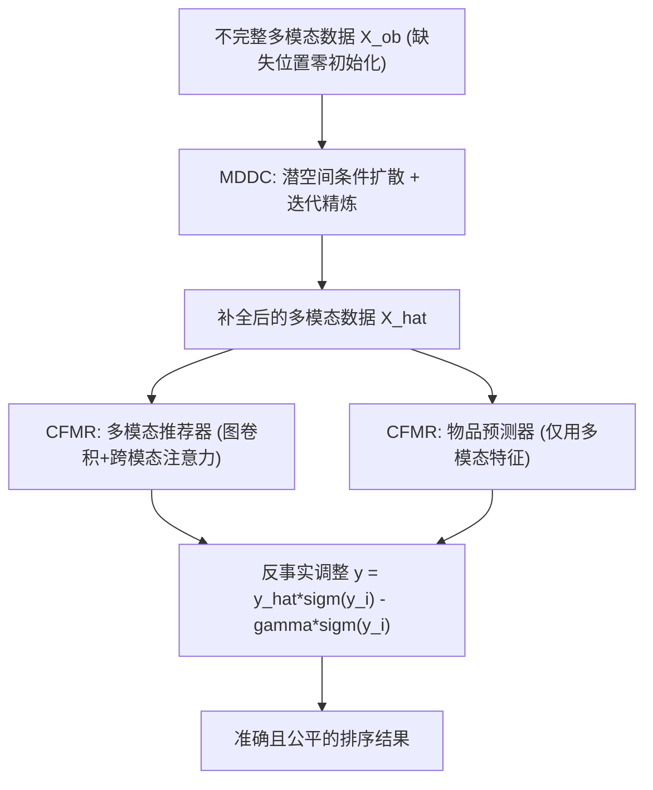

# Generating with Fairness: A Modality-Diffused Counterfactual Framework for Incomplete Multimodal Recommendations (以公平为导向的生成：面向不完整多模态推荐的模态扩散反事实框架)

- **会议/期刊**: WWW 2025
- **作者与机构**: Jin Li, Shoujin Wang, Shui Yu, Fang Chen (University of Technology Sydney); Qi Zhang (Tongji University)
- **推荐链路定位**: 召回（用户-物品匹配打分）
- **研究方向**: 多模态推荐 / 去偏与公平性
- **论文原文**: [https://arxiv.org/abs/2501.11916v4](https://arxiv.org/abs/2501.11916v4)
- **开源代码**: [https://github.com/JinLi-i/MoDiCF](https://github.com/JinLi-i/MoDiCF)

## TL;DR (1分钟核心速览)

真实场景中物品模态常缺失，现有 MMRec 方法既难以准确补全缺失模态（未建模模态特有分布），又忽视了"可见性偏差"——缺失模态物品因模型过度依赖多模态内容而被系统性压制曝光。本文提出 MoDiCF：用模态感知条件引导的潜空间扩散模型补全缺失模态并迭代精炼，再用反事实推断将"物品多模态数据直接决定排序"的捷径因果路径（NDE）从总效应中剔除。在 Baby/Tiktok/Allrecipes 三个数据集、$MR=0.4$的随机缺失设定下，Recall@20 相对最强基线 CI2MG 提升约 5.7%/20.0%/13.0%，同时公平性指标$F@20$ 逼近无偏的单模态参照。

## Background & Motivation (背景与核心矛盾)

- **主流范式**: 多模态推荐用 GNN 将图像/文本/音频编码进用户-物品交互图（MMSSL、BM3、DiffMM 等）；面对缺失模态，现有工作走两条路——数据补全（自编码器 LRMM、特征传播 CI2MG）或模态不变表征学习（MILK）。
- **前人局限**: 其一，补全方法只学"通用数据结构"，不显式建模各模态特有的分布与跨模态异质性，信息损失严重时补全质量差；其二，所有方法都默认"多模态内容越完整越该被推"，未意识到缺失模态物品被系统性降权。
- **核心洞察 (Key Insight)**: 作者用 MMSSL 在 Baby 上做曝光统计（图 1），发现不完整物品曝光量远低于完整物品，且缺失率越高被压制物品数增长越快。因果图上，不完整场景多出一条捷径边 $I^* \to Y$，使模型绕开用户偏好匹配$M$ 直接用模态完整度决定排序——这正是可见性偏差的根因。
- **本文切入点**: 用扩散模型在"模态特有分布空间"里高质量生成缺失数据，再用反事实推断把捷径路径的因果效应从排序分数中减掉。

## Method (核心方法设计)

### 1. 整体框架 (Overall Architecture)

MoDiCF 由两个模块串联：模态扩散补全模块（MDDC）先把每个模态的观测数据编码到潜空间，在该空间训练条件扩散过程学习模态特有分布，并以其他模态特征作为"模态感知条件"引导反向去噪；随后从高斯噪声出发采样生成缺失模态，解码回原空间后替换零初始化占位，多轮迭代精炼。补全后的完整多模态数据送入反事实多模态推荐模块（CFMR）：多模态推荐器（图卷积 + 跨模态注意力 + 对比学习）给出常规匹配分，物品预测器仅凭物品多模态特征给出"偏差分"，推理时按反事实公式做减法。两模块采用两阶段训练（先预训练扩散、再联合优化）。

### 2. 关键设计拆解 (Key Designs)

1. **模态感知条件扩散 (Modality-aware Conditioning)**：单模态扩散在信息缺失时样本不足、且无法保证跨模态语义一致。本文对第 $m$个模态独立建扩散过程，但把其他模态的潜表征经融合网络$f_{cn}$得到条件$v^{m}_{cn,t}$，注入 U-Net 去噪器并在每层做注意力条件融合：
$v^{m(l)}_{fuse,t}=\mathrm{softmax}\!\left(\tfrac{1}{\sqrt{d^{(l)}}}(v^{m(l)}_{ob,t}W_Q^{(l)})^\top(v^{m(l)}_{cn,t}W_K^{(l)})\right)(v^{m(l)}_{cn,t}W_V^{(l)})$
直觉是：条件提供互补语义，既缓解缺失导致的信息不足，又把跨模态一致性"压"进生成过程，使补全结果与原物品语义对齐。

2. **迭代精炼 (Iterative Refinement)**：一次性补全的生成数据噪声大，且训练时无法利用不完整物品。本文在每轮训练中把上一轮生成的 $\hat{x}^m_{ms}$回填到缺失位置，重新参与扩散训练与采样（采样步$T_s=10$，采用加速采样），使补全质量随训练轮次单调提升，逐步消解缺失带来的歧义。

3. **反事实去偏与训练目标**：将总效应分解为 $TE=NDE+TIE$，其中$NDE=Y_{i,M_{i^*}}-Y_{i^*,M_{i^*}}$对应捷径路径、是偏差根源，$TIE=Y_{i,M_i}-Y_{i,M_{i^*}}$ 才是期望的用户偏好效应。推理时按
$y_{u,i}=\hat{y}_{u,i^*}\mathrm{sigm}(\hat{y}_i)-\gamma\,\mathrm{sigm}(\hat{y}_i)$从常规打分中减去物品预测器给出的偏差分。总损失$\mathcal{L}=\mathcal{L}_{diff}+\mathcal{L}_{BPR}+\lambda_1\mathcal{L}_{CL}+\lambda_2\|\Theta\|_2^2$，其中$\mathcal{L}_{BPR}=\mathcal{L}^{u,i}_{BPR}+\alpha_2\mathcal{L}^{i}_{BPR}$；负采样沿用 BPR 的均匀负采样，对比损失采用跨模态 InfoNCE 式正负对。

## Experimental Setup & Evaluation Protocol (实验设置与评估协议)

- **数据集与预处理**: 沿用 MMSSL 的划分与过滤设置，物品至少保留一个模态：

| 数据集 | #Users | #Items | #Interactions | 稀疏度 | 模态 (维度) |
| :--- | :---: | :---: | :---: | :---: | :--- |
| Baby | 19,445 | 7,050 | 139,110 | 99.899% | V(4096), T(1024) |
| Tiktok | 9,319 | 6,710 | 59,541 | 99.904% | V(128), A(128), T(768) |
| Allrecipes | 19,805 | 10,067 | 58,922 | 99.970% | V(2048), T(20) |

- **缺失构造**: 定义缺失率 $MR=\sum_m|\mathcal{E}^m_{ms}|/(N_I\times M)$，默认$MR=0.4$，随机丢弃模态且保证每物品至少一个观测模态；缺失掩码在训练/验证/测试集上一致，防止信息泄漏。
- **数据划分与防穿越 (Splitting Strategy)**: 沿用 MMSSL 的训练/验证/测试比例划分，缺失掩码全局固定。
- **排名评测协议 (Ranking Protocol)**: 采用全库排序（Full-Ranking），报告 Recall@$\{10,20\}$、Precision@$\{10,20\}$、NDCG@$\{10,20\}$；公平性用新指标$F@K=1-|(P_r@K-P_d)/P_d|$（top-$K$中不完整物品占比与全库占比的偏离度），并用调和平均$F_{fuse}@K$融合准确率与公平性。显著性检验为配对 t 检验$p<0.05$，实验重复 10 次取均值±标准差。
- **对比基线与超参**: 13 个基线，涵盖单模态（LightGCN、AutoCF）、多模态（FREEDOM、MMSSL、BM3、MG、MCLN、MCDRec、DiffMM、MDB）与不完整多模态（LRMM、CI2MG、MILK）；嵌入维度 256/256/128，$L=2$层，$T_s=10$，$\lambda_2=10^{-5}$。

## Key Experimental Results (实验关键数据)

### 1. 主实验对比 (Main Results)

$K=20$ 结果（%）：

| 数据集 | 方法 | Recall@20 | NDCG@20 | $F$@20 |$F_{fuse}$@20 |
| :--- | :--- | :---: | :---: | :---: | :---: |
| Baby | LightGCN (公平参照) | 6.70 | 2.91 | 91.61 | 0.67 |
| Baby | MMSSL | 8.18 | 3.56 | 88.29 | 0.82 |
| Baby | DiffMM | 8.24 | 3.47 | 89.21 | 0.87 |
| Baby | CI2MG | 8.29 | 3.58 | 89.00 | 0.87 |
| Baby | **MoDiCF** | **8.76** | **3.78** | **90.12** | **0.92** |
| Tiktok | MMSSL | 7.38 | 3.24 | 90.05 | 0.71 |
| Tiktok | DiffMM | 7.60 | 3.40 | 89.68 | 0.76 |
| Tiktok | CI2MG | 7.74 | 3.38 | 91.32 | 0.76 |
| Tiktok | **MoDiCF** | **9.29** (+20.0%) | **3.99** | **92.27** | **0.92** |
| Allrecipes | MMSSL | 3.18 | 1.27 | 87.26 | 0.30 |
| Allrecipes | CI2MG | 3.23 | 1.21 | 89.42 | 0.32 |
| Allrecipes | **MoDiCF** | **3.65** (+13.0%) | **1.50** | **92.21** | **0.36** |

### 2. 消融实验 (Ablation Study)

$K=20$，Baby / Tiktok：

| 变体 | Baby Recall | Baby $F$| Tiktok Recall | Tiktok$F$ |
| :--- | :---: | :---: | :---: | :---: |
| MoDiCF-D+M (均值填充替 MDDC) | 8.39 | 89.69 | 7.70 | 91.54 |
| MoDiCF-D+Z (零填充) | 8.32 | 86.99 | 7.18 | 90.36 |
| MoDiCF-D+R (随机填充) | 7.56 | 89.32 | 6.48 | 90.15 |
| MoDiCF-con (去模态感知条件) | 7.50 | 89.57 | 7.68 | 89.39 |
| MoDiCF-C (去反事实推断) | 8.42 | 87.58 | 8.66 | 89.71 |
| MoDiCF-D-C+M (双模块均移除) | 8.08 | 86.39 | 7.59 | 88.49 |
| **MoDiCF** | **8.76** | **90.12** | **9.29** | **92.27** |

### 3. 关键实验发现 (Key Findings)

1. **补全模块是准确率主引擎**：去掉 MDDC 改用均值填充，Tiktok Recall@20 从 9.29 掉到 7.70（-17.1%）；而仅去掉模态感知条件（MoDiCF-con）Baby Recall 就跌至 7.50，说明"跨模态条件引导"而非扩散本身才是补全质量的关键增量。
2. **反事实模块是公平性主引擎**：MoDiCF-C 在 Tiktok 上 Recall 仍有 8.66，但 $F$@20 从 92.27 降至 89.71，Baby 上$F_{fuse}$ 从 0.92 降至 0.89——偏差被剥离后，缺失物品的曝光占比显著回升，且公平性提升反过来带动准确率（更多真实偏好匹配的物品进入排序）。
3. **对缺失率鲁棒**：在 $MR\in\{0.1,\dots,0.6\}$扫描中（图 4），MoDiCF 的$F_{fuse}$@20 始终领先，而 FREEDOM、MMSSL 在 Tiktok 上随缺失率上升明显失稳；采样步$T_s\ge 10$后性能趋于平稳，$T_s=10$ 即可兼顾质量与开销。

## Highlights & Limitations (亮点、对比与审稿批判)

- **与代表作对比 (vs. Prior Work)**: 相比 CI2MG（聚类超图 + 跨模态传输补全），本文用扩散模型显式建模模态特有分布并迭代精炼，补全误差更低（图 6 案例）；相比 MDB（多模态去偏），本文首次识别"不完整场景下的可见性偏差"这一独立偏差源，并用物品预测器做因果分离，而非笼统的模态主导偏差校正；相比 DiffMM（图扩散对齐），本文扩散作用于模态数据空间而非用户-物品图，直接服务缺失补全。
- **可迁移亮点**: ①"仅用物品侧特征训练辅助预测器、推理时做减法"的反事实去偏范式可低成本移植到任何存在曝光偏差的召回/精排模型；②迭代精炼（生成数据回填再训练）可推广到其他生成式补全任务（如序列推荐中的缺失行为补全）。
- **审稿级局限批判**: ①扩散采样即使 $T_s=10$仍带来额外推理开销，论文未给出线上时延预算与相对 MMSSL 的加速比；②缺失掩码为随机丢弃模拟，与真实场景中"按品类/热度非随机缺失"的分布存在差距，公平性结论在非随机缺失下是否成立尚待验证；③反事实系数$\gamma$需按数据集在$\{10^{-2},20,20\}$ 间人工调参，跨域迁移的自动化程度不足。

## Rating (四维评分)

- **方法创新性 (Novelty)**: ⭐⭐⭐⭐ （首次将"可见性偏差"形式化为不完整 MMRec 的捷径因果路径，扩散补全 + 反事实减法组合新颖，但两模块各自均为已有范式的针对性改造）
- **评估协议与实验扎实度 (Protocol & Experiments)**: ⭐⭐⭐⭐ （三数据集、13 基线、Full-Ranking、10 次重复 + t 检验，并自建 $F$/$F_{fuse}$ 公平指标；缺失模拟偏理想化扣一星）
- **写作与数学规范度 (Clarity & Rigor)**: ⭐⭐⭐⭐ （因果图与 TE/NDE/TIE 分解清晰，公式完整；部分超参取值散落附录，主文可读性略受影响）
- **工业落地与复现价值 (Industrial & Practical Value)**: ⭐⭐⭐⭐ （代码与处理后数据已开源，物品预测器可即插即用；扩散推理开销与两阶段训练成本是主要落地门槛）

