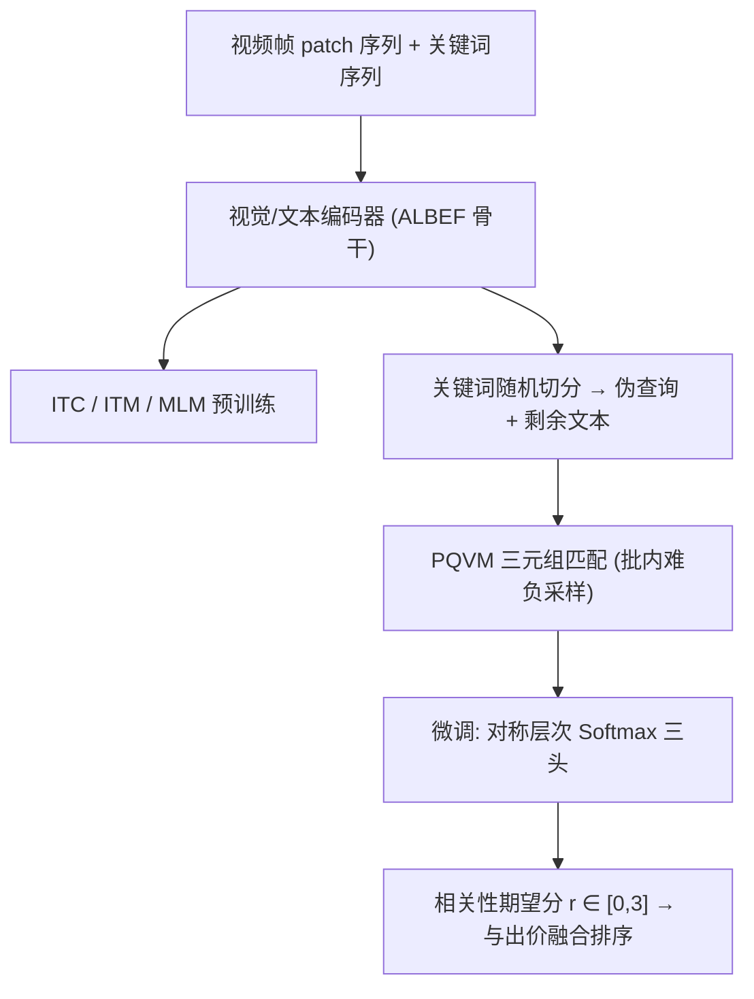
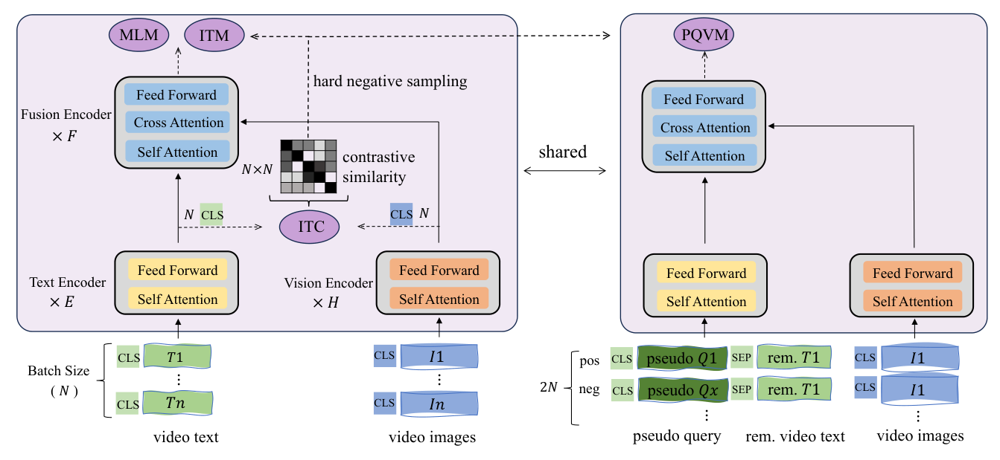

# HCMRM: A High-Consistency Multimodal Relevance Model for Search Ads (面向搜索广告的高一致性多模态相关性模型)

- **会议/期刊**: WWW 2025 (Industry Track)
- **作者与机构**: Guobing Gan, Kaiming Gao, Li Wang, Shen Jiang, Peng Jiang（快手科技）
- **推荐链路定位**: 精排（相关性过滤 + 与出价融合排序）
- **研究方向**: 多模态推荐 / CTR 预估与特征交叉
- **论文原文**: [https://arxiv.org/abs/2502.05822v1](https://arxiv.org/abs/2502.05822v1)
- **开源代码**: 暂未开源

## TL;DR (1分钟核心速览)

短视频搜索广告的相关性建模本质是「查询-视频画面-视频文本」三元组打分，而主流视觉语言预训练（ALBEF/BLIP）只做图文二元对齐，下游微调又用二分类交叉熵，与排序目标错位。HCMRM 在预训练阶段把视频关键词序列按随机长度切分为「伪查询 + 剩余文本」，直接复用 ALBEF 结构做三元组匹配（PQVM），微调阶段用对称层次 Softmax 建模四档标签的序关系。在 2.5M 人工标注数据上 AUC 0.878、Spearman 0.760，线上无关广告率降 6.1%、广告收入增 1.4%。

## Background & Motivation (背景与核心矛盾)

- **主流范式**: 工业界相关性模块普遍采用「文本塔 + 视觉塔 + 融合编码器」的视觉语言预训练模型（ALBEF、ViLT、Query-LIFE），在查询-物品对上做二分类或序回归微调，输出相关性分数供阈值过滤与出价融合排序。
- **前人局限一（预训练-下游任务错位）**: 图文对比/匹配只对齐「画面 ↔ 视频文本」二元组，而下游要判的是「查询 + 画面 + 文本」三元组；查询在预训练中完全缺席，模型学不到查询感知表征。
- **前人局限二（点击数据不可靠）**: Query-LIFE、QUALITY 等用线上点击日志构造查询-物品对做查询感知预训练，但曝光偏置与标题党使高 CTR 不等于高相关，且长尾分布下高置信查询-视频对极其稀疏；同时它们需额外加一个查询塔，改造成本高。
- **前人局限三（损失与排序目标错位）**: 四档标签 Bad/Less/Good/Excellent 被二值化为 0/1 后走 BCE，判别力强但丢失序信息，导致相关性模块在后续「相关性 × 出价」融合排序中排序能力弱。
- **核心洞察 (Key Insight)**: 视频文本已被压缩为按重要性降序排列的关键词序列，其头部关键词天然近似用户查询——无需真实查询即可合成三元组正样本，实现「预训练任务 = 下游任务」的结构一致性。
- **本文切入点**: 用伪查询切分替代点击日志，用对称层次 Softmax 替代 BCE，以极小改造成本同时修复两处不一致。

## Method (核心方法设计)

### 1. 整体框架 (Overall Architecture)

输入侧，视频均匀抽 3 帧、分块拼接为 patch 序列送入视觉编码器（ViT-B/32 前 6 层）；多字段文本（标题、描述、OCR、ASR）经 TF-IDF + NER 加权、按字段权重 $\alpha_i$求和后取 Top-$k$拼成关键词序列送入文本编码器（BERT-base-chinese 前 6 层）。预训练阶段在 ALBEF 原有 ITC/ITM/MLM 之外新增 PQVM：把关键词序列按随机长度$inx$ 切成伪查询与剩余文本，与画面组成三元组做匹配判别，负样本由 ITC 相似度分布驱动的批内难负采样给出。微调阶段冻结同一骨干，接三个二分类头构成层次 Softmax，输出四档概率并取期望作为连续相关性分数，与出价分数融合进入排序。

<figure class="paper-figure" markdown="span">
  <figcaption>图2：HCMRM 概览。它基于 ALBEF 构建，改动极小，并使用四个目标进行预训练：图文对比学习（ITC）、图文匹配（ITM）、掩码语言建模（MLM）和伪查询-视频匹配（PQVM）。注意，查询与短视频广告之间的下游相关性任务与 PQVM 一致。</figcaption>
</figure>

### 2. 关键设计拆解 (Key Designs)

1. **伪查询-视频匹配 PQVM（把下游任务搬进预训练）**：痛点在于真实查询缺失且点击数据噪声大。做法是对第 $i$条视频的关键词序列$T_i$取随机切点$inx \sim \text{randint}(a,b)$，切出$pseudoQ_i$与$rem.T_i$，正样本为$\{pseudoQ_i, rem.T_i, I_i\}$，难负样本按 ITC 相似度矩阵$S$的多项分布采样：$x = \text{multinomial}(S_i),\ neg_i=\{pseudoQ_x, rem.T_i, I_i\}, x\neq i$。关键细节是 PQVM 中视频文本必须剔除伪查询部分，否则造成信息泄漏。由于伪查询来自重要性排序头部，天然模拟「查询概括视频主旨」的真实分布，且不依赖任何点击日志，可用 200M 纯素材预训练。
2. **对称层次 Softmax（让损失函数学会「序」）**：四档标签构成平衡二叉树的层次结构，用三个二分类头回答「是否正向」「是否 Less」「是否 Excellent」：$p_{pos}=\sigma(z_{cls}W_{pos})$、$p_{le}=\sigma(z_{cls}W_{le})$、$p_{ex}=\sigma(z_{cls}W_{ex})$，四档概率由乘积分解给出，如$p_0=(1-p_{pos})(1-p_{le})$、$p_3=p_{pos}\cdot p_{ex}$。最终分数取期望$r=p_1+2p_2+3p_3\in[0,3]$，损失为$\mathcal{L}_{QVM}=-\frac{1}{N}\sum\log(p_l)-\frac{1}{N}\sum(r-l)^2$，即层次分类 + 标签回归的联合约束。直觉上，BCE 只压「正负边界」，层次 Softmax 额外在正样本内部（Good vs Excellent）与负样本内部（Bad vs Less）各压一道边界，等价于在标签空间上做多粒度间隔最大化，直接服务于融合排序。
3. **训练目标、负采样与推理效率**：预训练总损失 $\mathcal{L}_{pretrain}=\mathcal{L}_{ITC}+\mathcal{L}_{ITM}+\mathcal{L}_{MLM}+\mathcal{L}_{PQVM}$，ITM 与 PQVM 共用 ITC 相似度分布做在线难负采样（批内采样，无需额外负样本池）。文本侧用关键词序列替代原始长文本（上限 64 token、查询 16 token），是控制在线时延的核心手段；模型完全复用 ALBEF 结构，无额外查询塔，部署改造成本极低。

## Experimental Setup & Evaluation Protocol (实验设置与评估协议)

- **数据集与预处理**: 预训练用快手 200M 中文短视频素材（视频文本 + 画面，无查询）；微调用 2.5M 人工标注 `<query, video>` 对，其中 230K 作评测集，标签为 Bad/Less/Good/Excellent 四档。

| 数据集 | #Users | #Items | #Interactions | 稀疏度/密度 | 特征/场景说明 |
| :--- | :---: | :---: | :---: | :---: | :--- |
| 预训练集 | — | 200M 视频 | 200M 图文对 | — | 快手短视频素材，无查询、无点击 |
| 微调集 | — | 2.5M 查询-视频对 | 2.5M | — | 人工标注四档相关性，230K 作评测 |

- **数据划分与防穿越 (Splitting Strategy)**: 工业人工标注集按固定比例划出 230K 评测集，未采用 Leave-One-Out 或时间戳切分；预训练与微调数据严格分离，PQVM 中剔除伪查询以避免标签泄漏。
- **排名评测协议 (Ranking Protocol)**: 离线为全量评测集上的相关性打分评估，非负采样排序；AUC 将 0/1 视为负、2/3 视为正，Spearman/Pearson 考察四档偏序一致性。线上采用 A/B 实验，无关率由人工对两桶各随机抽 10,000 对标注后比较绝对差。
- **对比基线与超参设置**: 覆盖单模态 BERT、单流多模态 BERT-VL/ViLT、双流 ALBEF、三流 Query-LIFE，以及 Qwen-VL、MiniCPM-V-2.6 两个多模态大模型；抽帧数 3，文本/查询最大长度 64/16，预训练 3 epoch、batch 256、lr 5e-5（8×V100），微调 4 epoch、batch 64、lr 5e-6，AdamW + cosine decay + 2000 步 warmup。

## Key Experimental Results (实验关键数据)

### 1. 主实验对比 (Main Results)

| 模型 | 架构 | 查询感知 | AUC | Spearman | Pearson |
| :--- | :---: | :---: | :---: | :---: | :---: |
| BERT | single | ✗ | 0.864 | 0.733 | 0.743 |
| BERT-VL（原线上基线） | single | ✗ | 0.869 | 0.741 | 0.750 |
| ViLT | single | ✗ | 0.871 | 0.746 | 0.755 |
| Query-LIFE | triple | ✓ | 0.868 | 0.742 | 0.751 |
| ALBEF | dual | ✗ | 0.875 | 0.755 | 0.765 |
| Qwen-VL | MLLM | ✓ | 0.872 | 0.754 | 0.765 |
| MiniCPM-V-2.6 | MLLM | ✓ | 0.871 | 0.754 | 0.766 |
| **HCMRM (ALBEF + PQVM)** | dual | ✓ | **0.878** | **0.760** | **0.770** |
| Improv. vs ALBEF | — | — | +0.3% | +0.7% | +0.7% |
| Improv. vs BERT-VL | — | — | +1.0% | +2.6% | +2.7% |

线上 A/B（vs BERT-VL）：无关广告率 **−4.0%**、转化数 **+1.5%**、广告收入 **+1.0%**；层次 Softmax 单独替换 BCE（同用 HCMRM）：无关率 **−2.1%**、转化 **+0.9%**、收入 **+0.4%**。累计上线一年多，无关广告率降 6.1%、收入增 1.4%。

### 2. 消融实验 (Ablation Study)

| 配置 | AUC | Spearman | Pearson | 说明 |
| :--- | :---: | :---: | :---: | :--- |
| BERT | 0.864 | 0.733 | 0.743 | 纯文本 |
| BERT w/ PQVM | 0.868 | 0.742 | 0.752 | PQVM 可迁移至单流 |
| ViLT | 0.871 | 0.746 | 0.755 | — |
| ViLT w/ PQVM | 0.874 | 0.753 | 0.761 | +0.3% / +0.9% |
| ALBEF | 0.875 | 0.755 | 0.765 | 无 PQVM |
| ALBEF w/ PQVM | **0.878** | **0.760** | **0.770** | 完整 HCMRM |
| ALBEF + 60M 点击数据 QVM | 0.869 | 0.743 | 0.753 | 真实查询反而更差 |
| ALBEF 两阶段（素材→点击） | 0.876 | 0.757 | 0.766 | 仍不及 HCMRM |

| 微调损失 | AUC | Spearman | Pearson |
| :--- | :---: | :---: | :---: |
| binary cross-entropy | **0.884** | 0.668 | 0.685 |
| mean squared error | 0.876 | 0.756 | 0.766 |
| ordinal regression | 0.876 | 0.758 | 0.768 |
| **hierarchical softmax** | 0.878 | **0.760** | **0.770** |

### 3. 关键实验发现 (Key Findings)

1. **伪查询显著优于真实点击查询**：用 60M 高 CTR 点击数据做查询感知预训练的 ALBEF 反而从 0.875 掉到 0.869（AUC），即便两阶段「素材→点击」也只回到 0.876，仍低于 HCMRM 的 0.878。说明点击噪声与长尾稀疏的损害大于真实查询带来的收益，而伪查询以零标注成本拿到了更干净的三元组监督。
2. **层次 Softmax 是「以判别换排序」的精准交易**：相比 BCE，AUC 略降 0.7%（0.884→0.878），但 Spearman 暴涨 13.8%、Pearson 涨 12.4%；且全面优于 MSE 与序回归。这直接解释了线上收益——融合排序吃的是序而非阈值判别，故无关率降 2.1%、收入增 0.4%。
3. **领域预训练仍压过通用多模态大模型**：Qwen-VL 与 MiniCPM-V-2.6 微调后 AUC 仅 0.872/0.871，落后 HCMRM 0.7%/0.8%，但已明显超过 BERT-VL、ViLT 等域内预训练小模型，说明算力充足时 MLLM 域适应是可行替代路线。

## Highlights & Limitations (亮点、对比与审稿批判)

- **与代表作对比 (vs. Prior Work)**: 相比 ALBEF/BLIP 的图文二元对齐，HCMRM 用零成本的伪查询切分把预训练任务改造成与下游同构的三元组匹配；相比 Query-LIFE/QUALITY 依赖噪声点击日志且需额外查询塔，本文完全复用 ALBEF 骨干、无结构改动；相比 BCE/序回归微调，层次 Softmax 在保留四档偏序的同时维持了正负判别力。
- **可迁移亮点**: (1) 「用文档自身的重要性排序头部合成伪查询」这一自监督构造可平移到电商标题-商品图、长视频-字幕等任意「查询缺失但文档有结构」的检索场景；(2) 把有序标签组织成平衡二叉树、用多二分类头 + 期望打分替代回归，是工业相关性/质量分建模的通用轻量技巧。
- **审稿级局限批判**: (1) 评测仅限快手站内单一业务与人工标注集，缺少公开基准与跨平台复现，且未报告推理时延、QPS 与预训练算力开销，工业可复现性打折；(2) 伪查询切点范围 $[a,b]$与关键词数$k$ 等超参未做敏感性分析，且「头部关键词即查询」的假设在标题党或关键词堆砌视频上可能失效，论文未给出失效案例分析。

## Rating (四维评分)

- **方法创新性 (Novelty)**: ⭐⭐⭐⭐ （伪查询切分思路极简但切中「预训练-下游任务同构」要害，层次 Softmax 属成熟技术的恰当迁移，理论深度有限但工程洞察扎实）
- **评估协议与实验扎实度 (Protocol & Experiments)**: ⭐⭐⭐⭐ （离线三指标 + 两组线上 A/B + 点击数据对照 + MLLM 对照相当完整，扣分在于无公开数据集与显著性检验）
- **写作与数学规范度 (Clarity & Rigor)**: ⭐⭐⭐⭐ （公式与算法伪代码清晰、信息泄漏等细节交代到位，但部分符号如 $S_i$ 的来源需回查 ALBEF，缺少复杂度分析）
- **工业落地与复现价值 (Industrial & Practical Value)**: ⭐⭐⭐⭐⭐ （上线一年多、无关率降 6.1%、收入增 1.4%，零结构改造成本，是工业相关性建模的高性价比范式）

