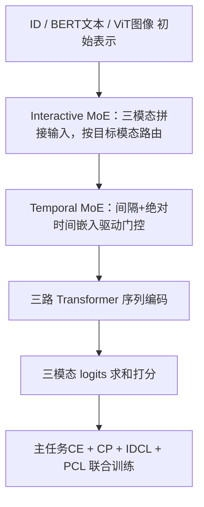
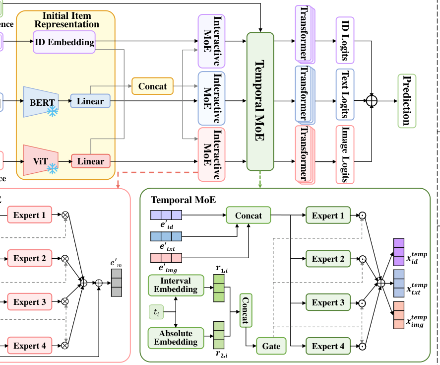
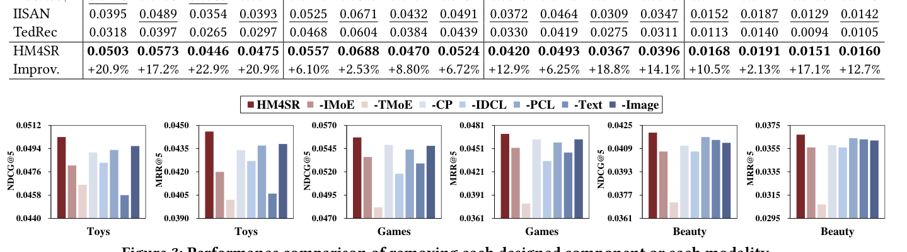

# Hierarchical Time-Aware Mixture of Experts for Multi-Modal Sequential Recommendation (面向多模态序列推荐的分层时间感知混合专家网络)

- **会议/期刊**: WWW 2025
- **作者与机构**: Shengzhe Zhang, Liyi Chen, Dazhong Shen, Chao Wang, Hui Xiong（中国科学技术大学、南京航空航天大学、香港科技大学（广州））
- **推荐链路定位**: 精排（序列级 Next-Item 打分）
- **研究方向**: 多模态推荐 / 序列与会话推荐
- **论文原文**: [https://arxiv.org/abs/2501.14269v2](https://arxiv.org/abs/2501.14269v2)
- **开源代码**: [https://github.com/SStarCCat/HM4SR](https://github.com/SStarCCat/HM4SR)

## TL;DR (1分钟核心速览)

多模态序列推荐的两大痛点是：图文描述中大量与兴趣无关的冗余信息会淹没真实偏好，且现有方法只用行为先后顺序隐式表达时间，丢弃了时间戳与时间间隔这类显式信号。HM4SR 提出两级 MoE——交互 MoE 让每个专家同时吃 ID/文本/图像三模态、按目标模态路由以滤除冗余；时序 MoE 用间隔嵌入与绝对时间嵌入驱动门控，把显式时间注入模态编码。再叠加类别预测、ID 对比、时间占位符对比三项辅助任务缓解稀疏。在四个 Amazon 数据集、Leave-One-Out + 全库排序协议下，NDCG@5 相对最强多模态基线提升 2.13%–22.9%。

## Background & Motivation (背景与核心矛盾)

- **主流范式**: 多模态序列推荐以 BERT/ViT 抽取图文特征，通过加和拼接（MV-RNN）、轻量自适应融合（MISSRec）、异构图融合（MMSR）、模态级 MoE（M3SRec）或频域融合（TedRec）把模态语义并入 ID 序列编码。
- **前人局限**: 其一，融合模块默认"模态信息越多越好"，未显式抑制图文中的兴趣无关片段（如商品包装上的人物、使用说明），冗余语义反而干扰真实偏好抽取；其二，时间建模仅依赖行为的时间先后顺序，TiSASRec 一类工作虽引入时间间隔，却未与多模态编码耦合，无法表达"长期偏好某品牌、近期转向夏季防晒"这类显式时间漂移。
- **核心洞察 (Key Insight)**: 冗余过滤与时间注入本质都是"按条件选择专家"的问题——前者条件为目标模态，后者条件为时间戳；而序列稀疏导致监督信号不足，需要多侧面辅助任务补充。
- **本文切入点**: 用两级层次化 MoE 把"模态去冗"与"显式时间路由"解耦为先后两个门控阶段，再以三项辅助任务补足稀疏序列的监督。

## Method (核心方法设计)

### 1. 整体框架 (Overall Architecture)

物品先经 BERT（[CLS] 文本）、ViT（[CLS] 图像）与 ID 嵌入矩阵得到三路初始表示，线性投影对齐到 $d$ 维并加位置嵌入。随后进入两级 MoE：交互 MoE 以三模态拼接向量为专家输入、以目标模态为路由条件输出融合表示；时序 MoE 以时间间隔嵌入与绝对时间嵌入拼接为门控输入，对三模态拼接特征做专家加权。三路输出分别送入各自的 Transformer 序列编码器，取末位隐状态与对应模态物品嵌入内积后求和得到打分。训练时主任务交叉熵与 CP、IDCL、PCL 三项辅助损失联合优化。

<figure class="paper-figure" markdown="span">
  <figcaption>图2：所提出的HM4SR的整体架构。</figcaption>
</figure>

### 2. 关键设计拆解 (Key Designs)

1. **交互 MoE（Interactive MoE，跨模态去冗）**：以往 MoE 每个专家只处理单一模态，模态间无交互，冗余信息无从被其他模态校验。本文令每个专家接收三模态拼接 $\boldsymbol{e}_{inter}=[\boldsymbol{e}_{id};\boldsymbol{e}_{txt};\boldsymbol{e}_{img}]$，但门控只由目标模态$m$ 决定：
$$\boldsymbol{x}^{inter}_{m}=\alpha_m\sum_{i=1}^{k_1}g^{m}_{i}\left(\boldsymbol{W}^{inter}_{i,m}\boldsymbol{e}_{inter}+\boldsymbol{b}^{inter}_{i,m}\right),\quad \boldsymbol{g}^{m}=\mathrm{Softmax}(\boldsymbol{W}_{1,m}\boldsymbol{e}_{m}+\boldsymbol{b}_{1,m})$$
再以残差 $\boldsymbol{e}'_{m}=\boldsymbol{e}_{m}+\boldsymbol{x}^{inter}_{m}$输出。直觉是：路由由"我要增强哪个模态"决定，而专家能看到全部模态，从而在跨模态比对中压制与兴趣无关的片段；可学习强度$\alpha_m$ 允许模型自行调节交互力度。

2. **时序 MoE（Temporal MoE，显式时间注入）**：时间间隔先经对数分桶 $\mathrm{pos}_i=\lfloor\mu\log(a_i+1)\rfloor$查表得$\boldsymbol{r}_{1,i}$，绝对时间戳用带可训练频率与相位的余弦编码得$\boldsymbol{r}_{2,i}$，二者拼接驱动第二级门控：
$$\boldsymbol{g}'=\mathrm{Softmax}\left(\boldsymbol{W}_{2}[\boldsymbol{r}_{1,i};\boldsymbol{r}_{2,i}]+\boldsymbol{b}_{2}\right),\quad \boldsymbol{x}^{temp}=\sum_{i=1}^{k_2}g'_{i}\left(\boldsymbol{W}^{temp}_{i}\odot\boldsymbol{e}_{temp}\right)$$
与把时间当额外特征拼接不同，这里时间直接决定"用哪组专家解释当前行为"，使同一物品在不同时间上下文下获得不同表征，天然契合兴趣漂移；对数分桶则避免长间隔数值爆炸并保持分辨率。

3. **训练目标、负采样与推理效率**：总损失为
$$\mathcal{L}=\mathcal{L}_{main}+\lambda_1\mathcal{L}_{CP}+\lambda_2\mathcal{L}_{IDCL}+\lambda_3\mathcal{L}_{PCL}$$
其中 CP 对序列内每个物品做多标签类别预测（BCE）；IDCL 在 batch 内做用户序列表示与真实下一物品 ID 嵌入的 InfoNCE 对齐；PCL 以比例 $\beta$随机把物品替换为时间占位符 `[TP]`，并用$\boldsymbol{W}_{P,m}[\boldsymbol{r}_{1,i};\boldsymbol{r}_{2,i}]+\boldsymbol{b}_{P,m}$ 填充该位置，构造增广序列与原序列做模态级对比（文本、图像两路平均）。主任务采用全库 softmax 交叉熵，**不使用负采样**；推理时仅需一次前向，两级 MoE 均为轻量线性专家，额外开销主要来自门控矩阵乘。

## Experimental Setup & Evaluation Protocol (实验设置与评估协议)

- **数据集与预处理**: 四个 Amazon Review 子集，均做 `5-core` 过滤，重复交互去重后按时间戳排序构序列；文本拼接 title/category/brand，图像取商品首图。

| 数据集 | #Users | #Items | #Interactions | 稀疏度/密度 | 特征/场景说明 |
| :--- | :---: | :---: | :---: | :---: | :--- |
| Toys | 19,412 | 11,924 | 167,597 | 99.93% 稀疏 | 玩具，图文描述冗长 |
| Games | 24,303 | 10,672 | 231,780 | 99.91% 稀疏 | 视频游戏，时间分布集中 |
| Beauty | 22,363 | 12,101 | 198,502 | 99.93% 稀疏 | 美妆护肤 |
| Home | 66,519 | 28,237 | 551,682 | 99.97% 稀疏 | 家居厨房，最稀疏 |

- **数据划分与防穿越 (Splitting Strategy)**: `Leave-One-Out`，每用户最后一条为测试、倒数第二条为验证，其余训练，严格按时间戳排序，无未来信息泄漏。
- **排名评测协议 (Ranking Protocol)**: 无偏 `Full-Ranking`，对全物品集未采样打分排序，指标 NDCG@{5,10} 与 MRR@{5,10}。
- **对比基线与超参设置**: 基线覆盖三类——非时间感知（GRU4Rec、SASRec、LRURec）、时间感知（TiSASRec、FEARec、TiCoSeRec）、多模态（NOVA、DIF-SR、UniSRec、MISSRec、M3SRec、IISAN、TedRec）。统一隐藏维 $d=64$、最大序列长 50、Transformer 2 层 2 头、batch 1024、Adam 学习率 1e-3；专家数$k_1,k_2\in\{2,4,6,8,12\}$，$\mu=100$，$freq=10000$，$\tau\in\{0.1,\dots,1.0\}$，$\lambda_1=1.0$，$\lambda_2\in[0.25,1.5]$，$\lambda_3\in\{0.1,\dots,1.5\}$，$\beta\in[0.1,0.5]$，网格搜索取最优。

## Key Experimental Results (实验关键数据)

### 1. 主实验对比 (Main Results)

| 方法 | Toys NDCG@5 | Toys MRR@5 | Games NDCG@5 | Beauty NDCG@5 | Home NDCG@5 | Home MRR@5 |
| :--- | :---: | :---: | :---: | :---: | :---: | :---: |
| SASRec | 0.0348 | 0.0257 | 0.0391 | 0.0325 | 0.0118 | 0.0089 |
| TiSASRec | 0.0372 | 0.0278 | 0.0406 | 0.0340 | 0.0117 | 0.0088 |
| TiCoSeRec | 0.0336 | 0.0280 | 0.0463 | 0.0335 | 0.0108 | 0.0091 |
| UniSRec | 0.0276 | 0.0194 | 0.0386 | 0.0287 | 0.0121 | 0.0092 |
| MISSRec | 0.0323 | 0.0235 | 0.0398 | 0.0315 | 0.0140 | 0.0107 |
| M3SRec | 0.0416 | 0.0363 | 0.0493 | 0.0345 | 0.0122 | 0.0105 |
| IISAN | 0.0395 | 0.0354 | 0.0525 | 0.0372 | 0.0152 | 0.0129 |
| TedRec | 0.0318 | 0.0265 | 0.0468 | 0.0330 | 0.0113 | 0.0094 |
| **HM4SR** | **0.0503** | **0.0446** | **0.0557** | **0.0420** | **0.0168** | **0.0151** |
| Improv. | +20.9% | +22.9% | +6.10% | +12.9% | +10.5% | +17.1% |

（Improv. 为相对最强多模态基线；对最强时间感知传统模型 TiCoSeRec 的相对提升达 13.6%–64.1%。）

### 2. 消融实验 (Ablation Study)

| 变体 | Toys NDCG@5 | Toys MRR@5 | Games NDCG@5 | Beauty NDCG@5 | Beauty MRR@5 |
| :--- | :---: | :---: | :---: | :---: | :---: |
| HM4SR 完整 | 0.0503 | 0.0446 | 0.0557 | 0.0420 | 0.0367 |
| w/o Interactive MoE | 显著下降 | 显著下降 | 下降 | 下降 | 下降 |
| w/o Temporal MoE（含 PCL） | 降幅最大 | 降幅最大 | 降幅最大 | 降幅最大 | 降幅最大 |
| w/o CP | 下降 | 下降 | 下降 | 下降 | 下降 |
| w/o IDCL | 下降 | 下降 | 下降 | 下降 | 下降 |
| w/o PCL | 下降 | 下降 | 下降 | 下降 | 下降 |
| w/o Text | 大幅下降 | 大幅下降 | 大幅下降 | 大幅下降 | 大幅下降 |
| w/o Image | 下降 | 下降 | 下降 | 下降 | 下降 |

<figure class="paper-figure" markdown="span">
  <figcaption>图3：移除每个设计组件或每种模态的性能比较。</figcaption>
</figure>

### 3. 关键实验发现 (Key Findings)

1. **时序 MoE 是最大贡献源**：消融中移除 Temporal MoE（连带 PCL）造成的跌幅在所有组件中最高，说明显式时间信号与多模态编码的耦合比单纯模态融合更关键；PCL 进一步放大该收益，验证"时间—模态相关性学习"的必要性。
2. **文本模态远比图像重要**：移除文本的跌幅显著大于移除图像，与 Beauty/Home 等类目文本描述信息量更大的数据特性一致，提示工业场景应优先保障文本质量与抽取精度。
3. **时间编码方式存在明确优劣**：在 Toys 与 Beauty 上，本文"间隔+绝对时间"组合的 NDCG@5 高于 Interval Only、Absolute Only、Day、Day of Year 与 Cos 五种变体，说明对数分桶间隔嵌入比固定频率余弦间隔更灵活；同时 Games 数据集提升最小（+6.10%），因其用户行为时间分布更集中，动态兴趣建模难度本就较低。

## Highlights & Limitations (亮点、对比与审稿批判)

- **与代表作对比 (vs. Prior Work)**: 相比 M3SRec 的"模态级 + 跨模态级"两级 MoE，本文两级 MoE 的分工是"去冗"与"时间路由"，且专家输入为三模态拼接而非单模态，交互更充分；相比 TedRec 在频域做序列级语义融合，本文在物品级用显式时间戳驱动门控，时间语义更可解释；相比 TiSASRec 仅把时间间隔喂入自注意力，本文将时间提升为专家选择条件，与多模态表征深度耦合。
- **可迁移亮点**: 其一，"门控条件与专家输入解耦"（条件用目标模态/时间，输入用全模态拼接）是一种低成本跨模态去冗范式，可直接迁移到短视频多模态召回；其二，时间占位符替换 + 用时间嵌入填充的增广对比策略，可作为通用时间感知自监督信号用于任何带时间戳的序列模型。
- **审稿级局限批判**: 其一，两级 MoE 叠加三路 Transformer，参数量与显存开销随专家数 $k_1,k_2$增长，论文未给出推理延迟或 FLOPs 对比，工业部署成本不明；其二，全部实验限于 Amazon 四个 5-core 子集与 Leave-One-Out 单点测试，缺乏时间切分或冷启动划分下的验证，且 PCL 的替换比例$\beta$、损失权重$\lambda_2,\lambda_3$ 均需网格搜索，超参敏感度较高。

## Rating (四维评分)

- **方法创新性 (Novelty)**: ⭐⭐⭐⭐ （两级 MoE 分工明确，"门控条件与专家输入解耦"与时间占位符对比均有巧思，但 MoE 与对比学习本身并非全新范式）
- **评估协议与实验扎实度 (Protocol & Experiments)**: ⭐⭐⭐⭐ （四数据集 + 全库排序 + 13 个基线较扎实，但仅 Leave-One-Out 单协议、缺时间切分与效率实验）
- **写作与数学规范度 (Clarity & Rigor)**: ⭐⭐⭐⭐ （公式与符号定义清晰、模块动机有图示支撑，个别符号如 $\alpha_m$ 的作用缺少消融验证）
- **工业落地与复现价值 (Industrial & Practical Value)**: ⭐⭐⭐⭐ （代码已开源、基于 RecBole 易复现，但两级 MoE 的在线延迟与显存成本未量化，落地需额外压测）

