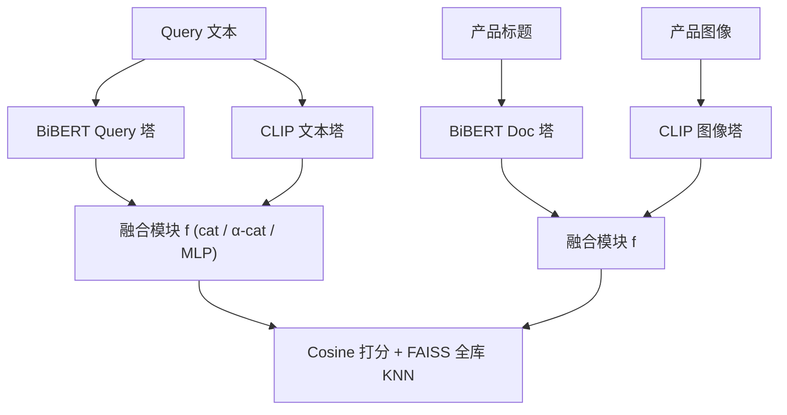
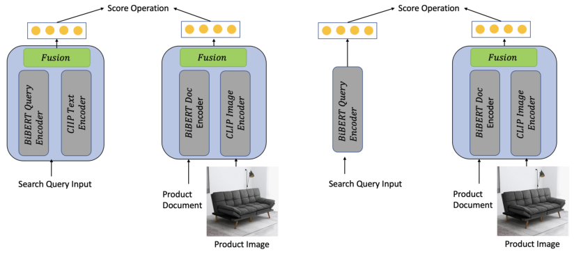

# Multimodal semantic retrieval for product search (面向产品搜索的多模态语义检索)

- **会议/期刊**: WWW Companion 2025 (EReL@MIR Workshop)
- **作者与机构**: Dong Liu, Esther Lopez Ramos (Amazon)
- **推荐链路定位**: 召回（语义稠密检索）
- **研究方向**: 多模态推荐 / 协同过滤与双塔召回
- **论文原文**: [https://arxiv.org/abs/2501.07365v3](https://arxiv.org/abs/2501.07365v3)
- **开源代码**: [FAISS 索引库](https://github.com/facebookresearch/faiss)（模型代码暂未开源）

## TL;DR (1分钟核心速览)

电商搜索长期以产品标题文本做双塔稠密检索，产品图像这一关键决策信号被系统性忽略。本文在 Amazon 真实搜索日志（540 万训练对、3.38M 全库产品）上构建 4-tower（BiBERT 文本 + CLIP 文本/图像）与 3-tower（BiBERT 查询 + BiBERT 文本 ⊕ CLIP 图像）两类融合模型，统一用 Cosine 相似度 + FAISS 全库 KNN 检索。结论是：多模态表征可在**购买召回**（78.1→78.6）或**相关性精度**（Exact 52.7→54.0、Irrelevant 13.6→11.9）二者之一取得增益，且联合微调可让 3-tower 逼近 4-tower，验证了独立预训练编码器间的语义空间错位可被微调弥合。

## Background & Motivation (背景与核心矛盾)

- **主流范式**: 电商检索以词法匹配（query 与产品标题关键词重叠）为主，近年转向 BERT 双塔稠密检索，将 query 与产品标题分别编码为向量后做内积/余弦比较。
- **前人局限**: ① 词法方案无法建模无语词重叠的语义相关性；② 纯文本双塔丢弃了用户在浏览决策中最依赖的产品图像信息；③ 已有电商多模态工作（如 3-tower/4-tower 的先行研究）依赖 MaxSim 类 late-interaction 打分，**无法被主流 ANN 索引器支持**，百万级商品库下不可扩展。
- **核心洞察 (Key Insight)**: CLIP 的文本塔与图像塔在预训练中已对齐，但 BiBERT 文本塔与 CLIP 图像塔是**独立训练**的，二者向量空间存在错位；这一错位是否可被下游微调修复、以及修复后能否在可扩展的 Cosine 打分下带来真实收益，此前未被量化。
- **本文切入点**: 在统一 Cosine + FAISS 的可扩展检索框架下，横向对比 4-tower 与 3-tower 两种融合拓扑及多种融合算子，用"购买召回 + 四级相关性精度"双指标拆解图像模态的真实贡献。

## Method (核心方法设计)

### 1. 整体框架 (Overall Architecture)

模型沿用双塔检索范式，训练目标为标准的 NT-Xent 归一化温度交叉熵 $\mathcal{L}=-\log\frac{\exp(s(\boldsymbol{q}_i,\boldsymbol{d}_i^+))}{\sum_j\exp(s(\boldsymbol{q}_i,\boldsymbol{d}_j^-))}$，其中$s(\cdot,\cdot)$ 为余弦相似度。差异全部集中在**塔的构成与融合方式**：4-tower 让 query 与 product 各自同时经过 BiBERT 文本塔与 CLIP 塔再融合；3-tower 则让 query 只走 BiBERT，product 走 BiBERT 文本 ⊕ CLIP 图像，由 MLP 融合模块兼任"跨空间对齐器"。训练后所有 query 与全库 3.38M 产品编码入库，用 FAISS KNN 取 Top-100 计算召回与相关性。

<figure class="paper-figure" markdown="span">
  <figcaption>图1：用于语义检索的两种多模态模型架构</figcaption>
</figure>

### 2. 关键设计拆解 (Key Designs)

1. **4-tower 融合拓扑（4tMM）**：query 与 product 均取两路编码后融合，$\boldsymbol{q}=f(\phi_q^{BiBERT}(\boldsymbol{x}_{query}),\phi_t^{CLIP}(\boldsymbol{x}_{query}))$，$\boldsymbol{d}=f(\phi_d^{BiBERT}(\boldsymbol{x}_{text}),\phi_i^{CLIP}(\boldsymbol{x}_{image}))$。融合算子对比三种：直接拼接$f_{cat}=\boldsymbol{v}_1\oplus\boldsymbol{v}_2$、加权拼接$f_{\alpha\text{-}cat}=(\alpha\boldsymbol{v}_1)\oplus((1-\alpha)\boldsymbol{v}_2)$、以及 MLP 融合。直觉是保留 CLIP 文本塔可提供已对齐的图文参照系，缓解图像塔与 BiBERT 的错位。
2. **3-tower 对齐式融合（3tMM）**：去掉 CLIP 文本塔，$\boldsymbol{q}=\phi_q^{BiBERT}(\boldsymbol{x}_{query})$，$\boldsymbol{d}=f_{MLP}(\phi_d^{BiBERT}(\boldsymbol{x}_{text}),\phi_i^{CLIP}(\boldsymbol{x}_{image}))$。此时 MLP 承担双重职责——既做模态融合，又把图像向量**投影进 BiBERT 的语义空间**。该设计直接检验"错位能否靠微调弥合"，同时把索引侧塔数从 4 降到 3，降低线上编码成本。
3. **训练目标、负采样与推理效率**：损失为式 (1) 的 in-batch 负采样 NT-Xent；额外构造 **Seen Negative** 变体，为每个 query 追加 3 个"被匹配但无购买记录"的产品作为显式难负例。微调学习率统一 $1e{-}4$，8×V100 训练。推理侧仅需 Cosine + FAISS，索引规模达百万级，避免了 MaxSim 无法被 ANN 索引支持的工程瓶颈。

## Experimental Setup & Evaluation Protocol (实验设置与评估协议)

- **数据集与预处理**: 训练集来自 12 个月搜索日志的 query-product 交互，相关性标签由购买/参与行为剪枝得到；评估集取与之**时间窗不重叠**的 1 个月数据。

| 数据集 | #Users | #Items | #Interactions | 稀疏度/密度 | 特征/场景说明 |
| :--- | :---: | :---: | :---: | :---: | :--- |
| Training | 988,090 distinct queries | 581,158 | 5,400,836 pairs | — | 12 个月搜索日志，购买参与标签 |
| Evaluation | 38,268 distinct queries | 3,384,067 | 150,179 pairs | — | 独立月份，无时间重叠 |

- **数据划分与防穿越 (Splitting Strategy)**: 采用**全局时间戳切分**（训练与评估时间窗不重叠），评估库含 3.38M 产品，远大于训练库，属"库扩容"式泛化测试。
- **排名评测协议 (Ranking Protocol)**: 无偏 **Full-Ranking**——对全部 3.38M 产品做 FAISS KNN 取 Top-100，无负采样。指标为 Recall@100（购买召回）与四级相关性精度（Exact / Substitute / Complement / Irrelevant，由标注模型 Sentinel 判定）。
- **对比基线与超参设置**: 基线为纯文本 BiBERT（2 层 Transformer、4 头，query/doc 塔共享大部分权重）与零样本 CLIP（50 亿图文对预训练，未见过电商数据）；融合维度经拼接/MLP 映射，微调 lr=$1e{-}4$。

## Key Experimental Results (实验关键数据)

### 1. 主实验对比 (Main Results)

| Model | Tune | MLP | Seen Neg | Recall@100 | Exact | Substitute | Complement | Irrelevant |
| :--- | :---: | :---: | :---: | :---: | :---: | :---: | :---: | :---: |
| BiBERT (text-only) | | | | **78.1** | 52.7 | 30.3 | 2.4 | 13.6 |
| CLIP (zero-shot) | | | | 46.0 | 45.4 | 26.5 | 2.7 | 25.4 |
| 4tMM cat | | | | 78.6 | 52.5 | 31.1 | 2.4 | 14.0 |
| 4tMM α-cat | | | | 78.5 | 51.9 | 31.2 | 2.4 | 14.5 |
| 4tMM | ✓ | ✓ | | 73.3 | **54.0** | 26.8 | 2.7 | **11.9** |
| 4tMM | ✓ | ✓ | ✓ | 77.8 | 50.6 | 30.5 | 2.3 | 13.6 |
| 3tMM | ✓ | ✓ | | 73.1 | 53.8 | 26.8 | 2.7 | 12.1 |
| 3tMM | ✓ | ✓ | ✓ | 74.9 | 50.0 | 30.4 | 2.6 | 14.0 |

（Recall@100 相对 BiBERT 最优提升 +0.5pt；Exact 最优 +1.3pt、Irrelevant 最优 −1.7pt。）

### 2. 消融实验 (Ablation Study)

| 配置 | Recall@100 | Exact | Irrelevant | 说明 |
| :--- | :---: | :---: | :---: | :--- |
| 4tMM cat（仅拼接，不微调） | 78.6 | 52.5 | 14.0 | 融合但不训练 |
| 4tMM 仅微调 MLP | 75.5 | 51.3 | 14.8 | 单训融合层反而掉点 |
| 4tMM 微调 BiBERT+MLP | 73.3 | 54.0 | 11.9 | 精度最优、召回最差 |
| 4tMM 微调 + Seen Neg | 77.8 | 50.6 | 13.6 | 召回回升、精度回落 |
| 3tMM 微调 BiBERT+MLP | 73.1 | 53.8 | 12.1 | 逼近 4tMM（差 0.2pt Exact） |
| 3tMM 微调 + Seen Neg | 74.9 | 50.0 | 14.0 | 召回 +1.8pt |

### 3. 关键实验发现 (Key Findings)

1. **召回与精度存在明确 trade-off，且由"微调范围"控制**：仅拼接不训练时 Recall@100 达 78.6（+0.5pt）但 Exact 微降；一旦联合微调 BiBERT+MLP，Exact 升至 54.0（+1.3pt）、Irrelevant 降至 11.9（−1.7pt），代价是召回跌至 73.3（−4.8pt）。说明图像模态主要贡献的是**相关性判别力**而非购买意图拟合。
2. **3-tower 足以逼近 4-tower，语义错位可被微调弥合**：3tMM（73.1 / 53.8 / 12.1）与 4tMM（73.3 / 54.0 / 11.9）三项指标差距均 ≤0.2pt，证明去掉 CLIP 文本塔后，MLP 融合层确实完成了图像→BiBERT 空间的投影对齐，索引侧塔数可安全从 4 降到 3。
3. **多模态模型检索到的是"新"商品而非重排**：与 BiBERT 的预测重叠率仅 39%（4tMM cat），每 query 平均 60 个独占预测；这些独占结果的 Net Recall@100 在联合微调下高达 56.2%，Net Exact 57.6%、Net Irrelevant 仅 11.4%，说明增益来自**互补召回**而非同集合内的分数扰动。

## Highlights & Limitations (亮点、对比与审稿批判)

- **与代表作对比 (vs. Prior Work)**: 相较先行电商多模态工作依赖 MaxSim late-interaction（不可 ANN 索引、大库不可扩展），本文坚持 Cosine + FAISS，工程可落地性显著更强；相较纯文本 BiBERT，本文首次在统一协议下量化了"图像塔与文本塔独立预训练导致的错位"及其可修复性；相较零样本 CLIP，本文显示 CLIP 单独使用虽 Exact+Substitute 达 71.9% 但购买召回仅 46%，必须与领域文本塔融合。
- **可迁移亮点**: ① "Net Prediction / Net Recall" 独占匹配分析框架，可直接用于评估任何新召回源对现有系统的**增量**价值，避免只看整体指标的虚假提升；② Seen Negative（匹配但未购买）作为难负例的构造方式，在电商场景低成本且对召回有效。
- **审稿级局限批判**: ① 增益幅度偏小（Recall +0.5pt、Exact +1.3pt），且未报告显著性检验与多次运行方差，统计可靠性存疑；② 相关性标签由标注模型 Sentinel 自动判定而非人工标注，存在评估环路风险；③ 未报告在线 A/B 与推理延迟/索引内存开销，3-tower 相对 4-tower 的工程收益仅停留在架构层面论证。

## Rating (四维评分)

- **方法创新性 (Novelty)**: ⭐⭐⭐ （融合拓扑与算子均为成熟组件的系统性组合，创新在于"错位可弥合"的实证命题与可扩展打分约束下的对比设计，而非新算子）
- **评估协议与实验扎实度 (Protocol & Experiments)**: ⭐⭐⭐ （3.38M 全库 Full-Ranking 与时间切分扎实、独占匹配分析出彩，但缺显著性检验、方差报告与在线验证）
- **写作与数学规范度 (Clarity & Rigor)**: ⭐⭐⭐ （架构与公式表述清晰，但 4eMM/4tMM、3eMM/3tMM 记号混用，表格 Tune/MLP 列语义未明确定义）
- **工业落地与复现价值 (Industrial & Practical Value)**: ⭐⭐⭐⭐ （Cosine + FAISS 百万级索引可直接落地，3-tower 降本结论明确；但模型代码未开源，仅索引库可参考）

