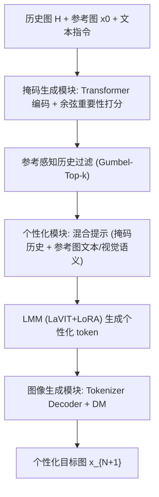

# Personalized Image Generation with Large Multimodal Models (基于大型多模态模型的个性化图像生成)

- **会议/期刊**: WWW 2025
- **作者与机构**: Yiyan Xu, Wenjie Wang, Yang Zhang, Biao Tang, Peng Yan, Fuli Feng, Xiangnan He（中国科学技术大学、新加坡国立大学、美团）
- **推荐链路定位**: 端到端生成式（个性化内容生成，替代传统过滤式推荐）
- **研究方向**: 多模态推荐 / 生成式推荐
- **论文原文**: [https://arxiv.org/abs/2410.14170v2](https://arxiv.org/abs/2410.14170v2)
- **开源代码**: [https://github.com/YiyanXu/Pigeon](https://github.com/YiyanXu/Pigeon)

## TL;DR (1分钟核心速览)

传统推荐只做"过滤"，受限于已有内容多样性，无法满足用户多样需求。本文提出 Pigeon，基于 LMM（LaVIT）从含噪历史交互图中推断隐式视觉偏好，并融合多模态指令生成个性化图像。核心是三个模块（掩码生成、个性化、图像生成）加两阶段偏好对齐（掩码偏好重建 + DPO 成对对齐），解决无监督数据难题。在 SER30K 贴纸与 ML-Latest 海报两个场景上，个性化指标（Overall/CS/CIS/DIS）较最优基线提升 7%~31%，MTurk 人工评测中平均 71% 参与者更偏好 Pigeon 生成结果。

## Background & Motivation (背景与核心矛盾)

- **主流范式**: 个性化图像生成分两派——DM 派（TI、DreamBooth、DiFashion）学习用户历史图表征后拼接指令引导扩散模型；LLM 派（PMG）把历史图与指令转成文本描述，用 LLM 编码后引导生成。
- **前人局限**: ① DM 派难以从覆盖多样兴趣的噪声历史图中准确抽取偏好，特征级噪声纠缠（角色、颜色等偏好与厌恶特征混杂）；② LLM 派受限于文本离散性，复杂视觉细节在"图转文"中丢失，表征不精确；③ 更致命的是缺乏 `<历史图, 多模态指令, 目标图>` 三元组监督数据，直接微调 LMM 会退化为"复制参考图"。
- **核心洞察 (Key Insight)**: 个性化生成的关键在于"从噪声历史中稳健推断隐式偏好"+"遵循显式多模态指令"双重能力，这恰是 LMM 的多模态理解与指令跟随强项；但需专门模块做特征级去噪与专门的对齐方案补数据缺口。
- **本文切入点**: 用 token 级掩码在特征层面过滤历史噪声，并用"历史序列末图作目标"自监督构造训练数据，两阶段对齐 LMM。

## Method (核心方法设计)

### 1. 整体框架 (Overall Architecture)

Pigeon 以 LaVIT 为骨干。输入用户历史图 $H=\{\boldsymbol{x}_i\}_{i=1}^{N}$与多模态指令$R=\{\boldsymbol{x}_0, \boldsymbol{txt}\}$（参考图 + 文本）。首先掩码生成模块用 Transformer 编码器对历史图与参考图的视觉 token 计算重要性分数，生成 token 级掩码过滤噪声历史；其次个性化模块将参考图的高层语义（Caption 文本 token + Tokenizer Decoder 稠密视觉特征经 Adapter 对齐）与掩码历史拼成混合提示，驱动 LMM 生成个性化目标 token；最后图像生成模块用 Tokenizer Decoder 将离散 token 转稠密特征，引导扩散模型出图。训练采用两阶段偏好对齐，仅微调掩码生成器、Adapter 与 LoRA。

### 2. 关键设计拆解 (Key Designs)

1. **参考感知的 token 级历史掩码（Mask Generation）**：痛点是从噪声历史中区分"与参考图相关且含个性化信息"的 token。将各图 token 序列加位置/类型嵌入后送入 Transformer 编码器做跨图注意力，用隐状态与原嵌入的余弦相似度量化重要性：$s_{ij}=\text{cosine}(\boldsymbol{z}_{ij},\boldsymbol{e}_{ij})$，再按历史掩码比例$\alpha_h$保留高分 token，$\tilde{\boldsymbol{E}}_i=\boldsymbol{m}_h\odot\boldsymbol{E}_i$，离散采样用 Gumbel-Softmax 保证可反传。直觉：注意力让历史 token 相互"投票"，离群噪声 token 因与整体语义不一致而得分低被剔除。

2. **多模态指令的高层语义编码（Personalization）**：痛点是直接把参考图喂给 LMM 会导致"复制参考图"而非个性化。本文双路提取高层语义：文本路用 Caption 模型（BLIP-2/LLaVA）生成参考图描述得 $\boldsymbol{r}_t$；视觉路用 LaVIT 预训练 Tokenizer Decoder 将$\boldsymbol{E}_0$转为稠密特征并平均池化，经 Adapter 对齐维度得$\boldsymbol{r}_v=\text{Adapter}(\text{AvgPooling}(\text{Tokenizer\_Decoder}(\boldsymbol{E}_0)))$。二者与掩码历史拼成混合提示$\boldsymbol{p}=\text{Prompt}(\tilde{\boldsymbol{E}}_1,\dots,\tilde{\boldsymbol{E}}_N,\boldsymbol{r}_t,\boldsymbol{r}_v)$。直觉：高层语义既保留视觉细节又避免低层像素复制。

3. **两阶段偏好对齐与训练目标**：Stage-1 掩码偏好重建——取交互序列末图为目标、前序为历史，用目标图自身构造指令并施加**双相参考掩码**（训练时遮高分 token 逼模型靠历史恢复目标，推理时遮低分 token 保留个性化信息），损失为自回归负对数似然 $\mathcal{L}_{sft}=-\sum\log P_\Theta(\boldsymbol{e}_{N+1,j}\mid\boldsymbol{p}(\alpha_r),\boldsymbol{e}_{N+1,<j})$，$\alpha_r\sim U(0,1)$随机采样增强鲁棒性。Stage-2 成对偏好对齐——用不同$\alpha_r$生成多图，以与历史图的 CLIP 相似度$s(\alpha_r)=\frac{1}{N}\sum_i\text{CLIPSim}(\boldsymbol{x}(\alpha_r),\boldsymbol{x}_i)$排序构造 chosen/rejected 伪标签对，用 DPO 优化$\mathcal{L}_{DPO}$（$\beta$ 控制偏离参考模型程度）。负采样为"生成式自采样 + 奖励排序"，无需人工标注。

## Experimental Setup & Evaluation Protocol (实验设置与评估协议)

- **数据集与预处理**:

| 数据集 | 场景 | 说明 |
| :--- | :---: | :--- |
| SER30K | 贴纸 | 大规模贴纸数据集，按主题分类并带情感标签 |
| ML-Latest | 电影海报 | MovieLens 基准，用户对电影评分，取海报为交互图 |

- **数据划分与防穿越**: 按用户交互序列构造，末图为目标、前序为历史（Leave-Last-Out 式自监督构造），训练/测试按用户切分，参考图与目标图不重叠以防信息泄漏。
- **排名/评测协议**: 非排名任务，采用生成质量指标——个性化（CS/CIS/DIS 语义相似度、LPIPS/MS-SSIM 感知相似度、Overall F1）、语义对齐（与参考图的 CS/CIS/DIS）、保真度（FID）；另做 MTurk 二选一人工评测（每场景 50 例，95% 置信区间）。
- **对比基线与超参**: DM 派 TI、LLM 派 PMG、LMM 派 LLaVA/LaVIT（含预训练 `*` 与微调版），另设 Recon（无个性化重建）与 Grd（真实参考图）参照；基线统一学习率 $1e-5$，除 PMG 外均用 SDXL 作生成器保证公平。

## Key Experimental Results (实验关键数据)

### 1. 主实验对比 (Main Results)

贴纸场景（#Sticker）核心指标：

| 方法 | Overall↑ | CS↑ | CIS↑ | DIS↑ | LPIPS↓ | FID↓ |
| :--- | :---: | :---: | :---: | :---: | :---: | :---: |
| TI (DM) | 36.91 | 18.67 | 40.90 | 36.58 | 0.7654 | 105.48 |
| PMG (LLM) | 32.83 | 19.16 | 47.34 | 39.15 | 0.7383 | 84.91 |
| LaVIT* | 34.56 | 18.77 | 53.63 | 50.96 | 0.6855 | 107.53 |
| LaVIT | 33.15 | 16.39 | 40.56 | 40.84 | 0.7377 | 83.39 |
| **Pigeon** | **44.38** | **23.69** | **67.65** | **62.23** | **0.6814** | 89.43 |
| Grd (参照) | 36.98 | 16.93 | 45.00 | 43.71 | 0.6443 | - |

海报场景（#Movie poster）：Pigeon Overall **33.31**（TI 31.07、LaVIT 27.82），CIS **40.16**（TI 28.29），DIS **21.29**，FID 47.79 与最优基线 33.53 接近。Overall 相对最优基线提升约 **7%~31%**。

### 2. 消融实验 (Ablation Study)

多模态指令编码消融（贴纸，Stage-1 后）：

| 变体 | CIS↑ | LPIPS↓ | CS↑ |
| :--- | :---: | :---: | :---: |
| Pigeon | **61.64** | **0.6800** | **25.74** |
| w/o visual feature | 55.46 | 0.6828 | 23.53 |
| w/o textual tokens | 65.73 | 0.6731 | 20.37 |
| w/o encoding | 55.35 | 0.6976 | 24.72 |

其余消融（图 4）：去历史掩码 → 个性化与语义对齐双降；去参考掩码 → 性能显著下滑；单相掩码（全遮高分或全遮低分）→ 个性化明显下降；仅 Stage-1 vs. Stage-1+2 → Stage-2 进一步提升个性化（语义对齐略降）。

### 3. 关键实验发现 (Key Findings)

1. **历史掩码是去噪关键**：移除后个性化 CIS 与语义对齐 CS 同时下降，证明噪声不仅损害偏好推断，还干扰指令对齐；且 $\alpha_h$ 增大时语义对齐升、个性化降，存在明确权衡。
2. **文本与视觉语义互补**：去文本 token 使 CIS 升至 65.73 但 CS 暴跌至 20.37（模型过度偏向用户偏好、丢失参考语义）；去视觉特征则 CIS 降至 55.46，说明视觉高层语义对个性化不可或缺。
3. **双相掩码优于单相**：训练遮高分、推理遮低分的非对称设计显著优于两阶段同遮高分或同遮低分，避免模型"过拟合于重建"而丧失泛化个性化能力；Stage-2 DPO 在语义对齐微降代价下换来个性化进一步提升。

## Highlights & Limitations (亮点、对比与审稿批判)

- **与代表作对比 (vs. Prior Work)**: 相较 TI（仅学用户嵌入、忽略历史噪声）与 PMG（图转文丢失视觉细节），Pigeon 在特征级做 token 掩码去噪并保留稠密视觉语义；相较直接微调 LaVIT（退化为复制参考图，CIS 仅 40.56），Pigeon 通过两阶段对齐真正学到个性化（CIS 67.65）。
- **可迁移亮点**: ① "末图为目标、前序为历史"的自监督三元组构造法可迁移到任意缺乏监督的生成式推荐任务；② 双相掩码（训练遮高分/推理遮低分）思路可迁移到其他"重建 vs. 生成"权衡场景。
- **审稿级局限批判**: ① 依赖 LaVIT + Caption 模型 + DM 多组件级联，推理开销大，论文未充分报告延迟；② 评测以 CLIP/DINO 相似度为主，与真实用户满意度存在 gap，且仅两场景、每场景 50 例人工评测规模偏小；③ 偏好奖励用与历史图 CLIP 相似度排序，可能奖励"与历史相似"而非"真正喜欢"，存在指标自洽性风险。

## Rating (四维评分)

- **方法创新性 (Novelty)**: ⭐⭐⭐⭐ （首次系统性地将 LMM 用于个性化图像生成，token 级双相掩码与两阶段对齐设计新颖，但各组件多为已有技术组合）
- **评估协议与实验扎实度 (Protocol & Experiments)**: ⭐⭐⭐⭐ （双场景 + 多维度量化 + MTurk 人工评测较完整，但人工评测规模小、缺乏线上验证）
- **写作与数学规范度 (Clarity & Rigor)**: ⭐⭐⭐⭐ （模块划分清晰、公式完整，混合提示与掩码方案表述明确，复杂度分析略欠）
- **工业落地与复现价值 (Industrial & Practical Value)**: ⭐⭐⭐⭐ （代码开源、场景贴合美团贴纸/海报业务，但多模型级联的推理成本是落地主要障碍）

