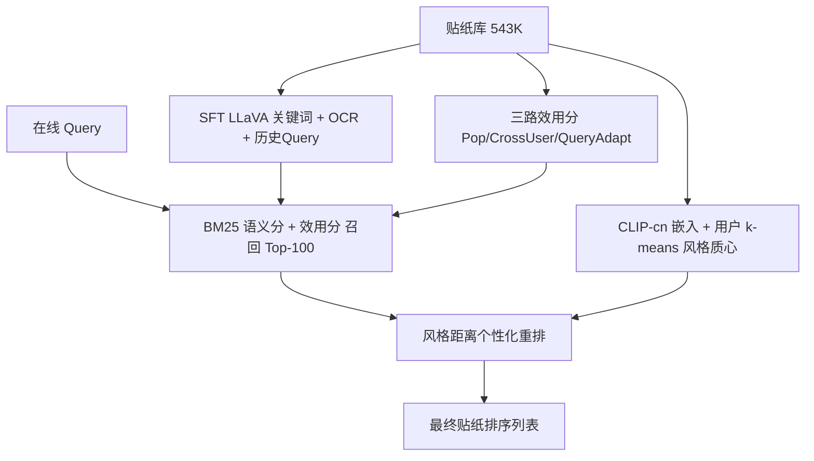
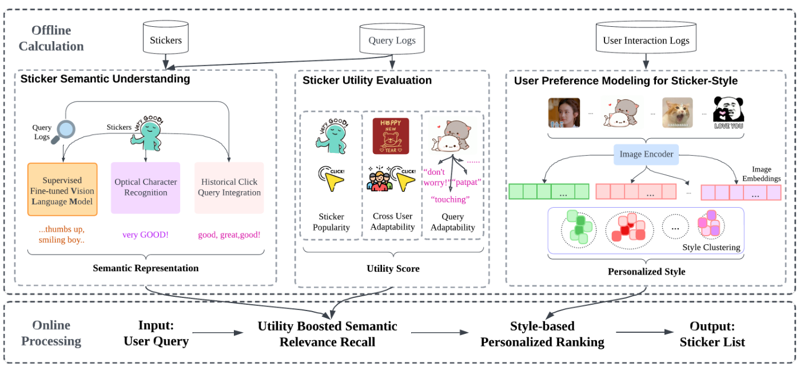

# PerSRV: Personalized Sticker Retrieval with Vision-Language Model (基于视觉语言模型的个性化贴纸检索)

- **会议/期刊**: WWW 2025
- **作者与机构**: Heng Er Metilda Chee, Jiayin Wang, Zhiqiang Guo, Weizhi Ma, Min Zhang（清华大学 DCST / AIR / 泉城实验室）
- **推荐链路定位**: 召回 + 重排（两阶段检索）
- **研究方向**: 多模态推荐 / 冷启动与长尾推荐
- **论文原文**: [https://arxiv.org/abs/2410.21801v2](https://arxiv.org/abs/2410.21801v2)
- **开源代码**: [https://github.com/metildachee/persrv](https://github.com/metildachee/persrv)（含 HuggingFace 微调模型 `metchee/persrv`）

## TL;DR (1分钟核心速览)

即时通讯贴纸检索长期依赖人工标签或对话上文，通用 VLM 又抓不住贴纸特有的"梗"语义，且纯相关性检索完全无视用户风格偏好。PerSRV 用 LoRA 微调 LLaVA-1.5-7B 生成类人关键词（辅以 OCR 文本与历史点击 query），离线预计算三路众包效用分与 CLIP 风格聚类质心，在线先 BM25+效用召回 top-100、再按风格距离个性化重排。在 WeChat 公开数据集（54.3 万候选、12,568 条交互）上，M-MRR@20 达 0.3020，较最强基线 BM25(+OCR) 相对提升 8.95%，M-MRR@1 提升约 19%。

## Background & Motivation (背景与核心矛盾)

- **主流范式**: 贴纸检索分两支——SRS/PESRS 类用卷积贴纸编码器 + 对话自注意力做贴纸-话语匹配，StickerCLIP 类微调图文编码器做跨模态对齐；二者均以"相关性"为唯一目标。
- **前人局限**: 其一，SRS/PESRS/CKES 等强依赖人工标注的情感标签或对应话语，无标注贴纸直接被排除在候选之外；其二，通用 VLM（BLIP2、CLIP-cn）在贴纸场景下 M-MRR@20 仅 0.0012/0.0087，几乎不可用，因为贴纸语义是"情绪表达"而非"物体识别"。
- **核心洞察 (Key Insight)**: 贴纸的"有用性"不等于视觉质量（SSIM/PSNR 失效），也不等于流行度；作者通过众包视角提出三个可量化的效用代理——流行度、跨用户适应性、query 适应性，并发现用户偏好高度集中在"贴纸系列/角色风格"这一低维结构上。
- **本文切入点**: 把"语义理解"交给微调 VLM 离线生成、把"效用"做成可预计算的标量、把"个性化"降维成风格聚类质心距离，从而在在线阶段只做轻量 BM25 + 距离计算。

## Method (核心方法设计)

### 1. 整体框架 (Overall Architecture)

框架严格分为离线预计算与在线两阶段。离线侧三模块并行：(1) 语义理解——SFT LLaVA 生成关键词 + PaddleOCR 抽取图内文字（置信度 > 0.7，覆盖 73% 贴纸）+ 训练集历史点击 query 拼接，共同构成贴纸语义文档 $\text{Semantics}_s=\{\text{VLM}_s,\text{VLM}_d,\text{OCR}_s,\text{QueryInteg.}_s\}$；(2) 效用评估——三路众包指标归一化后线性加权成标量$U_s$；(3) 偏好建模——CLIP-cn 提 512 维图像嵌入，对每个用户历史交互贴纸做 k-means 得到风格质心集合。在线时 query 到达，先以 BM25 语义分叠加效用分召回 top-$R{=}100$，再以风格距离做乘性个性化重排输出最终列表。

<figure class="paper-figure" markdown="span">
  <figcaption>图1：PerSRV 概览。该框架分为离线计算和在线处理两部分。离线准备包含三个模块：（1）多模态贴纸语义理解；（2）贴纸效用评估；（3）贴纸风格的用户偏好建模。当在线查询到来时，PerSRV 首先召回语义相关且效用增强的贴纸，然后根据用户偏好进行排序。</figcaption>
</figure>

### 2. 关键设计拆解 (Key Designs)

1. **SFT-VLM 贴纸语义生成（解决通用 VLM 语义失配）**：基座 LLaVA 直接 in-context 提问只能给出泛化描述（BLEU 近乎 0），作者以训练集真实点击 query 为 ground truth，用 LoRA 做监督微调（5 epoch、lr=1e-4、batch=2），并追加"描述 + 情绪"双段 prompt。微调后关键词 BLEU 从 0 升至 0.3625、嵌入余弦相似度从 0.3756 升至 0.6863。直觉在于：点击 query 本身就是用户对贴纸语义的"众包标注"，比人工标签更贴近检索分布。

2. **三路效用分与风格质心个性化（解决相关性与偏好割裂）**：效用分先对三指标做零值平滑再开方归一化，抑制流行度长尾主导：
$$\text{Utility}_s=\mathbf{w}^{\top}\sqrt{\text{Norm}\big([\text{Pop}_s,\ \text{CrossUserAdapt}_s,\ \text{QueryAdapt}_s]^{\top}\big)}$$
个性化侧，用户 $u$对贴纸$s$的偏好分取到其风格质心的最小距离$\text{PreferenceScore}_u(s)=\min_{\text{Style}_u}\text{Distance}(\text{Style}_u,s)$，最终以乘性融合避免偏好压过相关性：
$$\text{Score}_{u;q}(s)=\text{RecallScore}_q(s)\big(1+\alpha\,\text{PreferenceScore}_u(s)\big)$$
乘性形式保证语义不相关的贴纸即便风格再契合也无法被抬进前列，这是相对加性融合的关键工程直觉。

3. **训练目标、负采样与推理效率**：本文无端到端排序损失，VLM 侧为语言建模交叉熵（LoRA 参数），检索侧为无训练的 BM25 + 距离打分，因此**无需负采样**。在线单 query 推理仅 0.0541 s，与 BLIP2+Opus（0.0549 s）持平，却比 SRS（0.1103 s）快一倍，M-MRR@10 高出 26 倍。

## Experimental Setup & Evaluation Protocol (实验设置与评估协议)

- **数据集与预处理**: WeChat 公开贴纸检索数据集（CCIR Cup），无 5-core 过滤，全量候选参与排序：

| 数据集 | #Users | #Items | #Interactions | 稀疏度/密度 | 特征/场景说明 |
| :--- | :---: | :---: | :---: | :---: | :--- |
| WeChat Sticker | 8 | 543,098 | 12,568 | 2.3e-5 | 用户-query-贴纸三元组；2,308 个唯一 user-query 对，1,891 个唯一 query；73% 贴纸含 OCR 文本 |

- **数据划分与防穿越 (Splitting Strategy)**: 随机 `比例划分`，80% 交互训练、20% 用于测试与验证；VLM 微调仅见训练集 query，测试 query 不参与语义生成，无穿越。
- **排名评测协议 (Ranking Protocol)**: 无偏 `Full-Ranking`——在 543,098 个全库候选中排序，未做负采样；指标为 M-MMR@k（多正例平均倒数排名）与 Recall@k，$k\in\{1,5,10,20\}$。
- **对比基线与超参设置**: 四类基线——流行度（Global Pop / User Pop）、文本（BM25 / BM25+OCR）、通用 VLM（BLIP2+Opus 翻译、CLIP-cn）、贴纸排序（SRS，用 EmojiLM 补标注）。图像嵌入 512 维（CLIP-cn），OCR 置信阈值 0.7，召回截断 $R=100$，$\alpha$与效用权重$\mathbf{w}$经网格逐步搜索确定；显著性用双尾配对 t 检验（\*$p<0.05$，\*\*$p<0.01$）。

## Key Experimental Results (实验关键数据)

### 1. 主实验对比 (Main Results)

| 类别 | 方法 | M-MRR@1 | M-MRR@5 | M-MRR@10 | M-MRR@20 | R@20 |
| :--- | :--- | :---: | :---: | :---: | :---: | :---: |
| 流行度 | Global Pop | 0.0000 | 0.0009 | 0.0013 | 0.0015 | 0.0024 |
| 流行度 | User Pop | 0.0011 | 0.0022 | 0.0025 | 0.0028 | 0.0037 |
| 文本 | BM25 | 0.0097 | 0.0418 | 0.0494 | 0.0494 | 0.0535 |
| 文本 | BM25 (+OCR) | 0.0852 | 0.2414 | 0.2682 | 0.2772 | 0.2726 |
| 通用VLM | BLIP2 | 0.0000 | 0.0005 | 0.0011 | 0.0012 | 0.0021 |
| 通用VLM | CLIP-cn | 0.0021 | 0.0072 | 0.0078 | 0.0087 | 0.0123 |
| 贴纸排序 | SRS | 0.0064 | 0.0086 | 0.0102 | 0.0115 | 0.0175 |
| **本文** | **PerSRV** | **0.1014\*\*** | **0.2673\*\*** | **0.2938\*\*** | **0.3020\*\*** | **0.2736\*\*** |
| | *Improv. vs 次优* | *+19.0%* | *+10.7%* | *+9.5%* | *+8.95%* | *+0.4%* |

### 2. 消融实验 (Ablation Study)

| 配置 | M@1 | R@1 | M@10 | R@10 | M@20 | R@20 |
| :--- | :---: | :---: | :---: | :---: | :---: | :---: |
| 1. 仅 OCR | 0.0734 | 0.0734 | 0.2419 | 0.2062 | 0.2509 | 0.2525 |
| 2. +历史 Query | 0.0852 | 0.0852 | 0.2682 | 0.2269 | 0.2772 | 0.2726 |
| 3. +SFT VLM | 0.0874 | 0.0874 | 0.2716 | 0.2265 | 0.2808 | 0.2717 |
| 4. +效用分 | 0.0885 | 0.0885 | 0.2722 | 0.2265 | 0.2814 | 0.2740 |
| 5. +个性化（完整） | **0.1014** | **0.1014** | **0.2938** | **0.2326** | **0.3020** | **0.2736** |

### 3. 关键实验发现 (Key Findings)

1. **个性化是最大增益源，且增益随截断位置前移而放大**：去掉个性化重排后 M-MRR@10 掉 14.58%、M-MRR@20 掉 9.06%，而 M-MRR@1 掉 7.32%——说明风格质心主要作用是把"语义对但风格不对"的候选从前排挤下去，对头部精度贡献最直接。
2. **语义理解模块的收益呈"阶梯式递减"**：OCR 单独贡献 M@20 从 0 到 0.2509（最大单步），历史 query 再贡献 +0.0263，而 SFT VLM 仅 +0.0036、效用分仅 +0.0006。这揭示贴纸场景中图内文字与真实点击 query 的信息量远高于 VLM 生成描述，VLM 更多是"补盲"而非主力。
3. **文本检索范式在本任务上碾压视觉范式**：BM25(+OCR) 的 M-MRR@20（0.2772）是 CLIP-cn（0.0087）的 32 倍、SRS（0.0115）的 24 倍，说明贴纸检索的瓶颈不在视觉表征能力，而在"语义是否被显式文本化"——这正是 PerSRV 把 VLM 输出转成文本再走 BM25 的根本依据。

## Highlights & Limitations (亮点、对比与审稿批判)

- **与代表作对比 (vs. Prior Work)**: 相比 SRS/PESRS 依赖对话上文与人工情感标注，PerSRV 完全绕开标注瓶颈，用点击 query 自监督式地"蒸馏"语义；相比 StickerCLIP 只做跨模态对齐、无个性化，本文显式引入风格质心；相比直接用 BLIP2/CLIP-cn 做零样本检索，本文证明"微调 VLM 生成文本 + 传统 BM25"在贴纸域远优于端到端视觉相似度。
- **可迁移亮点**: (1) 用真实点击 query 作为 VLM 微调的弱监督标签，可平移到表情包、GIF、商品短标题等"语义口语化"的内容理解任务；(2) 乘性融合 $\text{Score}=\text{Rel}\cdot(1+\alpha\cdot\text{Pref})$ 是一种低成本保证"相关性不被个性化淹没"的工程范式。
- **审稿级局限批判**: 其一，数据集仅 8 个用户、2,308 个 user-query 对，个性化结论的统计效力极弱，k-means 质心在交互稀疏用户上极易退化，作者也未做用户分桶分析；其二，全流程无端到端可学习排序层，BM25 与效用分的线性叠加权重靠网格搜索，跨域迁移时需重新调参，且 VLM 离线推理 54 万贴纸的一次性成本未在文中量化。

## Rating (四维评分)

- **方法创新性 (Novelty)**: ⭐⭐⭐ （首个 VLM 驱动的个性化贴纸检索框架，但各组件均为成熟技术的组合式创新，缺少理论层面的新算子）
- **评估协议与实验扎实度 (Protocol & Experiments)**: ⭐⭐⭐ （Full-Ranking 全库排序协议规范、消融链条完整，但仅 8 用户单数据集、无线上 A/B、无用户分桶）
- **写作与数学规范度 (Clarity & Rigor)**: ⭐⭐⭐⭐ （公式简洁、符号表清晰、案例研究直观，但效用分权重 $\mathbf{w}$与$\alpha$ 的取值未在正文给出）
- **工业落地与复现价值 (Industrial & Practical Value)**: ⭐⭐⭐⭐ （代码与微调模型全开源，在线 0.054 s/query 满足实时性，离线预计算架构可直接嵌入现有 IM 检索链路）

