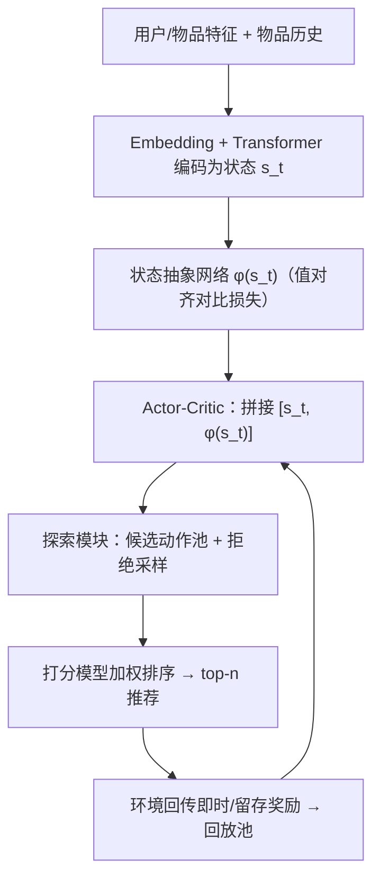
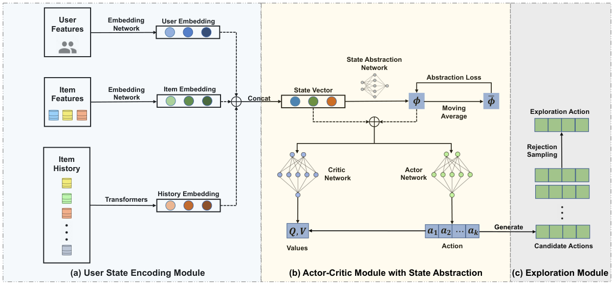

# AURO: Reinforcement Learning for Adaptive User Retention Optimization in Recommender Systems (面向推荐系统自适应用户留存优化的强化学习)

- **会议/期刊**: WWW 2025 (Oral)
- **作者与机构**: Zhenghai Xue, Bo An (NTU / Skywork AI); Qingpeng Cai, Bin Yang, Lantao Hu, Peng Jiang (快手); Kun Gai
- **推荐链路定位**: 重排（候选打分后的 top-n 排序策略）
- **研究方向**: 强化学习与动态探索推荐
- **论文原文**: [论文原文链接](https://arxiv.org/abs/2310.03984v3)
- **开源代码**: 暂未开源（正文提及 GitHub 但未给出可访问链接）

## TL;DR (1分钟核心速览)

针对留存优化 RL 在真实推荐环境中因用户行为漂移导致的**环境非平稳**与**隐式冷启动**两大痛点，AURO 在 Actor-Critic 中插入一个**值对齐的状态抽象网络**（用策略性能代理 $V$ 值构造对比损失），并用**基于性能的拒绝采样守护乐观探索**。在 KuaiSim 留存模拟器上平均回访天数从 1.705 降至 1.531、次日回访率从 0.803 升至 0.824；MovieLens-1M 离线 NCIS 与快手线上两周 A/B（7 日留存 +0.138‰、评论率 +8.392‰）均全面超越 RLUR/ESCP/TD3 等基线。

## Background & Motivation (背景与核心矛盾)

- **主流范式**: 以 RLUR、OSPIA 为代表的 RL 留存优化把用户当环境、策略输出 $k$ 维连续动作给预训练打分模型加权排序，用"回访时间"作延迟奖励。
- **前人局限**: ① 真实平台用户即时反馈正例率与回访时间分布随时间剧烈漂移（图 2：次日回访率一周内 70%→81%，follow/comment 信号标准差是 like 的 3–4 倍），导致动力学与奖励分布双重漂移，训练好的策略上线即失效；② Meta-RL/ESCP 类方法强行把非平稳性压缩为**单一隐参数**，无法刻画多维漂移；③ 漂移带来"隐式冷启动"，而 OAC/RND 的乐观探索步长固定，在代价敏感的推荐场景易推出低价值动作。
- **核心洞察 (Key Insight)**: RL 策略对分布漂移天然敏感，因此**策略性能本身（$V$值）就是最通用、最可靠的环境变化探针**——只要让状态抽象的输出距离与$V$ 值距离对齐，抽象向量就能自动"感知"环境切换。
- **本文切入点**: 用值对齐的状态抽象做环境识别，用候选池+拒绝采样把探索约束在高价值区域，兼顾适应速度与推荐质量稳定。

## Method (核心方法设计)

### 1. 整体框架 (Overall Architecture)

用户特征、物品特征与物品历史分别经 Embedding 网络与 Transformer 编码后拼接为状态向量 $s_t$；状态抽象网络输出$\phi(s_t)$，与$s_t$拼接后送入 Actor 与 Critic；Actor 输出原始动作$a_T$，探索模块沿$Q_{UB}$梯度方向生成候选动作池并按平均 Q 值拒绝采样选出$a_E$；动作经预训练打分模型与排序函数$f$得到 top-$n$ 推荐，环境回传即时奖励与回合末留存奖励，经验存入回放池驱动 Actor-Critic 与状态抽象网络联合更新。

<figure class="paper-figure" markdown="span">
  <figcaption>图3：AURO框架概览。(a) 用户状态编码模块，将用户特征、物品特征和物品历史嵌入为低维状态向量。(b) 带有状态抽象网络的演员-评论家模块，该网络生成潜在特征向量𝜙(𝑠)。状态向量与𝜙(𝑠)拼接后作为演员网络和评论家网络的输入。(c) 探索模块，用于选择与推荐环境交互的探索动作。</figcaption>
</figure>

### 2. 关键设计拆解 (Key Designs)

1. **值对齐状态抽象（Universal Non-stationarity Identification）**：痛点是把非平稳压成单一隐参数会失效。本文强制抽象空间中的 $l_2$距离逼近由$V$值定义的距离度量：$d(s_i,s_j)=0$若$V(s_i,\phi(s_i))$与$V(s_j,\phi(s_j))$接近，否则为$\infty$。将一批状态按$V$值排序分入$n$个类别$C_k$，代入后得到
$$\mathcal{J}(\phi)=\sum_{i}\Big[\sum_{j\in N(i)}\|\phi(s_i)-\phi(s_j)\|_2^2-\sum_{j\notin N(i)}\|\phi(s_i)-\phi(s_j)\|_2^2\Big],$$
即同类拉近、异类推远。为抑制回放池采样与 $V$更新带来的抖动，用类内滑动平均$\tilde{\phi}_k$ 替换类均值，最终损失为
$$\mathcal{J}(\phi)=\tfrac{2B}{n}\sum_{k}\sum_{i}\|\phi(s_i)-\tilde{\phi}_k\|_2^2-\tfrac{B^2}{n^2}\sum_{k}\sum_{m>k}\|\tilde{\phi}_k-\tilde{\phi}_m\|_2^2 .$$
直觉：$V$值即"当前策略在该状态表现如何"的代理，抽象输出因此天然携带环境状态信息，且$\phi(s)$ 回灌 Critic 后值估计更准（图 6(d) 值损失最低）。

2. **守护式在线探索（Guarded Exploration for Implicit Cold Start）**：固定步长乐观探索 $a_E=a_T+\delta\cdot\nabla_a Q_{UB}/\|{\cdot}\|$ 在 Q 值多峰地形下会错过局部最优（图 4）。本文改为生成候选池并按平均 Q 值筛选：
$$a_E=\arg\max_{a_k}\ \mu_Q(s,a_k),\quad a_k=a_T+k\delta\,[\nabla_a Q_{UB}(s,a)]_{a=\pi(s)},$$
$\delta$ 可取小值且无需精调，既提升探索效率又降低推出低价值动作的风险。

3. **训练目标、负采样与推理效率**：总损失为策略损失 + Critic 时序差分损失 + 状态抽象损失 $\mathcal{J}(\phi)$（策略梯度亦回传至$\phi$加速训练）；奖励为回合末$r=\lambda\times$ 用户回访时间，其余步为 0，属**免负采样**的连续动作 RL 范式。推理时仅需一次前向（Actor + 打分模型），探索模块仅在训练期启用，线上开销与 RLUR 同级。

## Experimental Setup & Evaluation Protocol (实验设置与评估协议)

- **数据集与预处理**: 线上采样数据统计如下（即时反馈归一化后计算标准差）：

| 数据集 | #Users | #Items | #Interactions | 稀疏度/密度 | 特征/场景说明 |
| :--- | :---: | :---: | :---: | :---: | :--- |
| 快手线上采样 | 27,285 | 7,551 | 1,186,059 | 密度约 0.58% | 短视频；Click 17.61%、Like 0.48%、Follow 0.026%、Comment 0.035%、Hate 0.114% |
| MovieLens-1M | 6,040 | ~3,900 | 1,000,209 | 密度约 4.2% | 5000 用户训练、其余测试；评分映射为留存奖励 |
| KuaiSim 模拟器 | — | — | — | — | 含 leave/return 模块，每回合扰动概率以制造非平稳 |

- **数据划分与防穿越 (Splitting Strategy)**: MovieLens 采用**用户级划分**（5000 训练 / 剩余测试），离线评估用 NCIS 避免策略偏差；模拟器与线上均为在线交互式回合制，无穿越问题。
- **排名评测协议 (Ranking Protocol)**: 非传统 Full-Ranking/Sampled Ranking，而是**留存导向指标**：平均回访天数（↓）、次日回访率（↑）、留存奖励（↑）；线上另看 7 日留存率、停留时长、CTR、点赞/评论/点踩率。
- **对比基线与超参设置**: 基线含非 RL（CEM、DIN）、值方法（DDPG/TD3/SAC）、探索方法（OAC/RND）、上下文编码（ESCP）、留存 RL（RLUR、OSPIA、RL-LTV）；模拟器 5 个随机种子 × 50K 步，$n=4$、$\delta=1$。

## Key Experimental Results (实验关键数据)

### 1. 主实验对比 (Main Results)

KuaiSim 模拟器（20K 步，5 种子均值）：

| 方法 | 平均回访天数 ↓ | 次日回访率 ↑ | 留存奖励 ↑ |
| :--- | :---: | :---: | :---: |
| DIN | 1.725 | 0.755 | -0.017 |
| TD3 | 1.772 | 0.738 | -0.017 |
| SAC | 1.810 | 0.726 | -0.017 |
| OAC | 1.794 | 0.731 | -0.018 |
| ESCP | 1.705 | 0.764 | -0.017 |
| RLUR | 1.706 | 0.765 | -0.017 |
| OSPIA | 1.726 | 0.803 | -0.017 |
| **AURO** | **1.531** | **0.824** | **-0.015** |
| Improv. (vs 最优基线) | **10.2%** | **2.6%** | — |

MovieLens-1M 离线 NCIS（留存奖励 ↑）：BC 1.702 / CEM 1.708 / TD3+BC 1.714 / ESCP+BC 1.755 / RLUR+BC 1.784 / **AURO+BC 1.798**。

线上两周 A/B（相对 RLUR 的提升，‰）：

| 方法 | 7d 留存 ↑ | 停留时长 ↑ | CTR ↑ | 点赞率 ↑ | 评论率 ↑ | 点踩率 ↓ |
| :--- | :---: | :---: | :---: | :---: | :---: | :---: |
| TD3 | 0.041 | -0.685 | 1.412 | 1.798 | 1.715 | -0.567 |
| ESCP | 0.123 | -0.115 | 0.703 | 0.302 | -1.975 | -0.116 |
| **AURO** | **0.138** | **0.263** | **3.260** | **2.821** | **8.392** | **-1.874** |

### 2. 消融实验 (Ablation Study)

| 变体 | 平均回访天数 ↓ | 次日回访率 ↑ | 留存奖励 ↑ |
| :--- | :---: | :---: | :---: |
| No exploration | 1.868 | 0.708 | -0.018 |
| No state abstraction | 1.803 | 0.732 | -0.018 |
| No auxiliary loss | 1.672 | 0.776 | -0.017 |
| $n=3$ | 1.598 | 0.804 | -0.016 |
| $n=5$ | 1.534 | 0.815 | -0.015 |
| $\delta=0.3$ | 1.547 | 0.813 | -0.016 |
| $\delta=3$ | 1.565 | 0.808 | -0.016 |
| **AURO ($n=4,\delta=1$)** | **1.531** | **0.824** | **-0.015** |

### 3. 关键实验发现 (Key Findings)

1. **探索模块是留存稀疏奖励下的命门**：去掉探索后平均回访天数从 1.531 恶化到 1.868（+22%），远超去掉状态抽象的 1.803，说明延迟留存信号下"敢探索"比"看得准"更基础。
2. **值对齐辅助损失不可替代**：保留抽象网络但去掉值对齐损失，回访天数退至 1.672、次日回访率降至 0.776，证明增益来自"与 $V$ 值对齐"而非单纯多一层网络；图 6(d) 亦显示 AURO 值损失全程最低。
3. **超参鲁棒且线上多目标同涨**：$n\in\{3,5,6\}$、$\delta\in\{0.3,3\}$ 波动仅 0.02–0.07 天；线上 AURO 是唯一同时提升停留时长（+0.263‰）与评论率（+8.392‰，约为 TD3 的 5 倍）并大幅压低点踩率（-1.874%）的算法，而 ESCP 出现停留与评论双降，印证"只推高 CTR 泛化内容"的短视问题。

## Highlights & Limitations (亮点、对比与审稿批判)

- **与代表作对比 (vs. Prior Work)**: 相比 RLUR/OSPIA 只处理延迟奖励与训练不稳定、未显式建模非平稳，AURO 首次把"策略性能"作为环境探针；相比 ESCP 依赖单一隐参数的上下文编码器，AURO 的值对齐抽象可刻画多维漂移；相比 OAC/RND 的固定步长乐观探索，候选池+拒绝采样在代价敏感场景更安全。
- **可迁移亮点**: ① "用 $V$ 值排序分桶构造对比损失"可迁移到任何非平稳序列/多场景 RL 状态表征；② 候选动作池 + 按均值 Q 拒绝采样的守护机制，可直接用于线上 bandit 探索的兜底。
- **审稿级局限批判**: ① 状态抽象需按 batch 内 $V$值排序分桶，$V$ 网络自身漂移时抽象目标随之抖动，缺乏收敛性理论保证；② 线上实验仅对比 3 个基线且提升幅度为千分位、方差与增益同量级，统计显著性存疑；③ 留存奖励以回访时间线性加权，未讨论与即时体验的长期权衡。

## Rating (四维评分)

- **方法创新性 (Novelty)**: ⭐⭐⭐⭐ （以策略性能为环境探针的值对齐状态抽象思路新颖，但对比损失形式与拒绝采样均为已有组件的巧妙重组）
- **评估协议与实验扎实度 (Protocol & Experiments)**: ⭐⭐⭐⭐ （模拟器+离线 NCIS+两周线上 A/B 三线验证完整，消融充分，但线上基线偏少、增益量级偏小）
- **写作与数学规范度 (Clarity & Rigor)**: ⭐⭐⭐⭐ （HiP-MDP 建模清晰、损失推导有上界近似说明，但滑动平均替代类均值的理论误差未展开）
- **工业落地与复现价值 (Industrial & Practical Value)**: ⭐⭐⭐⭐ （快手亿级交互线上验证、推理开销与 RLUR 同级，工程价值高；可惜代码链接缺失影响复现）

