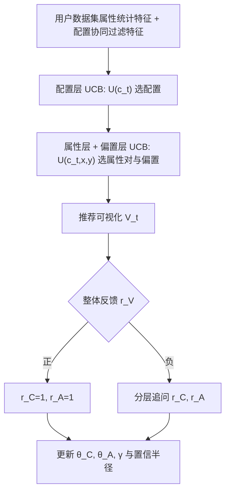

# Interactive Visualization Recommendation with Hier-SUCB (基于分层半臂老虎机的交互式可视化推荐)

- **会议/期刊**: WWW 2025 (The ACM Web Conference)
- **作者与机构**: Songwen Hu (Georgia Tech)、Ryan A. Rossi / Tong Yu / Handong Zhao / Sungchul Kim (Adobe Research)、Junda Wu (UCSD)、Shuai Li (上海交大)
- **推荐链路定位**: 在线交互式重排（逐轮推荐单个可视化组合）
- **研究方向**: 强化学习与动态探索推荐 / 冷启动与长尾推荐
- **论文原文**: [https://arxiv.org/abs/2502.03375v5](https://arxiv.org/abs/2502.03375v5)
- **开源代码**: 暂未开源

## TL;DR (1分钟核心速览)

个性化可视化推荐（PVisRec）中，用户对"属性对 + 图表配置"的组合偏好存在**非可加性**：喜欢属性也喜欢配置，却不喜欢二者组合（Plot.ly 上仅 22% 的偏好组合被真正接受）。本文提出 Hier-SUCB——带**可学习偏置项**的**分层上下文组合半臂老虎机**：先选配置（小臂池），再在给定配置下选属性对与偏置，把动作空间从 $O(nm^2)$压到$O(m^2)$，遗憾界同阶时间下改进动作空间阶数。在 Plot.ly-1k / Plot.ly-full 的模拟器上，HR@1 分别于第 80 / 160 轮超越离线 SOTA Neuro-PVR，并全程优于 LinUCB、C2UCB。

## Background & Motivation (背景与核心矛盾)

- **主流范式**: 个性化可视化推荐以离线监督学习为主（Neuro-PVR 用神经网络学习用户嵌入，VizRec 依赖元数据，图方法将数据集-可视化建成大图），新用户靠平均用户嵌入冷启动。
- **前人局限**: ① 离线模型**非交互**，无法利用实时反馈探索搜索空间，新用户冷启动只能退化为"平均用户"；② 传统上下文组合老虎机（C2UCB）假设组合奖励是单项奖励的线性/单调聚合，无法刻画"属性与配置相互抵触"的负向交互。
- **核心洞察 (Key Insight)**: 作者在 Plot.ly-full 上统计发现，用户偏好属性与偏好配置的全部组合中，仅 **4.1%** 被实际构造，而这其中又只有 **22%** 被用户接受为可视化——即"组合偏置"是普遍现象而非噪声，必须显式建模。
- **本文切入点**: 用一个**可学习的独立多臂老虎机偏置项** $\gamma$ 吸收配置-属性交互残差，并用**分层决策**（先配置后属性）压缩偏置项的动作空间，从而同时获得更低遗憾与更好用户体验。

## Method (核心方法设计)

### 1. 整体框架 (Overall Architecture)

每轮 $t$，智能体先在$n$个配置上计算 UCB$U(c_t)$选出最优配置$c_t$；再在给定$c_t$下枚举$m\times m$个属性对，结合属性 UCB 与偏置项$\gamma_t$计算可视化 UCB$U(v_t)$选出最终可视化；随后向用户请求对整体可视化的 Bernoulli 反馈——若为正，则配置与属性奖励自动置 1（省去追问）；若为负，则分层追问配置偏好$r_{C,t}$与属性偏好$r_{A,t}$，分别更新三套参数与置信半径。该"先粗后细"的追问协议既避免级联假设，又不损害用户体验。

### 2. 关键设计拆解 (Key Designs)

1. **可学习偏置项（Learnable Bias Term）**：针对"喜欢属性+配置却不喜欢组合"的奖励估计偏差，在可视化奖励中显式加入臂级偏置 $\gamma$：
$$r_V(t,a_t)=\langle\theta_{C,t},\mathbf{x}_{c,t}\rangle+\langle\theta_{A,t},\mathbf{x}_{x,t}\rangle+\langle\theta_{A,t},\mathbf{x}_{y,t}\rangle+r_{\gamma,t}+\epsilon_{t,a_t}$$
其中 $r_{\gamma,t}=f(r_V,r_C,r_A)$由独立多臂老虎机学习，置信半径$\rho_{\gamma,t}=\sqrt{2\ln(T)/t_\gamma}$。与 SPUCB 的**不可学习**偏置不同，本文偏置可随反馈更新，因而能真正刻画配置与属性的交互关系；其遗憾贡献仅$O(\ln T)$。

2. **分层决策结构（Hierarchical Structure）**：若直接在 $O(nm^2)$ 组合空间上做半臂老虎机，偏置项需对每个组合单独估计，样本效率极低。本文先在小臂池配置层（Plot.ly 中配置仅十余种）收敛，再在属性层与偏置层集中探索：
$$U(v_t)=\theta_{C,t}^{\top}\mathbf{x}_{c,t}+\theta_{A,t}^{\top}(\mathbf{x}_{x,t}+\mathbf{x}_{y,t})+\gamma_t+\rho_{c,t}+\rho_{a,t}+\rho_{\gamma,t}$$
由于配置臂池远小于属性对空间，智能体大部分时间只需估计属性与偏置，动作空间由 $O(nm^2)$降为$O(m^2)$，这是遗憾界改进的直接来源。

3. **训练目标、负采样与推理效率**：无梯度训练，采用 LinUCB 式闭式更新 $V_{C,t}=V_{C,t-1}+\mathbf{x}_{c,t-1}\mathbf{x}_{c,t-1}^{\top}$、$b_{C,t}=b_{C,t-1}+r_{C,t-1}\mathbf{x}_{c,t-1}$（属性层同理用$\mathbf{x}_{x}+\mathbf{x}_{y}$累积），$\theta=V^{-1}b$。无负采样概念；单轮推理仅需$O(n)$次配置打分与$O(m^2)$ 次属性对打分，实测 Plot.ly-1k 上 **0.01 秒/轮**（Intel 13700K），可支撑实时交互。

## Experimental Setup & Evaluation Protocol (实验设置与评估协议)

- **数据集与预处理**: 采用 Qian et al. 构建的 Plot.ly 社区数据集（与 Neuro-PVR 保持同源以公平对比），属性嵌入取 10 维（对比 30/1004 维后 HR@k/NDCG@k 最优）：

| 数据集 | #Users | #Datasets | #Attributes(过滤后) | 配置臂池 | 特征/场景说明 |
| :--- | :---: | :---: | :---: | :---: | :--- |
| Plot.ly-1k | 1,000 子集 | 1,000 | ≤100/数据集（长尾过滤） | 约十余种（bar/line/scatter/heatmap 等） | 属性用统计特征嵌入，配置用协同过滤嵌入 |
| Plot.ly-full | 17,469 | 94,419 | 同上 | 同上 | 全量语料，长尾显著（多数数据集 <100 属性） |

- **数据划分与防穿越 (Splitting Strategy)**: 非静态划分，采用**在线逐轮模拟**：每轮智能体推荐、模拟器即时反馈，无训练/测试切分，天然无穿越；Plot.ly-1k 跑 100 轮、Plot.ly-full 跑 200 轮。
- **排名评测协议 (Ranking Protocol)**: 单目标推荐场景，采用 **HR@1**（等价于平均奖励）与**累积遗憾 (Cumulative Regret)**；模拟器按 Bernoulli 分布反馈并注入 **5% 翻转噪声**，另用 51 名受试者（47 人有可视化经验）的用户研究校验模拟器真实性。
- **对比基线与超参设置**: LinUCB（非组合上下文老虎机）、C2UCB（组合上下文老虎机）、Neuro-PVR（离线神经网络 SOTA）；嵌入维度 $d=10$，$\alpha$ 按 LinUCB 惯例设定，实验重复 100 次取均值。

## Key Experimental Results (实验关键数据)

### 1. 主实验对比 (Main Results)

以 HR@1 / 平均奖励为指标（数值为收敛后水平，原文以曲线呈现，此处按图 6 读数归纳）：

| 方法 | 类型 | Plot.ly-1k HR@1 | Plot.ly-full HR@1 | 收敛速度 | 备注 |
| :--- | :---: | :---: | :---: | :---: | :--- |
| LinUCB | 非组合 Bandit | 低（最慢收敛） | 低（最慢收敛） | 慢 | 组合作为单臂，动作空间爆炸 |
| C2UCB | 组合 Bandit | 中 | 中 | 中 | 无偏置项，受组合偏差干扰 |
| Neuro-PVR | 离线监督 | 约 0.55（静态） | 约 0.55（静态） | 不适用 | 冷启动依赖平均用户嵌入 |
| **Hier-SUCB** | **分层半臂 Bandit** | **最优，第 80 轮超越 Neuro-PVR** | **最优，第 160 轮超越 Neuro-PVR** | **最快** | 全程优于两类 Bandit |

合成数据实验（100 次迭代 × 200 轮）中，Hier-SUCB 的平均奖励与累积遗憾同样全面优于 C2UCB 与 LinUCB。

### 2. 消融实验 (Ablation Study)

| 变体 | 平均奖励 | 累积遗憾 | 现象 |
| :--- | :---: | :---: | :--- |
| **Hier-SUCB (完整)** | **最高** | **最低** | 基准 |
| w/o Bias（去偏置项） | 下降 | 升高 | 第 70、170 轮附近出现明显震荡 |
| w/o Hierarchy（去分层，$O(nm^2)$ 空间） | 下降 | 升高 | 收敛显著变慢 |

### 3. 关键实验发现 (Key Findings)

1. **组合偏置是真实且普遍的**：Plot.ly-full 上偏好属性×偏好配置的组合仅占全部组合的 4.1%，其中仅 22% 被接受为可视化——这直接解释了为何无偏置的 C2UCB 会持续被"估计奖励与真实奖励的鸿沟"拖累，而 Hier-SUCB 的偏置项将这一残差显式吸收。
2. **分层结构是遗憾界改进的根源**：去掉分层后动作空间回到 $O(nm^2)$，累积遗憾曲线明显抬升；理论上正是把配置层降为普通上下文老虎机、属性层保持组合半臂老虎机，才把$n$ 从遗憾界的动作空间项中消去。
3. **在线交互可在百轮内追平离线大模型**：Hier-SUCB 在 Plot.ly-1k 第 80 轮、Plot.ly-full 第 160 轮 HR@1 超过离线 Neuro-PVR，说明在冷启动场景下"少量高质量交互反馈"比"依赖历史平均嵌入的离线预训练"更样本高效；用户研究亦显示第 20→50 轮喜欢推荐可视化的用户比例上升，验证模拟器可信。

## Highlights & Limitations (亮点、对比与审稿批判)

- **与代表作对比 (vs. Prior Work)**: 相比 **Neuro-PVR**（离线、非交互、冷启动靠平均嵌入），本文完全在线、零初始数据即可个性化；相比 **C2UCB**（组合老虎机但奖励假设可加、无偏置），本文显式建模配置-属性负向交互；相比 **SPUCB**（半臂老虎机有偏置但不可学习、依赖级联假设），本文偏置可学习且追问协议不依赖级联，遗憾界动作空间项由 $nm^2$降为$m^2$。
- **可迁移亮点**: ① "可学习偏置项 + 独立多臂老虎机"这一模式可迁移到任何**组合奖励非可加**的推荐场景（如套餐推荐、多模态图文搭配、旅行行程组合）；② "先在小臂池层收敛、再在大臂池层探索"的分层 UCB 是压缩组合动作空间的通用工程技巧。
- **审稿级局限批判**: ① 实验完全基于**模拟器**（虽经 51 人用户研究校验），缺乏真实线上 A/B 或长周期留存验证，5% 噪声的 Bernoulli 假设可能低估真实用户反馈的复杂性与非平稳性；② 属性嵌入固定为 10 维统计特征、配置臂池仅十余种，方法在**大规模异构配置空间**（如自由拖拽式 BI 工具）下的可扩展性与遗憾界常数项未经验证；③ 偏置项 $f(r_V,r_C,r_A)$ 的具体函数形式与可辨识性讨论较薄，存在与属性/配置奖励共线而难以分离的风险。

## Rating (四维评分)

- **方法创新性 (Novelty)**: ⭐⭐⭐⭐ （将"组合奖励非可加"这一被忽视的偏差显式建模为可学习偏置项，并给出严格遗憾界改进，理论与建模动机咬合紧密）
- **评估协议与实验扎实度 (Protocol & Experiments)**: ⭐⭐⭐ （合成+真实数据集+用户研究三重验证较完整，但全部依赖模拟器、无线上验证，基线数量偏少）
- **写作与数学规范度 (Clarity & Rigor)**: ⭐⭐⭐⭐ （四类反馈情形的遗憾分解清晰，引理-定理链条完整，符号略密但可读）
- **工业落地与复现价值 (Industrial & Practical Value)**: ⭐⭐⭐⭐ （0.01 秒/轮推理、闭式更新、无需预训练，极易嵌入 BI 工具；可惜未开源，且配置空间扩展性待验证）

