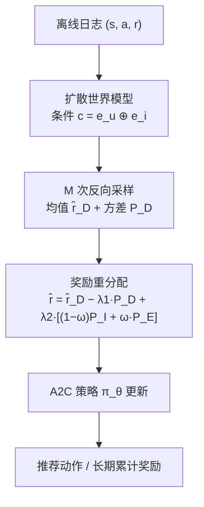
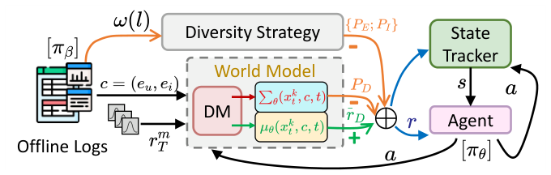

# Reward Balancing Revisited: Enhancing Offline Reinforcement Learning for Recommender Systems (奖励再平衡再审视：面向推荐系统的离线强化学习增强)

- **会议/期刊**: WWW Companion 2025 (Short Paper)
- **作者与机构**: Wenzheng Shu, Fan Zhou (UESTC)；Yanxiang Zeng, Yongxiang Tang, Teng Sha, Ning Luo, Yanhua Cheng, Xialong Liu, Peng Jiang (快手科技)
- **推荐链路定位**: 重排 / 交互式序列决策（离线策略学习）
- **研究方向**: 强化学习与动态探索推荐 / 生成式推荐（扩散世界模型）
- **论文原文**: [https://arxiv.org/abs/2506.22112v2](https://arxiv.org/abs/2506.22112v2)
- **开源代码**: 暂未开源

## TL;DR (1分钟核心速览)

离线 RL 推荐的核心痛点是：静态日志与动态策略之间存在分布错配，导致世界模型奖励预测塌缩、策略过度保守且推荐同质化。本文提出 R3S，用扩散模型重建世界模型以显式刻画奖励的内在不确定性（多次反向采样取均值 + 方差惩罚），并设计"交互惩罚 $P_I$+ 熵惩罚$P_E$"的指数衰减加权多样性机制。在 Coat / Yahoo / KuaiRand 三个真实数据集上，以累计奖励$R_{tra}$为主指标全面超越 ROLeR、DORL 等 11 个基线，KuaiRand 上$R_{tra}$ 相对 ROLeR 提升约 4.7%。

## Background & Motivation (背景与核心矛盾)

- **主流范式**: 离线 RL 将推荐建模为 MDP $\mathcal{M}=<\mathcal{S},\mathcal{A},\hat{T},\hat{r},\gamma>$，用世界模型$\hat{r}=R(s,a)$ 推断未观测反馈，再以 A2C 类范式优化长期累计奖励。
- **前人局限**: ① 世界模型塌缩——离线数据状态-动作覆盖不全，单次点估计奖励方差大，BCQ/CQL/MOPO 靠保守惩罚规避却牺牲探索；② 策略同质化——仅用静态熵惩罚 $P_E=-D_{KL}(\pi_\beta\|\pi_u)$ 约束，依赖有限离线动作集，无法建模长程依赖，易陷入马太效应。
- **核心洞察 (Key Insight)**: 扩散模型的反向采样天然从高斯连续空间出发，其多次采样之间的离散度本身就是奖励不确定性的无偏代理，无需额外集成多个世界模型即可同时得到均值与方差。
- **本文切入点**: 把"不确定性估计"与"多样性惩罚"统一进一个奖励重分配公式，并用衰减函数让早期偏熵惩罚、后期偏交互惩罚。

## Method (核心方法设计)

### 1. 整体框架 (Overall Architecture)

R3S 分两阶段：先用离线日志训练扩散世界模型（以用户嵌入 $\boldsymbol{e}_u$与物品嵌入$\boldsymbol{e}_i$拼接为条件$\boldsymbol{c}$），反向采样$M$次得到奖励均值与方差；再将世界模型嵌入 A2C 智能体，智能体在模拟环境中交互产生轨迹，奖励由"扩散均值 − 不确定性惩罚 + 衰减加权多样性惩罚"重分配后回传更新策略$\pi_\theta$。整个闭环无需在线交互，仅依赖静态日志与模型内推演。

<figure class="paper-figure" markdown="span">
  <figcaption>图2：R3S 的概要。它由基于扩散的世界模型以及 A2C 范式组成。注意，𝜋𝛽 表示离线数据中的固有行为，而 𝜋𝜃 表示待优化的目标策略。</figcaption>
</figure>

### 2. 关键设计拆解 (Key Designs)

1. **扩散世界模型的内在不确定性 (Inherent Diffusion Uncertainty)**：痛点是用 DeepFM 等点估计世界模型在稀疏日志上方差极大。本文以 DiffRec 为骨干，前向加噪后优化去噪目标 $\mathcal{L}_{DM}=\sum_{t=2}^{T}\mathbb{E}_{t,\epsilon}\|\boldsymbol{\epsilon}-\boldsymbol{\epsilon}_\theta(\boldsymbol{r}_t,\boldsymbol{c},t)\|_2^2$；反向阶段采样$M$次取均值$\hat{r}_D=\frac{1}{M}\sum_{m=1}^{M}\hat{W}_\phi[\boldsymbol{r}_T^m\sim\mathcal{N}(0,\boldsymbol{I})]$，并由样本离散度直接导出$P_D=\sum_{m=1}^{M}(\boldsymbol{x}_m-\hat{r}_D)^2/M$。直觉：扩散采样的随机性即"模型自己承认的不确定性"，方差大的动作被自动降权，等价于一种软性保守估计，但保留了探索空间。

2. **交互惩罚与衰减加权多样性 (Interactive Penalty + Diversity Attenuation)**：$P_E$只对固定离线动作集算熵，无法覆盖长程状态。本文提出$P_I$，保留$P_E$的 KL 结构但把第$i$步的$k$阶熵改为在历史区间$[0,i-1]$内随机采样$k$个位置计算，随迭代推进样本多样性自然增长。再用$\omega(l)=\alpha(e^{-\xi l}+1)$（$\alpha=0.5,\xi=1.0$）做衰减：早期$\omega$大、以$P_E$快速拉开动作分布；后期$\omega$小、由$P_I$ 捕捉长程上下文。

3. **训练目标、负采样与推理效率**：总奖励为
$$\hat{r}=\underbrace{\hat{r}_D-\lambda_1 P_D}_{\text{UNCERTAIN}}+\lambda_2\big[(1-\omega(l))P_I+\omega(l)P_E\big]$$
策略侧沿用 A2C 的 actor-critic 损失，无需负采样（动作空间由世界模型打分隐式定义）。推理开销主要来自扩散反向 $T$步 ×$M$ 次采样，是本文最大的工程代价点。

## Experimental Setup & Evaluation Protocol (实验设置与评估协议)

- **数据集与预处理**: 三个真实场景数据集，配置沿用 DiffRec 与 ROLeR 的公开设定：

| 数据集 | 场景 | 特点 | 交互长度上限 |
| :--- | :---: | :--- | :---: |
| Coat | 购物 | 用户-物品重叠少、稀疏 | 30 |
| Yahoo | 音乐 | 品类重叠少、易达上限 | 30 |
| KuaiRand | 短视频 | 复杂交互、长程依赖强 | 受预算约束 |

- **数据划分与防穿越 (Splitting Strategy)**: 沿用 ROLeR 的离线 RL 设定，日志按交互序列组织为轨迹，训练/评估轨迹分离，评估在模拟环境中展开而非静态留一。
- **排名评测协议 (Ranking Protocol)**: 非传统 Top-K 排序，而是交互式 rollout 评估：$R_{tra}$（累计奖励）、$R_{each}$（每步平均奖励）、$Length$（交互距离），在给定扩展预算下统计，属"模拟环境全轨迹评估"。
- **对比基线与超参设置**: 11 个基线，含 bandit 类（UCB、$\epsilon$-greedy）、无模型类（SQN、CRR、CQL、BCQ）、有模型类（MBPO、IPS、MOPO、DORL、ROLeR）；扩散步数$T$、采样数$M$、$\lambda_1,\lambda_2$、$\alpha=0.5$、$\xi=1.0$ 为主要超参。

## Key Experimental Results (实验关键数据)

### 1. 主实验对比 (Main Results)

| 方法 | Coat $R_{tra}$| Coat$R_{each}$| Yahoo$R_{tra}$| KuaiRand$R_{tra}$| KuaiRand$R_{each}$| KuaiRand$Length$ |
| :--- | :---: | :---: | :---: | :---: | :---: | :---: |
| UCB | 73.671 | 2.456 | 66.758 | 1.651 | 0.372 | 4.431 |
| CQL | 68.984 | 2.230 | 62.291 | 2.032 | 0.226 | 9.000 |
| MOPO | 71.181 | 2.373 | 65.510 | 10.934 | 0.437 | 25.002 |
| DORL | 71.399 | 2.380 | 66.351 | 11.850 | 0.428 | 27.609 |
| ROLeR | 76.160 | 2.539 | 68.364 | 13.455 | 0.457 | **29.270** |
| **R3S** | **78.224** | **2.607** | **69.223** | **14.087** | **0.488** | 28.841 |
| Improv. vs ROLeR | +2.7% | +2.7% | +1.3% | +4.7% | +6.8% | −1.5% |

### 2. 消融实验 (Ablation Study)

| 配置 | Coat $R_{tra}$| Coat$R_{each}$| KuaiRand$R_{tra}$| KuaiRand$R_{each}$| KuaiRand$Length$ |
| :--- | :---: | :---: | :---: | :---: | :---: |
| w/o U (DeepFM 替代扩散) | 72.369 | 2.412 | 12.136 | 0.446 | 27.207 |
| w/o D (去多样性机制) | 74.208 | 2.474 | 11.252 | 0.419 | 26.834 |
| w/o $P_E$ | 75.433 | 2.514 | 13.641 | 0.482 | 28.296 |
| w/o $P_I$ | 76.243 | 2.541 | 13.228 | 0.460 | 28.782 |
| **Full R3S** | **78.224** | **2.607** | **14.087** | **0.488** | 28.841 |

### 3. 关键实验发现 (Key Findings)

1. **扩散世界模型的收益高度依赖数据稀疏度**：Coat 上去掉扩散（w/o U）$R_{tra}$ 从 78.224 掉到 72.369（−7.5%），而 KuaiRand 上仅从 14.087 掉到 12.136（−13.9% 但绝对值差距小），说明扩散的分布泛化能力在稀疏小数据上价值最大，在密集短视频场景中边际收益被交互惩罚部分替代。
2. **多样性机制是 KuaiRand 的命门**：w/o D 使 KuaiRand $R_{tra}$ 从 14.087 暴跌至 11.252（−20.1%），远超 Coat 的 −5.1%，印证复杂交互环境下"探索不足"比"奖励估计不准"更致命。
3. **$P_E$与$P_I$互补而非冗余**：单独去掉$P_E$或$P_I$均造成下降，且$P_E$缺失时$Length$缩短更明显（28.296 vs 28.782），说明$P_E$提供更强的分布拉开约束、$P_I$ 负责长程上下文，衰减加权让二者各司其职。

## Highlights & Limitations (亮点、对比与审稿批判)

- **与代表作对比 (vs. Prior Work)**: 相比 DORL 用集成/先验经验估计不确定性，R3S 用扩散采样"一次建模、均值方差同出"，省去多世界模型训练；相比 ROLeR 仅用静态 $P_E$，R3S 引入$P_I$ 与衰减调度，把多样性从"离线动作集约束"扩展到"交互轨迹约束"。
- **可迁移亮点**: ① 用扩散反向采样的样本离散度作为不确定性代理，可迁移到任何需要 reward shaping 的离线 RL 场景；② 指数衰减加权双惩罚的调度思路，可直接用于探索-利用平衡的 bandit 系统。
- **审稿级局限批判**: ① 扩散反向 $T$步 ×$M$次采样带来显著推理延迟，论文未给出在线时延与吞吐数据，工业部署存疑；② 仅在三个中等规模数据集上验证，缺少大规模工业 A/B 与显著性检验（$p$值）报告，且$Length$ 指标在 KuaiRand 上反而略低于 ROLeR，长期留存收益的论证不够充分。

## Rating (四维评分)

- **方法创新性 (Novelty)**: ⭐⭐⭐⭐ （扩散采样方差作不确定性代理 + 衰减双惩罚调度，组合新颖但单点技术均有前作影子）
- **评估协议与实验扎实度 (Protocol & Experiments)**: ⭐⭐⭐ （三数据集 + 11 基线较全，但缺显著性检验、缺线上验证、$Length$ 指标未全面占优）
- **写作与数学规范度 (Clarity & Rigor)**: ⭐⭐⭐⭐ （奖励重分配公式 Eq.3 结构清晰，符号统一，但部分推导如 $P_D$ 的统计合理性论证偏简）
- **工业落地与复现价值 (Industrial & Practical Value)**: ⭐⭐⭐ （快手工业背景强，但未开源、扩散推理开销大，落地需蒸馏或采样加速）

