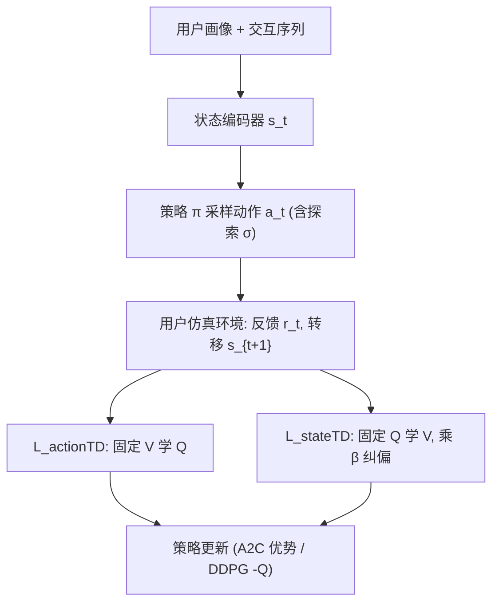

# Value Function Decomposition in Markov Recommendation Process (马尔可夫推荐过程中的价值函数分解)

- **会议/期刊**: WWW 2025
- **作者与机构**: Xiaobei Wang, Shuchang Liu, Qingpeng Cai, Xiang Li, Lantao Hu, Han Li (快手科技)；Guangming Xie (北京大学)
- **推荐链路定位**: 排序策略优化（在线 RL 长期价值学习）
- **研究方向**: 强化学习与动态探索推荐
- **论文原文**: [https://arxiv.org/abs/2501.17409v2](https://arxiv.org/abs/2501.17409v2)
- **开源代码**: [https://github.com/wangxiaobei565/TDDecomposition](https://github.com/wangxiaobei565/TDDecomposition)

## TL;DR (1分钟核心速览)

在线 RL 推荐中，标准 TD 学习把「策略随机探索」与「用户环境随机反馈」两个随机源混在同一回归目标里，导致价值函数估计次优、探索幅度一大就崩。本文把 TD 损失拆成 $\mathcal{L}_{actionTD}$（固定$V$学$Q$，吸收策略随机）与$\mathcal{L}_{stateTD}$（固定$Q$学$V$，吸收环境随机），并加重要性权重$\beta$纠偏。在 ML1M/KuaiRand/Amazon 三个 KuaiSim 仿真环境上，A2C 骨干总奖励提升 33.59%（KuaiRand），HAC 提升 35.45%，且$\sigma>0.1$ 时原版崩溃而分解版仍稳定增益。

## Background & Motivation (背景与核心矛盾)

- **主流范式**: 将用户-系统交互建模为 MDP，用 TD 学习估计 $V(s_t)$或$Q(s_t,a_t)$，再以 A2C 优势函数或 DDPG 期望奖励最大化引导策略。
- **前人局限**: ① 标准 TD 目标 $r_t+\gamma V(s_{t+1})-V(s_t)$同时混入策略动作随机$\Delta_\pi$与环境转移随机$\Delta_u$，二者条件独立却未被分离建模；② 探索幅度$\sigma$增大时$\Delta_\pi$ 方差膨胀，价值估计被噪声主导，策略被误导甚至崩溃。
- **核心洞察 (Key Insight)**: 由 $Q(s_t,a_t)=V(s_t)+\Delta_\pi$与$r_t+\gamma V(s_{t+1})=Q(s_t,a_t)+\Delta_u$可知，只要在各自回归目标中「停梯度」屏蔽无关随机项，即可分别逼近$V^*$与$Q^*$。
- **本文切入点**: 把单一 TD 损失拆为两个互相提供标签的子目标，并引入过去策略/当前策略的重要性比 $\beta$ 做离线-在线分布纠偏。

## Method (核心方法设计)

### 1. 整体框架 (Overall Architecture)

模型沿用「用户状态编码器 + Actor-Critic」结构：状态编码器（Transformer 序列 + 画像 MLP）输出 $s_t$，策略网络输出$K=6$的推荐列表动作，$V$头与$Q$头分别估计状态价值与状态-动作价值。训练时不再用单一 TD 误差，而是交替执行两条损失：$\mathcal{L}_{actionTD}$以$r_t+\gamma V(s_{t+1})$为回归目标更新$Q$（$V$停梯度），$\mathcal{L}_{stateTD}$以$Q(s_t,a_t)$为标签更新$V$（$Q$停梯度），并乘重要性权重$\beta$。策略侧仍用 A2C 优势$A_t=r_t+\gamma V(s_{t+1})-V(s_t)$或 DDPG 的$-Q(s_t,a_t)$ 更新。该框架与具体 RL 骨干解耦，可直接套在 A2C/DQN/DDPG/HAC 上。

### 2. 关键设计拆解 (Key Designs)

1. **动作侧 TD 分解（$\mathcal{L}_{actionTD}$）**：原$\mathcal{L}_{QTD}$中$\gamma\Delta_\pi$作为与用户转移独立的噪声污染$Q$的逼近。改为固定$V$ 只回归环境随机项：
$$\mathcal{L}_{actionTD}=\big(r(s_t,a_t)+\gamma V(s_{t+1})-Q(s_t,a_t)\big)^2$$
该式精确对应 $Q(s_t,a_t)=\mathbb{E}_{s_{t+1},r_t|s_t,a_t}[r_t+\gamma V(s_{t+1})]$，使$Q$ 专注刻画「给定动作下的环境期望回报」，不再被策略采样方差拖累。

2. **状态侧 TD 分解（$\mathcal{L}_{stateTD}$）与$\beta$纠偏**：原$\mathcal{L}_{VTD}$中$\Delta_u$使$V$无法收敛到$\mathbb{E}_{a\sim\pi}[Q]$。改为固定$Q$ 直接对齐：
$$\mathcal{L}_{\beta\text{-}stateTD}=\beta\big(V(s_t)-Q(s_t,a_t)\big)^2,\quad \beta=\frac{\pi(a_t|s_t)}{p(a_t|s_t)}$$
其中 $p$为采样时的历史策略。由重要性采样恒等式$\mathbb{E}_{a\sim\pi}[\mathcal{L}_{stateTD}]=\mathbb{E}_{a\sim p}[\mathcal{L}_{\beta\text{-}stateTD}]$可知，$\beta$把「过去策略采样的动作」校正为「当前策略下的无偏$V$ 估计」，缓解策略频繁更新带来的动作分布漂移。

3. **训练目标、负采样与推理效率**：总损失为两式加权和（实现中交替/联合优化），无负采样概念（RL 范式），探索由策略侧高斯扰动 $\sigma$控制。推理时仅需前向$Q$或策略网络，与原始 A2C/HAC 开销同阶，额外仅多一个$V$ 头的前向与一次停梯度回归，训练显存与计算增量可忽略。

## Experimental Setup & Evaluation Protocol (实验设置与评估协议)

- **数据集与预处理**: 三个公开数据集，均过滤交互数 $<10$的用户/物品并按时间重建序列；用训练好的用户响应模型构建 KuaiSim 式在线仿真器（点击奖励$+1.0$，未点击$-0.2$，temper 模型限制 episode 深度$\le 20$）。

| 数据集 | #Users | #Items | 交互规模 | 场景说明 |
| :--- | :---: | :---: | :---: | :--- |
| ML1M | ~6.0K | ~3.7K | 1M 评分 | 电影，任务较简单 |
| KuaiRand-1K | 1K | 短视频库 | 多行为日志 | 短视频，动态性最强 |
| Amazon (book) | 图书用户 | 图书库 | 评论交互 | 图书，中等难度 |

- **数据划分与防穿越 (Splitting Strategy)**: 按时间戳重建交互序列，仿真器在线逐步生成反馈，训练/评估在**同一在线交互流**上顺序进行（非静态留出），评估取最后 100 个 episode step 的均值。
- **排名评测协议 (Ranking Protocol)**: 非传统 Full-Ranking/Sampled Ranking，而是**在线仿真累计奖励协议**：主指标为 session 总奖励（无折扣）、session 深度，辅以每 batch 最小奖励与奖励方差衡量稳定性；所有方法训练至 30,000 步收敛。
- **对比基线与超参设置**: 基线含非 RL 监督模型（Transformer 序列 + BCE）、A2C、DQN、DDPG、HAC、SQN、Dueling DQN；$V$与$Q$网络结构在各方法间保持一致，动作列表长度$K=6$，5 个随机种子取均值，显著性用 Student-t 检验（$p<0.05$）。

## Key Experimental Results (实验关键数据)

### 1. 主实验对比 (Main Results)

| 模型 | ML1M 原始 → 分解 (Improv.) | KuaiRand 原始 → 分解 (Improv.) | Amazon 原始 → 分解 (Improv.) |
| :--- | :---: | :---: | :---: |
| Non-RL | 15.97 | 10.28 | - |
| D-DQN | 15.83 | 10.79 | 10.43 |
| A2C | 17.19 → **17.62** (2.50%) | 11.91 → **15.91** (33.59%) | 11.24 → **13.11** (16.64%) |
| DQN | 15.95 → **16.14** (1.19%) | 10.74 → **13.44** (25.14%) | 10.36 → **11.94** (15.25%) |
| DDPG | 13.52 → **17.05** (26.11%) | 12.86 → **13.78** (7.15%) | 10.99 → **11.58** (5.37%) |
| HAC | 16.89 → **17.76** (5.15%) | 12.47 → **16.89** (35.45%) | 12.17 → **13.31** (9.37%) |
| SQN | 16.33 → **16.88** (3.37%) | 11.22 → **15.42** (37.43%) | 6.94 → **11.74** (69.16%) |

### 2. 消融实验 (Ablation Study)

| 配置 | 现象（KuaiRand / ML1M） |
| :--- | :--- |
| w/o $\beta$纠偏项 | 四个骨干均出现次优性能，$\beta$ 移除后奖励下降（图 7） |
| 探索幅度 $\sigma$扫描（HAC） | 分解版在所有$\sigma$下均优于原版；原版$\sigma>0.1$崩溃，分解版$\sigma=1$ 仍稳定（图 5） |
| $\beta$与动作差异$\alpha$|$\sigma$越大$\beta\to1.00$、$\alpha\to10^{-6}$ 量级，说明大探索下过去/当前策略分布趋同，纠偏自然减弱 |

### 3. 关键实验发现 (Key Findings)

1. **分解收益与环境难度正相关**：KuaiRand（短视频高动态）上 A2C/HAC 分别提升 33.59%/35.45%，而 ML1M 仅 2.50%/5.15%，说明混合随机因子的危害在用户行为越不确定时越显著。
2. **收敛更快且后期不退化**：学习曲线显示分解版起步奖励爬升更快，且最小奖励曲线持续上升；原版 TD 在训练后期价值函数「不愿引导策略」，分解版仍持续改进。
3. **探索鲁棒性是核心卖点**：$\sigma$从 0.01 增至 1 时，原版 HAC 在 KuaiRand 直接崩溃，分解版不仅不崩还随探索增大获得更多增益，验证了「$\Delta_\pi$只进$Q$、不进$V$」的设计直觉。

## Highlights & Limitations (亮点、对比与审稿批判)

- **与代表作对比 (vs. Prior Work)**: 与 Dueling DQN 的 $Q=V+A$ 结构分解本质不同——D-DQN 只拆网络输出，仍在混合随机因子的 TD 目标下学习，故本文实验中 D-DQN 表现次优；与 HAC/SQN 等骨干改进正交，本文是可直接叠加的通用学习框架。
- **可迁移亮点**: ① 「停梯度 + 互相提供标签」的双目标交替回归可迁移到任何含双随机源的序贯决策任务（如多轮对话策略、竞价策略）；② 用 $\beta=\pi/p$ 纠偏历史策略采样偏差的做法，可复用到 offline-to-online 的推荐 RL 微调。
- **审稿级局限批判**: ① 全部实验基于 KuaiSim 仿真器，用户响应模型本身是拟合的，真实线上分布漂移与留返行为（$d$信号被忽略）未验证；② 分解引入$V$、$Q$双头与$\beta$估计，超参（两损失权重、$\beta$ 裁剪）敏感度与大规模工业部署的推理/训练开销未充分讨论。

## Rating (四维评分)

- **方法创新性 (Novelty)**: ⭐⭐⭐⭐ （从「混合随机因子」这一被忽视的统计根源切入，分解推导简洁且有重要性采样理论支撑，但本质是 TD 目标重写而非全新架构）
- **评估协议与实验扎实度 (Protocol & Experiments)**: ⭐⭐⭐⭐ （三数据集 × 四骨干 × 五种子 + 显著性检验 + $\sigma$ 扫描充分，但依赖仿真器、缺真实线上 A/B）
- **写作与数学规范度 (Clarity & Rigor)**: ⭐⭐⭐⭐ （$\Delta_\pi/\Delta_u$分解与$\beta$ 推导清晰，附录给出界分析；部分符号在正文与附录间需对照阅读）
- **工业落地与复现价值 (Industrial & Practical Value)**: ⭐⭐⭐⭐ （代码已开源，框架与骨干解耦、增量开销小，快手工业背景强；但线上部署的稳定性与超参调优成本仍需验证）

