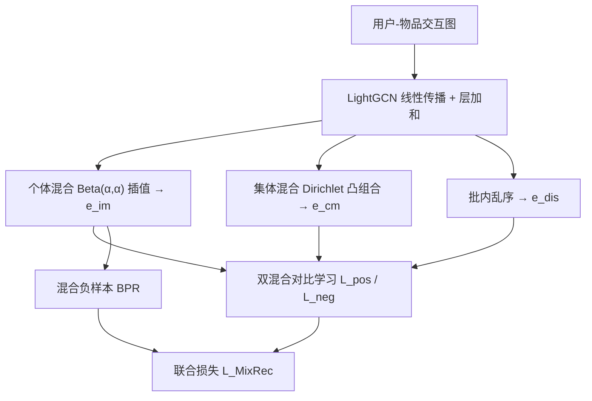
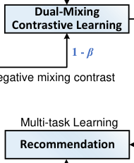

# MixRec: Individual and Collective Mixing Empowers Data Augmentation for Recommender Systems (个体与集体混合赋能推荐系统数据增强)

- **会议/期刊**: WWW 2025
- **作者与机构**: Yi Zhang, Yiwen Zhang（安徽大学）
- **推荐链路定位**: 召回（图协同过滤表征学习）
- **研究方向**: 自监督对比学习与交互去噪 / 图神经网络推荐
- **论文原文**: [https://arxiv.org/abs/2501.13579v3](https://arxiv.org/abs/2501.13579v3)
- **开源代码**: [https://github.com/BlueGhostYi/ID-GRec](https://github.com/BlueGhostYi/ID-GRec)

## TL;DR (1分钟核心速览)

现有图对比推荐依赖手工设计的图扰动/噪声注入，需多次图编码、超参繁多且新视图利用率低。MixRec 提出**个体混合**（批内 Beta 插值造"专属正样本"）与**集体混合**（Dirichlet 凸组合造"群体硬负样本"），仅用 1 个形状参数 $\alpha$、线性复杂度即可按需生成视图，并以双混合对比损失同时以原视图和乱序视图为锚点充分挖掘样本对。在 4 个数据集、20 个基线的 **Full-Ranking** 协议下，Recall@20 相对最优基线提升 1.78%–5.05%，且 MixRec-1 训练总时长仅 18 分钟（Tmall），远低于 SimGCL 的 53 分钟。

## Background & Motivation (背景与核心矛盾)

- **主流范式**: 以 LightGCN 为编码器，叠加 SGL/SimGCL/VGCL/BIGCF 等对比学习辅助任务，通过图扰动、表示加噪、聚类/注意力找语义邻居来构造多视图，缓解隐式反馈稀疏。
- **前人局限**: ① 增强策略高度手工化——需精确控制边/节点丢弃比例或噪声强度，且往往引入多个超参平衡多目标，跨数据集需反复调参；② 多视图需重复图编码或可学习查表，SGL 报告引入图增强 CL 后复杂度达基模型 3.7 倍；③ 标准 InfoNCE 只对齐一对正样本、忽略原始视图，与主任务不一致，新增样本难以规模化利用。
- **核心洞察 (Key Insight)**: 混合（Mixup 式凸组合）本身即可作为"零外部依赖"的增强算子——插值样本天然落在原样本附近，可充当正样本；而批内全体凸组合落在凸包内部、偏离原样本，天然可充当**硬负样本**；乱序对齐的批内他样本则是**易负样本**。三类样本恰好构成"易–硬"负样本梯度。
- **本文切入点**: 放弃图结构扰动，直接在编码后的嵌入空间做个体/集体两级混合，用混合系数 $\beta$ 同时充当对比损失权重与 BPR 负样本权重，实现"一个参数、线性时间"的增强闭环。

## Method (核心方法设计)

### 1. 整体框架 (Overall Architecture)

输入用户-物品二部图，经 $L$层 LightGCN 线性传播并逐层相加得$\mathbf{e}_u,\mathbf{e}_i$；随后在批内执行双重混合：个体混合对乱序后的嵌入做 Beta 插值生成$\mathbf{e}^{im}$，集体混合对全批嵌入做 Dirichlet 凸组合生成$\mathbf{e}^{cm}$；三者（原视图、$\mathbf{e}^{im}$、$\mathbf{e}^{cm}$、乱序视图$\mathbf{e}^{dis}$）共同送入双混合对比学习，同时个体混合样本还被复用为 BPR 的额外负样本；最终 BPR 主任务与对比辅助任务联合优化，推理阶段仅保留 LightGCN 编码器与内积打分，无任何额外开销。

<figure class="paper-figure" markdown="span">
  <figcaption>图1：所提出的MixRec的完整信息流。MixRec包含用户-物品交互编码、双重混合、双重混合对比学习和推荐多任务学习等多个阶段。</figcaption>
</figure>

### 2. 关键设计拆解 (Key Designs)

1. **个体混合 (Individual Mixing)**：针对"手工增强不通用"的痛点，对批内乱序后的嵌入做线性插值，$\mathbf{e}^{im}_u=\beta_u\cdot\mathbf{e}_u+(1-\beta_u)\cdot\mathbf{e}^{dis}_u$，其中$\beta_u\sim\mathrm{Beta}(\alpha,\alpha)$。取小$\alpha=0.1$使$\beta$ 偏向 1，保证插值样本保留原样本主要语义，符合对比学习的不变性假设，故可安全视为正样本；乱序操作零成本，无需重复编码。

2. **集体混合 (Collective Mixing)**：针对"忽略群体智慧"的痛点，用 Dirichlet 分布采样凸组合系数对全批嵌入加权，$\mathbf{e}^{cm}_u=\sum_{o=1}^{|\mathcal{B}|}\vartheta_o\mathbf{e}_o,\ \sum_o\vartheta_o=1$，$\{\vartheta_o\}\sim\mathrm{Dirichlet}(\alpha_1,\dots,\alpha_{|\mathcal{B}|})$。由于$\mathbf{e}^{cm}$ 落在批内凸包内部、受多用户共同影响而偏离原样本，被定位为**硬负样本**，与乱序得到的易负样本形成难度梯度。

3. **双混合对比学习与训练目标**：标准 InfoNCE 忽略原视图且只用单一负样本集，本文以原视图为锚定义 $\mathcal{L}^{pos}_u=-\log\frac{\exp(s(\mathbf{e}_u,\mathbf{e}^{im}_u)/\tau)}{\sum_{v}[\exp(s(\mathbf{e}_u,\mathbf{e}^{dis}_v)/\tau)+\exp(s(\mathbf{e}_u,\mathbf{e}^{cm}_v)/\tau)]}$，再以乱序视图为锚定义对称的$\mathcal{L}^{neg}_u$，并按混合系数加权$\mathcal{L}_{user}=\sum_u\beta_u\mathcal{L}^{pos}_u+(1-\beta_u)\mathcal{L}^{neg}_u$（物品侧同理）。主任务 BPR 亦被改造：$\mathcal{L}^{neg}_{BPR}=\sum_{<u,i>}-\ln\sigma(\mathbf{e}_u^\top\mathbf{e}_i-\sum_{j\in\mathcal{O}^-_u}\mathbf{e}_u^\top\mathbf{e}^{im}_j)$，用混合负样本替代单负样本。总损失$\mathcal{L}_{MixRec}=\mathcal{L}_{main}+\lambda_1(\mathcal{L}_{user}+\mathcal{L}_{item})+\lambda_2\|\Theta\|_2^2$。负采样为均匀采样（BPR 标准），无额外 hard-negative 挖掘开销；增强部分复杂度$O(|\mathcal{B}|^2d)$，因$|\mathcal{B}|\ll|\mathcal{E}|$，整体仅略高于 LightGCN。

## Experimental Setup & Evaluation Protocol (实验设置与评估协议)

- **数据集与预处理**: 沿用 SGL/LightGCN 一致的预处理（隐式反馈过滤），四个数据集覆盖书籍、本地生活、电商多领域：

| 数据集 | #Users | #Items | #Interactions | 稀疏度 | 场景说明 |
| :--- | :---: | :---: | :---: | :---: | :--- |
| Douban-Book | 13,024 | 22,347 | 792,062 | 99.72% | 图书评论 |
| Yelp | 31,668 | 38,048 | 1,561,406 | 99.87% | 本地生活 |
| Tmall | 47,939 | 41,390 | 2,357,450 | 99.88% | 电商 |
| Amazon-Book | 52,643 | 91,599 | 2,984,108 | 99.94% | 图书电商（最稀疏） |

- **数据划分与防穿越**: 沿用前作标准划分（训练/验证/测试集划分，与 SGL、SimGCL 保持一致），未采用全局时间戳切分。
- **排名评测协议**: 无偏 **Full-Ranking（全库未交互物品排序）**，指标 Recall@20 与 NDCG@20；显著性采用双尾配对 t 检验（$p<0.001$）。
- **对比基线与超参**: 20 个基线覆盖 MF、生成式（Mult-VAE/CVGA/DiffRec）、GCN（NGCF/LightGCN/IMP-GCN/MixGCF/CAGCN*）、SSL（SGL-ED/NCL/DirectAU/SimGCL/GraphAU/CGCL/VGCL/LightGCL/SCCF/RecDCL/BIGCF）。嵌入维度 $d=64$、批大小 2048、图卷积 3 层、$\tau=0.2$、$\alpha=0.1$、$\lambda_2=10^{-4}$，$\lambda_1$ 网格搜索。

## Key Experimental Results (实验关键数据)

### 1. 主实验对比 (Main Results)

| 模型 | Yelp R@20 | Yelp N@20 | Amazon R@20 | Amazon N@20 | Tmall R@20 | Tmall N@20 | Douban R@20 | Douban N@20 |
| :--- | :---: | :---: | :---: | :---: | :---: | :---: | :---: | :---: |
| LightGCN (SIGIR'20) | 0.0639 | 0.0525 | 0.0411 | 0.0315 | 0.0711 | 0.0530 | 0.1504 | 0.1404 |
| MixGCF (KDD'21) | 0.0713 | 0.0589 | 0.0485 | 0.0378 | 0.0813 | 0.0611 | 0.1731 | 0.1685 |
| SGL-ED (SIGIR'21) | 0.0675 | 0.0555 | 0.0478 | 0.0379 | 0.0738 | 0.0556 | 0.1633 | 0.1585 |
| SimGCL (SIGIR'22) | 0.0721 | 0.0601 | 0.0515 | 0.0414 | 0.0884 | 0.0674 | 0.1728 | 0.1671 |
| VGCL (SIGIR'23) | 0.0715 | 0.0587 | 0.0506 | 0.0401 | 0.0880 | 0.0670 | 0.1733 | 0.1689 |
| BIGCF (SIGIR'24) | 0.0729 | 0.0602 | 0.0500 | 0.0398 | 0.0876 | 0.0664 | 0.1741 | 0.1682 |
| **MixRec** | **0.0740** | **0.0612** | **0.0541** | **0.0433** | **0.0900** | **0.0686** | **0.1778** | **0.1712** |
| **Improv.%** | +1.51% | +1.66% | +5.05% | +4.59% | +1.81% | +1.78% | +2.13% | +1.36% |

效率对比（Tmall / Amazon-Book 总训练时长）：MixRec-1 为 18m / 15m，MixRec-3 为 24m / 19m，SimGCL 为 53m / 58m，BIGCF 为 38m / 50m，IMP-GCN 高达 13h43m / 25h48m。

### 2. 消融实验 (Ablation Study)

| 变体 | Yelp R@20 | Amazon R@20 | Tmall R@20 | Douban R@20 |
| :--- | :---: | :---: | :---: | :---: |
| w/o DMCL (user) | 0.0676 | 0.0484 | 0.0826 | 0.1566 |
| w/o DMCL (item) | 0.0652 | 0.0436 | 0.0815 | 0.1593 |
| w/o IM | 0.0731 | 0.0504 | 0.0872 | 0.1716 |
| w/o DM | 0.0721 | 0.0511 | 0.0868 | 0.1720 |
| **MixRec** | **0.0740** | **0.0541** | **0.0900** | **0.1778** |

### 3. 关键实验发现 (Key Findings)

1. **对比辅助任务是增益主引擎，物品侧更敏感**：移除物品侧 DMCL 后 Amazon-Book Recall@20 从 0.0541 跌至 0.0436（-19.4%），跌幅远超移除用户侧（-10.5%），说明物品嵌入在稀疏场景下更依赖混合视图提供的额外监督；而移除 IM/DM 的跌幅（约 3%–7%）证明两类混合各自不可替代。
2. **稀疏用户组收益最大，验证抗稀疏性**：在最稀疏的 $U_1$ 组（Tmall 占 36.8%、Amazon 占 55.5% 用户），MixRec 的 NDCG@20 相对提升分别达 12% 与 10%，显著高于整体平均增益，说明混合增强主要补偿了低活跃用户的监督信号缺口。
3. **单层即可超越三层基线，效率与效果兼得**：MixRec 在 $L=1$时 Tmall R@20=0.0890、Amazon=0.0533，已超过 SimGCL 与 BIGCF 在$L=3$ 时的表现（0.0884/0.0515 与 0.0876/0.0500），且训练曲线无 SimGCL 早期性能骤降现象，归因于双锚点对比在 alignment 与 uniformity 间取得更稳平衡。

## Highlights & Limitations (亮点、对比与审稿批判)

- **与代表作对比 (vs. Prior Work)**: 相比 SGL/SimGCL 的图扰动与表示加噪，MixRec 完全绕开图结构操作，增强成本从"多次编码"降为"一次加法"；相比 MixGCF 仅用混合造负样本、存在采样偏差且不提供辅助监督，MixRec 将混合样本同时用于对比正/负视图与 BPR 负样本；相比 BIGCF 依赖注意力找语义邻居，MixRec 无需任何可学习增强模块，超参从多个降为 1 个 $\alpha$。
- **可迁移亮点**: ① "乱序对齐 + Beta 插值"可在任意 batch 内零成本构造正样本，适用于序列/多模态嵌入的对比预训练；② 用 Dirichlet 凸包样本充当硬负样本，可作为难负样本挖掘的轻量替代方案。
- **审稿级局限批判**: ① 集体混合需对批内全嵌入做凸组合，复杂度 $O(|\mathcal{B}|^2d)$，批大小增大时开销上升，且 Dirichlet 参数$\alpha_i$的设定文中未充分讨论；② 实验仅在 4 个公开隐式反馈数据集上做离线 Full-Ranking，缺少线上 A/B 与工业级规模验证，且$\lambda_1$ 在不同稀疏度数据集上最优值差异大（0.1–1.0），跨场景仍需调参。

## Rating (四维评分)

- **方法创新性 (Novelty)**: ⭐⭐⭐⭐ （把 Mixup 从"造负样本"扩展为"正/硬负/易负"三视图体系，思路简洁但组合新颖，理论支撑偏经验性）
- **评估协议与实验扎实度 (Protocol & Experiments)**: ⭐⭐⭐⭐ （20 基线 + 4 数据集 + Full-Ranking + t 检验 + 效率/层数/稀疏性多维分析，但缺线上验证与划分方式细节）
- **写作与数学规范度 (Clarity & Rigor)**: ⭐⭐⭐⭐ （公式紧凑、三类视图角色定义清晰，复杂度分析完整；部分符号如 $\mathcal{O}^-_u$与$\mathbf{e}^{dis}$ 的构造细节略简）
- **工业落地与复现价值 (Industrial & Practical Value)**: ⭐⭐⭐⭐⭐ （代码开源，增强仅需一次加法、推理零额外开销，MixRec-1 训练 18 分钟即可超越多层基线，工程部署门槛极低）

