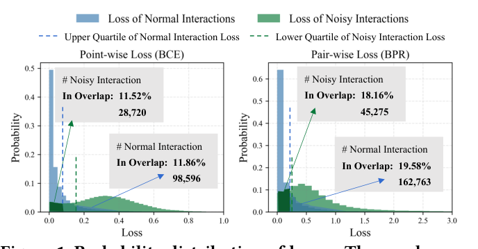
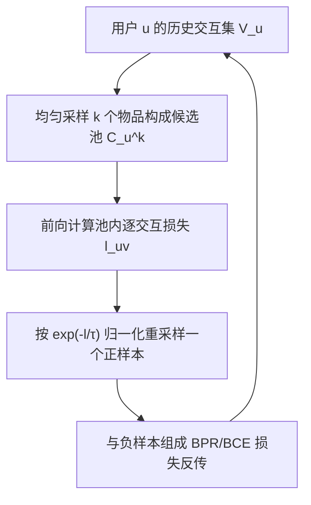

# Personalized Denoising Implicit Feedback for Robust Recommender System (基于用户个人损失分布的隐式反馈去噪)

- **会议/期刊**: WWW 2025
- **作者与机构**: Kaike Zhang, Qi Cao, Yunfan Wu, Fei Sun, Huawei Shen, Xueqi Cheng（中科院计算所 AI 安全重点实验室 / 国科大）
- **推荐链路定位**: 召回（训练阶段去噪，模型无关插件）
- **研究方向**: 自监督对比学习与交互去噪 / 协同过滤
- **论文原文**: [论文原文链接](https://arxiv.org/abs/2502.00348v1)
- **开源代码**: [开源代码仓库链接](https://github.com/Kaike-Zhang/PLD)

## TL;DR (1分钟核心速览)

现有基于损失的去噪方法（R-CE/T-CE/DCF）假设"噪声交互损失更高"，但本文实证发现：在**全局损失分布**中正常与噪声交互严重重叠（BCE 下各约 11.5%，BPR 下升至约 18–19.6%），pairwise 损失使重叠加剧 65%+。作者进一步发现**单个用户内部**正常/噪声损失区分清晰，据此提出 PLD：每步为用户构建候选池并按个人损失分布做 softmax 重采样，降低噪声被优化的概率。在 Gowalla/Yelp2018/MIND 上以 MF、LightGCN 为骨干，BPR 下 Recall@20 相对最优基线最高提升 7.36%，BCE 下亦提升 6.98%。

## Background & Motivation (背景与核心矛盾)

- **主流范式**: 隐式反馈去噪分两支——重加权类（R-CE 按损失降权、T-CE 按固定丢弃率删高损失样本、DCF 修补丢弃导致的稀疏、BOD 双层优化学权重）与自监督类（SGL 图增广、DeCA 双模型一致性），核心判据均为"全局损失分布中高损失即噪声"。
- **前人局限**: (1) 全局分布下正常与噪声交互重叠严重，单靠损失阈值必然误判；(2) 从 pointwise（BCE）切到 pairwise（BPR）后重叠进一步放大——MIND 上正常交互落入重叠区比例从 11.86% 升至 19.58%（+65.1%），噪声从 11.52% 升至 18.16%（+67.5%），使 T-CE/R-CE/DCF 在 BPR 下甚至劣于无去噪骨干。
- **核心洞察 (Key Insight)**: 重叠的根源是**用户间个人损失分布方差大**——某用户的正常交互损失可能高于另一用户的噪声损失；但**同一用户内部**，正常交互损失稳定低于噪声交互（图 3、图 4），个人分布重叠区占比骤降至 4–5%（正常）与 3% 左右（噪声）。
- **本文切入点**: 放弃"全局阈值/固定丢弃率"，改用**用户级概率重采样**——不硬性删除任何交互，只压低噪声被采样的概率，从而对无噪声用户零伤害。

<figure class="paper-figure" markdown="span">
  <figcaption>图1：损失的概分布。重叠区域包含偏离现有方法中常见假设的交互，即噪声交互表现出较低损失或正常交互表现出较高损失的情况。在确定重叠区域时，使用四分位数而非最大-最小值以减轻极端值的影响。</figcaption>
</figure>

## Method (核心方法设计)

### 1. 整体框架 (Overall Architecture)

PLD 是挂在任意 CF 骨干训练循环上的轻量插件。每个优化 step：先对当前用户 $u$从其历史交互集$\mathcal{V}_u$中**均匀随机**抽取$k$个物品构成候选池$\mathcal{C}_u^k$（保证后续重采样的稳定性，避免极小损失物品被反复采样）；再对池内$k$个物品前向计算逐交互损失$l_{u,v}$；随后按个人损失分布的 softmax 概率重采样一个正样本参与本步梯度更新，负样本仍按原策略采样。推理阶段完全不变，无额外开销。

### 2. 关键设计拆解 (Key Designs)

1. **个人损失分布重采样 (Personal Loss Resampling)**：痛点是用全局阈值会误杀高损失正常样本、漏放低损失噪声样本。核心算子把采样概率定义为池内损失的 softmax 负指数：
$$P_{u,v}=\frac{\exp(-l_{u,v}/\tau)}{\sum_{j\in\mathcal{C}_u^k}\exp(-l_{u,j}/\tau)}$$
直觉：损失越低（越像正常交互）被选中优化的概率越大；由于是"概率性降权"而非"硬删除"，即便用户完全无噪声，其正常交互仍以非零概率被训练，避免了 T-CE 式固定丢弃率对干净用户的系统性伤害。

2. **温度系数 $\tau$ 的理论化引入**：定理 1 给出正常/噪声采样概率差期望
$$\mathbb{E}[\Lambda_{\text{normal}}-\Lambda_{\text{noise}}]=\frac{n\alpha-m\beta}{(m+n)\eta}+\underbrace{\frac{\Gamma}{k}-\frac{\chi}{C^2}\frac{(k-1)^2}{}}_{\text{Fluctuation term}},\quad k>1$$
其中 $\xi=\beta/\alpha=\exp(g(\mu_1-\mu_2))<1$，且$\partial\big(\frac{n\alpha-m\beta}{(m+n)\eta}\big)/\partial\xi<0$。故减小$\xi$（即拉大正常/噪声损失的指数差距）可放大该期望差；引入$\tau$后$\xi'=\exp(g((\mu_1-\mu_2)/\tau))$，**降低$\tau$即锐化采样分布、增强去噪**。这解释了为何$\tau\le 0.1$ 时性能更稳。

3. **训练目标、负采样与推理效率**：总损失即骨干原损失（BPR 或 BCE），仅正样本来源被替换为 PLD 重采样结果，负采样策略不变（未引入额外难负样本挖掘）。每步额外开销仅为 $k$次前向打分与一次$k$维 softmax，$k$ 取 5 时实测每 epoch 训练时间与骨干几乎持平（图 9），远低于 T-CE/DCF 的批内排序与 BOD 的双层优化、DeCA 的双模型开销。

## Experimental Setup & Evaluation Protocol (实验设置与评估协议)

- **数据集与预处理**: 过滤交互数 $<10$ 的用户与物品（非严格 5-core）：

| 数据集 | #Users | #Items | #Interactions | 稀疏度 | 场景说明 |
| :--- | :---: | :---: | :---: | :---: | :--- |
| Gowalla | 29,858 | 40,981 | 1,027,370 | 99.92% | LBS 签到 |
| Yelp2018 | 31,668 | 38,048 | 1,561,406 | 99.88% | 本地商户 |
| MIND | 38,441 | 38,000 | 1,210,953 | 99.92% | 新闻推荐（采样子集） |
| MIND-Large | 111,664 | 54,367 | 3,294,424 | 99.95% | 新闻推荐（大规模） |

- **数据划分与防穿越 (Splitting Strategy)**: 每用户交互按 **8:2 比例划分**训练/测试，再从训练集随机抽 10% 作验证集调参（非 Leave-One-Out、非全局时间戳切分）。
- **排名评测协议 (Ranking Protocol)**: 采用 **Full-Ranking 全库未交互排序**，指标 Recall@{20,50} 与 NDCG@{20,50}；噪声鲁棒性实验额外注入 0.1–0.5 比例的随机噪声交互。
- **对比基线与超参设置**: 骨干为 MF 与 LightGCN；基线含 R-CE、T-CE、BOD、DCF（重加权类）与 DeCA（自监督类）。学习率 $\{0.1,\dots,10^{-5}\}$、权重衰减同网格；PLD 候选池$k\in\{2,3,5,10,20\}$、温度$\tau\in\{0.01,\dots,0.5\}$；显著性用双侧 t 检验（`*` 为$0.05\le p<0.1$，`**` 为$p<0.05$）。

## Key Experimental Results (实验关键数据)

### 1. 主实验对比 (Main Results)

BPR 损失下（节选 MF 与 LightGCN 骨干，Gowalla/Yelp2018/MIND）：

| 模型 | Gowalla R@20 | Gowalla N@20 | Yelp R@20 | Yelp N@20 | MIND R@20 | MIND N@20 |
| :--- | :---: | :---: | :---: | :---: | :---: | :---: |
| MF | 0.1486 | 0.1073 | 0.0621 | 0.0483 | 0.0658 | 0.0430 |
| MF+R-CE | 0.1456 | 0.1053 | 0.0654 | 0.0506 | 0.0716 | 0.0468 |
| MF+T-CE | 0.1326 | 0.0920 | 0.0571 | 0.0430 | 0.0359 | 0.0215 |
| MF+DeCA | 0.1463 | 0.1068 | 0.0645 | 0.0502 | 0.0714 | 0.0471 |
| MF+BOD | 0.1489 | 0.1079 | 0.0654 | 0.0511 | 0.0713 | 0.0473 |
| MF+DCF | 0.1489 | 0.1073 | 0.0635 | 0.0493 | 0.0710 | 0.0472 |
| **MF+PLD** | **0.1520** | **0.1097** | **0.0677** | **0.0527** | **0.0769** | **0.0513** |
| Improv. | +2.04% | +1.71% | +3.46% | +3.09% | +7.36% | +8.46% |
| LightGCN | 0.1553 | 0.1142 | 0.0665 | 0.0516 | 0.0817 | 0.0538 |
| LGCN+BOD | 0.1560 | 0.1154 | 0.0672 | 0.0523 | 0.0809 | 0.0532 |
| LGCN+DCF | 0.1276 | 0.0948 | 0.0619 | 0.0482 | 0.0734 | 0.0483 |
| **LGCN+PLD** | **0.1580** | **0.1157** | **0.0693** | **0.0538** | **0.0837** | **0.0551** |
| Improv. | +1.23% | +0.32% | +2.31% | +2.44% | +2.43% | +2.47% |

MIND-Large（噪声比 0.1）上 MF+PLD 达 R@20 0.0846 / N@20 0.0543，较最优基线 DCF（0.0818/0.0528）提升 +3.36%/+2.67%。BCE 损失下 MIND 上 MF+PLD 达 R@20 0.0731、N@20 0.0464，较最优基线提升 +6.98%/+4.94%。

### 2. 消融实验 (Ablation Study)

| 配置 | MIND R@20 | MIND N@20 | 说明 |
| :--- | :---: | :---: | :--- |
| MF（无去噪） | 0.0658 | 0.0430 | 骨干基线 |
| PLD, $k=1$ | ≈0.0658 | ≈0.0430 | 退化为标准训练（定理 1 边界） |
| PLD, $k=2$ | 波动大 | 波动大 | 采样方差高，候选池易被噪声主导 |
| PLD, $k=5$ | **最优** | **最优** | 各噪声比下稳定最优 |
| PLD, $k\ge10$ | 趋于饱和 | 趋于饱和 | 边际收益递减 |
| PLD, $\tau\ge0.2$ | 明显波动 | 明显波动 | 分布过平，去噪不足 |
| PLD, $\tau=0.05$ | 最稳 | 最稳 | 分布锐化，去噪最强 |

### 3. 关键实验发现 (Key Findings)

1. **pairwise 损失是全局去噪方法的"照妖镜"**：BPR 下 T-CE 在 MIND 上 R@20 从 MF 的 0.0658 暴跌至 0.0359（−45%），DCF 在 LightGCN 上从 0.1553 跌至 0.1276，而 PLD 在全部噪声比 0.1–0.5 下始终最优且最平稳——证明"全局损失阈值"判据在 pairwise 场景根本失效，个人分布判据才是稳健解。
2. **理论值与实测高度吻合**：图 6 中 6 个用户的 $\mathbb{E}[\Lambda_{\text{normal}}-\Lambda_{\text{noise}}]$ 理论值与 100 次模拟实测值几乎重合，且显著高于无重采样的标准训练值；图 7 显示每 epoch 采样到的噪声交互数被大幅压低，直接验证了"降采样概率而非删样本"的机制有效性。
3. **效率与效果兼得**：$k=5$、$\tau=0.05$ 为推荐配置；PLD 每 epoch 训练时间与骨干几乎持平，而 T-CE/DCF 因批内排序、BOD 因双层优化、DeCA 因双模型训练均显著更慢——PLD 是唯一在效果与开销上同时占优的方案。

## Highlights & Limitations (亮点、对比与审稿批判)

- **与代表作对比 (vs. Prior Work)**: 与 T-CE/DCF 的"固定丢弃率硬删"不同，PLD 用概率重采样实现软降权，对干净用户零伤害；与 R-CE 的"全局损失连续降权"不同，PLD 的判据是用户内相对损失，天然免疫用户间分布方差；与 BOD 的双层优化相比，PLD 无额外参数与内层训练，开销接近零。
- **可迁移亮点**: (1) "候选池 + 池内 softmax 重采样"可无缝嵌入任意 pairwise/pointwise 训练循环，作为即插即用去噪层；(2) 用温度 $\tau$ 控制采样分布锐度的思路，可直接迁移到难负样本采样与课程学习调度。
- **审稿级局限批判**: (1) 每步需对 $k$个候选物品额外前向打分，$k$ 增大时开销线性上升，且候选池均匀采样对超长交互序列用户可能引入额外方差；(2) 实验仅在 MF/LightGCN 两个浅层骨干上验证，未覆盖 Transformer 序列模型或图对比学习骨干，且噪声为人工随机注入而非真实工业噪声，鲁棒性结论的外推性有待检验。

## Rating (四维评分)

- **方法创新性 (Novelty)**: ⭐⭐⭐⭐ （从"全局损失"到"个人损失分布"的判据切换洞察扎实，配套定理给出 $\tau$ 的理论依据，但重采样本身属工程化改良）
- **评估协议与实验扎实度 (Protocol & Experiments)**: ⭐⭐⭐⭐ （四数据集、双骨干、双损失、多噪声比 + 理论验证 + 效率对比齐全，唯划分方式为比例划分而非时间切分）
- **写作与数学规范度 (Clarity & Rigor)**: ⭐⭐⭐⭐ （定理 1 推导完整、符号清晰，重叠区用四分位数规避极值的设计严谨；部分推导细节下放附录）
- **工业落地与复现价值 (Industrial & Practical Value)**: ⭐⭐⭐⭐⭐ （代码开源、模型无关插件、训练开销近零、推理零改动，落地门槛极低）

