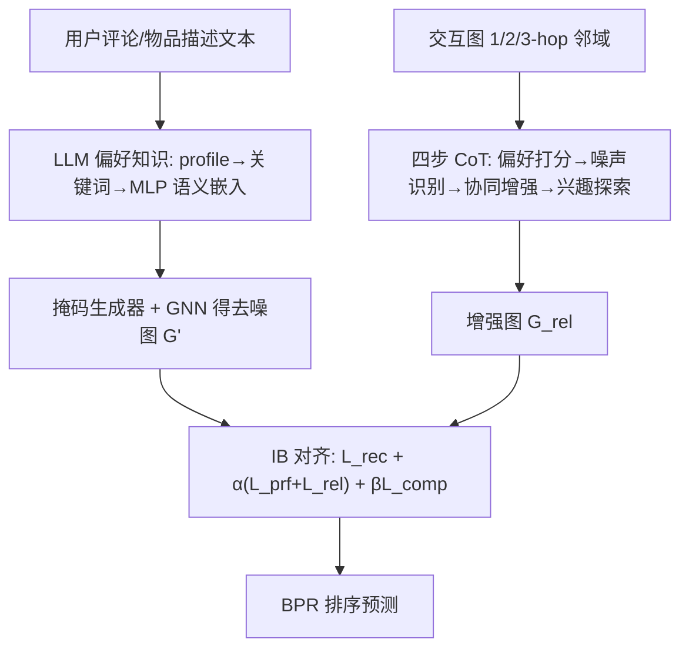
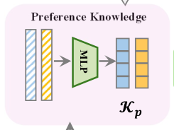

# Unleashing the Power of Large Language Model for Denoising Recommendation (释放大语言模型在推荐去噪中的潜力)

- **会议/期刊**: WWW 2025
- **作者与机构**: Shuyao Wang, Zhi Zheng (USTC), Yongduo Sui (Tencent), Hui Xiong (HKUST-GZ)
- **推荐链路定位**: 召回（图协同过滤骨干上的数据级去噪）
- **研究方向**: 自监督对比学习与交互去噪 / 大语言模型推荐
- **论文原文**: [https://arxiv.org/abs/2502.09058v1](https://arxiv.org/abs/2502.09058v1)
- **开源代码**: [https://github.com/shuyao-wang/LLaRD](https://github.com/shuyao-wang/LLaRD)

## TL;DR (1分钟核心速览)

隐式反馈去噪的现有方法（重加权/样本选择/对比增广）只能从**观测数据**里推断偏好，且依赖"高 loss 即噪声"这类预设假设，无法识别"看似噪声、实为潜在兴趣"的交互。LLaRD 让 LLM 从文本生成**偏好知识**、在交互图上做四步 CoT 生成**关系知识**（删噪边、加协同边与兴趣边），再用**信息瓶颈**把两类知识与去噪图对齐、压缩掉幻觉。在 Amazon-Book/Yelp/Steam 三数据集、GMF 与 LightGCN 双骨干、Full-Ranking 协议下，LightGCN 骨干平均超越次优 BOD 约 11.79%，Amazon-Book 上 Recall@20 从 0.1777 升至 0.2028。

## Background & Motivation (背景与核心矛盾)

- **主流范式**: 去噪分三路——侧信息（停留时长、知识图谱）、交互数据驱动（重加权 DeCA/BOD、样本选择 SGDL/DCF）、鲁棒表征（SGL/SimGCL 对比增广、RLMRec 语义对齐）。
- **前人局限**: ① 观测数据只覆盖真实偏好空间的一小块（图 1(a) 中 $P\cap\hat{P}$），与当前偏好不一致的交互被误判为噪声，实则可能是新兴趣；② 依赖"训练 loss 高即噪声"等预设假设，无法捕捉"美术↔园艺"这类跨域潜在关联。
- **核心洞察 (Key Insight)**: LLM 的世界知识可外推观测空间之外的偏好，其推理能力可在图结构上做多跳关联判断；但 LLM 直接输出存在幻觉，且难以原生处理图结构。
- **本文切入点**: 把 LLM 定位为"去噪知识生成器"而非表征增强器，用 IB 原则约束生成知识与推荐目标对齐。

## Method (核心方法设计)

### 1. 整体框架 (Overall Architecture)

LLaRD 由三部分组成：**偏好知识生成**（LLM 读用户评论/物品描述，先出 profile 再压缩为关键词，经 MLP 得语义嵌入 $\tilde{\mathbf{E}}_{u/i}$）、**关系知识生成**（以用户为中心的四步 CoT 在交互图上推理，产出删噪边$\mathcal{E}_{Noise}$、协同边$\mathcal{E}_{Collab}$、兴趣边$\mathcal{E}_{Interests}$，重构增强图$\mathcal{G}_{rel}$）、**知识增强去噪**（掩码生成器产出可微去噪图$\mathcal{G}'$，IB 目标同时最大化与推荐目标/两类知识的互信息、最小化与原图的互信息）。训练完成后仅保留轻量 GNN 推理，LLM 离线调用。

<figure class="paper-figure" markdown="span">
  <figcaption>图 2：所提出的 LLaRD 框架概览。</figcaption>
</figure>

### 2. 关键设计拆解 (Key Designs)

1. **用户中心四步图 CoT（把图结构翻译成 LLM 可推理的文本）**：LLM 不擅长直接吃图，故将 1-hop 交互序列配偏好关键词输入，先打 {High, Medium, Low} 三级偏好，再仅对 Low 项判定噪声（保留潜在兴趣）、在 High 项的二跳邻居中找相似用户建协同边、在三跳邻居中挖掘兴趣边。增强图为 $\mathcal{G}_{rel}=(\mathcal{U},\mathcal{I},(\mathcal{E}\setminus\mathcal{E}_{Noise})\cup\mathcal{E}_{Collab}\cup\mathcal{E}_{Interests})$。直觉：多跳关联语义正是 loss 阈值法看不见的信号，且每步要求 LLM 给出理由，提升可解释性。

2. **知识引导的信息瓶颈去噪（约束幻觉、压缩冗余）**：直接使用 LLM 知识会引入幻觉，故以 IB 为目标：
$$\max_{\mathcal{G}'}\ \mathbf{I}(\mathcal{R};\mathcal{G}')+\alpha\,\mathbf{I}(\mathcal{K}_p,\mathcal{K}_r;\mathcal{G}')-\beta\,\mathbf{I}(\mathcal{G}';\mathcal{G})$$
三项分别落地为 BPR 损失 $\mathcal{L}_{rec}$、两组 InfoNCE 对齐$\mathcal{L}_{prf}$（去噪图表征 vs 偏好语义嵌入）与$\mathcal{L}_{rel}$（去噪图 vs 增强图表征）、以及用 HSIC 近似互信息的压缩项$\mathcal{L}_{comp}=\frac{1}{(n-1)^2}\mathrm{trace}(\tilde{\mathbf{K}}\tilde{\mathbf{M}})$。直觉：HSIC 可微且无需估计高维图分布，最小化它等价于让$\mathcal{G}'$ 只保留任务必需信息。

3. **可微掩码生成器与训练目标**：边保留概率 $\lambda=\Phi(\mathbf{e}_u\|\mathbf{e}_i)$，经 Gumbel-Softmax$q=\sigma((\log\delta-\log(1-\delta)+\lambda_m)/\tau)$松弛为连续值实现端到端。总损失$\mathcal{L}=\mathcal{L}_{rec}+\alpha(\mathcal{L}_{prf}+\mathcal{L}_{rel})+\beta\mathcal{L}_{comp}$，负采样沿用 BPR 的均匀配对采样，无需额外难负样本挖掘；LLM 调用一次性离线完成，在线仅跑 GNN。

## Experimental Setup & Evaluation Protocol (实验设置与评估协议)

- **数据集与预处理**: Amazon-Book、Yelp、Steam 三个基准，沿用去噪推荐惯例过滤（详见原文附录 C），均含评论文本供 LLM 读取。

| 数据集 | #Users | #Items | #Interactions | 稀疏度/密度 | 特征/场景说明 |
| :--- | :---: | :---: | :---: | :---: | :--- |
| Amazon-Book | 见附录 C | 见附录 C | 见附录 C | 极稀疏 | 图书评论，含大量主观/无关描述 |
| Yelp | 见附录 C | 见附录 C | 见附录 C | 稀疏 | 本地商户评论 |
| Steam | 见附录 C | 见附录 C | 见附录 C | 稀疏 | 游戏平台交互 |

- **数据划分与防穿越 (Splitting Strategy)**: 沿用 SGDL/BOD 等去噪工作标准划分（正文未展开，见附录 C），测试集在加噪实验中保持不变。
- **排名评测协议 (Ranking Protocol)**: 报告 Recall@{10,20} 与 NDCG@{10,20}；加噪鲁棒性实验向训练集注入 5%/10%/15%/20% 对抗负交互，测试集不动。
- **对比基线与超参设置**: 实例级 WBPR、T-CE、R-CE、DeCA、SGDL、BOD、DCF；表征级 SGL、SimGCL、RLMRec；骨干为 GMF 与 LightGCN；超参 $\alpha,\beta,\tau,\tau'$ 见附录。

## Key Experimental Results (实验关键数据)

### 1. 主实验对比 (Main Results)

LightGCN 骨干（节选核心列，加粗为最优）：

| 方法 | Amazon R@20 | Amazon N@20 | Yelp R@20 | Yelp N@20 | Steam R@20 | Steam N@20 |
| :--- | :---: | :---: | :---: | :---: | :---: | :---: |
| Normal | 0.1010 | 0.0613 | 0.0871 | 0.0566 | 0.1170 | 0.0784 |
| T-CE | 0.1079 | 0.0715 | 0.0906 | 0.0612 | 0.1133 | 0.0754 |
| DeCA | 0.1291 | 0.0799 | 0.1092 | 0.0689 | 0.1288 | 0.0882 |
| SGL | 0.1498 | 0.0949 | 0.1171 | 0.0759 | 0.1254 | 0.0833 |
| SimGCL | 0.1538 | 0.1013 | 0.1146 | 0.0748 | 0.0903 | 0.0587 |
| SGDL | 0.1675 | 0.1054 | 0.1323 | 0.0841 | 0.1458 | 0.0755 |
| RLMRec | 0.1600 | 0.0960 | 0.1275 | 0.0815 | 0.1452 | 0.0924 |
| BOD | 0.1777 | 0.1131 | 0.1432 | 0.0884 | 0.1469 | 0.0891 |
| **LLaRD** | **0.2028** | **0.1326** | **0.1574** | **0.1008** | **0.1631** | **0.1059** |
| Improv.% vs BOD | +14.1% | +17.2% | +9.9% | +14.0% | +11.0% | +18.9% |

GMF 骨干上 LLaRD 同样全面最优（Amazon R@20 0.1619 vs BOD 0.1520），平均超次优 BOD 约 6.92%；对 T-CE/DeCA/DCF/SGDL 类交互数据驱动方法提升幅度达 46.1%–68.53%。

### 2. 消融实验 (Ablation Study)

| 变体 | Amazon R@10 | Amazon R@20 | Amazon N@20 | Steam R@10 | Steam R@20 | Steam N@20 |
| :--- | :---: | :---: | :---: | :---: | :---: | :---: |
| LLaRD | **0.1408** | **0.2028** | **0.1326** | **0.1054** | **0.1631** | **0.1059** |
| w/o MI$_{min}$ | 0.1259 | 0.1868 | 0.1205 | 0.0977 | 0.1525 | 0.0982 |
| w/o MI$_{max}$ | 0.1301 | 0.1856 | 0.1215 | 0.0949 | 0.1494 | 0.0957 |
| w/o PK | 0.1385 | 0.1983 | 0.1292 | 0.1012 | 0.1559 | 0.1017 |
| w/o RK | 0.1369 | 0.1947 | 0.1244 | 0.1001 | 0.1532 | 0.0904 |

### 3. 关键实验发现 (Key Findings)

1. **压缩项是去噪主力**：去掉 $\mathcal{L}_{comp}$（w/o MI$_{min}$）在 Amazon R@20 掉 0.0160（-7.9%），降幅大于去掉任一知识源，说明"最小化与原图互信息"才是筛掉冗余交互的核心算子，LLM 知识需配合压缩才生效。
2. **两类知识互补且不可替代**：w/o RK 在 Steam N@20 从 0.1059 暴跌至 0.0904（-14.6%），远大于 w/o PK 的 0.1017，表明图 CoT 挖掘的多跳关系知识比文本偏好知识更关键；而 w/o MI$_{max}$ 同时掉两项，验证了对齐项是知识注入的必要通道。
3. **噪声与冷启动双鲁棒**：注入 20% 对抗噪声时 LLaRD 性能下降率显著低于 T-CE/SGL/RLMRec/BOD（图 3）；在交互最稀疏的第 1 组冷启动用户上，LLaRD 的 Recall@20/NDCG@20 仍全面领先（图 4），说明 LLM 先验可补偿观测数据不足。

## Highlights & Limitations (亮点、对比与审稿批判)

- **与代表作对比 (vs. Prior Work)**: 相比 BOD 的双层优化先验，LLaRD 的知识来自观测空间之外；相比 RLMRec 仅做语义-协同表征对齐，LLaRD 同时改写了图结构（删边+加边），是数据级与表征级双重去噪；相比 SGL/SimGCL 的随机增广，其增广由 LLM 语义推理定向生成。
- **可迁移亮点**: ① "图结构→文本化多跳邻域→CoT 推理→回写边集"的范式可迁移到社交/知识图谱去噪；② 用 HSIC 近似互信息做图压缩，计算上比 MINE 类估计器更轻，适合大规模图。
- **审稿级局限批判**: ① 依赖 LLM 离线对全量用户做多轮 CoT，token 成本与推理时延随用户数线性增长，论文未给出成本-收益曲线；② 四步 CoT 的提示模板与三级偏好阈值缺乏敏感性分析，换 LLM 底座（如开源小模型）后知识质量是否稳定存疑；③ 数据集统计与划分细节置于附录，主文可复现性略打折。

## Rating (四维评分)

- **方法创新性 (Novelty)**: ⭐⭐⭐⭐ （首次把 LLM 定位为去噪知识生成器，图 CoT + IB 组合有理论抓手）
- **评估协议与实验扎实度 (Protocol & Experiments)**: ⭐⭐⭐⭐ （三数据集双骨干、加噪与冷启动分桶齐全，但缺 LLM 成本与提示敏感性分析）
- **写作与数学规范度 (Clarity & Rigor)**: ⭐⭐⭐⭐ （IB 三项与 HSIC 推导清晰，部分符号与附录依赖略重）
- **工业落地与复现价值 (Industrial & Practical Value)**: ⭐⭐⭐⭐ （代码开源、在线仅跑 GNN，但离线 LLM 全量推理成本是落地主要门槛）

