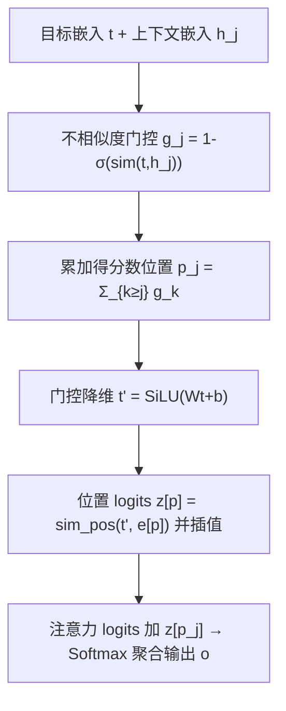

# A Contextual-Aware Position Encoding for Sequential Recommendation (面向序列推荐的上下文感知位置编码)

- **会议/期刊**: WWW 2025 (Industry Track)
- **作者与机构**: Jun Yuan, Guohao Cai, Zhenhua Dong（华为技术有限公司 / 华为诺亚方舟实验室）
- **推荐链路定位**: 精排（序列建模中的注意力单元）
- **研究方向**: 序列与会话推荐 / CTR 预估与特征交叉
- **论文原文**: [https://arxiv.org/abs/2502.09027v2](https://arxiv.org/abs/2502.09027v2)
- **开源代码**: [https://github.com/yjdy/CAPE](https://github.com/yjdy/CAPE)

## TL;DR (1分钟核心速览)

序列推荐（SR）的注意力机制天然顺序无关，但主流做法只是给每个位置分配一个可学习向量（Naïve PE），DIN/DIEN 甚至完全不用 PE，导致位置信息收益微弱。本文提出首个专为 SR 设计的位置编码 CAPE：以目标物品与上下文物品的**不相似度**累加动态定义位置，相似行为被压到同一位置、无关行为被拉开，再用门控+插值把位置信号注入异构特征空间。在 AmazonElectronics/KuaiVideo 上一致提升 DIN/DIEN/BST/SASRec/DMIN 五个骨干（AUC 最高 +0.21pt），大模型场景 NDCG 平均提升 8.65%，华为应用市场 8 天 A/B 的 eCPM 平均 +3.62%。

## Background & Motivation (背景与核心矛盾)

- **主流范式**: 注意力型 SR 分两支——目标注意力（DIN/DIEN/TIN）与自注意力（SASRec/Bert4Rec/BST/DMIN）；位置编码几乎一律沿用 NLP 的 Naïve 绝对 PE（每位置一个可学习向量），DIN/DIEN 则完全不用 PE。
- **前人局限**: ①NLP 的 PE 假设 token 处于统一隐空间，而 SR 的物品嵌入是 item ID、类目、标签等异构特征拼接而成，直接相加位置向量在隐空间上不匹配；②SR 的注意力形态多样（DIN 注意力、双线性注意力），并非只有点积，RoPE 式旋转与 CoPE 式相似度度量难以通用；③用户在同一意图/会话内会集中关注某簇物品，绝对位置无法表达这种"位置抽象层级"。
- **核心洞察 (Key Insight)**: SR 中物品的绝对先后顺序远不如语言中的词序重要（同一意图下连续购买顺序互换往往给出相同推荐），真正有意义的是"该上下文物品与目标的相关程度"——因此位置应由**不相似度**而非相似度定义：越相似的历史行为越应共享同一位置。
- **本文切入点**: 用目标-上下文不相似度门控值累加得到分数位置，再以门控线性层 + 整数位置插值把位置信号高效注入任意注意力形式。

## Method (核心方法设计)

### 1. 整体框架 (Overall Architecture)

输入为目标物品嵌入 $\mathbf{t}$与上下文物品嵌入序列$\{\mathbf{h}_1,\dots,\mathbf{h}_n\}$（item ID 与类目嵌入拼接，维度 128）。CAPE 先计算每个上下文物品相对目标的不相似度门控$g_j$，从后向前累加得到分数位置$p_j$；随后将目标嵌入经门控线性层降维到位置空间，与整数位置嵌入做点积得到位置 logits，并按$p_j$在相邻整数位置间插值；最终把插值标量$z[p_j]$ 加到原注意力 logits 上完成 softmax 聚合。整套流程可无缝嵌入目标注意力与自注意力，训练与推理均只增加极轻量开销。

### 2. 关键设计拆解 (Key Designs)

1. **不相似度累加位置（Context-aware Dissimilarity）**：痛点是不相似度而非相似度才对应 SR 的"意图簇"结构。核心算子为 $g_j = 1-\sigma(\mathrm{sim}(\mathbf{t},\mathbf{h}_j))$，再令$p_j=\sum_{k=j}^{n} g_k$；当所有门控恒为 1 时$p_j=j+1$，退化为标准相对位置，故 CAPE 是相对 PE 的严格推广，天然支持无界长序列。直觉上，与目标相似的历史行为门控趋 0、位置几乎不变，被"折叠"到同一位置；无关行为门控趋 1、位置被逐格推开，从而同时表达会话级与时间跨度级的多层位置抽象。

2. **门控融合 + 插值（Gate Fusion & Interpolation）**：痛点是位置嵌入与异构物品嵌入不在同一隐空间，且分数位置无法用查表实现。先以 $\mathbf{t}'=\mathrm{SiLU}(\mathbf{W}\mathbf{t}+\mathbf{b})$将目标嵌入投影到$d_{pos}$维位置空间（$d_{pos}<d$可省显存），计算$z[p]=\mathrm{sim}_{pos}(\mathbf{t}',\mathbf{e}[p])$，再对分数位置插值$z[p_j]=(p_j-\lfloor p_j\rfloor)z[\lceil p_j\rceil]+(1-p_j+\lfloor p_j\rfloor)z[\lfloor p_j\rfloor]$，最终$a_j=\mathrm{softmax}\big(\mathrm{sim}_{item}(\mathbf{t},\mathbf{h}_j)+z[p_j]\big)$。只用一个线性层而非 MLP，是为满足在线系统的高效率要求；插值把"每物品一次向量运算"降为"每序列一次向量运算 + 标量插值"。

3. **训练目标、负采样与推理效率**：沿用各骨干原有损失（CTR 场景为交叉熵 + Logloss，大模型场景为下一物品预测的交叉熵），不引入额外负采样策略；位置嵌入维度 $d_{pos}$网格搜索于$\{16,32,64\}$，多头数搜索于$\{1,2,4,8\}$。推理侧仅增加一次$d\times d_{pos}$线性投影与$n$ 次标量插值，工程改动极小，线上无需修改服务基础设施。

## Experimental Setup & Evaluation Protocol (实验设置与评估协议)

- **数据集与预处理**:

| 数据集 | #Users | #Items | #Interactions | 稀疏度/密度 | 特征/场景说明 |
| :--- | :---: | :---: | :---: | :---: | :--- |
| AmazonElectronics | 192,403 | 63,001 | 1,689,188 | 极稀疏 | item_id + category_id 序列，801 类目，按 DIN 预处理 |
| KuaiVideo | 10,000 | 3,239,534 | 3,239,534 | 极稀疏 | 短视频，随机采 10k 用户，按已有工作预处理 |
| AmazonBooks | 694,898 | 686,624 | 10,053,086 | 极稀疏 | 仅 item_id，`5-core` 过滤，最大长度 50，按 HLLM 预处理 |

- **数据划分与防穿越 (Splitting Strategy)**: 沿用 reczoo/FuxiCTR 与 HLLM 的既有样本级划分（CTR 样本按用户行为序列构造正负样本对），未额外引入时间戳切分；大模型实验遵循 HLLM 的下一物品预测划分。
- **排名评测协议 (Ranking Protocol)**: 小模型实验采用 CTR 式 `Sampled Ranking`（每正样本配采样负样本），报告 gAUC / AUC / Logloss；大模型实验采用 `Full-Ranking` 全库排序，报告 R@{5,10,50,200} 与 N@K。所有结果 5 个随机种子取均值，最优值以 $p<0.05$ 显著性标注。
- **对比基线与超参设置**: PE 基线为 None / Naïve PE / CoPE / RoPE，骨干为 DIN、DIEN、BST、SASRec、DMIN；嵌入维度 64（拼接后 128），上下文最大长度 100（Books 为 50），Adam 学习率 5e-4（Electronics）/1e-3（KuaiVideo），batch 1024/4096，早停 patience=3。

## Key Experimental Results (实验关键数据)

### 1. 主实验对比 (Main Results)

AmazonElectronics 与 KuaiVideo 上各骨干的最优 PE 对比（AUC，5 种子均值）：

| 骨干 | PE 方法 | Electronics gAUC | Electronics AUC | KuaiVideo gAUC | KuaiVideo AUC |
| :--- | :--- | :---: | :---: | :---: | :---: |
| DIN | None | 0.883526 | 0.886028 | 0.661646 | 0.741604 |
| DIN | RoPE | 0.884544 | 0.887220 | 0.664594 | 0.745957 |
| DIN | **CAPE** | **0.885698** | **0.888156** | **0.665215** | **0.745973** |
| DIEN | RoPE | 0.887128 | 0.889513 | 0.661536 | 0.744089 |
| DIEN | **CAPE** | **0.887736** | **0.889723** | **0.662178** | **0.744486** |
| BST | RoPE | 0.882918 | 0.885657 | 0.662909 | 0.745502 |
| BST | **CAPE** | **0.883349** | **0.886499** | **0.664139** | **0.746326** |
| SASRec | RoPE | 0.882185 | 0.884663 | 0.661662 | 0.745082 |
| SASRec | **CAPE** | **0.882793** | **0.885344** | **0.663006** | **0.745512** |
| DMIN | CoPE | 0.885583 | 0.887662 | 0.659226 | 0.744025 |
| DMIN | **CAPE** | **0.885703** | **0.888053** | **0.662567** | **0.746088** |

大模型场景（AmazonBooks + SASRec，Full-Ranking，平均提升相对同深度 Naïve PE）：

| #Blocks | PE | Avg R Impv.(%) | Avg N Impv.(%) |
| :---: | :--- | :---: | :---: |
| 2 | Naïve / RoPE / **CAPE** | 0.0 / -2.86 / **+0.23** | 0.0 / -3.06 / **+0.66** |
| 8 | Naïve / RoPE / **CAPE** | 0.0 / -0.06 / **+3.12** | 0.0 / +1.41 / **+1.66** |
| 12 | Naïve / RoPE / **CAPE** | 0.0 / +3.05 / **+4.27** | 0.0 / +4.76 / **+6.17** |
| 16 | Naïve / RoPE / **CAPE** | 0.0 / +4.18 / **+4.84** | 0.0 / +7.29 / **+8.65** |

### 2. 消融实验 (Ablation Study)

AmazonElectronics 上对位置维度与融合方式的消融（AUC，DIN / SASRec）：

| 配置 | DIN AUC | SASRec AUC | 说明 |
| :--- | :---: | :---: | :--- |
| None（无 PE） | 0.886028 | 0.879692 | 两骨干均受损 |
| Naïve 融合（直接相加） | 0.886702 | 0.882471 | DIN 提升有限，SASRec 受益 |
| **CAPE（门控融合，$d_{pos}$=16/64）** | **0.888156** | **0.885344** | 两骨干同时最优 |
| CAPE，$d_{pos}\le 32$ | 全上下文长度最优 | — | 短上下文（<100）仍优于所有基线 |
| CAPE，$d_{pos}\ge 32$ | — | 超越 CoPE | 验证"不相似度"优于"相似度" |

### 3. 关键实验发现 (Key Findings)

1. **PE 不是"加了就好"，选错会掉点**：Naïve PE 在 DMIN 上使 gAUC 从 0.885558 降至 0.883131，CoPE 在 SASRec/KuaiVideo 上使 gAUC 从 0.659623 降至 0.654668；而 CAPE 在全部 5 个骨干、2 个数据集上无一例外提升，说明 SR 专用 PE 的必要性而非"通用 PE 迁移"。
2. **门控融合是 DIN 场景的胜负手**：朴素相加融合使 DIN 性能下降，而门控融合使 DIN 的 AUC 从 0.886028 提升至 0.888156；这直接印证了"异构特征拼接的物品嵌入与位置嵌入不在同一隐空间"这一假设，也解释了为何 CoPE 在 DIN 注意力下失效。
3. **CAPE 兼具可扩展性**：Naïve PE 在层数超过 8 后平均性能开始下滑，RoPE 在超过 12 层后下滑，而 CAPE 在 16 层仍持续提升（NDCG 平均 +8.65%）；线上华为应用市场 8 天 A/B 中 eCPM 逐日稳定正向（首日 +6.12%），平均 +3.62%，验证了工业可用性。

## Highlights & Limitations (亮点、对比与审稿批判)

- **与代表作对比 (vs. Prior Work)**: 与 Naïve PE 的本质区别是位置不再与物品无关，而是由目标-上下文关系动态生成；与 CoPE 的区别在于用**不相似度**而非相似度定义位置，且额外设计了面向异构特征的门控融合，因而能同时适配 DIN 注意力与点积自注意力；与 RoPE 的区别是不依赖旋转点积这一特定注意力形式，且在小模型/浅层场景即生效（RoPE 需层数 >8 才超越 Naïve）。
- **可迁移亮点**: ①"分数位置 + 整数位置插值"技巧可低成本迁移到任何需要连续/软位置定义的序列建模任务；②门控线性降维融合异构嵌入的做法，可直接用于多特征域（类目、标签、行为类型）与结构先验（位置、时间间隔）的对齐。
- **审稿级局限批判**: ①小模型实验采用采样排序 + AUC/gAUC，与序列推荐社区主流的 Full-Ranking + Recall/NDCG 协议不完全对齐，跨论文比较需谨慎；②不相似度门控依赖目标物品嵌入，在目标特征缺失或冷启动目标上位置分配可能退化，论文未做该场景分析；③位置嵌入维度、门控维度等超参需按骨干网格搜索，缺少对 $d_{pos}$ 敏感性的系统曲线与理论分析。

## Rating (四维评分)

- **方法创新性 (Novelty)**: ⭐⭐⭐⭐ （首个面向 SR 定制的位置编码，不相似度累加 + 门控插值的组合简洁且动机自洽，但缺少理论层面的深入刻画）
- **评估协议与实验扎实度 (Protocol & Experiments)**: ⭐⭐⭐⭐ （5 骨干 × 2 数据集 + 大模型 scaling + 8 天线上 A/B，覆盖充分；小模型侧采样排序协议与主流 Full-Ranking 存在偏差）
- **写作与数学规范度 (Clarity & Rigor)**: ⭐⭐⭐⭐ （公式推导清晰、退化到相对 PE 的说明有说服力，符号表完整；部分实现细节如插值复杂度分析略简）
- **工业落地与复现价值 (Industrial & Practical Value)**: ⭐⭐⭐⭐⭐ （代码开源、仅增一个线性层与标量插值、线上零架构改动即获 eCPM +3.62%，工业迁移价值极高）

