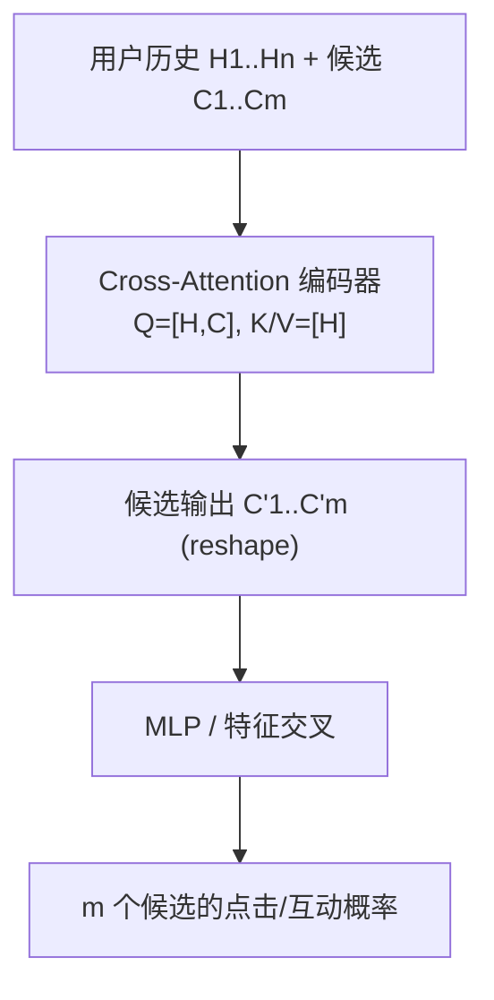
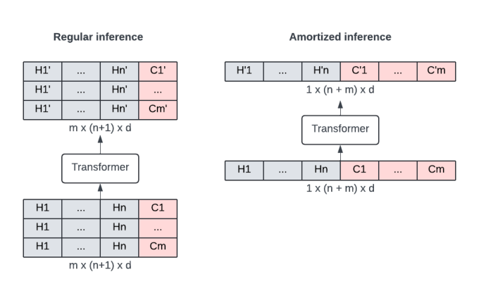

# Efficient User History Modeling with Amortized Inference for Deep Learning Recommendation Models (面向深度推荐模型的高效用户历史建模与摊销推理)

- **会议/期刊**: WWW 2025 (The Web Conference)
- **作者与机构**: Lars Hertel, Neil Daftary, Fedor Borisyuk, Aman Gupta, Rahul Mazumder（LinkedIn Corporation）
- **推荐链路定位**: 精排（DLRM 点式排序中的用户行为序列编码模块）
- **研究方向**: 序列与会话推荐 / 工业级全链路架构
- **论文原文**: [https://arxiv.org/abs/2412.06924v1](https://arxiv.org/abs/2412.06924v1)
- **开源代码**: 暂未开源

## TL;DR (1分钟核心速览)

Transformer 用户历史编码在 DLRM 精排中收益显著但线上延迟极高（TransAct 曾带来 24× CPU 延迟）。本文重新审视早期融合（early fusion）：把候选物品**追加到序列末尾**并用 cross-attention 阻断历史对候选的注意力，从而可将 M-FALCON 的**摊销推理**移植到 DLRM——一次请求只跑一次历史编码、同时为 $m$ 个候选打分。在 4 个公开数据集与 LinkedIn Feed/Ads 上，追加与拼接精度持平（Feed +0.18% vs +0.16%，Ads AUC +0.8130% vs +0.8125%），线上 p90 延迟从 +56% 降至 +11%，相对非摊销推理降低约 30%。

## Background & Motivation (背景与核心矛盾)

- **主流范式**: DLRM 精排中用 Transformer 编码用户行为序列（BST、TransAct），并通过 early fusion 让候选物品尽早参与历史建模以提取相关性信号。
- **前人局限**: ① TransAct 的"拼接式"融合把候选复制到每个历史步，计算复杂度较基线膨胀 65×、CPU 延迟 24×，被迫迁移 GPU 或压缩模型；② 点式排序下同一用户的 $m$个候选共享同一段历史，但历史编码被重复计算$m$ 次，算力严重浪费。
- **核心洞察 (Key Insight)**: 若候选只作为序列末尾的独立 token 且历史 token 不能反向注意候选（cross-attention），则 $m$ 个候选的输出与逐条推理**数学等价**，历史侧 KV 可完全复用——这正是生成式推荐 M-FALCON 摊销推理成立的前提。
- **本文切入点**: 用"追加 + cross-attention"替换"逐项拼接"，在精度不掉的前提下把摊销推理引入 DLRM 精排。

## Method (核心方法设计)

### 1. 整体框架 (Overall Architecture)

输入为用户历史序列嵌入 $[H_1,\dots,H_n]$与当前候选$C$（均为$d$维）。核心改动在 Transformer 编码器的输入构造与注意力掩码：候选作为第$n+1$个 token 进入 Query 侧，Key/Value 仅由历史构成，因此历史表示与候选无关、可预计算。编码后的候选输出与用户/物品特征一同送入 MLP（含特征交叉）得到行为预测。训练时按常规点式样本构造；在线推理时把同一请求的$m$个候选一次性拼入序列，经 reshape 后单次前向，再 reshape 回$m\times d$交给 MLP，实现"一次历史编码、$m$ 次打分"。

<figure class="paper-figure" markdown="span">
  <figcaption>图1：用户行为历史架构的常规推理（左）与摊销推理（右）示意图。历史项以灰色显示，候选项以红色显示。在摊销推理中，候选项被加入序列，使 Transformer 每次请求仅处理一个样本而非 m 个样本。</figcaption>
</figure>

### 2. 关键设计拆解 (Key Designs)

1. **追加式早期融合 + Cross-Attention（Append）**：拼接式（TransAct）把候选复制进每一步，序列长度与参数量随 $n$ 膨胀且历史间可互相"看到"候选；本文改为
$\mathrm{Transformer}\big([H_1,\dots,H_n,C]\big),\quad Q=W_q[H_1,\dots,H_n,C],\ K=W_k[H_1,\dots,H_n],\ V=W_v[H_1,\dots,H_n]$
即候选只出现在 Query 侧。直觉上这保留了 DIN 式的"历史-候选"相关性建模，同时切断候选对历史表示的污染，使历史编码成为与候选无关的常量。为公平比较，作者调节 key 维度与 FFN 维度使两种融合的参数量对齐，并对 padding 做 mask。

2. **DLRM 兼容的摊销推理（Amortized Inference）**：常规推理复杂度 $O(lmnd^2+lmn^2d)$，摊销后为$O(l(n+m)d^2+l(n+m)^2d)$；因$n+m<nm$（$n,m>2$），且两者比值随$n$线性增长，**序列越长收益越大**。工程关键在于 Transformer 前后做$m\times(n+1)\times d \leftrightarrow 1\times(n+m)\times d$ 的 reshape，使摊销后的张量仍能无缝接入 MLP 等 DLRM 组件。

3. **训练目标与开销**：公开数据集用 MSE 回归评分、MAE 评估；内部 Feed/Ads 为点式互动/点击二分类（交叉熵）。无需特殊负采样，摊销仅改变推理时的批组织方式，不改变训练分布，因此是"零精度代价"的推理优化。

## Experimental Setup & Evaluation Protocol (实验设置与评估协议)

- **数据集与预处理**: 4 个公开评分数据集 + 2 个 LinkedIn 内部排序场景（未给统计表，仅给超参）：

| 数据集 | 规模/来源 | 序列长度 | 层数/头数 | Emb / Ffwd-Key dim |
| :--- | :--- | :---: | :---: | :---: |
| MovieLens 20M | 2000 万电影评分 | 50 | 2 / 1 | 16 / 24(App), 16(Concat) |
| Amazon Books | 图书评分 | 50 | 2 / 1 | 16 / 24, 16 |
| Goodbooks | 最热 1 万本书评分 | 50 | 2 / 1 | 16 / 24, 16 |
| Netflix | Netflix Prize 子集 | 50 | 2 / 1 | 16 / 24, 16 |
| LinkedIn Feed | 互动（赞/评/转）预测 | 48 | 2 / 1 | 54/40(App), 104/24(Concat) |
| LinkedIn Ads | 点击预测 | 20 | 1 / 4 | 24/32(App), 40/16(Concat) |

- **数据划分与防穿越 (Splitting Strategy)**: 公开数据集按时间戳 **80/90/100 百分位切分**训练/验证/测试，预测用户最后一次评分，严格防穿越；内部场景为线上生产训练管线。
- **排名评测协议 (Ranking Protocol)**: 公开集为评分回归（MAE↓），非全库排序；内部 Feed 报告相对无历史编码基线的**离线互动提升**（0.05% 为显著阈值），Ads 报告 **AUC 提升**（0.1% 为显著阈值），并附线上 A/B 的 p90/p99 延迟与 p95 CPU 占用。
- **对比基线与超参设置**: 基线为 Concat（TransAct 式）与 Append（本文），并对比 Append 的摊销/非摊销版本；参数量经 key/FFN 维度调优对齐。

## Key Experimental Results (实验关键数据)

### 1. 主实验对比 (Main Results)

| 数据集 / 指标 | Append (本文) | Concat (TransAct 式) |
| :--- | :---: | :---: |
| MovieLens 20M (MAE↓) | **0.709** | 0.724 |
| Amazon Books (MAE↓) | **0.622** | 0.681 |
| Goodbooks (MAE↓) | 0.722 | **0.710** |
| Netflix (MAE↓) | 0.727 | **0.722** |
| LinkedIn Feed (互动↑) | **+0.18%** | +0.16% |
| LinkedIn Ads (AUC↑) | **+0.8130%** | +0.8125% |

线上部署对比（相对无历史编码基线）：

| 指标 | Concat | Append | Append (摊销) |
| :--- | :---: | :---: | :---: |
| Feed 延迟 p90 | +52% | +56% | **+11%** |
| Feed CPU p95 | +44% | +43% | **+5.5%** |
| Feed 互动 | +0.14% | +0.11% | **+0.18%** |
| Ads 延迟 p99 | +86% | – | **+10%** |
| Ads CPU | +50% | – | **+10%** |

### 2. 消融实验 (Ablation Study)

| 配置 | 效果 |
| :--- | :--- |
| Concat（无摊销能力） | 精度与 Append 持平，但延迟 +52%~+86% |
| Append + 常规推理 | 精度持平，延迟 +56%（历史被重复计算 $m$ 次） |
| Append + 摊销推理 | 精度不变，延迟 +11%，CPU +5.5% |
| 注意力可视化 | Concat 的注意力沿 query 维近乎常数（退化为 DIN 式成对注意力，Q/K 仅一维显著，存在参数冗余）；Append 呈对角+跨步传播模式 |

### 3. 关键实验发现 (Key Findings)

1. **精度无系统性差异**：4 个公开集上两种融合各胜 2 个，内部 Feed/Ads 差异均落在显著性阈值内（+0.18% vs +0.16%；+0.8130% vs +0.8125%），说明"追加"不是精度妥协而是等价替代。
2. **摊销收益随序列长度增长**：理论比值随 $n$线性上升，CPU 基准（$m=512$）中摊销曲线显著低于常规；GPU 上常规推理在最长序列处直接 OOM，而摊销几乎无时间增长（受 kernel 启动开销主导）。
3. **线上延迟即收益**：摊销把 Feed p90 延迟从 +56% 压到 +11%（相对非摊销降约 30%），并意外带来互动 +0.18%（高于非摊销 +0.11%），作者归因于排序系统已知的"延迟下降→互动上升"效应。

## Highlights & Limitations (亮点、对比与审稿批判)

- **与代表作对比 (vs. Prior Work)**: 相比 TransAct 的拼接融合，本文用 cross-attention 追加实现同等精度但可摊销；相比 M-FALCON（生成式推荐场景），本文把摊销推理首次系统移植到 DLRM 点式精排并解决 MLP 张量形状兼容问题；相比 GSU/ESU 两阶段长序列方案（SIM 类），本文不截断序列、无召回损失，且与稀疏注意力、多查询注意力等正交可叠加。
- **可迁移亮点**: ① "候选只入 Query、历史只入 KV"是让任意序列编码器获得 KV 缓存/摊销能力的最小改动范式；② reshape 桥接技巧可复用于任何"序列编码器 + 塔式 MLP"的工业架构。
- **审稿级局限批判**: ① 公开集实验为评分回归（MAE）而非 Top-N 排序，缺少 NDCG/HR 等排名指标与全库排序协议，说服力受限；② 未报告摊销在 $m$ 极大或序列极短时的收益边界，GPU 基准中"无时间增长"被归因于开销主导，缺乏更细粒度 profiling；③ 线上互动提升的因果归因（延迟→互动）仅为推测，未做控制实验。

## Rating (四维评分)

- **方法创新性 (Novelty)**: ⭐⭐⭐ （思路朴素但切中工业痛点，cross-attention 追加 + 摊销的组合有清晰的理论等价性支撑，非全新机制）
- **评估协议与实验扎实度 (Protocol & Experiments)**: ⭐⭐⭐ （公开集+双内部场景+线上 A/B 较完整，但公开集仅 MAE、无排名协议与显著性检验细节）
- **写作与数学规范度 (Clarity & Rigor)**: ⭐⭐⭐⭐ （融合方式、复杂度推导与 reshape 描述简洁准确，5 页短文信息密度高）
- **工业落地与复现价值 (Industrial & Practical Value)**: ⭐⭐⭐⭐⭐ （LinkedIn 双场景真实部署，延迟降 30%、CPU 降近 8 倍，工程可复制性极强）

