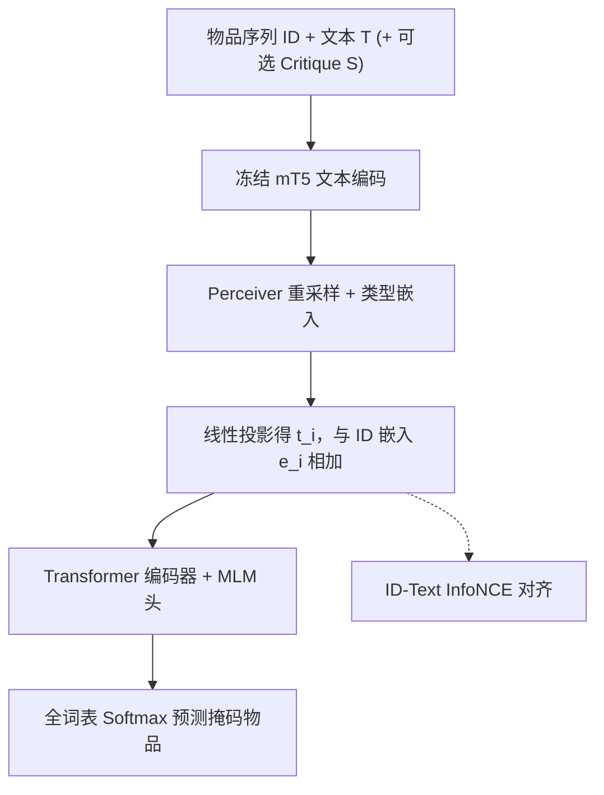
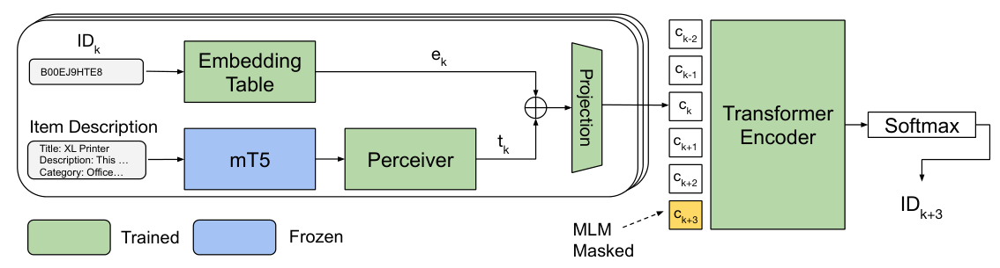

# FLARE: Fusing Language Models and Collaborative Architectures for Recommender Enhancement (融合语言模型与协同架构的推荐增强)

- **会议/期刊**: WWW Companion 2025
- **作者与机构**: Liam Hebert (University of Waterloo)、Marialena Kyriakidi、Hubert Pham、Krishna Sayana、James Pine、Sukhdeep Sodhi、Ambarish Jash (Google Research)
- **推荐链路定位**: 召回（序列下一物品预测）
- **研究方向**: 序列与会话推荐 / 多模态推荐
- **论文原文**: [https://arxiv.org/abs/2409.11699v2](https://arxiv.org/abs/2409.11699v2)
- **开源代码**: 暂未开源

## TL;DR (1分钟核心速览)

本文首先"翻案"：充分调参后的 Bert4Rec（记为 Bert4Rec*）在 6 个 Amazon 小数据集上大幅超越文献报告值，甚至在 Office、Games 上击败 Recformer，说明"文本带来增益"的既有结论被高估。在此基础上提出 Flare——用冻结 mT5 编码物品文本、Perceiver 重采样为定长上下文向量并与 ID 嵌入相加，辅以 ID-文本 InfoNCE 对齐。在 Leave-One-Out + Full-Ranking 协议下，Flare 相对 Bert4Rec* 在全部数据集上 Recall@10 提升 3%–26%，并在 376k 词表的 Clothing 上相对 Recformer 提升 9.6%–13.3%。

## Background & Motivation (背景与核心矛盾)

- **主流范式**: 序列推荐以 Bert4Rec 的 MLM 掩码预测为骨架；近年 Recformer、CALRec、TIGER 等主张用文本描述替代或补充 ID，并普遍以 Bert4Rec 作为"弱基线"论证文本价值。
- **前人局限**: ① 基线未充分调参——文献中的 Bert4Rec 数字远低于其真实潜力，导致文本增益被系统性夸大；② 评测词表过小——多数工作仅在 ≤40k 物品的 Amazon 子集上验证，与工业级大词表场景脱节。
- **核心洞察 (Key Insight)**: 作者复现发现，重调后的 Bert4Rec* 在 Office/Games 上反超 Recformer，说明 ID-only 模型被低估；而文本的真正价值应体现在"ID 稀疏的长尾物品"与"可被文本指令操控"两个维度，而非笼统的均值指标。
- **本文切入点**: 构建一个极简混合测试台 Flare（冻结文本编码器 + Perceiver 融合 + 对比对齐），在统一重调基线下重新度量 ID+文本增益，并引入 Critiquing 任务检验模型是否真正"读懂"文本。

## Method (核心方法设计)

### 1. 整体框架 (Overall Architecture)

输入为用户物品序列 $U=\{i_1,\dots,i_n\}$，每个物品$i=(\text{ID}, T)$，$T$为标题/描述/类目等文本。ID 经嵌入表查得$e_i$；文本$T$经**冻结** mT5-Base 编码后，由 Perceiver 将变长 token 序列重采样为定长潜向量，再线性投影至$d$维得$t_i$。二者相加得增强表示$c_i=e_i+t_i$ 送入 Transformer 编码器，输出端对掩码位置做全词表 softmax。训练同时优化 MLM 损失与 ID-文本对比损失；推理时掩码末位物品预测下一项。Critiquing 模式下，评论文本作为独立模态经同一 Perceiver 拼接融合。

<figure class="paper-figure" markdown="span">
  <figcaption>图1：带有文本编码器增强的序列推荐模型架构。文本 token 由冻结的（蓝色）语言模型（mT5）编码，相关嵌入由 Perceiver 重采样。绿色框中的参数通过掩码语言建模（MLM）学习。</figcaption>
</figure>

### 2. 关键设计拆解 (Key Designs)

1. **Perceiver 定长重采样融合（解决变长文本与 ID 维度错配）**：物品描述长度差异极大，直接池化会丢失细粒度信息且难以扩展多模态。Flare 用 Perceiver 的交叉注意力将任意长度 mT5 输出压缩为固定 $L$个潜向量，再投影求和：$c_k = e_k + \text{Linear}(\text{Perceiver}(T'_k))$。其物理直觉是：潜向量充当"信息瓶颈"，迫使模型只保留对协同信号有判别力的文本片段；同时 Perceiver 天然支持在序列维拼接多模态输入，为 Critiquing 预留接口。

2. **ID-Text 对比对齐（让文本为长尾物品兜底）**：尾部物品的 ID 嵌入训练不充分，而文本表征相对可靠。作者引入带加性间隔的 InfoNCE 将二者拉入同一潜空间：
$$\mathcal{L}_c=-\frac{1}{N}\sum_{i=1}^{N}\log\frac{\exp(e_i\cdot t_i/\tau-m)}{\exp(e_i\cdot t_i/\tau-m)+\sum_{j\neq i}\exp(e_i\cdot t_j/\tau)}$$
其中 $\tau=0.3$、$m=0.2$。间隔项$m$ 增大正负对间隔，缓解 batch 内负样本过于容易的问题；对齐后文本可在 ID 信号缺失时"补位"。

3. **训练目标、负采样与推理效率**：总损失 $\mathcal{L}_{total}=\alpha\mathcal{L}_{MLM}+(1-\alpha)\mathcal{L}_c$，$\alpha=0.5$；MLM 以 15% 概率掩码且保证至少掩一个。对比损失采用 **in-batch 负采样**（同批其他物品的文本向量），无需额外负采样器。文本编码器全程冻结，故在线仅需一次前向 mT5 + 轻量 Perceiver，ID 嵌入表是主要内存开销（376k 词表下尤为显著）。

## Experimental Setup & Evaluation Protocol (实验设置与评估协议)

- **数据集与预处理**: Amazon Product Reviews，分别沿用 Recformer 与 CALRec 两套预处理；Clothing 沿用 Recformer 流程但改为**过滤**超长序列（>50）而非截断，并剔除无标题物品。

| 数据集 | #Users | #Items | 平均序列长 I/U | 说明 |
| :--- | :---: | :---: | :---: | :--- |
| Games | 55,132 | 17,389 | 9.00 | Recformer 版 |
| Office | 101,357 | 27,932 | 7.88 | Recformer 版 |
| Scientific | 11,011 | 5,327 | 6.98 | 最小词表 |
| Music | 27,525 | 10,611 | 8.40 | 小词表 |
| Arts | 56,110 | 22,855 | 8.77 | — |
| Pets | 47,569 | 37,970 | 8.84 | CALRec 版另计 |
| Clothing | 1,219,592 | 376,843 | 9.20 | 约 9× 于最大小数据集 |

- **数据划分与防穿越**: `Leave-One-Out`——每用户倒数第二项作验证、最后一项作测试，其余训练。
- **排名评测协议**: `Full-Ranking`（全库未交互物品排序），指标 Recall@1/5/10、nDCG@10、MRR；Clothing 额外报告 Recall@1/5。
- **对比基线与超参设置**: ID-only（Bert4Rec、Bert4Rec*）、纯文本（Recformer、CALRec）、混合（S³Rec、UniSRec/UniSRec†）。Flare 三档规模：Small(2层/2头/64维)、Base(8层/16头/768维)、Large(32层/32头/768维)，Perceiver 统一 8 层/16 头/8 latents；Adam($\beta_1{=}0.9,\beta_2{=}0.99$)，序列打包训练并按序列内限制注意力。

## Key Experimental Results (实验关键数据)

### 1. 主实验对比 (Main Results)

Recformer 版数据集（节选 Recall@10 / nDCG@10 / MRR）：

| 数据集 | 指标 | Bert4Rec | Recformer | S³Rec | Bert4Rec* | Flare | %SotA | %ID |
| :--- | :--- | :---: | :---: | :---: | :---: | :---: | :---: | :---: |
| Office | R@10 | 0.121 | 0.140 | 0.119 | 0.141 | **0.148** | +5.71% | +4.96% |
| Office | nDCG@10 | 0.097 | 0.114 | 0.091 | 0.115 | **0.121** | +6.14% | +5.22% |
| Games | R@10 | 0.103 | 0.104 | 0.088 | 0.110 | **0.117** | +12.50% | +6.36% |
| Games | MRR | 0.059 | 0.065 | 0.050 | 0.067 | **0.069** | +6.15% | +2.99% |
| Music | nDCG@10 | 0.071 | 0.083 | 0.079 | 0.078 | **0.085** | +2.41% | +8.97% |
| Pets | R@10 | 0.077 | 0.116 | 0.104 | 0.101 | 0.112 | -3.45% | +10.89% |
| Scientific | R@10 | 0.106 | 0.145 | 0.080 | 0.113 | 0.119 | -17.93% | +5.31% |

CALRec 版（节选）：Pets 上 Flare R@10=**0.1091**（+12.47% vs SotA，+9.43% vs Bert4Rec*）；Office nDCG@10=**0.0976**（与 CALRec 持平，+4.39% vs ID）；Games R@10=0.0980（-8.75% vs CALRec，但 +26.29% vs Bert4Rec*）。

Clothing 大词表（376k）：

| 指标 | Recformer | Bert4Rec*-Base | Flare-Base | Flare-Large | % vs Recformer |
| :--- | :---: | :---: | :---: | :---: | :---: |
| R@10 | 0.135 | 0.143 | **0.148** | 0.147 | +9.63% |
| nDCG@10 | 0.123 | 0.134 | **0.138** | 0.138 | +12.20% |
| MRR | 0.120 | 0.133 | **0.136** | 0.136 | +13.33% |

### 2. 消融实验 (Ablation Study)

Clothing 数据集，Base 规模：

| 变体 | R@5 | R@10 | nDCG@10 | MRR |
| :--- | :---: | :---: | :---: | :---: |
| Flare 完整 | **0.142** | **0.148** | **0.138** | **0.136** |
| w/o Text | 0.138 | 0.143 | 0.134 | 0.133 |
| w/o Perceiver（改用 EOS 向量） | 0.140 | 0.145 | 0.135 | 0.133 |
| w/o 双向掩码 | 0.131 | 0.134 | 0.128 | 0.126 |
| w/o 对比损失 | 0.134 | 0.145 | 0.136 | 0.134 |
| w/o 去重 | 0.140 | 0.146 | 0.136 | 0.134 |

### 3. 关键实验发现 (Key Findings)

1. **基线重调是本文最大"隐形贡献"**：Bert4Rec* 在 Office/Games 上 R@10 分别达 0.141/0.110，超过 Recformer 的 0.140/0.104；这直接说明此前"文本模型碾压 ID 模型"的结论部分源于基线欠调，Flare 的真实增益应看 %ID 列（+3%～+26%）而非 %SotA。
2. **文本增益在 ID 稀疏处最显著**：Scientific（仅 5.3k 物品）与 Games 上 Flare 相对 Bert4Rec* 的 MRR 提升仅 +2.7%/+3.0%，而 Pets、Games(CALRec 版) 等长尾更重的数据上 R@10 提升达 +10.9%/+26.3%，与"文本为尾部物品兜底"的设计动机吻合。
3. **双向掩码是性能主引擎，Perceiver 贡献有限**：去掉双向掩码 R@5 掉 7.7%、MRR 掉 7.4%，为所有消融中最大跌幅；而去掉 Perceiver 仅掉 1.4%，说明当前融合方式尚未充分释放多模态潜力，作者亦承认此为后续工作空间。

## Highlights & Limitations (亮点、对比与审稿批判)

- **与代表作对比 (vs. Prior Work)**: 相较 Recformer/CALRec 的两阶段"多数据集预训练 + 目标域微调"，Flare 仅用**冻结** mT5 且每数据集独立训练，却在多数数据集上持平或反超，说明域内预训练并非必需；相较 S³Rec/UniSRec 的复杂自监督预训练目标，Flare 仅加一项 InfoNCE 即获稳定增益，工程上更轻。
- **可迁移亮点**: ① "先重调基线再比新方法"的实验纪律值得所有混合推荐论文借鉴；② Critiquing 评测（用类目字符串作提示、以 Cat-nDCG 度量对齐度）可低成本迁移到对话推荐/指令式推荐的语言理解能力评估。
- **审稿级局限批判**: ① 冻结 mT5 导致在 Scientific、Arts 等数据集上仍落后 Recformer 17%–21%，作者归因于缺少域内语言模型调优，但未给出验证实验；② Critiquing 用商品类目字符串冒充用户 critique，构造性较强，且 Cat-nDCG 在 Level 2 变异下已降至 0.890，说明模型在"历史信号与指令冲突"时仍会摇摆；③ 376k 词表下 ID 嵌入表内存开销未量化，工业可扩展性存疑。

## Rating (四维评分)

- **方法创新性 (Novelty)**: ⭐⭐⭐ （Perceiver 融合与 InfoNCE 对齐均为成熟组件的合理组合，创新度中等，但"基线重调 + Critiquing 评测"的方法论贡献有独立价值）
- **评估协议与实验扎实度 (Protocol & Experiments)**: ⭐⭐⭐⭐ （Leave-One-Out + Full-Ranking 规范，覆盖 7 数据集含 376k 大词表，消融完整；不足在于缺少显著性检验与多随机种子方差报告）
- **写作与数学规范度 (Clarity & Rigor)**: ⭐⭐⭐⭐ （公式简洁、符号一致，Critiquing 形式化清晰；但 %SotA 与 %ID 双列易误读，部分表格引用他人数字未标注复现差异）
- **工业落地与复现价值 (Industrial & Practical Value)**: ⭐⭐⭐ （架构轻量、冻结编码器降低训练成本，但未开源、大词表 ID 嵌入内存与 mT5 在线前向延迟未评估，落地需额外工程验证）

