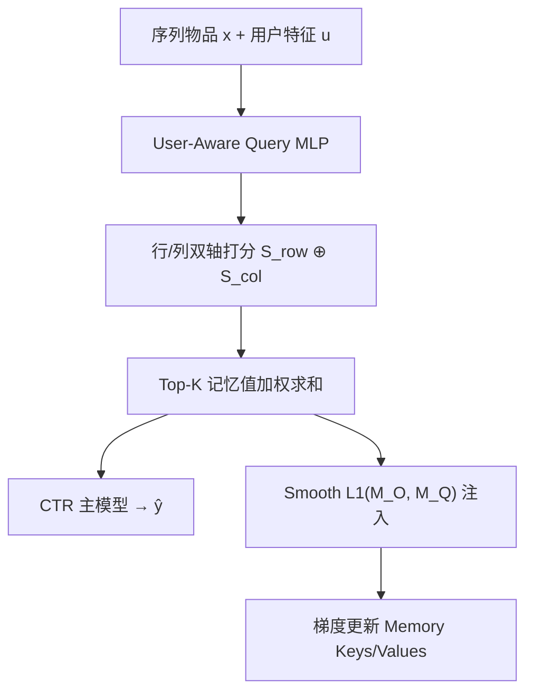
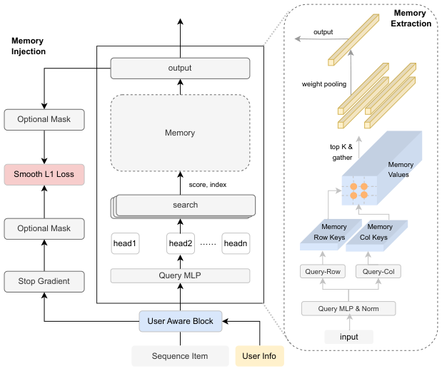

# Large Memory Network for Recommendation (面向推荐的大规模记忆网络)

- **会议/期刊**: WWW Companion 2025 (Industry Track)
- **作者与机构**: Hui Lu, Zheng Chai, Yuchao Zheng, Zhe Chen, Deping Xie, Peng Xu, Xun Zhou, Di Wu（字节跳动）
- **推荐链路定位**: 精排（CTR 预估中的用户序列建模模块，可插拔）
- **研究方向**: 序列与会话推荐 / 工业架构与部署
- **论文原文**: [https://arxiv.org/abs/2502.05558v3](https://arxiv.org/abs/2502.05558v3)
- **开源代码**: 暂未开源

## TL;DR (1分钟核心速览)

针对序列建模的两大痛点——**空间上**相似用户兴趣无法互相感知、**时间上**定长输入导致长期兴趣遗忘——本文提出 LMN：把所有用户的历史行为压缩进一个**全局共享的百万级 Key-Value 记忆块**，用「用户感知 Query + 乘积量化双轴激活」以 $O(\sqrt{n}d)$代价定位 Top-$K$记忆值，并以 Smooth L1 损失把用户-物品对信息注入记忆槽。在抖音电商搜索 36 亿样本离线集上 AUC 相对 DNN 基线提升 4.68%、LogLoss 降低 1.46%，线上 A/B 订单/人 +0.87%、订单/搜索 +0.72%（$p=0$），服务延迟仅增 0.38%。

## Background & Motivation (背景与核心矛盾)

- **主流范式**: 短序列走 Target-Attention（DIN/DIEN/CAN），长序列走两阶段检索（SIM/TWIN），或直接对长序列建模（如长序列 Transformer）。
- **前人局限**: ① 两阶段检索式方法工程复杂、行为丢弃导致兴趣估计不完整；② 直接长序列建模使训练/推理 FLOPs 与显存开销随长度线性膨胀，工业不可承受；③ 记忆网络代表 MIMN 依赖 GRU 串行读写，训练低效且记忆空间受限，无法享受 scaling law。
- **核心洞察 (Key Insight)**: 用户兴趣的"泛化"本质来自**跨用户共享**——相似用户的行为模式应可互相借用；而"长期记忆"不应靠加长输入序列，而应靠**外置参数化存储**。二者可由一个全局共享的大记忆块同时满足。
- **本文切入点**: 把记忆块当作"可微的、可分布式扩展的用户兴趣字典"，用乘积量化把检索复杂度从 $O(nd)$降到$O(\sqrt{n}d)$，从而让记忆规模在工业上真正能扩到百万级。

## Method (核心方法设计)

### 1. 整体框架 (Overall Architecture)

LMN 是一个端到端可插拔存储单元，分**记忆抽取**与**记忆注入**两阶段。抽取阶段：以序列中每个交互物品 $x$与用户特征$u$拼接后经 MLP 生成 Query，与记忆键做双轴（行/列）激活得到打分，取 Top-$K$ 记忆值加权求和作为序列表示，送入 CTR 主模型。注入阶段：不采用传统 write-back，而是用 Smooth L1 损失约束记忆输出逼近 Query，通过梯度下降反向更新键与值两张表，使记忆槽自动吸收用户-物品对语义。训练时记忆值分片存于多卡 HBM，经 All2All 完成查表与梯度更新；serving 时仅保留 All2All 查表。

<figure class="paper-figure" markdown="span">
  <figcaption>图1：所提出LMN的整体框架。记忆块中有两个可学习组件，包括记忆键和记忆值。LMN使用双轴激活来为给定特定查询定位前K个相关值。此外，采用Smooth L1损失将历史交互及对应用户信息注入记忆值槽中。可选掩码用于处理实践中部分序列项被零嵌入填充至固定长度的情况。</figcaption>
</figure>

### 2. 关键设计拆解 (Key Designs)

1. **乘积量化双轴记忆激活（把 $O(nd)$压到$O(\sqrt{n}d)$）**：原始键值记忆的相似度计算$s=x\cdot M_K^{\top}$随槽位数$n$线性增长，硬件上无法无限扩容。本文将$M_K\in\mathbb{R}^{n\times d}$分解为$M_K = M_{K\text{-}row}\times M_{K\text{-}col}$，两个子表各含$\sqrt{n}$个槽位，分别算行分$S_{row}=M_{Q\text{-}row}\cdot M_{K\text{-}row}^{\top}$与列分$S_{col}=M_{Q\text{-}col}\cdot M_{K\text{-}col}^{\top}$，再广播相加得$S\in\mathbb{R}^{\sqrt{n}\times\sqrt{n}}$并 reshape 为$\mathbb{R}^{n}$。直觉上这是把"全表扫描"换成"先定位行再定位列"的两级索引，与 PQ 的码本分解同源，代价是表达能力略受子空间约束——但实验证明扩容收益远大于该损失。

2. **用户感知块（User-Aware Block）**：同一物品在不同用户语境下语义不同，仅用物品 embedding 做 Query 无法区分。本文将用户侧特征并入 Query：$M_Q=\mathrm{MLP}(\mathrm{Merge}(x,u))$（Merge 取 concat），再分头生成$M_{Q\text{-}row}$、$M_{Q\text{-}col}$。这是"空间感知"的落点——Query 携带用户身份，使共享记忆块在检索时按用户个性化路由，而非退化为全局热门字典。

3. **记忆注入损失与训练目标**：传统记忆网络用 write-back 写回，与 Query-Key 激活框架不兼容。本文改用梯度式注入，令记忆输出逼近 Query 本身：$\mathcal{L}_{mem}=\mathrm{SmoothL1}(M_O, M_Q)$，总损失为$\mathcal{L}_{LMN}=\mathcal{L}_{CTR}+\alpha\mathcal{L}_{mem}$。Smooth L1 对异常值不敏感，适合行为序列中噪声点击较多的场景；$\alpha$平衡主任务与记忆保真度。推理侧无负采样需求（记忆检索是软加权而非对比学习），额外开销仅为一次 Top-$K$ gather。

## Experimental Setup & Evaluation Protocol (实验设置与评估协议)

- **数据集与预处理**: 抖音电商搜索（ECS）线上流量日志，2024-10-01 至 10-28 共 4 周、**36 亿样本**；前 3 周训练、最后 1 周评估。序列长度 50、embedding 维度 32，记忆键数默认 300（扩容实验至 500）。

| 数据集 | #Users | #Items | #Interactions | 稀疏度/密度 | 特征/场景说明 |
| :--- | :---: | :---: | :---: | :---: | :--- |
| Douyin ECS | 未披露（百万级日活） | 未披露 | 3.6B | 未披露 | 电商搜索点击日志，含用户侧特征与点击序列 |

- **数据划分与防穿越 (Splitting Strategy)**: **全局时间戳切分**（前 3 周训练 / 最后 1 周测试），符合工业流式场景，无未来信息泄漏。
- **排名评测协议 (Ranking Protocol)**: 工业 CTR 场景采用 **AUC 与 LogLoss** 点级评估（非 Full-Ranking 列表指标），并以相对 AUC 提升 `Imp.` 衡量；线上以订单/人、订单/搜索为商业指标，显著性 $p=0$。
- **对比基线与超参设置**: DNN（无序列）、Pooling、DIN、SIM、MIMN 五类基线；序列长度 50、$d=32$、记忆键 300；最优结果以$p<0.05$ 置信水平加粗。

## Key Experimental Results (实验关键数据)

### 1. 主实验对比 (Main Results)

| 方法 | AUC↑ | AUC Imp. | LogLoss↓ | LogLoss Imp. |
| :--- | :---: | :---: | :---: | :---: |
| DNN Base | 0.7265 | - | 0.6075 | - |
| Pooling | 0.7295 | +1.32% | 0.6053 | -0.36% |
| DIN | 0.7327 | +2.34% | 0.6023 | -0.86% |
| SIM | 0.7348 | +3.66% | 0.6009 | -1.09% |
| MIMN | 0.7363 | +4.33% | 0.5991 | -1.39% |
| **LMN** | **0.7371** | **+4.68%** | **0.5986** | **-1.46%** |

**线上 A/B（20% 流量，1.6 亿+ 用户，2024-08-30 至 09-05）**：订单/人 **+0.87%**、订单/搜索 **+0.72%**（$p=0$），服务延迟仅 **+0.38%**。

### 2. 消融/扩容实验 (Scaling Up)

| 配置 | AUC↑ | AUC Imp. | LogLoss↓ |
| :--- | :---: | :---: | :---: |
| DNN Base | 0.7265 | - | 0.6075 |
| LMN ($\sqrt{n}=50$) | 0.7357 | +4.06% | 0.5997 |
| LMN ($\sqrt{n}=100$) | 0.7364 | +4.37% | 0.5993 |
| LMN ($\sqrt{n}=200$) | 0.7370 | +4.64% | 0.5987 |
| LMN ($\sqrt{n}=300$) | 0.7371 | +4.68% | 0.5986 |
| LMN ($\sqrt{n}=500$) | **0.7380** | **+5.08%** | **0.5978** |

### 3. 关键实验发现 (Key Findings)

1. **记忆机制优于序列加长**：LMN 相对 MIMN 再提 0.35pp AUC（4.68% vs 4.33%），而 MIMN 已优于两阶段 SIM（0.7363 vs 0.7348），说明"外置共享记忆"比"检索+丢弃"和"GRU 串行记忆"都更充分，且无需两阶段工程复杂度。
2. **记忆规模呈单调 scaling 收益**：$\sqrt{n}$ 从 50 增至 500（槽位 2500→25 万）AUC 单调从 0.7357 升至 0.7380，未见饱和拐点，验证了乘积量化把扩容成本压到可承受区间后，记忆容量本身即是有效容量。
3. **线上收益与延迟解耦**：订单/人 +0.87% 属电商搜索的显著量级，而延迟仅 +0.38%，说明 MPS 的 GPU 分片 + All2All 查表设计使"参数扩容"几乎不转化为"serving 开销"，这是该方案能全量上线的关键。

## Highlights & Limitations (亮点、对比与审稿批判)

- **与代表作对比 (vs. Prior Work)**: 与 SIM/TWIN 的两阶段"检索-丢弃"不同，LMN 用可微记忆做软检索，无硬截断信息损失且单阶段部署；与 MIMN 的 GRU 串行读写不同，LMN 用梯度注入 + 并行双轴激活，训练效率与可扩展性均高一个量级；与 NLP 的 Product-Key Memory 不同，LMN 引入用户感知 Query 解决推荐中"同物品跨用户语义漂移"问题。
- **可迁移亮点**: ① 把任意中间表征（如特征交叉输出、高层压缩 MLP 输出）作为记忆注入目标，作者在结论中已点明该方向；② 双轴 PQ 激活可直接复用到任何需要百万级 key 的软检索模块（如超长序列召回、多模态码本）。
- **审稿级局限批判**: ① 实验仅在单一工业数据集（抖音 ECS）上完成，无公开基准（如 Amazon、Taobao）复现，外部有效性存疑；② 缺少对 $\alpha$、Top-$K$、head 数的敏感性分析与显存/吞吐的定量 profiling，且"记忆槽究竟学到了什么"缺乏可视化或案例级可解释性验证。

## Rating (四维评分)

- **方法创新性 (Novelty)**: ⭐⭐⭐⭐ （用户感知 Query + 双轴 PQ 激活的组合在推荐记忆网络中属首次，但 PQ 分解本身借鉴自 NLP 的 Product-Key Memory，理论新颖度中等）
- **评估协议与实验扎实度 (Protocol & Experiments)**: ⭐⭐⭐⭐ （36 亿样本 + 线上 A/B + 扩容曲线三重验证扎实，但缺公开数据集与消融细节，仅 5 页短文）
- **写作与数学规范度 (Clarity & Rigor)**: ⭐⭐⭐⭐ （公式简洁、框架图清晰，但符号定义偏简，Merge/多头的具体实现与复杂度分析略欠严谨）
- **工业落地与复现价值 (Industrial & Practical Value)**: ⭐⭐⭐⭐⭐ （已全量部署抖音 ECS 服务百万用户，MPS 部署方案完整可借鉴，延迟仅 +0.38%，落地价值极高；扣分项为未开源）

