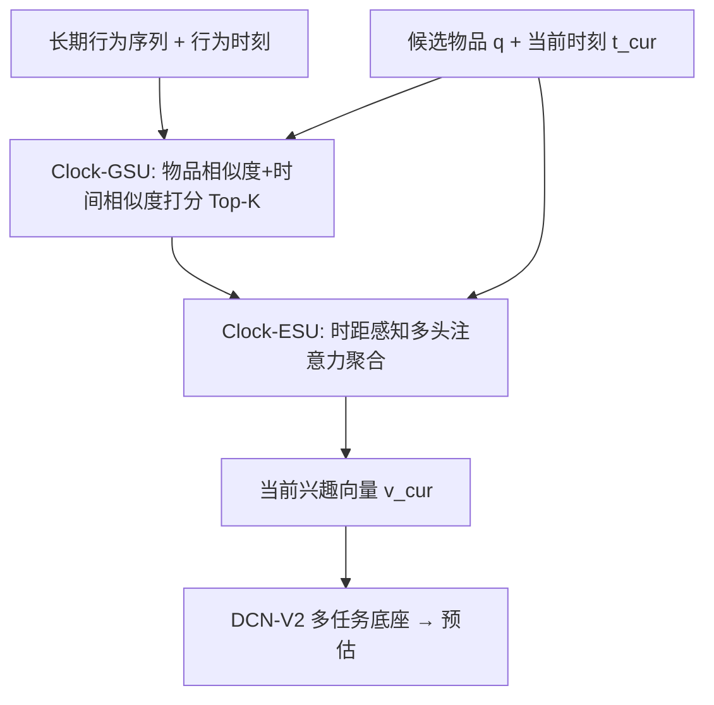
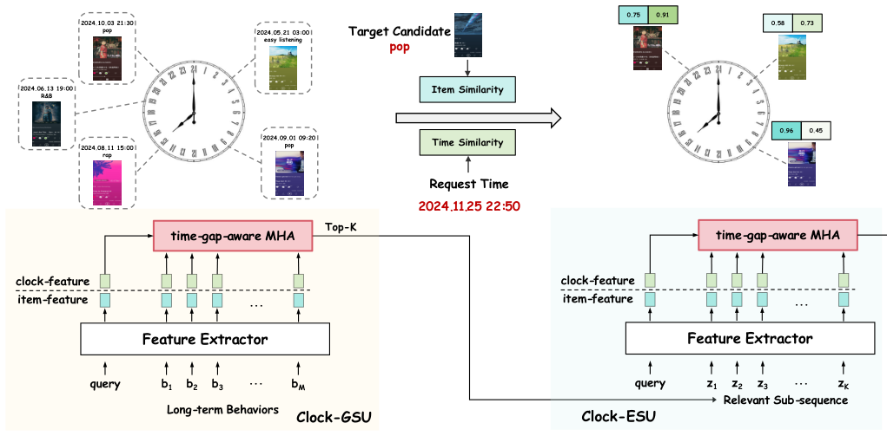

# Long-Term Interest Clock: Fine-Grained Time Perception in Streaming Recommendation System (长期兴趣时钟：流式推荐系统中的细粒度时间感知)

- **会议/期刊**: WWW 2025
- **作者与机构**: Yongchun Zhu, Guanyu Jiang, Jingwu Chen (通讯), Feng Zhang, Xiao Yang, Zuotao Liu — 字节跳动（抖音）
- **推荐链路定位**: 精排（Ranking，DCN-V2 多任务底座上的特征增强模块）
- **研究方向**: 序列与会话推荐 / CTR 预估与特征交叉
- **论文原文**: [https://arxiv.org/abs/2501.15817v1](https://arxiv.org/abs/2501.15817v1)
- **开源代码**: 暂未开源

## TL;DR (1分钟核心速览)

流式训练下，同一时刻的所有样本共享相同时间特征，传统 hour embedding 的离散性导致模型只拟合当前时段、产生周期性抖动；Interest Clock 虽以 24 小时兴趣时钟缓解该问题，但仅用近 30 天短期行为、且压缩为 genre/mood/language 的粗粒度类别，7:59 与 8:01 的特征可能截然不同、当前小时无交互时特征直接缺失。本文提出 LIC：以「候选物品 + 当前时刻」为双查询，从万级长期行为中检索 Top-K 子序列（Clock-GSU），再用时距感知多头注意力聚合出当前兴趣向量（Clock-ESU）。抖音音乐线上 A/B 活跃天数 +0.122%，离线 AUC 相对提升 +1.16%、UAUC +1.49%。

## Background & Motivation (背景与核心矛盾)

- **主流范式**: 工业界用 hour embedding 把一天 24 小时映射为离散嵌入；流式框架下 Interest Clock 进一步把用户 24 小时个性化兴趣编码成"时钟"特征。
- **前人局限**: ① **离散性**——按小时分组统计，7:59 与 8:01 特征可能完全不同，高斯平滑也只覆盖相邻两小时，当前小时无交互则特征缺失；② **粗粒度 + 短期**——只取近 30 天行为并压缩为 top-3 类别偏好，同 genre/mood/language 的用户会得到完全相同的时敏特征，且丢失物品级长期兴趣。
- **核心洞察 (Key Insight)**: 用户"此刻"的兴趣不应由"此刻的统计桶"决定，而应由**长期行为中与当前时刻相近、且与候选物品相关的那些具体交互**自适应决定——时间相似度应是连续量而非离散桶。
- **本文切入点**: 把时间感知从"特征工程式的时钟编码"改写为"以时间+物品为查询的长期序列检索与注意力聚合"，用相对时距 $\Delta$ 替代绝对时间戳。

## Method (核心方法设计)

### 1. 整体框架 (Overall Architecture)

输入为候选物品特征（压缩为查询 $\boldsymbol{q}\in\mathbb{R}^H$）、当前请求时刻$t_{cur}$与长度$M$达万级的长期行为序列$\{\boldsymbol{b}_1,\dots,\boldsymbol{b}_M\}$（每条含物品特征与发生时刻$t_{b_m}$）。Clock-GSU 先用"物品相似度 + 时间相似度"打分做 Top-K 检索（$K=100$），得到围绕当前时刻且与候选物品相关的子序列；Clock-ESU 再以时距感知多头注意力（4 头）对该子序列加权聚合，经两层 MLP 得到当前兴趣向量$\boldsymbol{v}_{cur}$，拼入 DCN-V2 多任务底座完成 CTR/多目标预估。训练沿用二分类交叉熵，检索侧打分所需的$W_b\boldsymbol{b}_m$、$W_q\boldsymbol{q}$ 预计算并存入在线 PS 以支撑毫秒级检索。

<figure class="paper-figure" markdown="span">
  <figcaption>图1：长期兴趣时钟的整体架构。</figcaption>
</figure>

### 2. 关键设计拆解 (Key Designs)

1. **Clock-GSU：时间+物品双查询的长期序列检索**：痛点是用绝对时间戳或 hour embedding 无法刻画"一天内的动态兴趣"。本文将候选物品与历史行为的相关分定义为物品相似度与时距相似度之和：
$$\alpha(\boldsymbol{b}_m,\boldsymbol{q})=\frac{(W_b\boldsymbol{b}_m)\odot(W_q\boldsymbol{q})^{\top}}{\sqrt{d}}+s\big(\Delta(t_{b_m},t_{cur})\big)$$
其中 $\Delta$为**相对时距**（按小时/分/秒取模，如$\Delta(23{:}00,1{:}00)=120$分钟），$s(\cdot)$为以$[\Delta,\sqrt{\Delta},\Delta^2,\log(\Delta+1)]$为输入的两层小网络。相对时距使"每天 8 点"在语义上对齐，天然具备跨天平滑性；$s(\cdot)$ 结构极简（8→1 维），复杂度远低于内积项，保证万级序列检索可行。

2. **Clock-ESU：时距感知多头注意力聚合**：检索到的 Top-K 子序列若等权聚合仍会稀释时间信号。本文将同一套 $\alpha$分数作为注意力 logits，第$i$头表示为$\boldsymbol{r}_i=\mathrm{Softmax}(\boldsymbol{\alpha}_i)^{\top}ZW_{v_i}$，各头独立参数$W_b,W_q$，最终$\boldsymbol{v}_{cur}=h([\boldsymbol{r}_1,\dots,\boldsymbol{r}_4])$。直觉是：与候选物品相似、且发生在"当前钟点附近"的行为获得更高权重，从而在不引入离散桶的前提下实现细粒度（物品级）时间感知。

3. **训练目标、负采样与推理效率**：总损失即标准二分类交叉熵 $\mathcal{L}=-y\log\hat{y}-(1-y)\log(1-\hat{y})$，无额外对比/辅助损失，也无显式负采样设计（工业曝光日志天然含负样本，标签取"Finish"）。推理开销集中在 GSU：通过 PS 预存$W_b\boldsymbol{b}_m$与$W_q\boldsymbol{q}$、各头嵌入直接拼接算内积，将在线检索压到可接受量级；ESU 仅对$K=100$ 条做 4 头注意力，成本可控。

## Experimental Setup & Evaluation Protocol (实验设置与评估协议)

- **数据集与预处理**: 因 LIC 需要跨年长期行为，公开数据集均不满足，仅用自建工业数据 DouyinMusic-20B（抖音音乐，DAU 超千万，样本超 200 亿，含 100+ 特征：性别/年龄/genre/mood/scene 等非 ID 特征与 user/item/artist/interacted-ID 序列）。

| 数据集 | #Users | #Items | #Interactions | 稀疏度/密度 | 特征/场景说明 |
| :--- | :---: | :---: | :---: | :---: | :--- |
| DouyinMusic-20B | 千万级 DAU（未披露精确值） | 未披露 | > 20B 样本 | 极稀疏（音乐长尾） | 2023.08–09 共 8 周曝光日志，标签为 Finish |

- **数据划分与防穿越 (Splitting Strategy)**: **全局时间戳切分**——前 6 周训练、第 7 周验证、第 8 周测试，严格避免未来信息泄漏。
- **排名评测协议 (Ranking Protocol)**: 离线采用 AUC 与 **UAUC（用户级分组 AUC）** 及相对提升 RelaImpr，属工业日志上的点式排序评估，未做全库 Full-Ranking；线上采用一个多月 A/B，主指标 Active Days，约束指标 Like / Finish / DisLike / Play，并给出 95% 置信区间。
- **对比基线与超参设置**: 基线均共享同一 DCN-V2 多任务底座：Base Model（无时间建模）、Hour Embedding、Naive Clock、Adaptive Clock、Gaussian Clock（后三者为 Interest Clock 原文方法）。GSU 取 $K=100$，ESU 头数 4，时距网络隐层 8→1。

## Key Experimental Results (实验关键数据)

### 1. 主实验对比 (Main Results)

线上 A/B（相对基线提升，方括号为 95% CI）：

| 方法 | Active Day | Like | Finish | DisLike | Play |
| :--- | :---: | :---: | :---: | :---: | :---: |
| Long-term Clock | **+0.122%** | **+0.101%** | **+0.093%** | **-0.683%** | **+0.095%** |
| 95% CI | [-0.052%, +0.052%] | [-0.083%, +0.083%] | [-0.065%, +0.066%] | [-0.586%, +0.586%] | [-0.079%, +0.079%] |

离线 DouyinMusic-20B（AUC / UAUC 及相对提升）：

| 方法 | AUC | RelaImpr | UAUC | RelaImpr |
| :--- | :---: | :---: | :---: | :---: |
| Base Model | 0.6643 | - | 0.6023 | - |
| Hour Embedding | 0.6631 | -0.18% | 0.6007 | -0.27% |
| Naive Clock | 0.6666 | +0.35% | 0.6015 | -0.13% |
| Adaptive Clock | 0.6662 | +0.29% | 0.5859 | -2.72% |
| Gaussian Clock | 0.6695 | +0.78% | 0.6069 | +0.76% |
| **Long-term Clock** | **0.6720** | **+1.16%** | **0.6113** | **+1.49%** |

### 2. 消融实验 (Ablation Study)

原文未提供逐模块（w/o Clock-GSU、w/o 时间相似度项、w/o 多头）的消融表，仅以"时间建模方式"作为等价消融维度，可整理为：

| 配置 | AUC | UAUC | 说明 |
| :--- | :---: | :---: | :--- |
| 无时间建模 (Base) | 0.6643 | 0.6023 | 时间信息完全缺失 |
| 离散时间 (Hour Emb.) | 0.6631 | 0.6007 | 流式下反而劣于 Base |
| 短期粗粒度时钟 (Gaussian Clock) | 0.6695 | 0.6069 | 最强前人基线 |
| 长期细粒度时钟 (LIC) | **0.6720** | **0.6113** | 相对 Gaussian 再 +0.38% / +0.73% |

### 3. 关键实验发现 (Key Findings)

1. **离散时间编码在流式场景是负收益**：Hour Embedding 的 AUC 相对 Base 为 -0.18%、UAUC -0.27%，直接印证了"同一时刻样本时间特征同质化 → 模型只适应当前时段"的动机假设。
2. **自适应权重难学，经验平滑更稳**：Adaptive Clock 的 UAUC 暴跌至 0.5859（-2.72%），说明在流式分布下让模型自行学习时间权重易失稳；而 LIC 用相对时距 + 简单 $s(\cdot)$ 网络取得 UAUC +1.49%，是全部方法中唯一双指标均显著为正的方案。
3. **线上收益具备业务显著性**：Active Days +0.122% 远超生产算法平均 ~0.05% 的水平，同时 DisLike 下降 0.683%、Like/Finish/Play 均正向，说明细粒度时间感知在提升活跃的同时未牺牲约束指标。

## Highlights & Limitations (亮点、对比与审稿批判)

- **与代表作对比 (vs. Prior Work)**: 与 Hour Embedding 的本质区别是把时间从"离散 ID 特征"变为"连续时距信号"；与 Interest Clock（Naive/Adaptive/Gaussian）的区别在于用**长期物品级行为 + 候选物品条件化**替代**短期类别级统计**，从而同时解决离散性、粗粒度、短期性三大缺陷；与 SIM/ETA 等长期序列两段式方法相比，其 GSU 检索分中显式加入时间相似度项，而非仅用物品/上下文相似度。
- **可迁移亮点**: ① "相对时距 + 轻量 $s(\cdot)$ 网络"可低成本替换任何场景中的绝对时间戳/小时桶特征；② 检索分与注意力 logits 复用同一打分函数、并将内积项预存 PS 的两段式工程范式，可直接迁移到其他万级序列召回-聚合结构。
- **审稿级局限批判**: ① **评估可复现性弱**——仅用单一未公开工业数据集，无公开基准、无 Full-Ranking 协议、无逐模块消融与超参敏感性分析（$K$、头数、时距网络结构均未扫），学术说服力受限；② **线上置信区间跨零**——Active Day 的 95% CI 为 [-0.052%, +0.052%]，严格看统计显著性存疑，且 GSU 万级检索 + PS 预存的工程复杂度对小规模系统不友好。

## Rating (四维评分)

- **方法创新性 (Novelty)**: ⭐⭐⭐⭐ （把时间感知重构为"时间+物品双查询的长期序列检索"，相对时距设计简洁有效，但两段式 GSU/ESU 框架本身沿用 SIM 范式，增量偏工程化）
- **评估协议与实验扎实度 (Protocol & Experiments)**: ⭐⭐⭐ （有真实线上 A/B 与时间切分，但仅单数据集、缺逐模块消融与显著性稳健性，线上 CI 跨零）
- **写作与数学规范度 (Clarity & Rigor)**: ⭐⭐⭐⭐ （公式精简、动机与三缺陷剖析清晰，4 页短文信息密度高；但部分符号如 $s(\cdot)$ 维度、PS 存储细节略简）
- **工业落地与复现价值 (Industrial & Practical Value)**: ⭐⭐⭐⭐ （已在抖音音乐多应用精排上线，预计算+PS 方案可直接复用；但无开源代码、依赖长期行为日志，复现门槛高）

