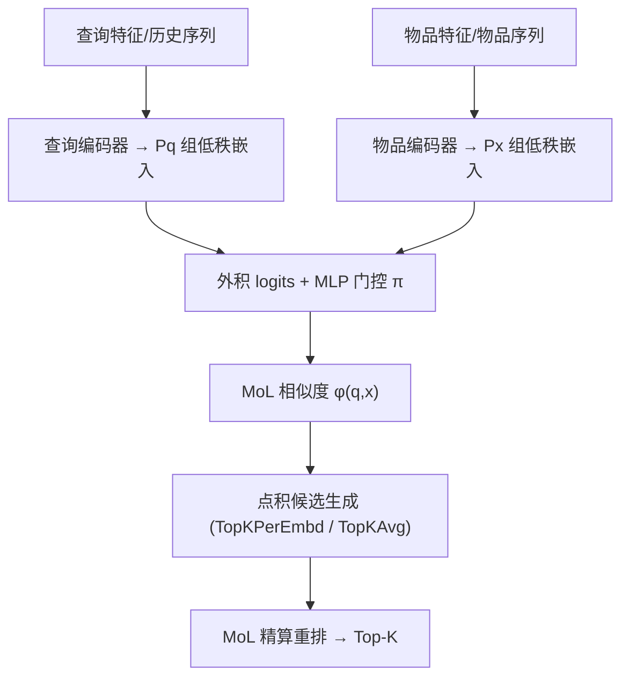

# Retrieval with Learned Similarities (基于学习相似度的检索)

- **会议/期刊**: WWW 2025
- **作者与机构**: Bailu Ding (Microsoft Research), Jiaqi Zhai (Meta)
- **推荐链路定位**: 召回
- **研究方向**: 序列与会话推荐 / 协同过滤与双塔召回
- **论文原文**: [https://arxiv.org/abs/2407.15462v4](https://arxiv.org/abs/2407.15462v4)
- **开源代码**: [https://github.com/bailuding/rails](https://github.com/bailuding/rails)

## TL;DR (1分钟核心速览)

工业召回已从点积迁移到多向量/生成式等"学习相似度"，但后者缺乏高效 top-K 检索方案（暴力枚举或图索引在非度量相似度下退化）。本文证明 Mixture-of-Logits (MoL) 是任意相似度函数的通用逼近器，提出互信息负载均衡损失 $\mathcal{L}_{MI}$ 使 MoL 的稀疏门控真正可训练，并给出带紧误差界的精确/近似 top-K 算法。在 ML-1M/ML-20M/Books 序列召回上 HR@1 平均提升 29.1%，NQ320K 上超越 GenRet；近似检索在 >0.99 相对召回下延迟最高降低 66×。

## Background & Motivation (背景与核心矛盾)

- **主流范式**: 双塔点积 + MIPS（PQ/LSH/HNSW）是向量数据库的标准召回范式，工程成熟、延迟可控。
- **前人局限**: ① 点积诱导 $\ln p(x|q)\propto\langle f(q),g(x)\rangle$的低秩瓶颈，而增大维度$d$ 受内存带宽与过拟合双重制约；② 多向量 max 相似度、TDM 树搜索、生成式 ID 解码等表达力更强，但树搜索需 20 步不可并行 beam search，生成式需自回归解码，均难以支撑十亿级物品、数十毫秒预算；③ 图索引在相似度非度量时性能显著退化。
- **核心洞察 (Key Insight)**: 所有学习相似度的本质都是对 $p(x|q)$ 矩阵做更高秩的参数化；若能把任意高秩矩阵分解为若干低秩点积的加权混合，就能复用现成的 MIPS 基础设施。
- **本文切入点**: 用 MoL 统一表达所有学习相似度，把"表达力"与"检索效率"解耦——训练时用 MoL 拟合，检索时用点积 API 做候选生成 + MoL 精算。

## Method (核心方法设计)

### 1. 整体框架 (Overall Architecture)

查询侧与物品侧分别经编码器（推荐场景为 RNN/Transformer 序列编码器 + MLP/User-ID 嵌入；QA 场景为 T5 + 特殊聚合 token + 参数化池化）产出 $P_q$与$P_x$组低秩嵌入，两两外积得到$P=P_q\times P_x$个 logits，再由 MLP 门控$\pi_{p_q,p_x}(q,x)$加权求和得到 MoL 相似度。训练用 sampled softmax +$\mathcal{L}_{MI}$；检索时先用点积 top-K 生成候选，再用 MoL 精算重排。

### 2. 关键设计拆解 (Key Designs)

1. **MoL 通用逼近定理（表达力保证）**：点积的低秩瓶颈无法靠加维度解决。作者证明任意 $n\times m$矩阵$A$可写成$\left|A-\sum_{p=1}^{P}\pi_p\circ B_p\right|<\epsilon$，其中$B_p$秩$\le d$、$\pi_p$逐元素构成概率分布。证明思路是满秩时用两个低秩矩阵$B_1=\lambda_{\min}UD_{n,d}V$、$B_2=\lambda_{\max}UD_{n,d}V$与插值门控$\pi=(\lambda_{\max}-\lambda)/(\lambda_{\max}-\lambda_{\min})$精确重构，再递归推广到$P$ 项。直觉：门控把"每个 (q,x) 对需要哪段子空间"显式建模，等价于逐样本自适应的高秩分解。

2. **互信息负载均衡损失 $\mathcal{L}_{MI}$（让表达力落地）**：MoL 的门控是条件计算，若不加约束会退化为$\pi_p=1/P$的均匀解或少数专家垄断。作者要求全局负载均衡（最大化$H(p)$）同时单样本稀疏（最小化$H(p|(q,x))$），二者合并即最大化互信息：
$$\mathcal{L}_{MI}=-H(p)+H(p|(q,x)),\qquad \mathcal{L}=-\log\frac{\exp\phi(q,x)}{\exp\phi(q,x)+\sum_{x'\in X}\exp\phi(q,x')}+\alpha\mathcal{L}_{MI}$$
这与 MoE 的 load balancing 同源，但作用在"相似度分量"而非"专家网络"上，$\alpha=0.001$ 即可稳定训练。

3. **精确与近似 top-K 检索（效率保证）**：精确算法两遍扫描——先对每组嵌入取点积 top-K 得候选集 $G$，算出$S_{\min}=\min_{x\in G}\phi(q,x)$，再对每组嵌入做 range query 取$\langle f_p(q),g_p(x)\rangle\ge S_{\min}$的全部物品，最后暴力精算。近似算法给出三种候选生成：`TopKPerEmbd`（每组取 top-K 并集，误差界$S_\Delta\le S-S_K$且紧）、`TopKAvg`（对$\sum_p f_p(q)$与$\sum_p g_p(x)/P$做单次点积，与$P$无关，可预处理）、`CombTopK`（两者并集，误差界$S_\Delta\le S'-S_K$）。训练负采样为 in-batch（推荐 128/512 个，QA 沿用基线），推理仅需向量库 top-K API。

## Experimental Setup & Evaluation Protocol (实验设置与评估协议)

- **数据集与预处理**:

| 数据集 | #Users(Query) | #Items | #Interactions | $P_q\times P_x$|$d_P$ | 场景说明 |
| :--- | :---: | :---: | :---: | :---: | :---: | :--- |
| ML-1M | 6,040 | 3,649 | ~1M | 8×4 | 64 | 电影序列推荐 |
| ML-20M | 138,493 | 24,186 | ~20M | 8×4 | 128 | 电影序列推荐 |
| Books | 694,897 | 674,044 | ~2.9M | 8×8 | 32 | Amazon 图书序列推荐 |
| NQ320K | 307,373 | 109,739 | 320K | 4×4 | 768 | 开放域问答检索 |

- **数据划分与防穿越**: 推荐数据集沿用 SASRec/HSTU 的 `Leave-One-Out` 序列切分（最后一项测试、倒数第二项验证）；NQ320K 沿用 DSI/NCI 官方 train/test 划分，并用 DocT5Query 生成合成查询做数据增广。
- **排名评测协议**: 推荐场景为 `Full-Ranking`（对全物品库排序，报告 HR@{1,10,50,200} 与 MRR）；NQ320K 报告 HR@{1,10,100} 与 MRR。检索效率实验以暴力 MoL 全排序为 ground truth，报告归一化 HR 与 batch=32 的端到端延迟（RTX 6000 Ada，20 次预热均值）。
- **对比基线与超参**: 推荐侧对比 SASRec、HSTU 的点积版本；QA 侧对比 BM25/DocT5Query（稀疏）、DPR/Sentence-T5/GTR-Base（稠密）、GENRE/DSI/SEAL/DSI+QG/NCI/GenRet（生成式），均以 T5-base 微调保证公平。$\alpha=0.001$，$|P_x|\in\{2,4,8,16\}$、$d_P\in\{32,64,128\}$ 网格搜索。

## Key Experimental Results (实验关键数据)

### 1. 主实验对比 (Main Results)

| 方法 | ML-1M HR@1 | ML-1M HR@200 | ML-20M HR@1 | Books HR@1 | Books HR@200 | NQ320K HR@1 | NQ320K MRR |
| :--- | :---: | :---: | :---: | :---: | :---: | :---: | :---: |
| SASRec | .0610 | .7540 | .0653 | .0058 | .1431 | — | — |
| SASRec + MoL | .0697 | .7667 | .0778 | .0095 | .1635 | — | — |
| HSTU | .0750 | .7824 | .0962 | .0101 | .1876 | — | — |
| **HSTU + MoL** | **.0884** | **.7935** | **.1010** | **.0156** | **.2173** | — | — |
| GenRet (生成式 SOTA) | — | — | — | — | — | .681 | .759 |
| **MoL** | — | — | — | — | — | **.685** | **.773** |
| Improv. (vs 点积骨干) | +17.9% | +1.4% | +5.0% | +54.5% | +15.8% | +0.6% | +1.8% |

（MoL 相对点积基线在六个推荐场景平均提升：HR@1 +29.1%、HR@10 +16.3%、MRR +18.1%。）

### 2. 消融实验 (Ablation Study)

| 配置 | ML-1M HR@1 | ML-20M HR@1 | Books HR@1 | NQ320K HR@1 | NQ320K MRR |
| :--- | :---: | :---: | :---: | :---: | :---: |
| HSTU + MoL (完整) | .0884 | .1010 | .0156 | .685 | .773 |
| w/o $\mathcal{L}_{MI}$ | .0847 | .0994 | .0153 | .673 | .767 |
| $\Delta$ | −4.2% | −1.6% | −1.9% | −1.8% | −0.8% |

| 检索算法 (Books) | HR@100 (相对) | 延迟/ms |
| :--- | :---: | :---: |
| BruteForce | 1.00 | 128.36 |
| TopKPerEmbd50 | 0.93 | 21.60 |
| TopKAvg500 | 0.81 | 1.17 |
| CombTopK200_2000 | **1.00** | 28.01 |

### 3. 关键实验发现 (Key Findings)

1. **MoL 的收益在稀疏数据上最显著**：Books 上 HR@1 从 .0101 跃至 .0156（+54.5%），远超 ML-1M 的 +17.9%，说明高秩相似度对长尾/稀疏交互的补偿作用强于点积的维度扩张。
2. **$\mathcal{L}_{MI}$ 是"从理论到落地"的必要条件**：去掉后 NQ320K HR@1 掉 1.8%，恰好使 MoL 从超越 GenRet（.685 vs .681）跌回持平区间，证明负载均衡直接决定门控是否真正分化。
3. **TopKAvg 是效率-召回的最优折衷**：NQ320K 上 TopKAvg100 达 >0.99 相对 HR 且延迟仅 0.57ms（vs 暴力 37.74ms，66× 加速）；且其延迟与 $P$ 无关，从 ML-20M 到 Books 仅增长 1.0×，而暴力法增长 47.0×，规模越大优势越明显。

## Highlights & Limitations (亮点、对比与审稿批判)

- **与代表作对比 (vs. Prior Work)**: 相比 LiNR/MoL 原工作 [59]，本文补上了"为何可训练"（$\mathcal{L}_{MI}$）与"如何高效检索"（误差界算法）两块拼图；相比 ColBERT 类多向量 max 相似度，MoL 用可学习门控替代硬 max，表达更平滑；相比 DSI/GenRet 生成式检索，MoL 无需自回归解码，可直接复用向量库 top-K API，规避了 beam search 的串行瓶颈。
- **可迁移亮点**: ① `TopKAvg` 的"求和后单次点积"技巧可迁移到任何多向量召回系统，把 $P$ 次检索压缩为 1 次；② 把 MoE 的互信息负载均衡损失迁移到"相似度分量"层面，是提升任何门控混合模型可训练性的通用手段。
- **审稿级局限批判**: ① 精确两遍算法依赖 range query，当点积分布偏斜时 $G'$膨胀，作者自己承认暴力法反而更快，精确路径实际不可用；② 推荐实验仅在 MovieLens/Amazon 公开集上验证，缺少工业十亿级线上 A/B 与实时更新物品集的延迟数据，而论文核心卖点恰是工业可部署性；③ MoL 的$P_q\times P_x$外积使训练算力随$P$ 平方增长，QA 场景需 4×H100，小团队复现门槛偏高。

## Rating (四维评分)

- **方法创新性 (Novelty)**: ⭐⭐⭐⭐ （MoL 通用逼近定理 + 互信息负载均衡的组合有理论深度，但 MoL 本体沿用 [59]，增量在于可训练性与检索算法）
- **评估协议与实验扎实度 (Protocol & Experiments)**: ⭐⭐⭐⭐ （跨推荐/QA 两类异构场景、Full-Ranking 协议、误差界理论与延迟实测兼备，缺工业级线上验证）
- **写作与数学规范度 (Clarity & Rigor)**: ⭐⭐⭐⭐⭐ （定理-引理-紧界证明链条完整，符号表清晰，算法伪代码与数值示例（Table 6）极大降低理解成本）
- **工业落地与复现价值 (Industrial & Practical Value)**: ⭐⭐⭐⭐ （代码与 checkpoint 开源，仅需向量库 top-K API 即可部署，但训练算力与 $P^2$ 复杂度对中小规模团队不友好）

