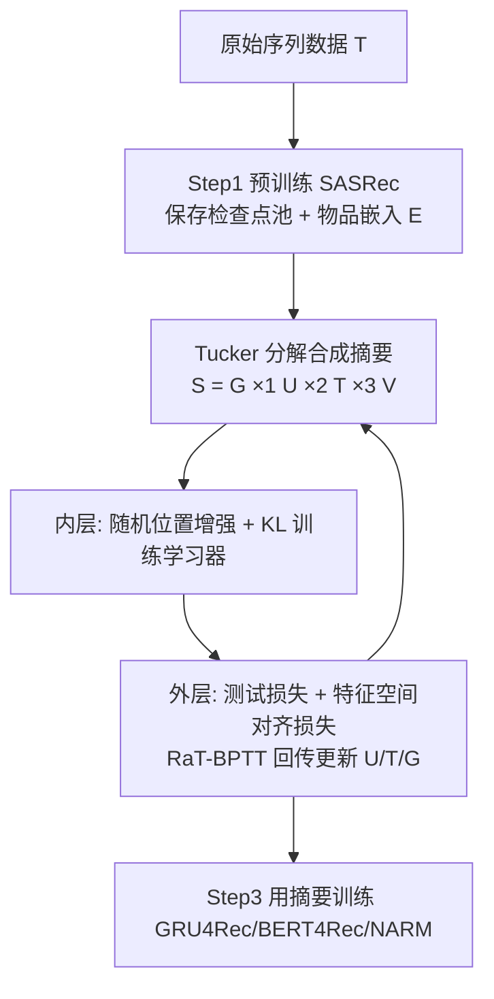
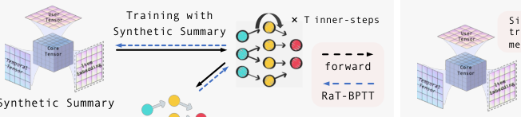

# TD3: Tucker Decomposition Based Dataset Distillation Method for Sequential Recommendation (基于 Tucker 分解的序列推荐数据集蒸馏方法)

- **会议/期刊**: WWW 2025
- **作者与机构**: Jiaqing Zhang, Mingjia Yin, Hao Wang, Yawen Li, Yuyang Ye, Xingyu Lou, Junping Du, Enhong Chen（中国科学技术大学、认知智能全国重点实验室、北京邮电大学、Rutgers、中山大学）
- **推荐链路定位**: 数据侧（训练数据蒸馏，服务于召回/精排模型的离线训练加速）
- **研究方向**: 序列与会话推荐 / 自监督与去噪（数据质量侧）
- **论文原文**: [https://arxiv.org/abs/2502.02854v2](https://arxiv.org/abs/2502.02854v2)
- **开源代码**: [https://github.com/USTC-StarTeam/TD3](https://github.com/USTC-StarTeam/TD3)

## TL;DR (1分钟核心速览)

序列推荐的数据蒸馏卡在两点：交互离散且时序相关，合成数据难以保留序列依赖；参数化合成集尺寸随序列长度与物品集爆炸，双层优化难收敛。TD3 把合成序列摘要 $\mathcal{S}\in\mathbb{R}^{\mu\times\zeta\times|\mathcal{V}|}$ 用 Tucker 分解解耦为合成用户因子、时间动态因子、与物品嵌入表共享的物品因子及关系核，并在外层目标中加入特征空间对齐损失、内层加入随机位置增强，配合 RaT-BPTT 加速。在 `Leave-One-Out` + 100 负采样排序协议下，仅用 0.2%–7.4% 数据即在 Magazine/Epinions 上超越全量训练（如 Epinions HR@10 19.86 vs 19.13）。

## Background & Motivation (背景与核心矛盾)

- **主流范式**: 序列推荐长期是模型中心（SASRec/BERT4Rec/GRU4Rec），而数据中心路线目前只有 DR4SR 式数据再生与启发式采样（随机采样、最长序列采样）。
- **前人局限**: 非序列 DD 方法（$\infty$-AE、DConRec、CGM、TF-DCon）独立生成多条合成交互，简单拼成序列无法刻画偏好演化；Farzi 虽在隐空间蒸馏自回归数据，但其参数随词表与序列长度线性增长，物品集大时不可用。
- **核心洞察 (Key Insight)**: 合成摘要的尺寸由三个维度（合成用户数 $\mu$、序列长度$\zeta$、物品集$|\mathcal{V}|$）共同决定，而这三者本质可解耦——物品维度可直接复用已训练的物品嵌入表，无需学习。
- **本文切入点**: 用 Tucker 分解把三维概率张量拆成"小因子 + 关系核"，把待学参数量从 $\mu\zeta|\mathcal{V}|$量级压到$(\mu+\zeta)d_1+d_1^2d_3$ 量级，再用特征空间对齐弥补单纯性能匹配的病态损失面。

## Method (核心方法设计)

### 1. 整体框架 (Overall Architecture)

三阶段闭环：**Step 1** 在全量数据上预训练 SASRec，保存早期 epoch 检查点构成学习器池（供外层每步随机初始化，保证合成数据鲁棒），同时取出物品嵌入表 $\mathbf{E}$供共享物品因子使用；**Step 2** 蒸馏：内层用合成摘要$\mathcal{S}=\llbracket\boldsymbol{G};\mathbf{U},\mathbf{T},\mathbf{V}\rrbracket$与$\mathbf{E}$做矩阵积生成输入序列、以 KL 散度训练学习器若干步，外层用「原始数据测试损失 + 特征空间对齐损失」的元梯度更新$\mathbf{U},\mathbf{T},\boldsymbol{G}$；**Step 3** 用蒸馏出的摘要训练任意新架构，性能逼近全量训练而时间/显存大幅下降。

<figure class="paper-figure" markdown="span">
  <figcaption>图3：TD3示意图。步骤1中，训练学习器以获得用于特征空间对齐的最佳检查点和用于共享物品潜在因子的物品嵌入，并保存早期轮次的检查点以构成用于每个外循环初始化的池。步骤2展示单个外循环步骤，其中元梯度由测试损失和特征空间对齐损失共同计算。步骤3表明，蒸馏摘要能够训练其他网络，使其性能与在真实数据上训练的模型相似，同时显著减少训练时间和</figcaption>
</figure>

### 2. 关键设计拆解 (Key Designs)

1. **Tucker 分解式合成序列摘要（把三维张量参数化的爆炸问题解耦）**：直接学 $\mathcal{S}\in\mathbb{R}^{\mu\times\zeta\times|\mathcal{V}|}$在物品集大时不可行。TD3 令$\mathcal{S}=\boldsymbol{G}\times_1\mathbf{U}\times_2\mathbf{T}\times_3\mathbf{V}$，其中$\mathbf{U}\in\mathbb{R}^{\mu\times d_1}$、$\mathbf{T}\in\mathbb{R}^{\zeta\times d_2}$、$\mathbf{V}\in\mathbb{R}^{|\mathcal{V}|\times d_3}$、$\boldsymbol{G}\in\mathbb{R}^{d_1\times d_2\times d_3}$且$d_n\ll|\mathcal{V}|$；关键是把$\mathbf{V}$ 与已训练物品嵌入表共享、蒸馏期不更新。直觉：物品语义已由预训练模型给出，蒸馏只需学"哪些用户、在哪些时间步、以何种权重组合物品"，参数量与物品集规模解耦。

2. **特征空间对齐的外层替代目标（跳出朴素性能匹配的病态损失面）**：仅匹配最终测试损失只能复制目标数据的局部极小点，截断展开会带来偏差与病态条件。TD3 在外层加入
$$\mathcal{L}^{F}(\mathcal{S},\mathcal{T};\theta^{*})=\tfrac{1}{2}\|\Phi_{\theta_{\mathcal{T}}}(\mathcal{T})-\Phi_{\theta^{*}}(\mathcal{T})\|_F^2,$$
即要求合成数据训练出的模型与全量数据训练出的模型在原始数据上抽取的特征表示一致，使优化走向更平滑的损失面。内层则用 KL 散度 $\mathcal{L}_S=\sum_{i}y_i\log(y_i/\hat{y}_i)$，并**随机采样序列中间位置**作为预测目标（而非只用第$\zeta$ 个），提升上下文多样性与泛化。

3. **训练目标、负采样与推理效率**：总外层目标为 $\mathcal{L}_T(\theta^{*})+\mathcal{L}^{F}(\theta^{*})$，内层为 KL；RaT-BPTT 在随机锚定的固定窗口$W$内回传（$M\sim U(W,N)$），梯度是全 BPTT 梯度的随机子采样，兼顾长依赖与显存。推理侧无额外开销——蒸馏是一次性成本，之后训练新模型仅需秒级（ML-1M 上 22s vs 全量 57m31s）。

## Experimental Setup & Evaluation Protocol (实验设置与评估协议)

- **数据集与预处理**:

| 数据集 | #Users | #Items | #Interactions | 平均长度/稀疏度 | 特征/场景说明 |
| :--- | :---: | :---: | :---: | :---: | :--- |
| Magazine | 408 | 758 | 2.7k | 6.6 / 99.13% | Amazon 杂志订阅，极小规模 |
| Epinions | 4739 | 7998 | 24.7k | 5.2 / 99.99% | 点评网站，极稀疏 |
| ML-100k | 944 | 1683 | 100k | 106.0 / 93.71% | 电影评分，中等密度 |
| ML-1M | 6041 | 3707 | 1M | 165.6 / 95.53% | 电影评分，大规模长序列 |

- **数据划分与防穿越**: `Leave-One-Out`——每序列最后一条测试、倒数第二条验证、其余训练。
- **排名评测协议**: `Sampled Ranking`，每条正样本随机采 100 个负样本共同排序（作者称近似全库排序），指标 HR/NDCG/MRR@$\{5,10,20\}$。
- **对比基线与超参**: 基线含随机采样、最长序列采样、Farzi 蒸馏与 Full-Data；学习器 SASRec（层数 $\{1,2\}$、隐维$\{64,128\}$、dropout 0.5/0.2），$d_1,d_2$在 Magazine/Epinions 取$\{8,16\}$、ML 系列取$\{16,32,64\}$；内层步数 200、RaT 窗口 40；显著性$p<0.05$/$p<0.01$。

## Key Experimental Results (实验关键数据)

### 1. 主实验对比 (Main Results)

以 SASRec 为学习器，对比同规模合成摘要（格式 `[μ×ζ]`）与全量数据：

| 数据集 (规模) | 方法 | HR@10 | HR@20 | NDCG@10 | NDCG@20 |
| :--- | :--- | :---: | :---: | :---: | :---: |
| Magazine [30×20] | Random Sampling | 15.44 | 27.50 | 7.75 | 10.75 |
| | Longest Sampling | 19.62 | 33.66 | 9.58 | 13.10 |
| | Farzi | 41.46 | 58.70 | 24.27 | 28.65 |
| | **TD3** | **47.87** | **61.17** | **27.90** | **31.25** |
| | Full-Data | 45.40 | 56.98 | 25.63 | 28.57 |
| Epinions [15×30] | Farzi | 18.99 | 29.82 | 10.38 | 13.09 |
| | **TD3** | **19.86** | **31.06** | **10.67** | **13.49** |
| | Full-Data | 19.13 | 30.09 | 10.25 | 13.00 |
| ML-100k [30×50] | Farzi | 62.92 | 77.84 | 34.92 | 38.72 |
| | **TD3** | **66.14** | **81.37** | **38.56** | **42.44** |
| | Full-Data | 68.93 | 83.78 | 40.97 | 44.76 |
| ML-1M [200×50] | Farzi | 38.01 | 56.10 | 19.85 | 24.41 |
| | **TD3** | **70.52** | **82.52** | **45.93** | **48.97** |
| | Full-Data | 79.32 | 87.60 | 58.82 | 60.93 |

TD3 相对 Farzi 在 ML-1M 上 HR@10 提升 **+85.5%**（70.52 vs 38.01）、NDCG@10 提升 **+131.4%**；在 Magazine/Epinions 上以 7.4%/0.3% 数据量反超全量训练。

### 2. 消融实验 (Ablation Study)

ML-100k，[50×50] 摘要：

| FSA | ALT | NDCG@5 | NDCG@10 | MRR@5 | MRR@10 |
| :---: | :---: | :---: | :---: | :---: | :---: |
| ✗ | ✗ | 33.27 | 38.80 | 27.90 | 30.19 |
| ✓ | ✗ | 34.27 | 40.06 | 29.03 | 31.44 |
| ✗ | ✓ | 34.45 | 39.75 | 28.84 | 31.03 |
| ✓ | ✓ | **35.13** | **40.62** | **29.63** | **31.90** |

### 3. 关键实验发现 (Key Findings)

1. **数据质量 > 数据数量**：Magazine 与 Epinions 上蒸馏摘要训练效果反超全量数据（HR@10 47.87 vs 45.40、19.86 vs 19.13），说明原始数据中的噪声被蒸馏过程过滤，小规模高质量摘要更利于收敛。
2. **两模块互补且缺一不可**：单独加 FSA 或 ALT 各带来约 +1.0~1.3 NDCG@10，二者叠加达 40.62（较基线 +1.82），证明"内层拟合更准"与"外层损失面更平滑"分别作用于蒸馏的两端。
3. **跨架构可迁移**：用 SASRec 蒸馏的 Epinions [50×20] 摘要训练 NARM/BERT4Rec 仍保持甚至超过各自全量训练（BERT4Rec HR@10 18.98 vs 17.14），说明摘要捕获的是数据层面的通用序列模式而非某一模型的偏好。

## Highlights & Limitations (亮点、对比与审稿批判)

- **与代表作对比 (vs. Prior Work)**: 相比 Farzi 的"隐摘要 + 解码器"两段式，TD3 用 Tucker 分解把物品维度直接锚定到预训练嵌入表，参数量与 $|\mathcal{V}|$解耦，ML-1M 上 HR@10 高出 32.5 个点；相比$\infty$-AE/DConRec 面向 user-item 矩阵、CGM 面向 CTR 离散特征，TD3 是首个显式建模序列时序维度的 DD 方法。
- **可迁移亮点**: ①"共享预训练嵌入表作为分解因子"可迁移到任何大词表/大物品集的合成数据生成；②特征空间对齐损失可替代朴素性能匹配，用于其他 meta-learning 式数据筛选。
- **审稿级局限批判**: ①蒸馏本身开销不小（ML-1M 需 2h27m、9.8GB 显存），仅在"同数据集反复训多模型"场景可摊销，单次训练反而更贵；②评估仅用 100 负采样排序，未给全库 Full-Ranking 结果，且数据集规模偏小（最大 1M 交互），工业级千万级物品集上的可扩展性未验证。

## Rating (四维评分)

- **方法创新性 (Novelty)**: ⭐⭐⭐⭐ （首次将 Tucker 分解引入序列推荐数据蒸馏，物品因子共享预训练嵌入是干净且有效的解耦思路）
- **评估协议与实验扎实度 (Protocol & Experiments)**: ⭐⭐⭐ （四数据集 + 跨架构 + 消融 + 时间显存分析齐全，但仅 100 负采样、缺全库排序与大规模验证）
- **写作与数学规范度 (Clarity & Rigor)**: ⭐⭐⭐⭐ （双层优化与复杂度对比推导清晰，Farzi/TD3 显存复杂度并列给出，符号统一）
- **工业落地与复现价值 (Industrial & Practical Value)**: ⭐⭐⭐⭐ （代码已开源、基于 RecBole 实现，蒸馏后训练提速 2–3 个数量级，适合超参搜索与架构探索场景）

