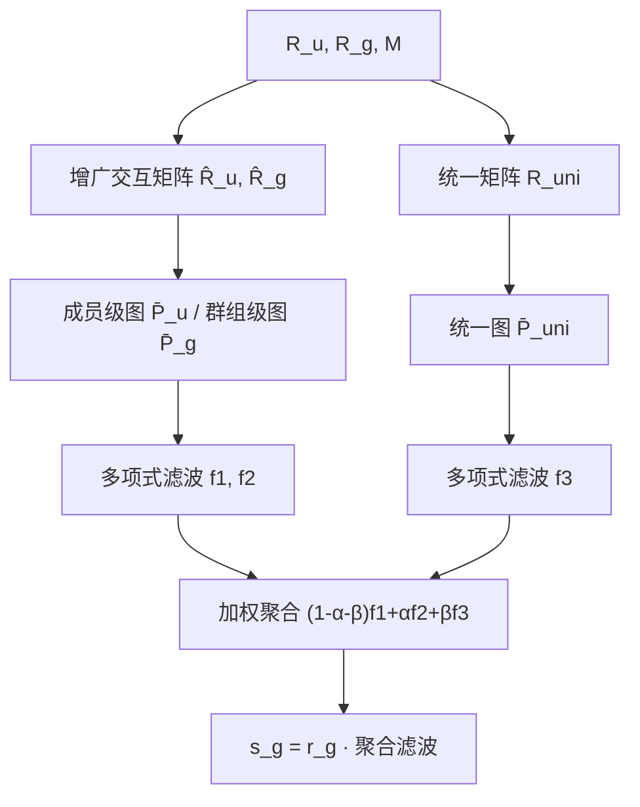

# Leveraging Member-Group Relations via Multi-View Graph Filtering for Effective Group Recommendation (基于多视图图滤波的成员-群组关系群组推荐)

- **会议/期刊**: WWW 2025 (Companion)
- **作者与机构**: Chae-Hyun Kim, Yoon-Ryung Choi, Jin-Duk Park, Won-Yong Shin (延世大学 / 淑明女子大学)
- **推荐链路定位**: 召回 (群组级物品打分)
- **研究方向**: 社交与群组推荐 / 图神经网络与知识图谱推荐
- **论文原文**: [论文原文链接](https://arxiv.org/abs/2502.09050v1)
- **开源代码**: [开源代码仓库链接](https://github.com/chaehyun1/Group-GF)

## TL;DR (1分钟核心速览)

群组推荐现有 SOTA 几乎都依赖超图建模或自监督训练的 DNN，训练开销大、难以响应成员偏好的快速变化。本文提出 Group-GF：构造成员级、群组级、统一三张物品相似图，为每张图设计独立多项式图滤波器并加权聚合，**完全免训练**。在 CAMRa2011/Mafengwo/Douban 三个基准上 HR@10 与 NDCG@10 全面超越 8 个 SOTA，Douban 上 HR@10 相对最优基线提升 16.4%，运行时间最快仅 1.55s（较次优快 36.85 倍）。

## Background & Motivation (背景与核心矛盾)

- **主流范式**: 群组推荐需同时刻画成员级与群组级交互，主流做法分两支——超图建模（HyperGroup/HCR/ConsRec）与自监督学习（GroupIM/S2-HHGR/CubeRec），均以 DNN 端到端训练。
- **前人局限**: ① 超图/SSL 训练流程复杂昂贵，Douban 上 AGREE 需 12 小时、CubeRec 需 4 小时以上，GroupIM 甚至 OOM；② 成员偏好随场景快速漂移，重训练模型无法及时响应。
- **核心洞察 (Key Insight)**: 作者统计三张候选物品相似图的特征值分布，KL 散度分别为 0.1010/0.1570/0.0901，差异显著——说明不同视图的图结构性质不同，**用同一个低通滤波器处理所有图并非最优**。
- **本文切入点**: 将群组推荐重构为免训练的图滤波问题，用多视图多项式滤波替代 DNN 训练，兼顾精度与毫秒级响应。

## Method (核心方法设计)

### 1. 整体框架 (Overall Architecture)

Group-GF 从成员-物品矩阵 $R_u$、群组-物品矩阵$R_g$与成员-群组关系矩阵$M$出发：先用$M$增广交互矩阵，构造成员级图$\bar{P}_u$、群组级图$\bar{P}_g$；再拼接$R_u$与$R_g$构造统一图$\bar{P}_{\text{uni}}$。三张图分别经独立多项式滤波器$f_1,f_2,f_3$传播，按权重$(1-\alpha-\beta),\alpha,\beta$聚合后与群组信号$r_g$ 相乘得到打分。全流程仅含矩阵乘法，无梯度反传。

### 2. 关键设计拆解 (Key Designs)

1. **成员-群组关系增广构图**：常规做法对 $R_u$、$R_g$分别建图，丢失成员-群组归属信息。本文将关系矩阵拼接到交互矩阵上：$\hat{R}_u=R_u\|M^\top$，$\hat{R}_g=R_g\|M$，再归一化得$\tilde{P}_u=\tilde{R}_u^\top\tilde{R}_u$、$\tilde{P}_g=\tilde{R}_g^\top\tilde{R}_g$，截取前$|I|$行列并用 Hadamard 幂$\bar{P}=\tilde{P}^{\circ s}$ 调节相似度差异以防过/欠平滑。直觉：归属关系让成员偏好与群组偏好在同一图空间内传播，而非割裂建模。

2. **多视图独立多项式滤波与聚合**：因三图特征值分布差异显著，为每图配独立滤波器 $f_1(\bar{P}_u)=\sum_{k=1}^{K_u}a_k\bar{P}_u^k$、$f_2(\bar{P}_g)=\sum_{k=1}^{K_g}b_k\bar{P}_g^k$、$f_3(\bar{P}_{\text{uni}})=\sum_{k=1}^{K_{\text{uni}}}c_k\bar{P}_{\text{uni}}^k$，最终打分为
$$s_g=r_g\big((1-\alpha-\beta)f_1(\bar{P}_u)+\alpha f_2(\bar{P}_g)+\beta f_3(\bar{P}_{\text{uni}})\big).$$
系数沿用预定义多项式（免搜索），仅调 $\alpha,\beta$。直觉：不同视图承载不同粒度的偏好信号，独立滤波避免单一频率响应压制某一视图的结构特性。

3. **理论解释与免训练推理**：定理 3.1 证明式 (11) 的打分是如下平滑正则优化问题的近似解：
$$s_g\approx\arg\min_s\big(\|s-r_g\|^2+\lambda s^\top((1-\alpha-\beta)L_u+\alpha L_g+\beta L_{\text{uni}})s\big),$$
其中 $L=I-\bar{P}$。当$\lambda=0$时打分退化为观测交互$r_g$，即图信息完全未被利用——这为多视图传播提供了可解释性。训练目标即无训练：仅需在验证集上网格搜索$\alpha,\beta,s$，推理为纯矩阵运算。

## Experimental Setup & Evaluation Protocol (实验设置与评估协议)

- **数据集与预处理**: 三个群组推荐基准，规模天然小于个体推荐数据集：

| 数据集 | #Members | #Items | #Groups | #M-I inter. | #G-I inter. |
| :--- | :---: | :---: | :---: | :---: | :---: |
| CAMRa2011 | 602 | 7,710 | 290 | 116,344 | 145,068 |
| Mafengwo | 5,275 | 1,513 | 995 | 39,761 | 3,595 |
| Douban | 3,481 | 43,916 | 1,162 | 829,229 | 9,245 |

- **数据划分与防穿越**: 沿用 HCR/ConsRec 的群组推荐标准划分协议（原文未展开细节，以引用协议为准）。
- **排名评测协议**: 采用 HR@10 与 NDCG@10，$k=10$ 为默认值。
- **对比基线与超参设置**: 8 个 SOTA——NCF（DNN）、AGREE（注意力聚合）、HyperGroup/HCR/ConsRec（超图）、GroupIM/S2-HHGR/CubeRec（SSL）。Group-GF 免训练，仅验证集调 $\alpha,\beta$与 Hadamard 幂参数$s$；多项式系数取预定义值（作者验证穷举搜索增益可忽略）。硬件为 i7-9700K + RTX A6000。

## Key Experimental Results (实验关键数据)

### 1. 主实验对比 (Main Results)

| 方法 | CAMRa HR | CAMRa NDCG | Mafengwo HR | Mafengwo NDCG | Douban HR | Douban NDCG |
| :--- | :---: | :---: | :---: | :---: | :---: | :---: |
| NCF | 0.7693 | 0.4448 | 0.6269 | 0.4141 | 0.4132 | 0.2446 |
| AGREE | 0.7789 | 0.4530 | 0.6321 | 0.4203 | 0.7701 | 0.6859 |
| HyperGroup | 0.7986 | 0.4538 | 0.6482 | 0.5018 | 0.7757 | 0.5318 |
| HCR | 0.7821 | 0.4670 | 0.8503 | 0.6852 | 0.6537 | 0.6441 |
| GroupIM | 0.8407 | 0.4914 | 0.8161 | 0.6330 | OOM | OOM |
| S2-HHGR | 0.7903 | 0.4453 | 0.7779 | 0.7391 | 0.7180 | 0.4565 |
| CubeRec | 0.8207 | 0.4935 | 0.9025 | 0.7708 | 0.6992 | 0.4240 |
| ConsRec | 0.8248 | 0.4945 | 0.9156 | 0.7794 | 0.7403 | 0.6621 |
| **Group-GF** | **0.9552** | **0.5030** | **0.9266** | **0.8451** | **0.9028** | **0.7291** |
| Improv.% | +13.6% | +1.7% | +1.2% | +8.4% | +16.4% | +6.3% |

运行时间对比（表 2）：CAMRa2011 上 Group-GF 仅 6.71s（次优 GroupIM 1m34s）；Mafengwo 1.55s（次优 GroupIM 57.13s，快 36.85 倍）；Douban 3m26s（次优 ConsRec 1h21m1s，GroupIM OOM）。

### 2. 消融实验 (Ablation Study)

| 变体 | CAMRa NDCG | Mafengwo NDCG | Douban NDCG |
| :--- | :---: | :---: | :---: |
| Group-GF | **0.5030** | **0.8451** | **0.7291** |
| w/o 成员级图 (Group-GF-m) | 0.4769 | 0.8376 | 0.6104 |
| w/o 群组级图 (Group-GF-g) | 0.5003 | 0.8367 | 0.7272 |
| w/o 统一图 (Group-GF-uni) | 0.4999 | 0.8272 | 0.6665 |
| w/o 关系矩阵 M (Group-GF-a) | 0.5025 | 0.8446 | 0.6728 |

### 3. 关键实验发现 (Key Findings)

1. **免训练仍全面 SOTA**：Group-GF 在 3 数据集 × 2 指标上全部最优，Douban 上 HR@10 达 0.9028，较 ConsRec 的 0.7403 提升 16.4%，说明多视图滤波已足以刻画成员-群组复杂动态，DNN 训练并非必需。
2. **统一图是跨数据集最稳健组件**：移除 $\bar{P}_{\text{uni}}$ 后三数据集 NDCG 分别掉 0.0031/0.0179/0.0626，是唯一在所有数据集均显著下降的变体；而成员级图在 CAMRa/Douban 上影响最大（掉 0.0261/0.1187），说明交互类型重要性随数据分布而异。
3. **关系矩阵 M 不可省**：Group-GF-a 在 Douban 上 NDCG 从 0.7291 降至 0.6728（-7.7%），验证了显式注入成员-群组归属关系对群组偏好传播的关键作用，而非仅靠交互共现隐式推断。

## Highlights & Limitations (亮点、对比与审稿批判)

- **与代表作对比 (vs. Prior Work)**: 相比 ConsRec/CubeRec 等超图+SSL 方法，Group-GF 用三张相似图 + 多项式滤波替代超边建模与对比学习，精度更高且免训练；相比 GroupIM 的成员-群组互信息正则，本文以平滑正则的近似解形式获得同等甚至更强的偏好传播能力，且无 OOM 风险。
- **可迁移亮点**: ① Hadamard 幂 $\bar{P}^{\circ s}$ 调节相似度差异以抑制过平滑，可直接移植到任意 GF-based 推荐；② 多视图独立滤波 + 加权聚合的免训练范式，适合偏好快速漂移的在线场景做轻量召回。
- **审稿级局限批判**: ① 三张图需常驻内存，Douban 规模下内存开销大，作者亦在结论中承认可扩展性不足；② 多项式系数取预定义值而非学习，且 $\alpha,\beta,s$ 仍需验证集网格搜索，超参敏感度分析仅置于附录；③ 仅在 3 个中小规模群组数据集验证，缺乏大规模工业场景与线上 A/B 证据。

## Rating (四维评分)

- **方法创新性 (Novelty)**: ⭐⭐⭐⭐ （首次将免训练多视图图滤波引入群组推荐，特征值分布差异驱动独立滤波设计，并有平滑正则理论支撑）
- **评估协议与实验扎实度 (Protocol & Experiments)**: ⭐⭐⭐⭐ （3 数据集 × 8 SOTA × 2 指标 + 运行时间 + 4 变体消融完整，但划分细节依赖引用、缺显著性检验）
- **写作与数学规范度 (Clarity & Rigor)**: ⭐⭐⭐⭐ （5 页短文公式紧凑，定理 3.1 给出清晰优化解释，符号定义完整）
- **工业落地与复现价值 (Industrial & Practical Value)**: ⭐⭐⭐⭐ （代码开源、推理毫秒级、免训练易部署，但内存占用与大规模扩展性是主要工程瓶颈）

