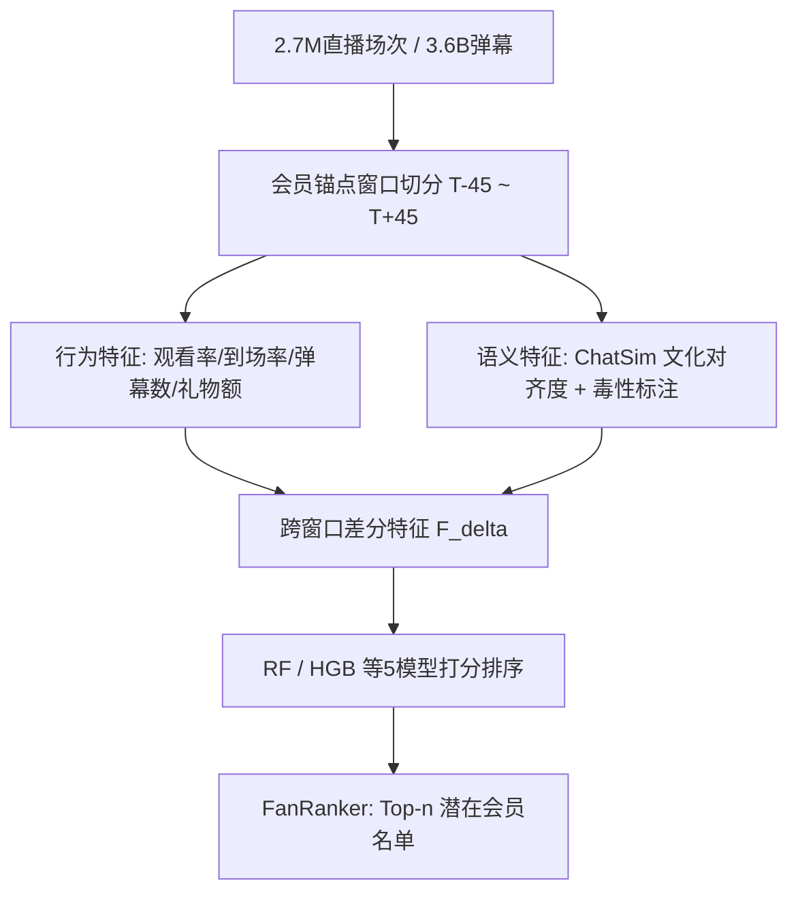

# Virtual Stars, Real Fans: Understanding the VTuber Ecosystem (虚拟偶像，真实粉丝：理解VTuber生态)

- **会议/期刊**: WWW 2025 (The 2025 ACM Web Conference)
- **作者与机构**: Yiluo Wei, Gareth Tyson（香港科技大学广州）
- **推荐链路定位**: 召回（逆向：向主播推荐潜在付费会员）
- **研究方向**: 社交与群组推荐 / 冷启动与长尾推荐
- **论文原文**: [https://arxiv.org/abs/2502.01553v1](https://arxiv.org/abs/2502.01553v1)
- **开源代码**: [https://github.com/JovenChu/embedding_model_test](https://github.com/JovenChu/embedding_model_test)

## TL;DR (1分钟核心速览)

本文针对VTuber（虚拟主播）这一"刻意隐藏真人身份、以虚拟人设构建粉丝社区"的新型直播形态，首次对Bilibili上270万场直播、36亿条弹幕进行大规模测量，刻画核心粉丝（付费会员）的行为与语言特征。核心发现：会员在付费前45天活跃度持续攀升、付费后迅速衰减（仅8.9%续费）；会员弹幕与直播间文化对齐度更高（ChatSim 0.80 vs 0.74），但毒性发言比例也更高。作者据此构建FanRanker，将"向观众推荐主播"反转为"向主播推荐潜在会员"，在真实购买事件上实现52%的会员排名第一、85%落入Top-50。

## Background & Motivation (背景与核心矛盾)

- **主流范式**: 直播推荐研究长期聚焦"向观众推荐主播/直播流"，以观看时长、点击率为优化目标；粉丝社区研究则多依赖访谈等定性方法。
- **前人局限**: 其一，VTuber刻意隐匿真人身份、以虚拟人设运营，与"真实性驱动参与"的既有结论（真人主播研究）直接冲突，旧框架无法解释其粉丝黏性来源；其二，现有付费订阅研究（如Twitch）以定性或小样本为主，缺乏对"付费前—付费后"行为演化轨迹的大规模量化刻画。
- **核心洞察 (Key Insight)**: Bilibili的"大航海"会员制（月费约24美元，远高于Twitch的5.99美元）提供了一个可精确识别核心粉丝的天然标签——付费即强承诺。作者观察到会员在购买前存在显著的"活跃度爬坡"信号，且该信号在弹幕语义层面同样存在。
- **本文切入点**: 用首个覆盖4.9k VTuber + 21k普通主播、2.7M直播场次的数据集，先测量后建模，把"识别潜在会员"转化为一个可排序的监督学习问题。

## Method (核心方法设计)

### 1. 整体框架 (Overall Architecture)

研究分三层递进：**测量层**以会员购买日 $T+0$为锚点，取前后各45天窗口，对比会员（购买前/后）与非会员在观看、弹幕、礼物三维度的行为差异；**语义层**用 text2vec-base-chinese 将弹幕编码，定义 ChatSim 度量个体与直播间整体文化的对齐度，并用 OpenAI Moderation API 标注毒性；**建模层**将上述显著差异特征（含跨时间窗差分特征$F_\Delta = X_2 - X_1$）输入五种经典 ML 模型，输出每位观众"未来成为会员"的概率并排序，形成 FanRanker 工具。

### 2. 关键设计拆解 (Key Designs)

1. **ChatSim 文化对齐度量（把"社区文化"变成可计算标量）**：痛点在于"粉丝亚文化"此前只能定性描述。作者对每场直播取全部弹幕嵌入均值作为"直播间文化向量" $\boldsymbol{c}_s$，对用户$u$取其在场弹幕嵌入均值$\boldsymbol{u}_s$，以余弦相似度定义对齐度：
$$\text{ChatSim}(u,s)=\frac{\boldsymbol{u}_s\cdot\boldsymbol{c}_s}{\lVert\boldsymbol{u}_s\rVert\,\lVert\boldsymbol{c}_s\rVert}$$
直觉上，该指标捕捉的是"是否会说这个直播间的黑话"——会员均值0.80、非会员0.74，且购买日达到峰值0.86，说明文化习得先于付费行为发生。

2. **逆向推荐 FanRanker（把推荐对象从物品翻转为用户）**：传统推荐是"给观众排主播"，本文反转为"给主播排观众"。对每笔真实会员购买事件 $(M,S)$，模型输出$P_{S,M}$与同场所有非会员$P_{S,O}$，按概率降序得到$M$ 的排名位次作为评估量。特征选择严格由 RQ1/RQ2 的显著性差异驱动（ChatSim、弹幕数、对该主播的观看率等），并引入跨窗口差分以刻画"爬坡趋势"。

3. **训练目标、负采样与推理效率**：本质是二分类（未来是否购买会员），采用下采样非会员缓解类别不平衡，5折交叉验证 + 网格搜索调参。无复杂深度结构，RF/HGB 训练与推理开销极低，单场直播仅需对在场观众做一次前向打分，完全满足主播端实时辅助的工程约束。

## Experimental Setup & Evaluation Protocol (实验设置与评估协议)

- **数据集与预处理**: 覆盖2022-06至2023-09，含4.9k VTuber与21k普通主播；会员识别要求购买记录为"对该主播的首次付费"，且前后各有45天可观测窗口，最终得608k会员记录、337k独立用户。

| 数据集 | #Streamers | #Sessions | #Interactions | #Chat Messages | 说明 |
| :--- | :---: | :---: | :---: | :---: | :--- |
| Bilibili VTuber | 4.9k VTuber + 21k 其他 | 2.7M | 10.7B | 3.6B | 含观看/弹幕/礼物/会员购买全事件 |

- **数据划分与防穿越 (Splitting Strategy)**: 采用**时间锚点窗口划分**——以会员购买日 $T+0$为界，特征仅取自$T-45$至$T+0$区间，标签为$T+0$ 的购买事件，天然避免未来信息泄漏。
- **排名评测协议 (Ranking Protocol)**: 自定义**事件内全库排序（Full-Ranking within Session）**——对每笔真实购买，将该用户与同场全部非会员共同排序，报告其排名位次与百分位的 CDF，无负采样。
- **对比基线与超参设置**: 五种模型 LiR / LoR / RF / HGB / KNN，5折交叉验证 + 网格搜索；毒性判定阈值0.5；显著性检验使用 $\chi^2$独立性检验（$p<10^{-280}$）。

## Key Experimental Results (实验关键数据)

### 1. 主实验对比 (Main Results)

FanRanker 排序性能（真实购买会员在同场观众中的位次分布）：

| 模型 | Top-1 命中率 | Top-50 命中率 | 相对表现 |
| :--- | :---: | :---: | :---: |
| LiR | 低 | 低 | 最差梯队 |
| LoR | 低 | 低 | 最差梯队 |
| KNN | 中 | 中 | 次优 |
| **RF** | **52%** | **85%** | **并列最优** |
| **HGB** | **52%** | **85%** | **并列最优** |

行为测量主结果（会员购买前 vs 非会员，均值）：

| 指标 | 会员(Pre) | 非会员 | 提升 |
| :--- | :---: | :---: | :---: |
| 直播观看率 | 26% | 20% | +6pp |
| 准点到场率 | 18% | 9% | +9pp |
| 观看时长占比 | 17% | 7% | +10pp |
| 平台弹幕总数 | 876 | 161 | 5.4× |
| 对该主播场均弹幕 | 12.9 | 3.2 | 4.0× |
| ChatSim | 0.80 | 0.74 | +0.06 |

### 2. 消融实验 (Ablation Study)

原文未做严格模块消融，但通过**置换特征重要性**给出等效归因：

| 特征组 | HGB 重要性排名 | RF 重要性排名 |
| :--- | :---: | :---: |
| ChatSim 及其差分 | 1 / 2 | 2 / 4 |
| 弹幕发送数量 | 3 / 4 | 1 / 3 |
| 对该主播的观看活动指标 | 中高 | 中高 |
| 礼物/SC 金额 | 中 | 中 |

### 3. 关键实验发现 (Key Findings)

1. **付费是"一次性事件"而非持续订阅**：仅8.9%会员在次月续费，且 $\chi^2$检验显示六项活跃度指标的衰减与不续费显著相关（$p<10^{-280}$），说明购买后约两周即达活跃峰值随后回落，高月费（约24美元）可能是主因。
2. **文化对齐先于付费、且付费后不衰减**：ChatSim 从 $T-45$的0.78升至$T+0$ 的0.86，付费后仅微降至0.83仍高于付费前，主题分析显示增长集中于爱称（100%主播）、规定性观众反应（98%）、梗与口头禅（95%）——会员习得的是"身份"而非"活跃度"。
3. **毒性发言来自核心粉丝内部**：12.1%的付费后会员发送过骚扰类、6.4%发送过性相关内容，远高于非会员的约2%；内容分析表明这更多是"文化性越界"（如"踩我"占暴力类23.3%）而非纯恶意，对平台审核提出柔性化新要求。

## Highlights & Limitations (亮点、对比与审稿批判)

- **与代表作对比 (vs. Prior Work)**: 相较 Twitch 订阅研究（Wohn et al.、Kim et al.）聚焦情绪与动机的定性分析，本文首次给出百万级"付费前后"行为轨迹的量化证据；相较传统直播推荐（向观众推主播），本文完成推荐方向的根本反转，且不依赖深度模型即取得可用精度。
- **可迁移亮点**: ①"跨时间窗差分特征" $F_\Delta$ 可直接迁移至任何存在"转化事件"的场景（如首购、首充预测）；②ChatSim 这一"个体—群体语义对齐度"是低成本、免训练的社区融入度代理指标，可用于新用户冷启动分群。
- **审稿级局限批判**: ①FanRanker 仅为五种经典 ML 的横向对比，未与图神经网络或序列模型等现代推荐基线对照，且评估仅限 Bilibili 单平台、单会员制，外部效度存疑；②"排名位次"指标依赖同场观众构成，热门大场与冷清小场的位次不可直接比较，缺少归一化的 NDCG 类指标；③毒性标注完全依赖 OpenAI Moderation API 阈值0.5，中文直播语境下的误判率未做人工校验。

## Rating (四维评分)

- **方法创新性 (Novelty)**: ⭐⭐⭐ （测量视角与"逆向推荐"问题设定新颖，但建模部分为经典 ML 组合，缺少方法层面的理论突破）
- **评估协议与实验扎实度 (Protocol & Experiments)**: ⭐⭐⭐⭐ （2.7M场次超大规模数据、时间锚点防穿越设计严谨，但缺少现代推荐基线与归一化排序指标）
- **写作与数学规范度 (Clarity & Rigor)**: ⭐⭐⭐⭐ （ChatSim 定义简洁、RQ 组织清晰、统计检验到位，公式层面本身较浅）
- **工业落地与复现价值 (Industrial & Practical Value)**: ⭐⭐⭐⭐ （Top-50 命中85%对主播端极具操作性，RF/HGB 推理开销极低，代码已开源，但跨平台迁移需重新校准）

