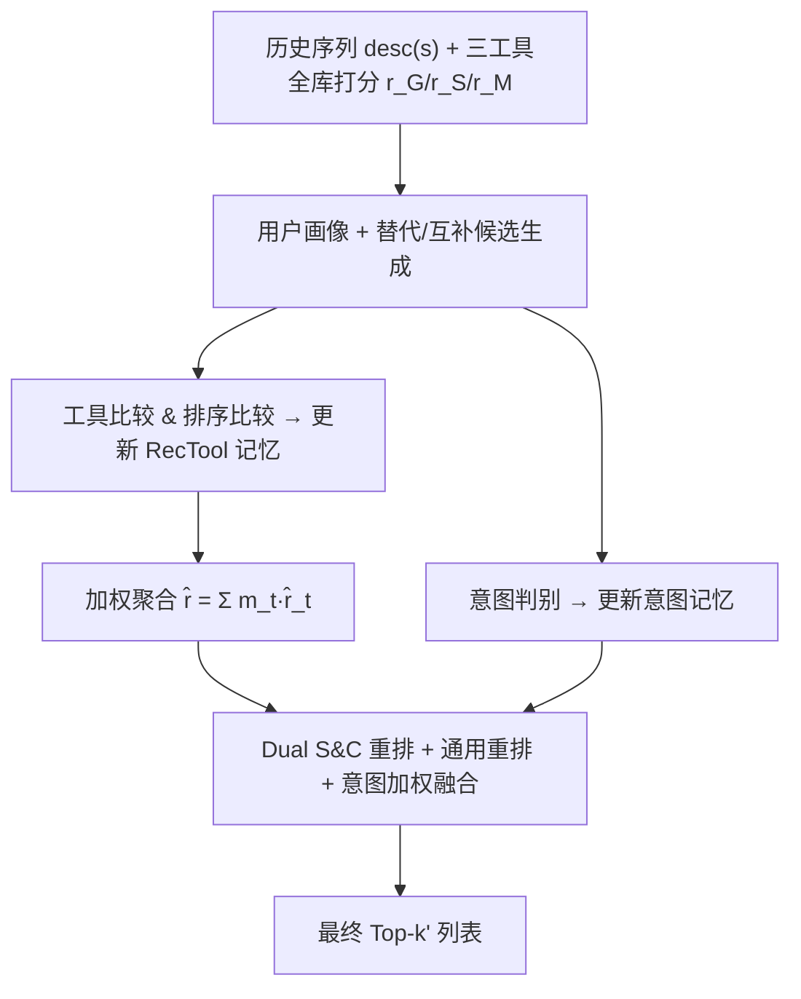
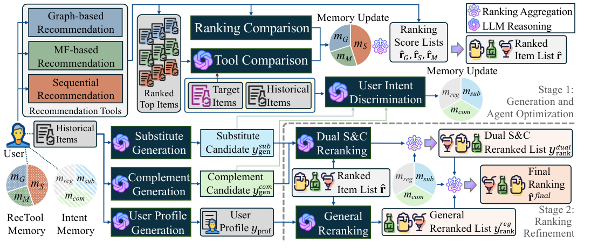

# AgentDR: Dynamic Recommendation with Implicit Item-Item Relations via LLM-based Agents (基于 LLM 智能体的隐式物品关系动态推荐)

- **会议/期刊**: WWW 2026 (Long Paper)
- **作者与机构**: Mingdai Yang, Nurendra Choudhary, Jiangshu Du, Edward W Huang, Philip Yu, Karthik Subbian, Danai Koutra (UIC / Amazon / University of Michigan)
- **推荐链路定位**: 重排（工具级集成 + 列表级精排）
- **研究方向**: 对话推荐与智能体仿真 / 大语言模型推荐
- **论文原文**: [https://arxiv.org/abs/2510.05598v3](https://arxiv.org/abs/2510.05598v3)
- **开源代码**: 暂未开源

## TL;DR (1分钟核心速览)

现有 LLM-Agent 推荐框架直接让 LLM 生成物品，存在**幻觉不存在的物品**与**token 限制无法全库排序**两大硬伤，且评测普遍退化为小候选集采样排序，与真实场景错位。AgentDR 把全排序委托给 LightGCN/SASRec/SimpleX 等传统工具，LLM Agent 只做两件事：(i) 依据个性化 RecTool 记忆对多工具排序结果加权聚合；(ii) 基于意图记忆推理替代品/互补品并做 dual S&C 重排。在 Instacart/Electronics/Sports 三个 grocery 数据集上采用 Full-Ranking 协议，Recall@10 最高提升 33.5%，NDCG@20 最高提升 28.4%，相对底层工具平均约两倍提升。

## Background & Motivation (背景与核心矛盾)

- **主流范式**: 一条路线是 ID-based 协同过滤/序列模型（LightGCN、SASRec、SimpleX），擅长交互模式但丢失文本语义；另一条是 LLM-as-Recommender 与 LLM-Agent（带记忆与反思），擅长世界知识但生成式输出不可控。
- **前人局限**: 其一，LLM Agent 直接生成物品会**幻觉出目录外物品**，且长序列输入输出受 token 限制，无法对全库打分；其二，现有 Agent 工作评测时只把真值物品与**少量随机负样本**比较，人为抬高指标，掩盖了大规模排序的真实难度。
- **核心洞察 (Key Insight)**: 物品间的**替代 (substitute) 与互补 (complement) 关系**在数据集中几乎无显式标注（人工标注需 $O(|\mathcal{I}|^2)$ 量级的世界知识），但恰恰是 LLM 常识推理的强项；而协同/序列信号本就被传统模型建模得很好——两者应当**分工而非替代**。
- **本文切入点**: 让 LLM 只负责"选工具 + 关系推理 + 列表重排"，把打分与全库排序交还给目录感知的传统模型，从机制上根除幻觉并保证可扩展性。

## Method (核心方法设计)

### 1. 整体框架 (Overall Architecture)

每个用户独立配备一个 Agent，含静态用户画像 $y_{prof}$（LLM 由历史物品描述摘要生成）与两个紧凑记忆：RecTool 记忆$\mathbf{m}_{rec}\in\mathbb{R}^{1\times|\mathcal{T}|}$（三工具权重$m_G,m_S,m_M$）与意图记忆$\mathbf{m}_{int}\in\mathbb{R}^{1\times3}$（$m_{sub},m_{com},m_{reg}$）。流程分两阶段：**阶段一（生成与 Agent 优化）** 由 LLM 针对用户最近$c$个物品生成替代/互补候选列表，再通过工具比较、排序比较、意图判别三个反思模块分别更新两类记忆；**阶段二（排序精炼）** 先用 RecTool 权重对三工具的全库打分做加权和聚合，取 top-$k'$ 交给 dual S&C 重排与通用重排，再按意图权重做排序融合得到最终列表。所有 LLM 输出均经规则化幻觉过滤，保证只输出目录内合法 ID。

<figure class="paper-figure" markdown="span">
  <figcaption>图 2：AgentDR 的框架：每个用户智能体配备两个记忆模块：用于存储工具适用性的 RecTool 记忆，以及用于跟踪用户意图的意图记忆。来自推荐工具的排序结果基于 RecTool 记忆进行聚合。聚合结果进一步由 dual S&amp;C 与通用排序模块精炼。</figcaption>
</figure>

### 2. 关键设计拆解 (Key Designs)

1. **个性化工具选择与排序级聚合**：不同用户适配不同范式（追续集者适合 SASRec，找相似口味者适合 CF），单一工具无法通吃。Agent 用 LLM 对三工具 top-$k_{cpr}$与最近$k$个真值物品做整体比较，输出二值指示$z^t_{cpr}$并以$m_t\leftarrow m_t+\alpha z^t_{cpr}$更新；同时用排名倒数做定量反思$m_t\leftarrow m_t+\beta\sum_{i^j\in s[-k:]}\frac{(r^j_t)^{-1}}{\sum_{t'}(r^j_{t'})^{-1}}$，最终聚合$\hat{\mathbf{r}}=\sum_{t\in\mathcal{T}}m_t\hat{\mathbf{r}}_t$。直觉：LLM 倾向"谁都夸好"，故必须引入真值锚定的对比与排名统计双通道，才能拉开工具权重差异。

2. **Dual S&C 重排与意图融合**：替代/互补关系隐式且因人而异，故不做全局标注，而是对聚合后 top-$k'$分别以替代候选$y^{sub}_{gen}$、互补候选$y^{com}_{gen}$为条件各重排一次，得到$y^{sub}_{rank},y^{com}_{rank}$；再按意图记忆做位置级加权融合$\hat{r}^{dual}_i=m_{sub}\cdot index(i,y^{sub}_{rank})+m_{com}\cdot index(i,y^{com}_{rank})$，最后与通用重排列表以$m_{reg}$再融合。这样把$O(|\mathcal{I}|^2)$的两两标注降为$O(|\mathcal{U}|)$ 的个性化意图生成，且融合本身零额外 LLM 调用。

3. **训练目标、负采样与推理效率**：框架本身**免训练**（工具预训练于 $s[:-k]$，Agent 靠记忆在线反思），无 BPR/InfoNCE 类损失；幻觉过滤规则为"仅保留目录内合法 ID，不足$k'$ 则按原序补齐"，从机制上把幻觉对排序的影响降为零。推理开销集中在每用户常数次 LLM 调用（生成 2 次 + 工具比较 1 次 + 意图判别 3 次 + 重排 3 次），与目录规模无关。

## Experimental Setup & Evaluation Protocol (实验设置与评估协议)

- **数据集与预处理**: 三个 grocery 域公开数据集，未做 5-core 过滤（原文未报告过滤细节）：

| 数据集 | #Users | #Items | #Interactions | 密度 | 特征/场景说明 |
| :--- | :---: | :---: | :---: | :---: | :--- |
| Instacart | 6,987 | 2,108 | 5,105,339 | 34.663% | 杂货复购，物品少而交互极密 |
| Electronics | 4,966 | 14,635 | 91,819 | 0.126% | XMarket 子集，描述长、语义可区分 |
| Sports | 10,873 | 4,306 | 55,990 | 0.120% | XMarket 子集，稀疏 |

- **数据划分与防穿越 (Splitting Strategy)**: 采用序列推荐的 `Leave-Last-k-Out` 式协议——工具在 $s[:-k]$上预训练，最近$k$ 个物品作为真值信号用于 Agent 记忆优化与评测，严格防穿越。
- **排名评测协议 (Ranking Protocol)**: 无偏 `Full-Ranking`（对全库未交互物品排序），明确批判并弃用前人 Agent 工作的小候选集采样排序；另提出 **VDCG** 指标，用 LLM 对每个推荐物品与真值物品的语义贴近度打 0–9 分作为相关性，再算 DCG 并以合成理想列表 $[p,p/2,\dots,p/2^l]$ 归一化，联合衡量语义对齐与排序正确性。
- **对比基线与超参设置**: 3 个底层工具（LightGCN/SASRec/SimpleX）+ 3 个传统强基线（ENMF、DiffRec、FEARec）+ 2 个语言基线（BM25、LLMRanker）+ 3 个 RAG 变体（RAG-G/S/M，从各工具检索 50 候选后由 LLM 生成 top-20，并施加同等幻觉过滤）。指标为 Recall@{10,20}、NDCG@{10,20} 与 VDCG@{5,10}。

## Key Experimental Results (实验关键数据)

### 1. 主实验对比 (Main Results)

| 方法 | Instacart R@10 | Instacart N@20 | Electronics R@10 | Electronics N@20 | Sports R@10 | Sports N@20 |
| :--- | :---: | :---: | :---: | :---: | :---: | :---: |
| LightGCN | 0.0500 | 0.0398 | 0.1188 | 0.0765 | 0.1438 | 0.1040 |
| SASRec | 0.0875 | 0.0552 | 0.1188 | 0.0667 | 0.1000 | 0.0667 |
| SimpleX | 0.0313 | 0.0226 | 0.1000 | 0.0776 | 0.1375 | 0.0999 |
| ENMF | 0.1125 | 0.0797 | 0.1250 | 0.0897 | 0.1375 | 0.1187 |
| DiffRec | 0.1188 | 0.0806 | 0.1562 | 0.0981 | 0.1125 | 0.0890 |
| FEARec | 0.1063 | 0.0845 | 0.1250 | 0.0726 | 0.1313 | 0.0797 |
| BM25 | 0.0625 | 0.0370 | 0.1000 | 0.0514 | 0.1188 | 0.0552 |
| LLMRank | 0.0750 | 0.0436 | 0.1000 | 0.0565 | 0.0938 | 0.0488 |
| RAG-S | 0.0688 | 0.0405 | 0.1063 | 0.0605 | 0.1375 | 0.0913 |
| **AgentDR** | **0.1563** | **0.0907** | **0.1688** | **0.1260** | **0.1750** | **0.1326** |
| Improv.% | +33.50% | +7.34% | +8.07% | +28.44% | +21.67% | +11.71% |

VDCG 上 AgentDR 在 Instacart 达 0.4683/0.5743（V@5/V@10，较最佳基线 +39.25%/+26.53%），Electronics 达 0.3334/0.3846（+25.90%/+15.21%）；Sports 上略低于 RAG-S（−0.20%/−5.76%），说明语义型指标上 RAG 仍有局部优势。

### 2. 消融实验 (Ablation Study)

| 变体 | Instacart N@10 | Electronics N@10 | Sports N@10 |
| :--- | :---: | :---: | :---: |
| w/o LLM（无重排无工具比较） | 0.0428 | 0.0765 | 0.0859 |
| + 工具比较 T | 0.0634 | 0.1054 | 0.1238 |
| + 单侧 S/C 重排 | 0.0614 | 0.1047 | 0.1107 |
| + Dual S&C | 0.0682 | 0.1095 | 0.1155 |
| + T + Dual S&C | 0.0666 | 0.1112 | 0.1240 |
| **+ T + Dual S&C + General（完整）** | **0.0701** | **0.1149** | **0.1221** |

### 3. 关键实验发现 (Key Findings)

1. **LLM 模块贡献是数量级而非边际的**：Instacart 上从 w/o LLM 的 N@10=0.0428 到完整模型 0.0701，提升 63.8%，远超任何单一传统基线；说明"工具聚合 + 关系重排"的组合收益大于任一底层工具本身。
2. **Dual S&C 显著优于单侧重排**：三数据集上 Dual S&C 均优于仅按意图记忆选替代或互补单侧重排（如 Sports N@10 0.1155 vs 0.1107），证明同时建模两类关系并做意图加权融合是必要的，而非二选一。
3. **工具比较存在域敏感性**：工具比较在 Electronics/Sports 稳定增益，但在 Instacart 上单独使用反而略降（0.0634 vs 0.0682 的 Dual S&C），原因是杂货食品列表在不同工具间语义差异小，LLM 难判别优劣；而通用重排作为正则项在多数设置下补足这一缺陷，使完整模型在三数据集均取最优。

## Highlights & Limitations (亮点、对比与审稿批判)

- **与代表作对比 (vs. Prior Work)**: 相比 LLM-as-Recommender 与 LLM-Rec Agents（如 Agent4Rec 类工作），本文根本区别在于**不让 LLM 生成物品**，从而同时获得全排序能力与零幻觉；相比 RAG-G/S/M，本文不是从单一工具的偏置候选集中生成，而是对多工具高置信聚合结果做意图条件重排，故在 Recall/NDCG 上全面领先，仅在 Sports 的 VDCG 上被 RAG-S 反超。
- **可迁移亮点**: (i) "LLM 只做集成与重排、传统模型做全库打分"的分工范式可直接迁移到任何已有强召回/精排的工业链路；(ii) 用排名倒数做工具权重的定量反思（Eq.6）是零训练成本的轻量 ensemble，可替代需要反传的 MLP/Attention 融合。
- **审稿级局限批判**: 其一，替代/互补关系在杂货域天然稠密，作者自承在电影/音乐等域可能失效，泛化性存疑；其二，每用户每轮需约 9 次 LLM 调用，虽与目录规模无关但绝对延迟与成本对工业在线服务仍偏高，且全文缺少与 MLP/Attention 融合（表 5 显示可再涨 13.56% NDCG）的延迟-收益权衡分析。

## Rating (四维评分)

- **方法创新性 (Novelty)**: ⭐⭐⭐⭐ （"LLM 不生成只集成"的分工范式清晰有力，替代/互补意图记忆设计新颖，但缺少理论或谱分析支撑）
- **评估协议与实验扎实度 (Protocol & Experiments)**: ⭐⭐⭐⭐ （坚持 Full-Ranking 并公开批判采样排序，基线覆盖传统/语言/RAG 三类，消融完整；扣分在未报告数据过滤细节与显著性检验）
- **写作与数学规范度 (Clarity & Rigor)**: ⭐⭐⭐⭐ （公式紧凑、模块边界清楚，Eq.6 与 Eq.15 的融合定义明确；部分符号如 $k$与$k'$、$c$ 的关系需前后对照阅读）
- **工业落地与复现价值 (Industrial & Practical Value)**: ⭐⭐⭐ （免训练、模型无关、幻觉可规则化消除，工程友好；但未开源、每用户多次 LLM 调用的在线成本与域依赖性是落地主要障碍）

